# سكيما قاعدة بيانات قادر — مسودة عربية للمراجعة

> هذه نسخة شرح ورسوم للمقترح. بعد اعتماد S00 أضيفت migrations مركزة لأجهزة FCM وربط زوج التوكن، بينما تظل بقية السكيما مقترحًا غير منفذ. الأولوية لتصميم **Qader web** للبوابات الثلاث.

## فتح الديجرام

- **للعرض المباشر:** افتح [الديجرام التفاعلي](database-schema-diagram.html) بمتصفحك؛ يدعم اختيار الموديول والبحث والتكبير وعرض الأعمدة والعلاقات وحفظ الرسم بصيغة SVG. لا يحتاج إنترنت.
- **للمراجعة النصية:** أكمل قراءة هذا الملف. رسوم Mermaid أدناه تظهر كرسم في قارئ Markdown يدعمها؛ إذا ظهرت ككود استخدم نسخة HTML.
- **المصدر التقني:** [السكيما بصيغة DBML](database-schema-proposal.dbml). أسماء الأعمدة والجداول والقيم البرمجية تبقى بالإنجليزية حتى تطابق الكود.

## ما الذي تمت مراجعته؟

المشروع وسيط توظيف تديره قادر: المرشح يسجل ويقدم ملفه، الأدمن يراجع ويقابل ويقيّم، ثم يظهر الملف المعتمد والمتاح للشركات. العميل يجمع مرشحين داخل مساحة عمل، ولكل مرشح عرض ومقابلة وقرار مستقلان، ثم تأتي الرسوم والعقود والتوظيف.

هناك ثلاثة سجلات مختلفة لا يصح دمجها:

1. `talent_applications`: طلب الانضمام إلى شبكة المواهب واعتماد المرشح.
2. `hiring_requests`: طلب العميل لتوظيف مرشح أو عدة مرشحين.
3. `job_form_submissions`: تقديم على وظيفة عامة من نموذج منشور، وقد يقدمه زائر دون حساب.

تم الرجوع إلى تصميم الويب للبوابات الثلاث وملفات البيزنس وملفات migrations. المقترح الكامل يعرض **118 جدولًا و239 علاقة مفتاح أجنبي** في 17 مجموعة. هذه ليست دعوة لتنفيذ كل الجداول دفعة واحدة.

| التصنيف | العدد | المعنى |
| --- | ---: | --- |
| موجود | 40 | يحافظ على الجدول الحالي |
| تعديل | 8 | جدول موجود مع تعديلات مقترحة |
| جديد | 61 | تخزين مقترح لتدفق ظاهر في التصميم |
| اقتراح | 6 | يحتاج حسم تفاصيل المنتج أو التشغيل |
| من الوثائق | 2 | لم تتضح واجهته بعد |
| مؤجل | 1 | حد تكامل لمرحلة لاحقة |

**حدود المراجعة:** الحصر مبني على الملفات، لا على اتصال بقاعدة البيانات. الحزمة `ichtrojan/laravel-otp` تحمل migration جدول `otps` تلقائيًا من الـservice provider. بعض الملفات مؤرخة بعد تاريخ المراجعة؛ وجودها لا يثبت تطبيقها على قاعدة بيانات بيئة بعينها.

## القرارات التي تحتاج مراجعتك

| القرار | المقترح وسبب الحاجة للمراجعة |
| --- | --- |
| D01 — إعادة التقديم | تحويل طلب المرشح من علاقة واحد لواحد إلى تاريخ محاولات، مع محاولة نشطة واحدة فقط. الحالي يستخدم `UNIQUE(talent_id)` ويمنع ذلك. |
| D02 — نسخة التقديم والقفل | حفظ نسخة ثابتة من بيانات وملفات التقديم، وقفل التعديل أثناء المراجعة حسب Figma. الكود الحالي لا يحفظ النسخة المذكورة في بعض الوثائق. لا نخترع نسخة تاريخية للطلبات القديمة. |
| D03 — جولات المقابلات | دعم أكثر من مقابلة لأن Figma تعرض جولتين، رغم أن إحدى الوثائق تؤجل المقابلة الثانية. الجولة مختلفة عن محاولة إعادة الجدولة. |
| D04 — فصل الحالات | حالة الحساب والتوفر والظهور وقرار الطلب والحظر حقائق مختلفة. نعتمد `accepted` مع مراجعة القيم القديمة مثل `approved` قبل أي تحويل. |
| D05 — المهل والإنذارات | مهلة الرد وعدد مرات الإلغاء والمحاولات سياسات قابلة للضبط. تجاوز المهلة يستدعي متابعة، ولا يرفض تلقائيًا. إنذار عدم الرد مستقل عن الحظر والإيقاف. |
| D06 — الموعد المشترك | طلب الاعتماد يختار فيه المرشح موعدًا؛ مقابلة التوظيف تحتاج توافق الطرفين. ترتيب الاختيار والتأكيد يحتاج اعتمادًا، فلا يكفي توليد المواعيد لتأكيد المقابلة. |
| D07 — الرسوم | دعم ثابت ونسبة واستثناءات حسب المجال، لكن أساس النسبة والضريبة والتقريب غير محسومة. أرقام شاشة التحويل متعارضة، فلا تستخدم كقواعد حساب. |
| D08 — التقييم والرواتب | معايير Figma الأربعة ودرجات 1–5 هي نقطة البداية. الأوزان وطريقة الترتيب تحتاج اعتمادًا. الراتب الشهري والسنوي يحفظان بفترة صريحة. |
| D09 — الحذف | النص في Figma يقترح حذف العميل وتاريخه نهائيًا. البديل المقترح للمراجعة هو الأرشفة مع الاحتفاظ بالعقود والمدفوعات؛ هذا اختلاف معلن يحتاج موافقة. |
| D10 — التقارير المدفوعة | شراء الرأي لا يكشف البيانات الخاصة. يلزم تحديد هل ملكية شراء العميل للحساب أم مساحة العمل، وهل تشمل نسخة تقرير واحدة أم التحديثات. الدفع المبكر لا يتجاوز الحظر. |
| D11 — اشتراك الوصول | مذكور في البيزنس لكن واجهته غير واضحة. جدولاه مصنفان «من الوثائق». بيانات الاتصال لا تظهر قبل اكتمال التعاقد وفق المسار التفصيلي. |
| D12 — دقة العملات | الرواتب الحالية تستخدم `decimal(12,2)`، والجديد يقترح `decimal(18,4)`؛ توحيد الدقة يحتاج اعتمادًا. تحفظ معدلات التحويل التاريخية ولا تستبدل المبالغ الأصلية. |
| D13 — إدارة العمل بعد التعاقد | الوثائق تختلف بين بوابة مدمجة ونظام SaaS مستقل، والتصميم يعرض روابط وبطاقات أكثر من شاشات تشغيل. نؤجل جداول المشروعات والمهام والحضور إلى حسم هذا الجزء. |
| D14 — نماذج الوظائف | فصل كتالوج أسئلة الوظائف عن حقول ملف المرشح. زر بدء التوظيف بعد تقديم الزائر لا يوضح التحويل بالكامل؛ المقترح تحويل موثق دون قبول تلقائي. |
| D15 — الدعوات ومساحات العمل | العميل يمكنه امتلاك والانضمام لعدة مساحات. أدوار المساحة منفصلة لأن إعداد الصلاحيات الحالي لا يدعم نطاق الفرق. تفاصيل الدعوات وحفظ الوظيفة تحتاج اعتمادًا. |
| D16 — بيانات السوق الإضافية | التخصص الدقيق والخبرة القطاعية ظاهران دون مدخل واضح في التسجيل؛ يقترح أن يديرهما الأدمن في الملف المعتمد. لا نعيد أعمدة تقييم المهارات المحذوفة اعتمادًا على عنوان واجهة فقط. |

## القواعد المشتركة قبل التنفيذ

1. **عزل مساحة العمل:** العضو والدور والطلب والعقد والفاتورة المرتبطة يجب أن تتبع المساحة نفسها، مع تحقق الصلاحية في الخادم.
2. **محاولة نشطة واحدة:** تكون `active_guard=1` في المحاولة النشطة و`NULL` في النهائية، مع قيد تفرد وقاعدة تحقق. إعادة التقديم لا تتجاوز الحظر أو الموعد المعتمد.
3. **النشر للشركات:** قبول الطلب وحده لا يكفي؛ يلزم ملف معتمد ظاهر، وتوفر مناسب، وحساب نشط موثّق، وعدم وجود حظر نشط.
4. **حفظ التاريخ:** لا يستبدل المرشح الأصلي بالبديل داخل السجل نفسه، ولا تعدل شروط عرض مرسل أو إصدار تقييم أو عقد موقع بأثر رجعي.
5. **حجز الموعد:** وقت النهاية بعد البداية، والتخزين UTC مع منطقة زمنية للعرض، ومنع تعارض المحاورين. اختيار الموعد وإلغاء البدائل يتمان في معاملة واحدة.
6. **المال:** مبالغ عشرية وعملة صريحة، والحد الأدنى لا يتجاوز الأعلى. الرسوم غير المعروفة تظل `NULL` وليست صفرًا؛ تأكيد الراتب ليس سدادًا ورفع الإيصال ليس تحققًا.
7. **الملفات:** استخدام `media` مع صلاحيات تنزيل لكل مالك ومجموعة ملفات. تحفظ نسخة مستقلة لسيرة التقديم حتى لا تمحوها استبدالات السيرة الحالية.
8. **الخصوصية:** الملاحظات الداخلية ورسالة المرشح والتقرير المنشور منفصلة. شراء التقرير لا يمنح الهاتف أو البريد أو السيرة الذاتية تلقائيًا.
9. **نماذج الوظائف:** الاسم والبريد والهاتف والمسمى الوظيفي حقول هوية ثابتة. الأسئلة والإجابات تربط بإصدار منشور ثابت؛ المسمى يملؤه الخادم من الوظيفة.
10. **التدقيق والإشعارات:** تغيير الحالة وسجل الحدث ورسالة الإشعار تحفظ معًا، ثم ترسل الإشعارات بعد نجاح الحفظ. يسجل الفاعل الحقيقي والطرف الذي يتصرف نيابة عنه.

### دورة اعتماد المرشح

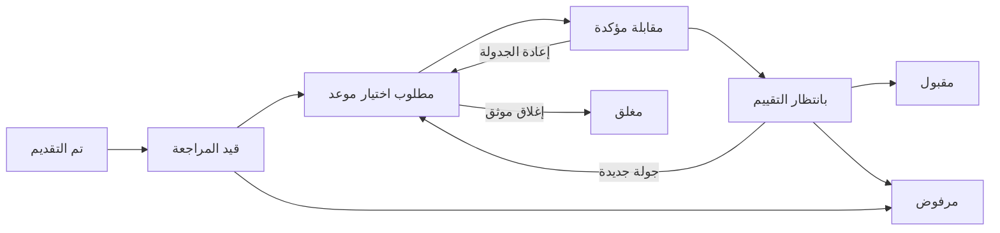

الحظر سجل مستقل، وليس قبولًا أو رفضًا جديدًا. فك الحظر لا يعيد الطلب تلقائيًا. الطلبات المقبولة والمرفوضة والمغلقة تخرج من قائمة العمل النشطة وتبقى محفوظة في التاريخ.

### دورة توظيف مرشح داخل طلب العميل

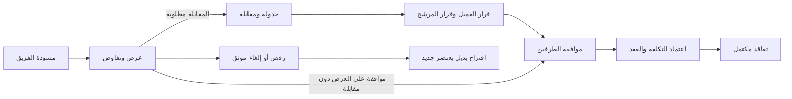

التعليق حالة قابلة للاستئناف، والإلغاء نهائي. عند التعليق تلغى الأنشطة النشطة ويستأنف العمل بأنشطة جديدة. تقدم الطلب الكلي يحسب من عناصره الحالية دون عدّ المرشح المستبدل مرتين.

## ترتيب التنفيذ بعد اعتماد السكيما

1. تدقيق قاعدة البيئة ثم طلبات المرشحين والتاريخ والمقابلات والتقييمات والنشر.
2. مساحات العمل والعضويات والمساعدة وسوق المواهب.
3. أنواع العقود والتسعير وطلبات التوظيف والعروض والبدائل والقرارات.
4. الفواتير والإيصالات والتحقق والعقود والتوقيعات والتوظيف.
5. الوظائف العامة والنماذج والتقديم عليها كمسار مستقل.
6. الخدمات المدفوعة والعملات؛ اشتراك الوصول بعد حسم سياسته.
7. نظام إدارة العمل بعد التعاقد بعد تحديد حدوده وتصميمه.

لا تعدّل migrations تاريخية منفذة. أي migrations لاحقة تنشأ فقط بعد مراجعتك، مع خطة تعبئة البيانات القديمة وإضافة القيود تدريجيًا.

## دليل قراءة التفاصيل

- الرسوم التالية تعرض **العلاقات الصادرة** من جداول الموديول؛ الجدول الموصوف بأنه «خارجي» ينتمي لموديول آخر.
- السهم من عمود المفتاح الأجنبي إلى الجدول المرجعي، ولا يختصر وحده قيود التفرد أو الإلزامية.
- «إلزامي» يعني أن العمود غير قابل لـ`NULL` في المقترح، وليس بالضرورة حقلًا مطلوبًا من المستخدم في كل شاشة.
- عدم وجود `NOT NULL` في وصف DBML يعني أن العمود يسمح بالقيمة الفارغة. حقول توقيت Laravel يملؤها التطبيق عند الكتابة.
- `CASCADE`: حذف السجل التابع مع الأصل؛ `RESTRICT`: منع حذف الأصل المرتبط؛ `SET NULL`: تفريغ المرجع؛ `NO ACTION`: سياسة القيد الحالية.
- الفهارس المركبة مبينة بعد كل جدول. اشتراك عمود في فهرس مركب لا يجعله فريدًا منفردًا.
- أنواع الأرقام منطقية في هذا الملف؛ تفاصيل `unsigned` والقيود الخاصة بمحرك قاعدة البيانات تثبت عند تنفيذ migrations.

## الموديولات

- [الحسابات والهوية](#module-identity)
- [الصلاحيات](#module-access)
- [البيانات المرجعية](#module-reference)
- [ملف المرشح](#module-talent)
- [البنية الأساسية](#module-infrastructure)
- [التقديم والاعتماد](#module-applications)
- [مساحات العمل](#module-workspace)
- [أنواع العقود والرسوم](#module-commercial)
- [طلبات التوظيف والعروض](#module-hiring)
- [المقابلات وجدولة المواعيد](#module-interviews)
- [التقييمات وتقارير الخبراء](#module-evaluation)
- [طلبات المساعدة](#module-support)
- [الوظائف ونماذج التقديم](#module-jobsforms)
- [المدفوعات والعملات](#module-finance)
- [العقود والتوظيف الفعلي](#module-contracts)
- [التسليم بعد التعاقد](#module-postcontract)
- [سجل العمليات والإشعارات](#module-operations)

<a id="module-identity"></a>

## الحسابات والهوية

تضم هذه المجموعة 4 جدولًا.

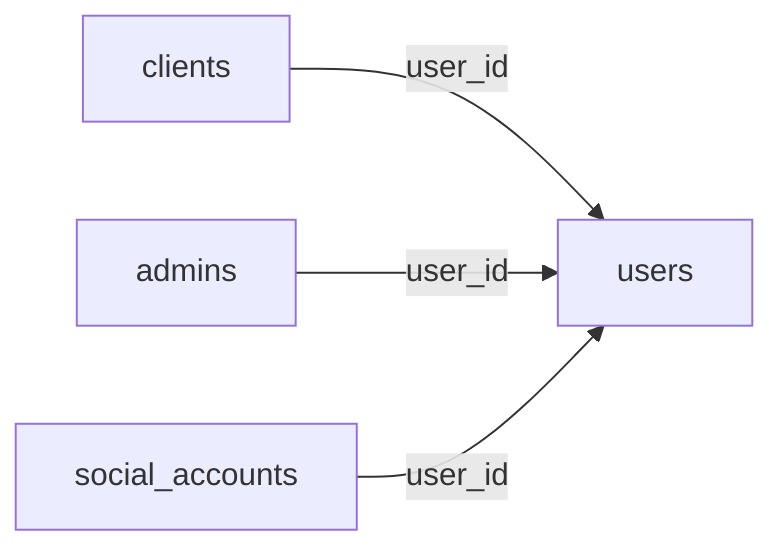

### `users`

**التصنيف:** موجود ويحتاج تعديلًا.

الهوية المشتركة: الاسم والبريد وكلمة المرور ونوع المستخدم وحالة الحساب. تضاف اللغة والمنطقة الزمنية وبيانات الإيقاف والأرشفة.

| العمود | النوع | إلزامي | القيود والملاحظات المختصرة | المرجع عند وجوده |
| --- | --- | --- | --- | --- |
| `id` | `bigint` | نعم | مفتاح أساسي؛ ترقيم تلقائي | — |
| `first_name` | `varchar(255)` | نعم | — | — |
| `last_name` | `varchar(255)` | نعم | — | — |
| `email` | `varchar(255)` | نعم | — | — |
| `email_verified_at` | `timestamp` | لا | — | — |
| `password` | `varchar(255)` | نعم | — | — |
| `type` | `varchar(255)` | نعم | القيم: `talent, client, admin` | — |
| `avatar` | `varchar(255)` | لا | — | — |
| `is_active` | `boolean` | نعم | الافتراضي: `true` | — |
| `last_login_at` | `timestamp` | لا | — | — |
| `remember_token` | `varchar(100)` | لا | — | — |
| `timezone` | `varchar(64)` | لا | إضافة مقترحة | — |
| `locale` | `varchar(10)` | لا | إضافة مقترحة | — |
| `suspended_at` | `timestamp` | لا | إضافة مقترحة | — |
| `suspension_reason` | `text` | لا | إضافة مقترحة | — |
| `deleted_at` | `timestamp` | لا | إضافة مقترحة | — |
| `created_at` | `timestamp` | لا | — | — |
| `updated_at` | `timestamp` | لا | — | — |

**الفهارس والقيود المركبة:**

- قيد تفرد: `(email, type)`.
- فهرس بحث: `type`.
### `clients`

**التصنيف:** موجود ويحتاج تعديلًا.

ملف الشخص المستخدم لبوابة العميل، وليس الشركة. يضاف رقم التواصل.

| العمود | النوع | إلزامي | القيود والملاحظات المختصرة | المرجع عند وجوده |
| --- | --- | --- | --- | --- |
| `id` | `bigint` | نعم | مفتاح أساسي؛ ترقيم تلقائي | — |
| `user_id` | `bigint` | نعم | فريد | `users.id`؛ `CASCADE` |
| `phone_country_code` | `varchar(5)` | لا | إضافة مقترحة | — |
| `phone_number` | `varchar(20)` | لا | إضافة مقترحة | — |
| `created_at` | `timestamp` | لا | — | — |
| `updated_at` | `timestamp` | لا | — | — |
### `admins`

**التصنيف:** موجود ويحتاج تعديلًا.

ملف عضو فريق قادر. يضاف رقم التواصل والاسم المعروض بالعربية.

| العمود | النوع | إلزامي | القيود والملاحظات المختصرة | المرجع عند وجوده |
| --- | --- | --- | --- | --- |
| `id` | `bigint` | نعم | مفتاح أساسي؛ ترقيم تلقائي | — |
| `user_id` | `bigint` | نعم | فريد | `users.id`؛ `CASCADE` |
| `phone_country_code` | `varchar(5)` | لا | إضافة مقترحة | — |
| `phone_number` | `varchar(20)` | لا | إضافة مقترحة | — |
| `display_name_ar` | `varchar(255)` | لا | إضافة مقترحة | — |
| `created_at` | `timestamp` | لا | — | — |
| `updated_at` | `timestamp` | لا | — | — |
### `social_accounts`

**التصنيف:** موجود دون تغيير مقترح.

ربط الحساب بمزود تسجيل الدخول الاجتماعي. التفرد الحالي لهوية المزود يشمل البوابات كلها ويحتاج مراعاة عند الربط.

| العمود | النوع | إلزامي | القيود والملاحظات المختصرة | المرجع عند وجوده |
| --- | --- | --- | --- | --- |
| `id` | `bigint` | نعم | مفتاح أساسي؛ ترقيم تلقائي | — |
| `user_id` | `bigint` | نعم | — | `users.id`؛ `CASCADE` |
| `provider` | `varchar(255)` | نعم | — | — |
| `provider_user_id` | `varchar(255)` | نعم | — | — |
| `email` | `varchar(255)` | نعم | — | — |
| `name` | `varchar(255)` | لا | — | — |
| `avatar` | `varchar(255)` | لا | — | — |
| `created_at` | `timestamp` | لا | — | — |
| `updated_at` | `timestamp` | لا | — | — |

**الفهارس والقيود المركبة:**

- قيد تفرد: `(provider, provider_user_id)`.
- فهرس بحث: `(email, provider)`.

<a id="module-access"></a>

## الصلاحيات

تضم هذه المجموعة 6 جدولًا.

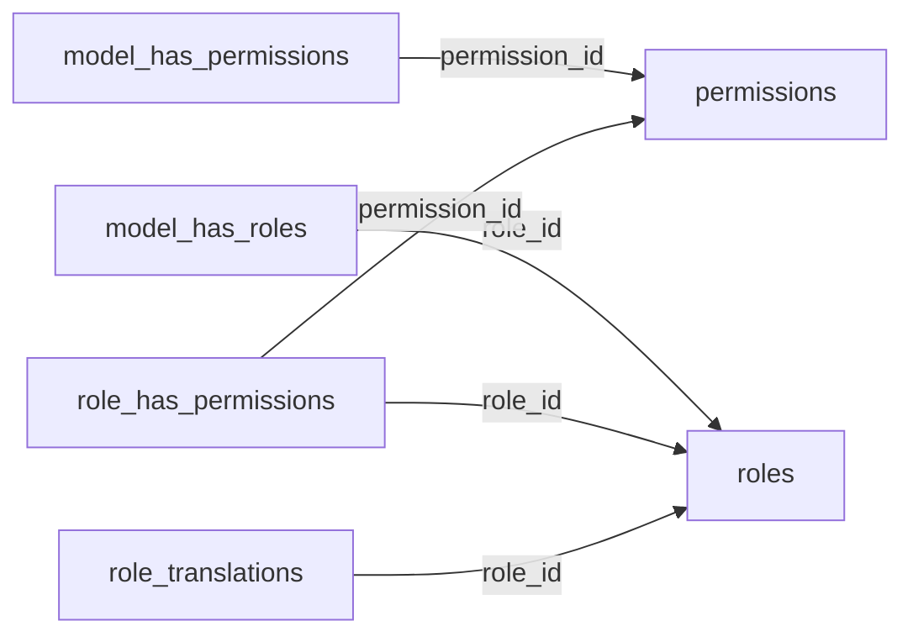

### `permissions`

**التصنيف:** موجود دون تغيير مقترح.

كتالوج الصلاحيات حسب البوابة والحارس الأمني.

| العمود | النوع | إلزامي | القيود والملاحظات المختصرة | المرجع عند وجوده |
| --- | --- | --- | --- | --- |
| `id` | `bigint` | نعم | مفتاح أساسي؛ ترقيم تلقائي | — |
| `name` | `varchar(255)` | نعم | — | — |
| `guard_name` | `varchar(255)` | نعم | — | — |
| `portal` | `varchar(255)` | نعم | — | — |
| `created_at` | `timestamp` | لا | — | — |
| `updated_at` | `timestamp` | لا | — | — |

**الفهارس والقيود المركبة:**

- قيد تفرد: `(name, guard_name, portal)`.
- فهرس بحث: `portal`.
### `roles`

**التصنيف:** موجود ويحتاج تعديلًا.

الأدوار العامة الحالية. تضاف حالة التفعيل والترجمة؛ أدوار مساحات العمل منفصلة عنها.

| العمود | النوع | إلزامي | القيود والملاحظات المختصرة | المرجع عند وجوده |
| --- | --- | --- | --- | --- |
| `id` | `bigint` | نعم | مفتاح أساسي؛ ترقيم تلقائي | — |
| `name` | `varchar(255)` | نعم | — | — |
| `guard_name` | `varchar(255)` | نعم | — | — |
| `portal` | `varchar(255)` | نعم | — | — |
| `is_active` | `boolean` | نعم | الافتراضي: `true`؛ إضافة مقترحة | — |
| `created_at` | `timestamp` | لا | — | — |
| `updated_at` | `timestamp` | لا | — | — |

**الفهارس والقيود المركبة:**

- قيد تفرد: `(name, guard_name, portal)`.
- فهرس بحث: `portal`.
### `model_has_permissions`

**التصنيف:** موجود دون تغيير مقترح.

إسناد صلاحيات مباشرة لكيانات النظام وفق بنية Spatie الحالية.

| العمود | النوع | إلزامي | القيود والملاحظات المختصرة | المرجع عند وجوده |
| --- | --- | --- | --- | --- |
| `permission_id` | `bigint` | نعم | — | `permissions.id`؛ `CASCADE` |
| `model_type` | `varchar(255)` | نعم | — | — |
| `model_id` | `bigint` | نعم | — | — |

**الفهارس والقيود المركبة:**

- مفتاح أساسي مركب: `(permission_id, model_id, model_type)`.
- فهرس بحث: `(model_id, model_type)`.
### `model_has_roles`

**التصنيف:** موجود دون تغيير مقترح.

إسناد الأدوار العامة للكيانات وفق بنية Spatie الحالية.

| العمود | النوع | إلزامي | القيود والملاحظات المختصرة | المرجع عند وجوده |
| --- | --- | --- | --- | --- |
| `role_id` | `bigint` | نعم | — | `roles.id`؛ `CASCADE` |
| `model_type` | `varchar(255)` | نعم | — | — |
| `model_id` | `bigint` | نعم | — | — |

**الفهارس والقيود المركبة:**

- مفتاح أساسي مركب: `(role_id, model_id, model_type)`.
- فهرس بحث: `(model_id, model_type)`.
### `role_has_permissions`

**التصنيف:** موجود دون تغيير مقترح.

الصلاحيات التابعة لكل دور عام.

| العمود | النوع | إلزامي | القيود والملاحظات المختصرة | المرجع عند وجوده |
| --- | --- | --- | --- | --- |
| `permission_id` | `bigint` | نعم | — | `permissions.id`؛ `CASCADE` |
| `role_id` | `bigint` | نعم | — | `roles.id`؛ `CASCADE` |

**الفهارس والقيود المركبة:**

- مفتاح أساسي مركب: `(permission_id, role_id)`.
### `role_translations`

**التصنيف:** جدول جديد مقترح لتدفق ظاهر في التصميم.

الاسم العربي والإنجليزي لكل دور عام.

| العمود | النوع | إلزامي | القيود والملاحظات المختصرة | المرجع عند وجوده |
| --- | --- | --- | --- | --- |
| `id` | `bigint` | نعم | مفتاح أساسي؛ ترقيم تلقائي | — |
| `role_id` | `bigint` | نعم | — | `roles.id`؛ `CASCADE` |
| `locale` | `varchar(10)` | نعم | — | — |
| `name` | `varchar(255)` | نعم | — | — |

**الفهارس والقيود المركبة:**

- قيد تفرد: `(role_id, locale)`.

<a id="module-reference"></a>

## البيانات المرجعية

تضم هذه المجموعة 20 جدولًا.

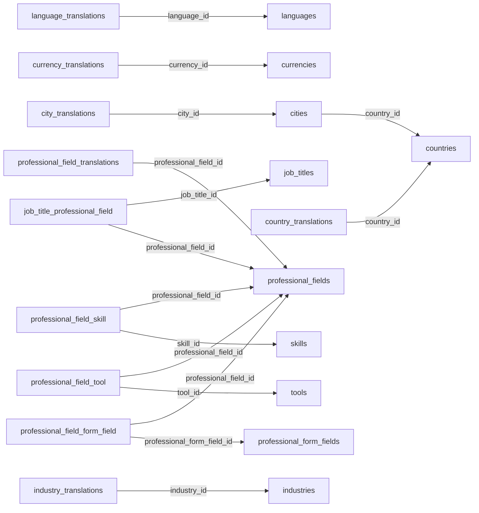

### `countries`

**التصنيف:** موجود دون تغيير مقترح.

كتالوج الدول وحالة تفعيلها.

| العمود | النوع | إلزامي | القيود والملاحظات المختصرة | المرجع عند وجوده |
| --- | --- | --- | --- | --- |
| `id` | `bigint` | نعم | مفتاح أساسي؛ ترقيم تلقائي | — |
| `code` | `char(2)` | نعم | فريد | — |
| `is_active` | `boolean` | نعم | الافتراضي: `true` | — |
| `created_at` | `timestamp` | لا | — | — |
| `updated_at` | `timestamp` | لا | — | — |
### `languages`

**التصنيف:** موجود دون تغيير مقترح.

كتالوج اللغات وحالة تفعيلها.

| العمود | النوع | إلزامي | القيود والملاحظات المختصرة | المرجع عند وجوده |
| --- | --- | --- | --- | --- |
| `id` | `bigint` | نعم | مفتاح أساسي؛ ترقيم تلقائي | — |
| `code` | `varchar(10)` | نعم | فريد | — |
| `is_active` | `boolean` | نعم | الافتراضي: `true` | — |
| `created_at` | `timestamp` | لا | — | — |
| `updated_at` | `timestamp` | لا | — | — |
### `currencies`

**التصنيف:** موجود دون تغيير مقترح.

كتالوج العملات ورموزها وحالة تفعيلها؛ أسعار الصرف في جدول مستقل.

| العمود | النوع | إلزامي | القيود والملاحظات المختصرة | المرجع عند وجوده |
| --- | --- | --- | --- | --- |
| `id` | `bigint` | نعم | مفتاح أساسي؛ ترقيم تلقائي | — |
| `code` | `char(3)` | نعم | فريد | — |
| `symbol` | `varchar(10)` | لا | — | — |
| `is_active` | `boolean` | نعم | الافتراضي: `true` | — |
| `created_at` | `timestamp` | لا | — | — |
| `updated_at` | `timestamp` | لا | — | — |
### `cities`

**التصنيف:** موجود دون تغيير مقترح.

المدن التابعة للدول. يجب أن تتطابق المدينة مع الدولة المختارة.

| العمود | النوع | إلزامي | القيود والملاحظات المختصرة | المرجع عند وجوده |
| --- | --- | --- | --- | --- |
| `id` | `bigint` | نعم | مفتاح أساسي؛ ترقيم تلقائي | — |
| `country_id` | `bigint` | نعم | — | `countries.id`؛ `CASCADE` |
| `is_active` | `boolean` | نعم | الافتراضي: `true` | — |
| `created_at` | `timestamp` | لا | — | — |
| `updated_at` | `timestamp` | لا | — | — |
### `professional_fields`

**التصنيف:** موجود دون تغيير مقترح.

المجالات المهنية الأساسية، مثل البرمجة والتصميم.

| العمود | النوع | إلزامي | القيود والملاحظات المختصرة | المرجع عند وجوده |
| --- | --- | --- | --- | --- |
| `id` | `bigint` | نعم | مفتاح أساسي؛ ترقيم تلقائي | — |
| `slug` | `varchar(255)` | نعم | فريد | — |
| `is_active` | `boolean` | نعم | الافتراضي: `true` | — |
| `created_at` | `timestamp` | لا | — | — |
| `updated_at` | `timestamp` | لا | — | — |
### `country_translations`

**التصنيف:** موجود دون تغيير مقترح.

أسماء الدول المترجمة.

| العمود | النوع | إلزامي | القيود والملاحظات المختصرة | المرجع عند وجوده |
| --- | --- | --- | --- | --- |
| `id` | `bigint` | نعم | مفتاح أساسي؛ ترقيم تلقائي | — |
| `country_id` | `bigint` | نعم | — | `countries.id`؛ `CASCADE` |
| `locale` | `varchar(255)` | نعم | — | — |
| `name` | `varchar(255)` | نعم | — | — |

**الفهارس والقيود المركبة:**

- قيد تفرد: `(country_id, locale)`.
- فهرس بحث: `locale`.
### `city_translations`

**التصنيف:** موجود دون تغيير مقترح.

أسماء المدن المترجمة.

| العمود | النوع | إلزامي | القيود والملاحظات المختصرة | المرجع عند وجوده |
| --- | --- | --- | --- | --- |
| `id` | `bigint` | نعم | مفتاح أساسي؛ ترقيم تلقائي | — |
| `city_id` | `bigint` | نعم | — | `cities.id`؛ `CASCADE` |
| `locale` | `varchar(255)` | نعم | — | — |
| `name` | `varchar(255)` | نعم | — | — |

**الفهارس والقيود المركبة:**

- قيد تفرد: `(city_id, locale)`.
- فهرس بحث: `locale`.
### `language_translations`

**التصنيف:** موجود دون تغيير مقترح.

أسماء اللغات المترجمة.

| العمود | النوع | إلزامي | القيود والملاحظات المختصرة | المرجع عند وجوده |
| --- | --- | --- | --- | --- |
| `id` | `bigint` | نعم | مفتاح أساسي؛ ترقيم تلقائي | — |
| `language_id` | `bigint` | نعم | — | `languages.id`؛ `CASCADE` |
| `locale` | `varchar(255)` | نعم | — | — |
| `name` | `varchar(255)` | نعم | — | — |

**الفهارس والقيود المركبة:**

- قيد تفرد: `(language_id, locale)`.
- فهرس بحث: `locale`.
### `currency_translations`

**التصنيف:** موجود دون تغيير مقترح.

أسماء العملات المترجمة.

| العمود | النوع | إلزامي | القيود والملاحظات المختصرة | المرجع عند وجوده |
| --- | --- | --- | --- | --- |
| `id` | `bigint` | نعم | مفتاح أساسي؛ ترقيم تلقائي | — |
| `currency_id` | `bigint` | نعم | — | `currencies.id`؛ `CASCADE` |
| `locale` | `varchar(255)` | نعم | — | — |
| `name` | `varchar(255)` | نعم | — | — |

**الفهارس والقيود المركبة:**

- قيد تفرد: `(currency_id, locale)`.
- فهرس بحث: `locale`.
### `professional_field_translations`

**التصنيف:** موجود مع تعديل ضمن S01.

أسماء المجالات وأوصاف بطاقات الاختيار المترجمة.

| العمود | النوع | إلزامي | القيود والملاحظات المختصرة | المرجع عند وجوده |
| --- | --- | --- | --- | --- |
| `id` | `bigint` | نعم | مفتاح أساسي؛ ترقيم تلقائي | — |
| `professional_field_id` | `bigint` | نعم | — | `professional_fields.id`؛ `CASCADE` |
| `locale` | `varchar(255)` | نعم | — | — |
| `name` | `varchar(255)` | نعم | — | — |
| `description` | `text` | لا | وصف بطاقة المجال المترجم | — |
**الفهارس والقيود المركبة:**

- قيد تفرد: `(professional_field_id, locale)`.
- فهرس بحث: `locale`.
### `job_titles`

**التصنيف:** موجود دون تغيير مقترح.

المسميات الوظيفية. حقل التصنيف القديم أزيل لصالح الربط بالمجالات المهنية.

| العمود | النوع | إلزامي | القيود والملاحظات المختصرة | المرجع عند وجوده |
| --- | --- | --- | --- | --- |
| `id` | `bigint` | نعم | مفتاح أساسي؛ ترقيم تلقائي | — |
| `name` | `varchar(255)` | نعم | — | — |
| `slug` | `varchar(255)` | نعم | فريد | — |
| `is_active` | `boolean` | نعم | الافتراضي: `true` | — |
| `created_at` | `timestamp` | لا | — | — |
| `updated_at` | `timestamp` | لا | — | — |
### `skills`

**التصنيف:** موجود دون تغيير مقترح.

المهارات القابلة للاختيار والفلترة.

| العمود | النوع | إلزامي | القيود والملاحظات المختصرة | المرجع عند وجوده |
| --- | --- | --- | --- | --- |
| `id` | `bigint` | نعم | مفتاح أساسي؛ ترقيم تلقائي | — |
| `name` | `varchar(255)` | نعم | — | — |
| `slug` | `varchar(255)` | نعم | فريد | — |
| `is_active` | `boolean` | نعم | الافتراضي: `true` | — |
| `created_at` | `timestamp` | لا | — | — |
| `updated_at` | `timestamp` | لا | — | — |
### `tools`

**التصنيف:** موجود دون تغيير مقترح.

الأدوات والتقنيات القابلة للاختيار والفلترة.

| العمود | النوع | إلزامي | القيود والملاحظات المختصرة | المرجع عند وجوده |
| --- | --- | --- | --- | --- |
| `id` | `bigint` | نعم | مفتاح أساسي؛ ترقيم تلقائي | — |
| `name` | `varchar(255)` | نعم | — | — |
| `slug` | `varchar(255)` | نعم | فريد | — |
| `is_active` | `boolean` | نعم | الافتراضي: `true` | — |
| `created_at` | `timestamp` | لا | — | — |
| `updated_at` | `timestamp` | لا | — | — |
### `job_title_professional_field`

**التصنيف:** موجود دون تغيير مقترح.

ربط المسمى الوظيفي بمجال مهني أو أكثر.

| العمود | النوع | إلزامي | القيود والملاحظات المختصرة | المرجع عند وجوده |
| --- | --- | --- | --- | --- |
| `job_title_id` | `bigint` | نعم | — | `job_titles.id`؛ `CASCADE` |
| `professional_field_id` | `bigint` | نعم | — | `professional_fields.id`؛ `CASCADE` |

**الفهارس والقيود المركبة:**

- مفتاح أساسي مركب: `(job_title_id, professional_field_id)`.
### `professional_field_skill`

**التصنيف:** موجود دون تغيير مقترح.

المهارات المتاحة لكل مجال مهني.

| العمود | النوع | إلزامي | القيود والملاحظات المختصرة | المرجع عند وجوده |
| --- | --- | --- | --- | --- |
| `professional_field_id` | `bigint` | نعم | — | `professional_fields.id`؛ `CASCADE` |
| `skill_id` | `bigint` | نعم | — | `skills.id`؛ `CASCADE` |

**الفهارس والقيود المركبة:**

- مفتاح أساسي مركب: `(professional_field_id, skill_id)`.
### `professional_field_tool`

**التصنيف:** موجود دون تغيير مقترح.

الأدوات المتاحة لكل مجال مهني.

| العمود | النوع | إلزامي | القيود والملاحظات المختصرة | المرجع عند وجوده |
| --- | --- | --- | --- | --- |
| `professional_field_id` | `bigint` | نعم | — | `professional_fields.id`؛ `CASCADE` |
| `tool_id` | `bigint` | نعم | — | `tools.id`؛ `CASCADE` |

**الفهارس والقيود المركبة:**

- مفتاح أساسي مركب: `(professional_field_id, tool_id)`.
### `professional_form_fields`

**التصنيف:** موجود مع تبسيط مقترح.

كتالوج مفاتيح حقول استكمال ملف المرشح الحالي، وليس أسئلة نماذج الوظائف العامة. يرجع الـBackend المفاتيح فقط، ويتولى الفرونت الخطوة والترتيب وطريقة العرض وعلامة الإلزام.

| العمود | النوع | إلزامي | القيود والملاحظات المختصرة | المرجع عند وجوده |
| --- | --- | --- | --- | --- |
| `id` | `bigint` | نعم | مفتاح أساسي؛ ترقيم تلقائي | — |
| `key` | `varchar(255)` | نعم | فريد | — |
| `created_at` | `timestamp` | لا | — | — |
| `updated_at` | `timestamp` | لا | — | — |

التغيير المقترح: حذف `step` و`is_default` و`is_required_by_default`. قواعد validation الأساسية تظل معرفة داخل كود الـBackend.
### `professional_field_form_field`

**التصنيف:** موجود مع تبسيط مقترح.

تحديد input keys التابعة لكل مجال مهني في ملف المرشح.

| العمود | النوع | إلزامي | القيود والملاحظات المختصرة | المرجع عند وجوده |
| --- | --- | --- | --- | --- |
| `professional_field_id` | `bigint` | نعم | — | `professional_fields.id`؛ `CASCADE` |
| `professional_form_field_id` | `bigint` | نعم | — | `professional_form_fields.id`؛ `CASCADE` |
| `created_at` | `timestamp` | لا | — | — |
| `updated_at` | `timestamp` | لا | — | — |

**الفهارس والقيود المركبة:**

- مفتاح أساسي مركب: `(professional_field_id, professional_form_field_id)`.

التغيير المقترح: حذف `is_required`؛ الإلزامية لا تحفظ في قاعدة البيانات.
### `industries`

**التصنيف:** جدول جديد مقترح لتدفق ظاهر في التصميم.

قطاعات الأعمال للشركات وخبرات المرشح القطاعية، وهي مختلفة عن المجال المهني.

| العمود | النوع | إلزامي | القيود والملاحظات المختصرة | المرجع عند وجوده |
| --- | --- | --- | --- | --- |
| `id` | `bigint` | نعم | مفتاح أساسي؛ ترقيم تلقائي | — |
| `slug` | `varchar(255)` | نعم | فريد | — |
| `is_active` | `boolean` | نعم | الافتراضي: `true` | — |
| `created_at` | `timestamp` | لا | — | — |
| `updated_at` | `timestamp` | لا | — | — |
### `industry_translations`

**التصنيف:** جدول جديد مقترح لتدفق ظاهر في التصميم.

أسماء قطاعات الأعمال المترجمة.

| العمود | النوع | إلزامي | القيود والملاحظات المختصرة | المرجع عند وجوده |
| --- | --- | --- | --- | --- |
| `id` | `bigint` | نعم | مفتاح أساسي؛ ترقيم تلقائي | — |
| `industry_id` | `bigint` | نعم | — | `industries.id`؛ `CASCADE` |
| `locale` | `varchar(10)` | نعم | — | — |
| `name` | `varchar(255)` | نعم | — | — |

**الفهارس والقيود المركبة:**

- قيد تفرد: `(industry_id, locale)`.

<a id="module-talent"></a>

## ملف المرشح

تضم هذه المجموعة 8 جدولًا.

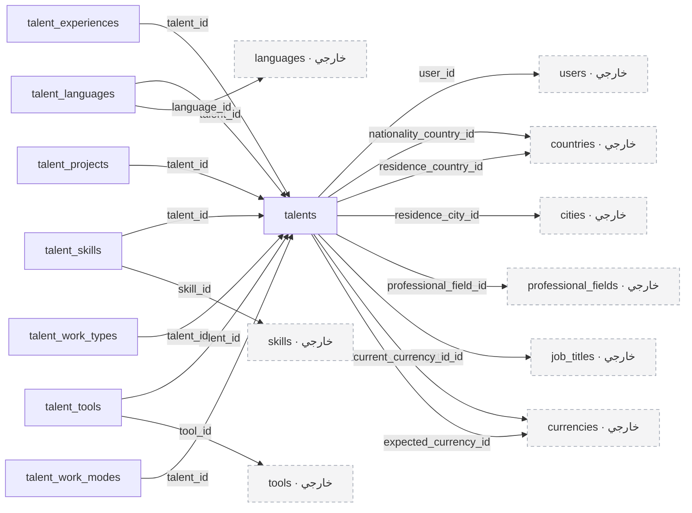

### `talents`

**التصنيف:** موجود ويحتاج تعديلًا.

ملف المرشح الحالي وتفضيلاته ورواتبه. تضاف هوية عامة للعرض وحالة التوفر المستقلة عن القبول.

| العمود | النوع | إلزامي | القيود والملاحظات المختصرة | المرجع عند وجوده |
| --- | --- | --- | --- | --- |
| `id` | `bigint` | نعم | مفتاح أساسي؛ ترقيم تلقائي | — |
| `user_id` | `bigint` | نعم | فريد | `users.id`؛ `CASCADE` |
| `profile_completion_percentage` | `tinyint` | نعم | الافتراضي: `0` | — |
| `onboarding_step` | `varchar(255)` | نعم | الافتراضي: `'personal-information'` | — |
| `profile_completion_details` | `json` | لا | — | — |
| `profile_completion_updated_at` | `timestamp` | لا | — | — |
| `professional_summary` | `text` | لا | — | — |
| `whatsapp_country_code` | `varchar(5)` | لا | — | — |
| `whatsapp_number` | `varchar(20)` | لا | — | — |
| `phone_country_code` | `varchar(5)` | لا | — | — |
| `phone_number` | `varchar(20)` | لا | — | — |
| `date_of_birth` | `date` | لا | — | — |
| `gender` | `varchar(255)` | لا | — | — |
| `religion` | `varchar(50)` | لا | — | — |
| `nationality_country_id` | `bigint` | لا | — | `countries.id`؛ `SET NULL` |
| `residence_country_id` | `bigint` | لا | — | `countries.id`؛ `SET NULL` |
| `residence_city_id` | `bigint` | لا | — | `cities.id`؛ `SET NULL` |
| `professional_field_id` | `bigint` | لا | — | `professional_fields.id`؛ `SET NULL` |
| `willing_to_relocate` | `boolean` | لا | — | — |
| `job_title_id` | `bigint` | لا | — | `job_titles.id`؛ `SET NULL` |
| `seniority_level` | `varchar(255)` | لا | — | — |
| `years_of_experience` | `smallint` | لا | — | — |
| `linkedin_url` | `varchar(255)` | لا | — | — |
| `github_url` | `varchar(255)` | لا | — | — |
| `behance_url` | `varchar(255)` | لا | — | — |
| `portfolio_url` | `varchar(255)` | لا | — | — |
| `onboarding_completed_at` | `timestamp` | لا | — | — |
| `notice_period_days` | `smallint` | لا | — | — |
| `current_salary` | `decimal(12,2)` | لا | — | — |
| `current_currency_id` | `bigint` | لا | — | `currencies.id`؛ `SET NULL` |
| `expected_salary_min` | `decimal(12,2)` | لا | — | — |
| `expected_salary_max` | `decimal(12,2)` | لا | — | — |
| `expected_currency_id` | `bigint` | لا | — | `currencies.id`؛ `SET NULL` |
| `public_code` | `varchar(32)` | لا | فريد؛ إضافة مقترحة | — |
| `availability_status` | `varchar(32)` | نعم | الافتراضي: `'unavailable'`؛ إضافة مقترحة؛ القيم: `available, notice_period, unavailable` | — |
| `availability_updated_at` | `timestamp` | لا | إضافة مقترحة | — |
| `created_at` | `timestamp` | لا | — | — |
| `updated_at` | `timestamp` | لا | — | — |

**الفهارس والقيود المركبة:**

- فهرس بحث: `profile_completion_percentage`.
- فهرس بحث: `(job_title_id, seniority_level, years_of_experience)`.
- فهرس بحث: `(availability_status, professional_field_id)`.

**مهم:** الإضافات هي `public_code`, `availability_status`, `availability_updated_at` وفهارس البحث المقترحة. لا تحفظ حالة اعتماد الطلب هنا.
### `talent_languages`

**التصنيف:** موجود دون تغيير مقترح.

اللغات التي يجيدها المرشح ومستوى إجادته لكل لغة.

| العمود | النوع | إلزامي | القيود والملاحظات المختصرة | المرجع عند وجوده |
| --- | --- | --- | --- | --- |
| `id` | `bigint` | نعم | مفتاح أساسي؛ ترقيم تلقائي | — |
| `talent_id` | `bigint` | نعم | — | `talents.id`؛ `CASCADE` |
| `language_id` | `bigint` | نعم | — | `languages.id`؛ `RESTRICT` |
| `proficiency_level` | `varchar(255)` | نعم | — | — |
| `created_at` | `timestamp` | لا | — | — |
| `updated_at` | `timestamp` | لا | — | — |

**الفهارس والقيود المركبة:**

- قيد تفرد: `(talent_id, language_id)`.
### `talent_skills`

**التصنيف:** موجود دون تغيير مقترح.

مهارات المرشح. لا تعاد أعمدة مستوى المهارة وسنواتها التي أزيلت من السكيما الحالية.

| العمود | النوع | إلزامي | القيود والملاحظات المختصرة | المرجع عند وجوده |
| --- | --- | --- | --- | --- |
| `id` | `bigint` | نعم | مفتاح أساسي؛ ترقيم تلقائي | — |
| `talent_id` | `bigint` | نعم | — | `talents.id`؛ `CASCADE` |
| `skill_id` | `bigint` | نعم | — | `skills.id`؛ `RESTRICT` |
| `created_at` | `timestamp` | لا | — | — |
| `updated_at` | `timestamp` | لا | — | — |

**الفهارس والقيود المركبة:**

- قيد تفرد: `(talent_id, skill_id)`.
### `talent_tools`

**التصنيف:** موجود دون تغيير مقترح.

الأدوات التي يستخدمها المرشح.

| العمود | النوع | إلزامي | القيود والملاحظات المختصرة | المرجع عند وجوده |
| --- | --- | --- | --- | --- |
| `id` | `bigint` | نعم | مفتاح أساسي؛ ترقيم تلقائي | — |
| `talent_id` | `bigint` | نعم | — | `talents.id`؛ `CASCADE` |
| `tool_id` | `bigint` | نعم | — | `tools.id`؛ `RESTRICT` |
| `created_at` | `timestamp` | لا | — | — |
| `updated_at` | `timestamp` | لا | — | — |

**الفهارس والقيود المركبة:**

- قيد تفرد: `(talent_id, tool_id)`.
### `talent_experiences`

**التصنيف:** موجود دون تغيير مقترح.

الخبرات السابقة وتواريخها ومسؤوليات العمل وترتيب العرض.

| العمود | النوع | إلزامي | القيود والملاحظات المختصرة | المرجع عند وجوده |
| --- | --- | --- | --- | --- |
| `id` | `bigint` | نعم | مفتاح أساسي؛ ترقيم تلقائي | — |
| `talent_id` | `bigint` | نعم | — | `talents.id`؛ `CASCADE` |
| `job_title` | `varchar(255)` | نعم | — | — |
| `company_name` | `varchar(255)` | نعم | — | — |
| `company_url` | `varchar(255)` | لا | — | — |
| `started_at` | `date` | نعم | — | — |
| `ended_at` | `date` | لا | — | — |
| `currently_working` | `boolean` | نعم | الافتراضي: `false` | — |
| `responsibilities` | `text` | لا | — | — |
| `display_order` | `smallint` | نعم | الافتراضي: `0` | — |
| `created_at` | `timestamp` | لا | — | — |
| `updated_at` | `timestamp` | لا | — | — |
### `talent_projects`

**التصنيف:** موجود دون تغيير مقترح.

مشروعات معرض أعمال المرشح. الصور تستخدم جدول الملفات الحالي.

| العمود | النوع | إلزامي | القيود والملاحظات المختصرة | المرجع عند وجوده |
| --- | --- | --- | --- | --- |
| `id` | `bigint` | نعم | مفتاح أساسي؛ ترقيم تلقائي | — |
| `talent_id` | `bigint` | نعم | — | `talents.id`؛ `CASCADE` |
| `name` | `varchar(255)` | نعم | — | — |
| `description` | `text` | لا | — | — |
| `url` | `varchar(255)` | لا | — | — |
| `display_order` | `smallint` | نعم | الافتراضي: `0` | — |
| `created_at` | `timestamp` | لا | — | — |
| `updated_at` | `timestamp` | لا | — | — |
### `talent_work_types`

**التصنيف:** موجود دون تغيير مقترح.

أنواع العمل المفضلة: دوام كامل أو جزئي.

| العمود | النوع | إلزامي | القيود والملاحظات المختصرة | المرجع عند وجوده |
| --- | --- | --- | --- | --- |
| `id` | `bigint` | نعم | مفتاح أساسي؛ ترقيم تلقائي | — |
| `talent_id` | `bigint` | نعم | — | `talents.id`؛ `CASCADE` |
| `work_type` | `varchar(255)` | نعم | — | — |
| `created_at` | `timestamp` | لا | — | — |
| `updated_at` | `timestamp` | لا | — | — |

**الفهارس والقيود المركبة:**

- قيد تفرد: `(talent_id, work_type)`.
### `talent_work_modes`

**التصنيف:** موجود دون تغيير مقترح.

أنماط العمل المفضلة: عن بعد أو حضوري أو هجين.

| العمود | النوع | إلزامي | القيود والملاحظات المختصرة | المرجع عند وجوده |
| --- | --- | --- | --- | --- |
| `id` | `bigint` | نعم | مفتاح أساسي؛ ترقيم تلقائي | — |
| `talent_id` | `bigint` | نعم | — | `talents.id`؛ `CASCADE` |
| `work_mode` | `varchar(255)` | نعم | — | — |
| `created_at` | `timestamp` | لا | — | — |
| `updated_at` | `timestamp` | لا | — | — |

**الفهارس والقيود المركبة:**

- قيد تفرد: `(talent_id, work_mode)`.

<a id="module-infrastructure"></a>

## البنية الأساسية

تضم هذه المجموعة 12 جدولًا.

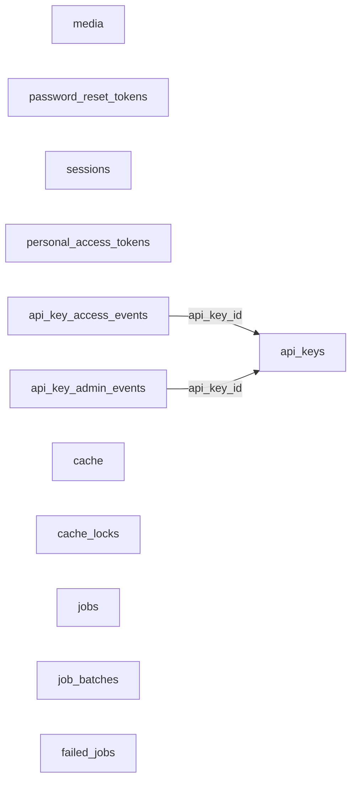

### `media`

**التصنيف:** موجود دون تغيير مقترح.

جدول ملفات Spatie الحالي. يعاد استخدامه للسيرة الذاتية والصور والمستندات والإيصالات دون إنشاء نظام ملفات موازٍ.

| العمود | النوع | إلزامي | القيود والملاحظات المختصرة | المرجع عند وجوده |
| --- | --- | --- | --- | --- |
| `id` | `bigint` | نعم | مفتاح أساسي؛ ترقيم تلقائي | — |
| `model_type` | `varchar(255)` | نعم | — | — |
| `model_id` | `bigint` | نعم | — | — |
| `uuid` | `uuid` | لا | فريد | — |
| `collection_name` | `varchar(255)` | نعم | — | — |
| `name` | `varchar(255)` | نعم | — | — |
| `file_name` | `varchar(255)` | نعم | — | — |
| `mime_type` | `varchar(255)` | لا | — | — |
| `disk` | `varchar(255)` | نعم | — | — |
| `conversions_disk` | `varchar(255)` | لا | — | — |
| `size` | `bigint` | نعم | — | — |
| `manipulations` | `json` | نعم | — | — |
| `custom_properties` | `json` | نعم | — | — |
| `generated_conversions` | `json` | نعم | — | — |
| `responsive_images` | `json` | نعم | — | — |
| `order_column` | `int` | لا | — | — |
| `created_at` | `timestamp` | لا | — | — |
| `updated_at` | `timestamp` | لا | — | — |

**الفهارس والقيود المركبة:**

- فهرس بحث: `(model_type, model_id)`.
- فهرس بحث: `order_column`.
### `password_reset_tokens`

**التصنيف:** موجود دون تغيير مقترح.

جدول Laravel الحالي لإعادة تعيين كلمة المرور. التدفق الحالي يعتمد على OTP؛ تفعيل الوسيط الافتراضي يتطلب مراجعة نطاق البوابة.

| العمود | النوع | إلزامي | القيود والملاحظات المختصرة | المرجع عند وجوده |
| --- | --- | --- | --- | --- |
| `email` | `varchar(255)` | نعم | — | — |
| `token` | `varchar(255)` | نعم | — | — |
| `created_at` | `timestamp` | لا | — | — |
### `sessions`

**التصنيف:** موجود دون تغيير مقترح.

جلسات Laravel الحالية؛ عمود المستخدم مفهرس لكنه غير مربوط بقيد مفتاح أجنبي فعلي في migration الحالية.

| العمود | النوع | إلزامي | القيود والملاحظات المختصرة | المرجع عند وجوده |
| --- | --- | --- | --- | --- |
| `id` | `varchar(255)` | نعم | مفتاح أساسي | — |
| `user_id` | `bigint` | لا | — | — |
| `ip_address` | `varchar(45)` | لا | — | — |
| `user_agent` | `text` | لا | — | — |
| `payload` | `longtext` | نعم | — | — |
| `last_activity` | `int` | نعم | — | — |

**الفهارس والقيود المركبة:**

- فهرس بحث: `user_id`.
- فهرس بحث: `last_activity`.
### `user_devices`

**التصنيف:** جديد في S00.

أقل بيانات لازمة لربط حساب المستخدم بتسجيل FCM. لا ينشأ السجل إلا بعد Login ناجح يحتوي على `fcm_token`، ولا توجد endpoint منفصلة لتسجيل الجهاز.

| العمود | النوع | إلزامي | القيود والملاحظات المختصرة | المرجع عند وجوده |
| --- | --- | --- | --- | --- |
| `id` | `bigint` | نعم | مفتاح أساسي؛ ترقيم تلقائي | — |
| `user_id` | `bigint` | نعم | يحذف الجهاز مع المستخدم | `users.id` |
| `platform` | `varchar(20)` | نعم | `web` أو`ios` أو`android` | — |
| `fcm_token` | `text` | نعم | مشفر داخل التطبيق | — |
| `fcm_token_hash` | `char(64)` | نعم | SHA-256؛ فريد للبحث ومنع التكرار | — |
| `created_at` | `timestamp` | لا | — | — |
| `updated_at` | `timestamp` | لا | — | — |

**الفهارس والقيود المركبة:**

- قيد فريد: `fcm_token_hash`.
- فهرس بحث: `(user_id, platform)`.
### `personal_access_tokens`

**التصنيف:** موجود مع تعديل S00.

رموز Sanctum الحالية للوصول والتجديد والتحقق. يتشارك access وrefresh الصادران معًا قيمة `token_family_id` حتى يلغي Logout الزوج كاملًا، ويرتبطان اختياريًا بالجهاز الذي أرسل FCM token.

| العمود | النوع | إلزامي | القيود والملاحظات المختصرة | المرجع عند وجوده |
| --- | --- | --- | --- | --- |
| `id` | `bigint` | نعم | مفتاح أساسي؛ ترقيم تلقائي | — |
| `tokenable_type` | `varchar(255)` | نعم | — | — |
| `tokenable_id` | `bigint` | نعم | — | — |
| `token_family_id` | `char(36)` | لا | UUID مشترك لزوج access/refresh | — |
| `user_device_id` | `bigint` | لا | يحذف المرجع عند حذف الجهاز | `user_devices.id` |
| `name` | `text` | نعم | — | — |
| `token` | `char(64)` | نعم | فريد | — |
| `abilities` | `text` | لا | — | — |
| `last_used_at` | `timestamp` | لا | — | — |
| `expires_at` | `timestamp` | لا | — | — |
| `created_at` | `timestamp` | لا | — | — |
| `updated_at` | `timestamp` | لا | — | — |

**الفهارس والقيود المركبة:**

- فهرس بحث: `(tokenable_type, tokenable_id)`.
- فهرس بحث: `token_family_id`.
- فهرس بحث: `expires_at`.
### `api_keys`

**التصنيف:** موجود دون تغيير مقترح.

مفاتيح الوصول الخاصة بالتكاملات الحالية.

| العمود | النوع | إلزامي | القيود والملاحظات المختصرة | المرجع عند وجوده |
| --- | --- | --- | --- | --- |
| `id` | `int` | نعم | مفتاح أساسي؛ ترقيم تلقائي | — |
| `name` | `varchar(255)` | نعم | — | — |
| `key` | `varchar(64)` | نعم | — | — |
| `active` | `boolean` | نعم | الافتراضي: `true` | — |
| `deleted_at` | `timestamp` | لا | — | — |
| `created_at` | `timestamp` | لا | — | — |
| `updated_at` | `timestamp` | لا | — | — |

**الفهارس والقيود المركبة:**

- فهرس بحث: `name`.
- فهرس بحث: `key`.
### `api_key_access_events`

**التصنيف:** موجود دون تغيير مقترح.

سجل استخدام مفاتيح التكامل، وهو مختلف عن سجل أعمال التوظيف.

| العمود | النوع | إلزامي | القيود والملاحظات المختصرة | المرجع عند وجوده |
| --- | --- | --- | --- | --- |
| `id` | `int` | نعم | مفتاح أساسي؛ ترقيم تلقائي | — |
| `api_key_id` | `int` | نعم | — | `api_keys.id`؛ `NO ACTION` |
| `ip_address` | `varchar(45)` | نعم | — | — |
| `url` | `text` | نعم | — | — |
| `created_at` | `timestamp` | لا | — | — |
| `updated_at` | `timestamp` | لا | — | — |
### `api_key_admin_events`

**التصنيف:** موجود دون تغيير مقترح.

سجل إدارة مفاتيح التكامل.

| العمود | النوع | إلزامي | القيود والملاحظات المختصرة | المرجع عند وجوده |
| --- | --- | --- | --- | --- |
| `id` | `int` | نعم | مفتاح أساسي؛ ترقيم تلقائي | — |
| `api_key_id` | `int` | نعم | — | `api_keys.id`؛ `NO ACTION` |
| `ip_address` | `varchar(45)` | نعم | — | — |
| `event` | `varchar(255)` | نعم | — | — |
| `created_at` | `timestamp` | لا | — | — |
| `updated_at` | `timestamp` | لا | — | — |

**الفهارس والقيود المركبة:**

- فهرس بحث: `event`.
### `cache`

**التصنيف:** موجود دون تغيير مقترح.

بيانات التخزين المؤقت الحالية.

| العمود | النوع | إلزامي | القيود والملاحظات المختصرة | المرجع عند وجوده |
| --- | --- | --- | --- | --- |
| `key` | `varchar(255)` | نعم | مفتاح أساسي | — |
| `value` | `mediumtext` | نعم | — | — |
| `expiration` | `bigint` | نعم | — | — |

**الفهارس والقيود المركبة:**

- فهرس بحث: `expiration`.
### `cache_locks`

**التصنيف:** موجود دون تغيير مقترح.

أقفال التخزين المؤقت الحالية.

| العمود | النوع | إلزامي | القيود والملاحظات المختصرة | المرجع عند وجوده |
| --- | --- | --- | --- | --- |
| `key` | `varchar(255)` | نعم | مفتاح أساسي | — |
| `owner` | `varchar(255)` | نعم | — | — |
| `expiration` | `bigint` | نعم | — | — |

**الفهارس والقيود المركبة:**

- فهرس بحث: `expiration`.
### `jobs`

**التصنيف:** موجود دون تغيير مقترح.

مهام طابور Laravel؛ ليس جدول الوظائف المتاحة للمتقدمين.

| العمود | النوع | إلزامي | القيود والملاحظات المختصرة | المرجع عند وجوده |
| --- | --- | --- | --- | --- |
| `id` | `bigint` | نعم | مفتاح أساسي؛ ترقيم تلقائي | — |
| `queue` | `varchar(255)` | نعم | — | — |
| `payload` | `longtext` | نعم | — | — |
| `attempts` | `smallint` | نعم | — | — |
| `reserved_at` | `int` | لا | — | — |
| `available_at` | `int` | نعم | — | — |
| `created_at` | `int` | نعم | — | — |

**الفهارس والقيود المركبة:**

- فهرس بحث: `queue`.
### `job_batches`

**التصنيف:** موجود دون تغيير مقترح.

دفعات المهام الخلفية الحالية.

| العمود | النوع | إلزامي | القيود والملاحظات المختصرة | المرجع عند وجوده |
| --- | --- | --- | --- | --- |
| `id` | `varchar(255)` | نعم | مفتاح أساسي | — |
| `name` | `varchar(255)` | نعم | — | — |
| `total_jobs` | `int` | نعم | — | — |
| `pending_jobs` | `int` | نعم | — | — |
| `failed_jobs` | `int` | نعم | — | — |
| `failed_job_ids` | `longtext` | نعم | — | — |
| `options` | `mediumtext` | لا | — | — |
| `cancelled_at` | `int` | لا | — | — |
| `created_at` | `int` | نعم | — | — |
| `finished_at` | `int` | لا | — | — |
### `failed_jobs`

**التصنيف:** موجود دون تغيير مقترح.

سجل المهام الخلفية التي فشلت.

| العمود | النوع | إلزامي | القيود والملاحظات المختصرة | المرجع عند وجوده |
| --- | --- | --- | --- | --- |
| `id` | `bigint` | نعم | مفتاح أساسي؛ ترقيم تلقائي | — |
| `uuid` | `varchar(255)` | نعم | فريد | — |
| `connection` | `text` | نعم | — | — |
| `queue` | `text` | نعم | — | — |
| `payload` | `longtext` | نعم | — | — |
| `exception` | `longtext` | نعم | — | — |
| `failed_at` | `timestamp` | نعم | الافتراضي: `CURRENT_TIMESTAMP` | — |

**الفهارس والقيود المركبة:**

- فهرس بحث: `(connection, queue, failed_at)`.

<a id="module-applications"></a>

## التقديم والاعتماد

تضم هذه المجموعة 6 جدولًا.

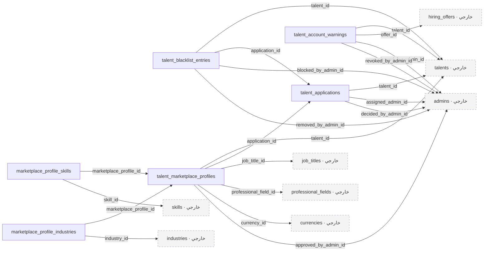

### `talent_applications`

**التصنيف:** موجود ويحتاج تعديلًا.

محاولات الانضمام إلى شبكة قادر. يتحول الربط من طلب واحد لكل مرشح إلى تاريخ محاولات مع منع تعدد المحاولات النشطة.

| العمود | النوع | إلزامي | القيود والملاحظات المختصرة | المرجع عند وجوده |
| --- | --- | --- | --- | --- |
| `id` | `bigint` | نعم | مفتاح أساسي؛ ترقيم تلقائي | — |
| `talent_id` | `bigint` | نعم | — | `talents.id`؛ `RESTRICT` |
| `status` | `varchar(255)` | نعم | الافتراضي: `'submitted'`؛ القيم: `submitted, under_review, interview_required, interview_scheduled, waiting_result, accepted, rejected, closed` | — |
| `submitted_at` | `timestamp` | نعم | — | — |
| `reference` | `varchar(32)` | لا | فريد؛ إضافة مقترحة | — |
| `attempt_number` | `int` | نعم | الافتراضي: `1` | — |
| `active_guard` | `tinyint` | لا | — | — |
| `assigned_admin_id` | `bigint` | لا | — | `admins.id`؛ `RESTRICT` |
| `review_started_at` | `timestamp` | لا | — | — |
| `profile_locked_at` | `timestamp` | لا | — | — |
| `profile_completion_at_submission` | `tinyint` | لا | — | — |
| `submission_snapshot` | `json` | لا | — | — |
| `snapshot_version` | `int` | لا | — | — |
| `snapshot_captured_at` | `timestamp` | لا | — | — |
| `snapshot_origin` | `varchar(32)` | لا | القيم: `submission, legacy_capture` | — |
| `decision_at` | `timestamp` | لا | — | — |
| `decided_by_admin_id` | `bigint` | لا | — | `admins.id`؛ `RESTRICT` |
| `rejection_stage` | `varchar(32)` | لا | القيم: `initial_review, interview, scheduling` | — |
| `rejection_category` | `varchar(64)` | لا | — | — |
| `internal_decision_reason` | `text` | لا | — | — |
| `talent_visible_message` | `text` | لا | — | — |
| `reapply_policy` | `varchar(32)` | لا | القيم: `allowed_after_date, not_allowed, early_paid_eligible` | — |
| `reapply_at` | `timestamp` | لا | — | — |
| `priority` | `varchar(16)` | نعم | الافتراضي: `'normal'`؛ القيم: `normal, high, urgent` | — |
| `last_activity_at` | `timestamp` | لا | — | — |
| `version` | `int` | نعم | الافتراضي: `1` | — |
| `created_at` | `timestamp` | لا | — | — |
| `updated_at` | `timestamp` | لا | — | — |

**الفهارس والقيود المركبة:**

- قيد تفرد: `(talent_id, attempt_number)`.
- قيد تفرد: `(talent_id, active_guard)`.
- فهرس بحث: `(assigned_admin_id, status, submitted_at)`.
- فهرس بحث: `(status, submitted_at)`.
- فهرس بحث: `reapply_at`.

**مهم:** الأعمدة الحالية فقط هي `id`, `talent_id`, `status`, `submitted_at`, `created_at`, `updated_at`. بقية الأعمدة إضافات مقترحة، والتفرد المنفرد لـ`talent_id` يستبدل بقيود المحاولات الموضحة.
### `talent_blacklist_entries`

**التصنيف:** جدول جديد مقترح لتدفق ظاهر في التصميم.

تاريخ حظر المرشح وفك الحظر. فك الحظر لا يقبل طلبًا مرفوضًا تلقائيًا.

| العمود | النوع | إلزامي | القيود والملاحظات المختصرة | المرجع عند وجوده |
| --- | --- | --- | --- | --- |
| `id` | `bigint` | نعم | مفتاح أساسي؛ ترقيم تلقائي | — |
| `talent_id` | `bigint` | نعم | — | `talents.id`؛ `RESTRICT` |
| `application_id` | `bigint` | لا | — | `talent_applications.id`؛ `RESTRICT` |
| `reason` | `text` | نعم | — | — |
| `blocked_by_admin_id` | `bigint` | نعم | — | `admins.id`؛ `RESTRICT` |
| `blocked_at` | `timestamp` | نعم | — | — |
| `active_guard` | `tinyint` | لا | — | — |
| `removed_at` | `timestamp` | لا | — | — |
| `removed_by_admin_id` | `bigint` | لا | — | `admins.id`؛ `RESTRICT` |
| `removal_reason` | `text` | لا | — | — |
| `created_at` | `timestamp` | لا | — | — |
| `updated_at` | `timestamp` | لا | — | — |

**الفهارس والقيود المركبة:**

- قيد تفرد: `(talent_id, active_guard)`.
### `talent_marketplace_profiles`

**التصنيف:** جدول جديد مقترح لتدفق ظاهر في التصميم.

نسخة الملف المعتمدة للنشر للشركات، منفصلة عن الملف الخاص القابل للتعديل.

| العمود | النوع | إلزامي | القيود والملاحظات المختصرة | المرجع عند وجوده |
| --- | --- | --- | --- | --- |
| `id` | `bigint` | نعم | مفتاح أساسي؛ ترقيم تلقائي | — |
| `talent_id` | `bigint` | نعم | فريد | `talents.id`؛ `RESTRICT` |
| `application_id` | `bigint` | نعم | — | `talent_applications.id`؛ `RESTRICT` |
| `job_title_id` | `bigint` | نعم | — | `job_titles.id`؛ `RESTRICT` |
| `professional_field_id` | `bigint` | نعم | — | `professional_fields.id`؛ `RESTRICT` |
| `seniority_level` | `varchar(32)` | نعم | — | — |
| `years_of_experience` | `smallint` | نعم | — | — |
| `public_summary` | `text` | لا | — | — |
| `main_specialization` | `varchar(255)` | لا | — | — |
| `salary_min` | `decimal(18,4)` | نعم | — | — |
| `salary_max` | `decimal(18,4)` | نعم | — | — |
| `currency_id` | `bigint` | نعم | — | `currencies.id`؛ `RESTRICT` |
| `salary_period` | `varchar(16)` | نعم | الافتراضي: `'month'` | — |
| `visibility` | `varchar(16)` | نعم | الافتراضي: `'hidden'`؛ القيم: `visible, hidden` | — |
| `public_profile_snapshot` | `json` | نعم | — | — |
| `approved_at` | `timestamp` | نعم | — | — |
| `approved_by_admin_id` | `bigint` | نعم | — | `admins.id`؛ `RESTRICT` |
| `created_at` | `timestamp` | لا | — | — |
| `updated_at` | `timestamp` | لا | — | — |

**الفهارس والقيود المركبة:**

- فهرس بحث: `(visibility, professional_field_id, job_title_id, seniority_level)`.
- فهرس بحث: `(currency_id, salary_min, salary_max)`.
### `marketplace_profile_skills`

**التصنيف:** جدول جديد مقترح لتدفق ظاهر في التصميم.

المهارات المعتمدة القابلة للفلترة في سوق المواهب.

| العمود | النوع | إلزامي | القيود والملاحظات المختصرة | المرجع عند وجوده |
| --- | --- | --- | --- | --- |
| `marketplace_profile_id` | `bigint` | نعم | — | `talent_marketplace_profiles.id`؛ `CASCADE` |
| `skill_id` | `bigint` | نعم | — | `skills.id`؛ `RESTRICT` |

**الفهارس والقيود المركبة:**

- مفتاح أساسي مركب: `(marketplace_profile_id, skill_id)`.
### `marketplace_profile_industries`

**التصنيف:** جدول جديد مقترح لتدفق ظاهر في التصميم.

خبرة الملف المعتمد في قطاعات أعمال محددة. يقترح أن يديرها الأدمن لحين اعتماد مصدر إدخالها.

| العمود | النوع | إلزامي | القيود والملاحظات المختصرة | المرجع عند وجوده |
| --- | --- | --- | --- | --- |
| `marketplace_profile_id` | `bigint` | نعم | — | `talent_marketplace_profiles.id`؛ `CASCADE` |
| `industry_id` | `bigint` | نعم | — | `industries.id`؛ `RESTRICT` |

**الفهارس والقيود المركبة:**

- مفتاح أساسي مركب: `(marketplace_profile_id, industry_id)`.
### `talent_account_warnings`

**التصنيف:** جدول جديد مقترح لتدفق ظاهر في التصميم.

إنذارات عدم الرد على العروض وإلغاؤها وانتهاؤها. الإنذار مستقل عن الحظر والإيقاف.

| العمود | النوع | إلزامي | القيود والملاحظات المختصرة | المرجع عند وجوده |
| --- | --- | --- | --- | --- |
| `id` | `bigint` | نعم | مفتاح أساسي؛ ترقيم تلقائي | — |
| `talent_id` | `bigint` | نعم | — | `talents.id`؛ `RESTRICT` |
| `offer_id` | `bigint` | نعم | — | `hiring_offers.id`؛ `RESTRICT` |
| `category` | `varchar(32)` | نعم | — | — |
| `issued_by_admin_id` | `bigint` | نعم | — | `admins.id`؛ `RESTRICT` |
| `reason` | `text` | نعم | — | — |
| `policy_snapshot` | `json` | نعم | — | — |
| `issued_at` | `timestamp` | نعم | — | — |
| `expires_at` | `timestamp` | لا | — | — |
| `revoked_at` | `timestamp` | لا | — | — |
| `revoked_by_admin_id` | `bigint` | لا | — | `admins.id`؛ `RESTRICT` |
| `revocation_reason` | `text` | لا | — | — |
| `created_at` | `timestamp` | لا | — | — |
| `updated_at` | `timestamp` | لا | — | — |

**الفهارس والقيود المركبة:**

- قيد تفرد: `(offer_id, category)`.
- فهرس بحث: `(talent_id, revoked_at, expires_at)`.

<a id="module-workspace"></a>

## مساحات العمل

تضم هذه المجموعة 7 جدولًا.

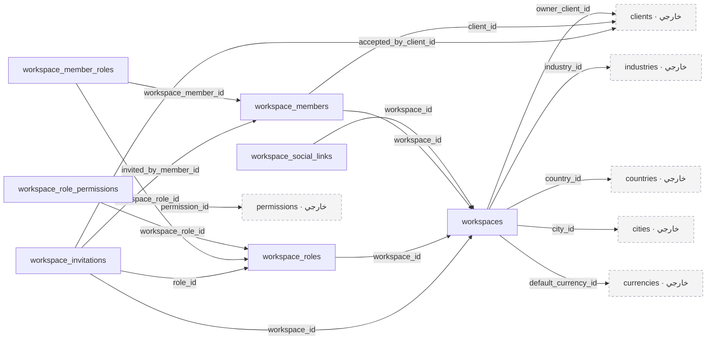

### `workspaces`

**التصنيف:** جدول جديد مقترح لتدفق ظاهر في التصميم.

مساحة عمل أو هوية شركة يملكها عميل. يمكن للعميل امتلاك أكثر من مساحة.

| العمود | النوع | إلزامي | القيود والملاحظات المختصرة | المرجع عند وجوده |
| --- | --- | --- | --- | --- |
| `id` | `bigint` | نعم | مفتاح أساسي؛ ترقيم تلقائي | — |
| `owner_client_id` | `bigint` | نعم | — | `clients.id`؛ `RESTRICT` |
| `name` | `varchar(255)` | نعم | — | — |
| `slug` | `varchar(255)` | نعم | فريد | — |
| `industry_id` | `bigint` | نعم | — | `industries.id`؛ `RESTRICT` |
| `description` | `text` | نعم | — | — |
| `is_company` | `boolean` | نعم | — | — |
| `country_id` | `bigint` | نعم | — | `countries.id`؛ `RESTRICT` |
| `city_id` | `bigint` | لا | — | `cities.id`؛ `RESTRICT` |
| `size_band` | `varchar(32)` | لا | — | — |
| `website_url` | `varchar(2048)` | لا | — | — |
| `commercial_registration_number` | `varchar(100)` | لا | — | — |
| `status` | `varchar(32)` | نعم | الافتراضي: `'active'`؛ القيم: `active, suspended, archived` | — |
| `timezone` | `varchar(64)` | نعم | — | — |
| `default_currency_id` | `bigint` | لا | — | `currencies.id`؛ `RESTRICT` |
| `deleted_at` | `timestamp` | لا | — | — |
| `created_at` | `timestamp` | لا | — | — |
| `updated_at` | `timestamp` | لا | — | — |

**الفهارس والقيود المركبة:**

- فهرس بحث: `(owner_client_id, status)`.
### `workspace_social_links`

**التصنيف:** جدول جديد مقترح لتدفق ظاهر في التصميم.

روابط الحسابات الاجتماعية لمساحة العمل.

| العمود | النوع | إلزامي | القيود والملاحظات المختصرة | المرجع عند وجوده |
| --- | --- | --- | --- | --- |
| `id` | `bigint` | نعم | مفتاح أساسي؛ ترقيم تلقائي | — |
| `workspace_id` | `bigint` | نعم | — | `workspaces.id`؛ `CASCADE` |
| `platform` | `varchar(32)` | نعم | — | — |
| `url` | `varchar(2048)` | نعم | — | — |
| `display_order` | `smallint` | نعم | الافتراضي: `0` | — |
| `created_at` | `timestamp` | لا | — | — |
| `updated_at` | `timestamp` | لا | — | — |
### `workspace_members`

**التصنيف:** جدول جديد مقترح لتدفق ظاهر في التصميم.

عضوية العملاء داخل مساحات العمل. العضو الإداري ليس هو المرشح المتعاقد معه.

| العمود | النوع | إلزامي | القيود والملاحظات المختصرة | المرجع عند وجوده |
| --- | --- | --- | --- | --- |
| `id` | `bigint` | نعم | مفتاح أساسي؛ ترقيم تلقائي | — |
| `workspace_id` | `bigint` | نعم | — | `workspaces.id`؛ `RESTRICT` |
| `client_id` | `bigint` | نعم | — | `clients.id`؛ `RESTRICT` |
| `status` | `varchar(16)` | نعم | الافتراضي: `'active'`؛ القيم: `active, suspended, removed` | — |
| `joined_at` | `timestamp` | نعم | — | — |
| `removed_at` | `timestamp` | لا | — | — |
| `created_at` | `timestamp` | لا | — | — |
| `updated_at` | `timestamp` | لا | — | — |

**الفهارس والقيود المركبة:**

- قيد تفرد: `(workspace_id, client_id)`.
- فهرس بحث: `(client_id, status)`.
### `workspace_roles`

**التصنيف:** جدول جديد مقترح لتدفق ظاهر في التصميم.

أدوار محلية لكل مساحة عمل، معزولة عن صلاحيات الأدمن العامة.

| العمود | النوع | إلزامي | القيود والملاحظات المختصرة | المرجع عند وجوده |
| --- | --- | --- | --- | --- |
| `id` | `bigint` | نعم | مفتاح أساسي؛ ترقيم تلقائي | — |
| `workspace_id` | `bigint` | نعم | — | `workspaces.id`؛ `RESTRICT` |
| `key` | `varchar(100)` | نعم | — | — |
| `name_en` | `varchar(255)` | نعم | — | — |
| `name_ar` | `varchar(255)` | لا | — | — |
| `is_active` | `boolean` | نعم | الافتراضي: `true` | — |
| `created_at` | `timestamp` | لا | — | — |
| `updated_at` | `timestamp` | لا | — | — |

**الفهارس والقيود المركبة:**

- قيد تفرد: `(workspace_id, key)`.
### `workspace_role_permissions`

**التصنيف:** جدول جديد مقترح لتدفق ظاهر في التصميم.

صلاحيات بوابة العميل التابعة لدور داخل مساحة العمل.

| العمود | النوع | إلزامي | القيود والملاحظات المختصرة | المرجع عند وجوده |
| --- | --- | --- | --- | --- |
| `workspace_role_id` | `bigint` | نعم | — | `workspace_roles.id`؛ `CASCADE` |
| `permission_id` | `bigint` | نعم | — | `permissions.id`؛ `RESTRICT` |

**الفهارس والقيود المركبة:**

- مفتاح أساسي مركب: `(workspace_role_id, permission_id)`.
### `workspace_member_roles`

**التصنيف:** جدول جديد مقترح لتدفق ظاهر في التصميم.

إسناد أدوار مساحة العمل لأعضائها، مع اشتراط تطابق المساحة.

| العمود | النوع | إلزامي | القيود والملاحظات المختصرة | المرجع عند وجوده |
| --- | --- | --- | --- | --- |
| `workspace_member_id` | `bigint` | نعم | — | `workspace_members.id`؛ `CASCADE` |
| `workspace_role_id` | `bigint` | نعم | — | `workspace_roles.id`؛ `CASCADE` |

**الفهارس والقيود المركبة:**

- مفتاح أساسي مركب: `(workspace_member_id, workspace_role_id)`.
### `workspace_invitations`

**التصنيف:** اقتراح يحتاج اعتماد تفاصيله.

دعوات عضوية مساحة العمل. تفاصيل تجربة الدعوة ما زالت مقترحة.

| العمود | النوع | إلزامي | القيود والملاحظات المختصرة | المرجع عند وجوده |
| --- | --- | --- | --- | --- |
| `id` | `bigint` | نعم | مفتاح أساسي؛ ترقيم تلقائي | — |
| `workspace_id` | `bigint` | نعم | — | `workspaces.id`؛ `RESTRICT` |
| `email` | `varchar(255)` | نعم | — | — |
| `role_id` | `bigint` | لا | — | `workspace_roles.id`؛ `RESTRICT` |
| `invited_by_member_id` | `bigint` | نعم | — | `workspace_members.id`؛ `RESTRICT` |
| `token_hash` | `char(64)` | نعم | فريد | — |
| `status` | `varchar(16)` | نعم | الافتراضي: `'pending'`؛ القيم: `pending, accepted, revoked, expired` | — |
| `expires_at` | `timestamp` | نعم | — | — |
| `accepted_by_client_id` | `bigint` | لا | — | `clients.id`؛ `RESTRICT` |
| `accepted_at` | `timestamp` | لا | — | — |
| `created_at` | `timestamp` | لا | — | — |
| `updated_at` | `timestamp` | لا | — | — |

**الفهارس والقيود المركبة:**

- فهرس بحث: `(workspace_id, email, status)`.

<a id="module-commercial"></a>

## أنواع العقود والرسوم

تضم هذه المجموعة 4 جدولًا.

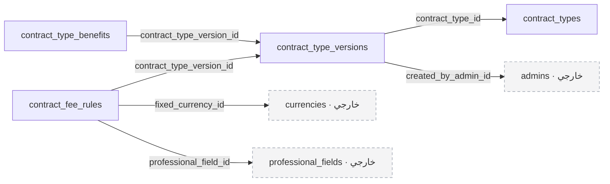

### `contract_types`

**التصنيف:** جدول جديد مقترح لتدفق ظاهر في التصميم.

نوعا التعاقد الرئيسيان: إدارة مستمرة أو توظيف بعمولة مرة واحدة.

| العمود | النوع | إلزامي | القيود والملاحظات المختصرة | المرجع عند وجوده |
| --- | --- | --- | --- | --- |
| `id` | `bigint` | نعم | مفتاح أساسي؛ ترقيم تلقائي | — |
| `code` | `varchar(32)` | نعم | فريد؛ القيم: `managed, one_time` | — |
| `is_active` | `boolean` | نعم | الافتراضي: `true` | — |
| `created_at` | `timestamp` | لا | — | — |
| `updated_at` | `timestamp` | لا | — | — |
### `contract_type_versions`

**التصنيف:** جدول جديد مقترح لتدفق ظاهر في التصميم.

إصدارات أسماء وشروط وإعدادات نوع العقد. الإصدار المنشور لا يعدل بأثر رجعي.

| العمود | النوع | إلزامي | القيود والملاحظات المختصرة | المرجع عند وجوده |
| --- | --- | --- | --- | --- |
| `id` | `bigint` | نعم | مفتاح أساسي؛ ترقيم تلقائي | — |
| `contract_type_id` | `bigint` | نعم | — | `contract_types.id`؛ `RESTRICT` |
| `version_number` | `int` | نعم | — | — |
| `status` | `varchar(16)` | نعم | الافتراضي: `'draft'`؛ القيم: `draft, published, retired` | — |
| `name_en` | `varchar(255)` | نعم | — | — |
| `name_ar` | `varchar(255)` | نعم | — | — |
| `description_en` | `text` | لا | — | — |
| `description_ar` | `text` | لا | — | — |
| `terms_en` | `text` | لا | — | — |
| `terms_ar` | `text` | لا | — | — |
| `default_work_type` | `varchar(32)` | لا | — | — |
| `default_work_mode` | `varchar(32)` | لا | — | — |
| `default_schedule` | `json` | لا | — | — |
| `published_at` | `timestamp` | لا | — | — |
| `created_by_admin_id` | `bigint` | نعم | — | `admins.id`؛ `RESTRICT` |
| `created_at` | `timestamp` | لا | — | — |
| `updated_at` | `timestamp` | لا | — | — |

**الفهارس والقيود المركبة:**

- قيد تفرد: `(contract_type_id, version_number)`.
### `contract_type_benefits`

**التصنيف:** جدول جديد مقترح لتدفق ظاهر في التصميم.

المزايا والخدمات الداخلة في كل إصدار من نوع العقد.

| العمود | النوع | إلزامي | القيود والملاحظات المختصرة | المرجع عند وجوده |
| --- | --- | --- | --- | --- |
| `id` | `bigint` | نعم | مفتاح أساسي؛ ترقيم تلقائي | — |
| `contract_type_version_id` | `bigint` | نعم | — | `contract_type_versions.id`؛ `RESTRICT` |
| `name_en` | `varchar(255)` | نعم | — | — |
| `name_ar` | `varchar(255)` | لا | — | — |
| `display_order` | `smallint` | نعم | — | — |
| `created_at` | `timestamp` | لا | — | — |
| `updated_at` | `timestamp` | لا | — | — |

**الفهارس والقيود المركبة:**

- قيد تفرد: `(contract_type_version_id, display_order)`.
### `contract_fee_rules`

**التصنيف:** جدول جديد مقترح لتدفق ظاهر في التصميم.

رسوم افتراضية واستثناءات حسب المجال المهني، بقيمة ثابتة أو نسبة أو الاثنين.

| العمود | النوع | إلزامي | القيود والملاحظات المختصرة | المرجع عند وجوده |
| --- | --- | --- | --- | --- |
| `id` | `bigint` | نعم | مفتاح أساسي؛ ترقيم تلقائي | — |
| `contract_type_version_id` | `bigint` | نعم | — | `contract_type_versions.id`؛ `RESTRICT` |
| `professional_field_id` | `bigint` | لا | — | `professional_fields.id`؛ `RESTRICT` |
| `scope_key` | `varchar(64)` | نعم | — | — |
| `fee_type` | `varchar(32)` | نعم | القيم: `fixed, percentage, fixed_percentage` | — |
| `fixed_amount` | `decimal(18,4)` | لا | — | — |
| `fixed_currency_id` | `bigint` | لا | — | `currencies.id`؛ `RESTRICT` |
| `percentage` | `decimal(7,4)` | لا | — | — |
| `percentage_basis` | `varchar(32)` | لا | القيم: `monthly_salary, annual_salary, contract_total` | — |
| `billing_frequency` | `varchar(16)` | نعم | القيم: `monthly, one_time` | — |
| `created_at` | `timestamp` | لا | — | — |
| `updated_at` | `timestamp` | لا | — | — |

**الفهارس والقيود المركبة:**

- قيد تفرد: `(contract_type_version_id, scope_key)`.

<a id="module-hiring"></a>

## طلبات التوظيف والعروض

تضم هذه المجموعة 6 جدولًا.

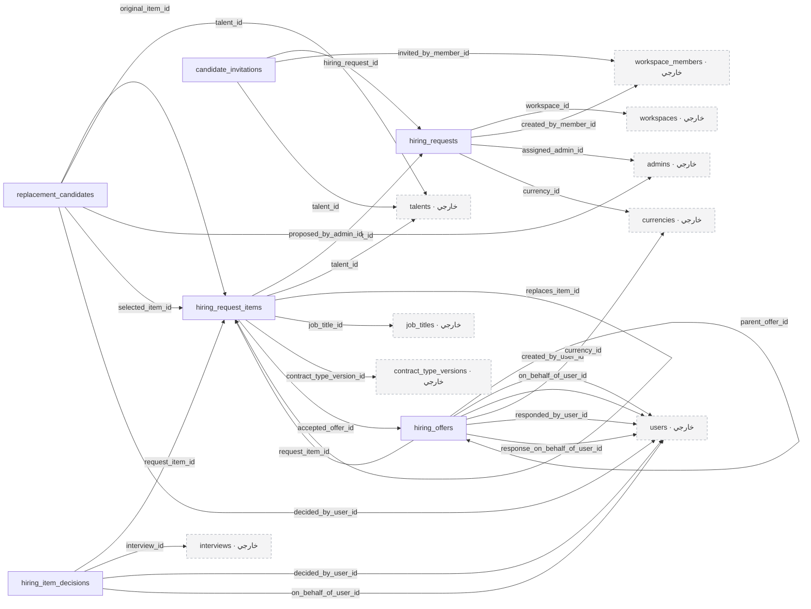

### `hiring_requests`

**التصنيف:** جدول جديد مقترح لتدفق ظاهر في التصميم.

طلب توظيف تابع لمساحة عمل، يحتوي عدة مرشحين. المسودة تمثل الفريق المختار قبل الإرسال.

| العمود | النوع | إلزامي | القيود والملاحظات المختصرة | المرجع عند وجوده |
| --- | --- | --- | --- | --- |
| `id` | `bigint` | نعم | مفتاح أساسي؛ ترقيم تلقائي | — |
| `workspace_id` | `bigint` | نعم | — | `workspaces.id`؛ `RESTRICT` |
| `reference` | `varchar(32)` | نعم | فريد | — |
| `created_by_member_id` | `bigint` | نعم | — | `workspace_members.id`؛ `RESTRICT` |
| `assigned_admin_id` | `bigint` | لا | — | `admins.id`؛ `RESTRICT` |
| `currency_id` | `bigint` | نعم | — | `currencies.id`؛ `RESTRICT` |
| `status` | `varchar(32)` | نعم | الافتراضي: `'draft'`؛ القيم: `draft, submitted, in_progress, completed, cancelled` | — |
| `submitted_at` | `timestamp` | لا | — | — |
| `closed_at` | `timestamp` | لا | — | — |
| `version` | `int` | نعم | الافتراضي: `1` | — |
| `created_at` | `timestamp` | لا | — | — |
| `updated_at` | `timestamp` | لا | — | — |

**الفهارس والقيود المركبة:**

- فهرس بحث: `(workspace_id, status, created_at)`.
- فهرس بحث: `(assigned_admin_id, status)`.
### `hiring_request_items`

**التصنيف:** جدول جديد مقترح لتدفق ظاهر في التصميم.

عنصر مستقل لكل مرشح داخل الطلب، له حالة وعرض ومقابلة وتعاقد مستقل. البديل ينشئ عنصرًا جديدًا.

| العمود | النوع | إلزامي | القيود والملاحظات المختصرة | المرجع عند وجوده |
| --- | --- | --- | --- | --- |
| `id` | `bigint` | نعم | مفتاح أساسي؛ ترقيم تلقائي | — |
| `hiring_request_id` | `bigint` | نعم | — | `hiring_requests.id`؛ `RESTRICT` |
| `talent_id` | `bigint` | نعم | — | `talents.id`؛ `RESTRICT` |
| `replaces_item_id` | `bigint` | لا | فريد | `hiring_request_items.id`؛ `RESTRICT` |
| `reference` | `varchar(32)` | نعم | فريد | — |
| `job_title_id` | `bigint` | نعم | — | `job_titles.id`؛ `RESTRICT` |
| `contract_type_version_id` | `bigint` | نعم | — | `contract_type_versions.id`؛ `RESTRICT` |
| `interview_required` | `boolean` | نعم | — | — |
| `status` | `varchar(32)` | نعم | الافتراضي: `'draft'`؛ القيم: `draft, awaiting_response, negotiating, interview_scheduling, interview_scheduled, awaiting_decisions, accepted, ready_for_contract, contracted, rejected, cancelled, on_hold, replaced` | — |
| `resume_status` | `varchar(32)` | لا | — | — |
| `active_guard` | `tinyint` | لا | — | — |
| `accepted_offer_id` | `bigint` | لا | — | `hiring_offers.id`؛ `RESTRICT` |
| `held_at` | `timestamp` | لا | — | — |
| `cancelled_at` | `timestamp` | لا | — | — |
| `closed_at` | `timestamp` | لا | — | — |
| `last_activity_at` | `timestamp` | لا | — | — |
| `closure_reason_code` | `varchar(64)` | لا | القيم: `talent_rejected, client_rejected, no_response, cancelled, replaced` | — |
| `version` | `int` | نعم | الافتراضي: `1` | — |
| `created_at` | `timestamp` | لا | — | — |
| `updated_at` | `timestamp` | لا | — | — |

**الفهارس والقيود المركبة:**

- قيد تفرد: `(hiring_request_id, talent_id, active_guard)`.
- فهرس بحث: `(hiring_request_id, status)`.
- فهرس بحث: `(talent_id, status, created_at)`.
### `hiring_offers`

**التصنيف:** جدول جديد مقترح لتدفق ظاهر في التصميم.

إصدارات العرض والعرض المضاد وشروط العمل والراتب والرد. العرض المرسل لا يعاد تحرير شروطه.

| العمود | النوع | إلزامي | القيود والملاحظات المختصرة | المرجع عند وجوده |
| --- | --- | --- | --- | --- |
| `id` | `bigint` | نعم | مفتاح أساسي؛ ترقيم تلقائي | — |
| `request_item_id` | `bigint` | نعم | — | `hiring_request_items.id`؛ `RESTRICT` |
| `version_number` | `int` | نعم | — | — |
| `parent_offer_id` | `bigint` | لا | — | `hiring_offers.id`؛ `RESTRICT` |
| `origin_party` | `varchar(16)` | نعم | القيم: `client, talent` | — |
| `created_by_user_id` | `bigint` | نعم | — | `users.id`؛ `RESTRICT` |
| `on_behalf_of_user_id` | `bigint` | لا | — | `users.id`؛ `RESTRICT` |
| `salary_amount` | `decimal(18,4)` | نعم | — | — |
| `currency_id` | `bigint` | نعم | — | `currencies.id`؛ `RESTRICT` |
| `salary_period` | `varchar(16)` | نعم | الافتراضي: `'month'` | — |
| `work_type` | `varchar(32)` | نعم | — | — |
| `work_mode` | `varchar(32)` | نعم | — | — |
| `notice_period_days` | `smallint` | لا | — | — |
| `contract_duration_months` | `smallint` | لا | — | — |
| `proposed_start_date` | `date` | لا | — | — |
| `work_schedule` | `json` | نعم | — | — |
| `message` | `text` | لا | — | — |
| `status` | `varchar(16)` | نعم | الافتراضي: `'draft'`؛ القيم: `draft, sent, accepted, rejected, superseded, withdrawn, expired` | — |
| `sent_at` | `timestamp` | لا | — | — |
| `response_due_at` | `timestamp` | لا | — | — |
| `responded_at` | `timestamp` | لا | — | — |
| `responded_by_user_id` | `bigint` | لا | — | `users.id`؛ `RESTRICT` |
| `response_on_behalf_of_user_id` | `bigint` | لا | — | `users.id`؛ `RESTRICT` |
| `response_reason` | `text` | لا | — | — |
| `created_at` | `timestamp` | لا | — | — |
| `updated_at` | `timestamp` | لا | — | — |

**الفهارس والقيود المركبة:**

- قيد تفرد: `(request_item_id, version_number)`.
- فهرس بحث: `(status, response_due_at)`.
### `hiring_item_decisions`

**التصنيف:** جدول جديد مقترح لتدفق ظاهر في التصميم.

قرار كل من العميل والمرشح بعد المقابلة، مع حفظ الفاعل الحقيقي عند اتخاذ إجراء بالنيابة.

| العمود | النوع | إلزامي | القيود والملاحظات المختصرة | المرجع عند وجوده |
| --- | --- | --- | --- | --- |
| `id` | `bigint` | نعم | مفتاح أساسي؛ ترقيم تلقائي | — |
| `request_item_id` | `bigint` | نعم | — | `hiring_request_items.id`؛ `RESTRICT` |
| `interview_id` | `bigint` | نعم | — | `interviews.id`؛ `RESTRICT` |
| `party` | `varchar(16)` | نعم | القيم: `client, talent` | — |
| `decision` | `varchar(16)` | نعم | القيم: `continue, reject` | — |
| `decided_by_user_id` | `bigint` | نعم | — | `users.id`؛ `RESTRICT` |
| `on_behalf_of_user_id` | `bigint` | لا | — | `users.id`؛ `RESTRICT` |
| `reason` | `text` | لا | — | — |
| `decided_at` | `timestamp` | نعم | — | — |
| `withdrawn_at` | `timestamp` | لا | — | — |
| `active_guard` | `tinyint` | لا | — | — |
| `created_at` | `timestamp` | لا | — | — |
| `updated_at` | `timestamp` | لا | — | — |

**الفهارس والقيود المركبة:**

- قيد تفرد: `(interview_id, party, active_guard)`.
### `replacement_candidates`

**التصنيف:** جدول جديد مقترح لتدفق ظاهر في التصميم.

البدائل المقترحة وحالة التواصل معها واختيار العميل للبديل.

| العمود | النوع | إلزامي | القيود والملاحظات المختصرة | المرجع عند وجوده |
| --- | --- | --- | --- | --- |
| `id` | `bigint` | نعم | مفتاح أساسي؛ ترقيم تلقائي | — |
| `original_item_id` | `bigint` | نعم | — | `hiring_request_items.id`؛ `RESTRICT` |
| `talent_id` | `bigint` | نعم | — | `talents.id`؛ `RESTRICT` |
| `proposed_by_admin_id` | `bigint` | لا | — | `admins.id`؛ `RESTRICT` |
| `match_score` | `decimal(5,2)` | لا | — | — |
| `match_reasons` | `json` | لا | — | — |
| `status` | `varchar(32)` | نعم | القيم: `suggested, contacted, available, unavailable, presented, accepted, rejected` | — |
| `contacted_at` | `timestamp` | لا | — | — |
| `contact_note` | `text` | لا | — | — |
| `selected_item_id` | `bigint` | لا | فريد | `hiring_request_items.id`؛ `RESTRICT` |
| `decided_by_user_id` | `bigint` | لا | — | `users.id`؛ `RESTRICT` |
| `decided_at` | `timestamp` | لا | — | — |
| `created_at` | `timestamp` | لا | — | — |
| `updated_at` | `timestamp` | لا | — | — |

**الفهارس والقيود المركبة:**

- قيد تفرد: `(original_item_id, talent_id)`.
### `candidate_invitations`

**التصنيف:** اقتراح يحتاج اعتماد تفاصيله.

دعوة مرشح جديد من شاشة بناء الفريق. لا تمنح الدعوة قبولًا تلقائيًا في شبكة قادر.

| العمود | النوع | إلزامي | القيود والملاحظات المختصرة | المرجع عند وجوده |
| --- | --- | --- | --- | --- |
| `id` | `bigint` | نعم | مفتاح أساسي؛ ترقيم تلقائي | — |
| `hiring_request_id` | `bigint` | نعم | — | `hiring_requests.id`؛ `RESTRICT` |
| `email` | `varchar(255)` | نعم | — | — |
| `invited_by_member_id` | `bigint` | نعم | — | `workspace_members.id`؛ `RESTRICT` |
| `token_hash` | `char(64)` | نعم | فريد | — |
| `expires_at` | `timestamp` | نعم | — | — |
| `status` | `varchar(16)` | نعم | القيم: `pending, accepted, expired, revoked` | — |
| `talent_id` | `bigint` | لا | — | `talents.id`؛ `RESTRICT` |
| `created_at` | `timestamp` | لا | — | — |
| `updated_at` | `timestamp` | لا | — | — |

**الفهارس والقيود المركبة:**

- قيد تفرد: `(hiring_request_id, email)`.

<a id="module-interviews"></a>

## المقابلات وجدولة المواعيد

تضم هذه المجموعة 6 جدولًا.

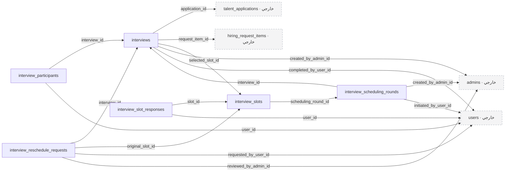

### `interviews`

**التصنيف:** جدول جديد مقترح لتدفق ظاهر في التصميم.

جولة مقابلة تتبع إما طلب اعتماد مرشح أو عنصر طلب توظيف، وليس الاثنين معًا.

| العمود | النوع | إلزامي | القيود والملاحظات المختصرة | المرجع عند وجوده |
| --- | --- | --- | --- | --- |
| `id` | `bigint` | نعم | مفتاح أساسي؛ ترقيم تلقائي | — |
| `application_id` | `bigint` | لا | — | `talent_applications.id`؛ `RESTRICT` |
| `request_item_id` | `bigint` | لا | — | `hiring_request_items.id`؛ `RESTRICT` |
| `round_number` | `smallint` | نعم | — | — |
| `category` | `varchar(32)` | نعم | القيم: `hr, technical, general, final, behavioral, panel, group, phone, portfolio, other` | — |
| `session_status` | `varchar(32)` | نعم | القيم: `awaiting_slots, selecting_slot, scheduled, ready, started, completed, no_show, cancelled` | — |
| `selected_slot_id` | `bigint` | لا | فريد | `interview_slots.id`؛ `RESTRICT` |
| `scheduled_start_at` | `timestamp` | لا | — | — |
| `scheduled_end_at` | `timestamp` | لا | — | — |
| `actual_start_at` | `timestamp` | لا | — | — |
| `actual_end_at` | `timestamp` | لا | — | — |
| `decision_due_at` | `timestamp` | لا | — | — |
| `created_by_admin_id` | `bigint` | نعم | — | `admins.id`؛ `RESTRICT` |
| `notes_internal` | `text` | لا | — | — |
| `completed_by_user_id` | `bigint` | لا | — | `users.id`؛ `RESTRICT` |
| `version` | `int` | نعم | الافتراضي: `1` | — |
| `created_at` | `timestamp` | لا | — | — |
| `updated_at` | `timestamp` | لا | — | — |

**الفهارس والقيود المركبة:**

- قيد تفرد: `(application_id, round_number)`.
- قيد تفرد: `(request_item_id, round_number)`.
- فهرس بحث: `(session_status, scheduled_start_at)`.
### `interview_participants`

**التصنيف:** جدول جديد مقترح لتدفق ظاهر في التصميم.

المحاورون والأطراف المشاركة والحضور الفعلي لكل منهم.

| العمود | النوع | إلزامي | القيود والملاحظات المختصرة | المرجع عند وجوده |
| --- | --- | --- | --- | --- |
| `id` | `bigint` | نعم | مفتاح أساسي؛ ترقيم تلقائي | — |
| `interview_id` | `bigint` | نعم | — | `interviews.id`؛ `RESTRICT` |
| `user_id` | `bigint` | نعم | — | `users.id`؛ `RESTRICT` |
| `participant_role` | `varchar(16)` | نعم | القيم: `interviewer, talent, client` | — |
| `attendance` | `varchar(16)` | نعم | الافتراضي: `'unknown'`؛ القيم: `unknown, attended, no_show, excused` | — |
| `joined_at` | `timestamp` | لا | — | — |
| `left_at` | `timestamp` | لا | — | — |
| `created_at` | `timestamp` | لا | — | — |
| `updated_at` | `timestamp` | لا | — | — |

**الفهارس والقيود المركبة:**

- قيد تفرد: `(interview_id, user_id)`.
- فهرس بحث: `(user_id, interview_id)`.
### `interview_scheduling_rounds`

**التصنيف:** جدول جديد مقترح لتدفق ظاهر في التصميم.

كل دفعة مواعيد مقترحة ومحاولة إعادة جدولة، مع مهلة الاختيار والسياسة المطبقة.

| العمود | النوع | إلزامي | القيود والملاحظات المختصرة | المرجع عند وجوده |
| --- | --- | --- | --- | --- |
| `id` | `bigint` | نعم | مفتاح أساسي؛ ترقيم تلقائي | — |
| `interview_id` | `bigint` | نعم | — | `interviews.id`؛ `RESTRICT` |
| `sequence_number` | `int` | نعم | — | — |
| `scheduling_mode` | `varchar(16)` | نعم | القيم: `manual, automatic` | — |
| `generation_config` | `json` | لا | — | — |
| `policy_snapshot` | `json` | نعم | — | — |
| `status` | `varchar(32)` | نعم | القيم: `draft, offered, selected, rejected_all, expired, cancelled` | — |
| `created_by_admin_id` | `bigint` | نعم | — | `admins.id`؛ `RESTRICT` |
| `published_at` | `timestamp` | لا | — | — |
| `selection_due_at` | `timestamp` | لا | — | — |
| `closed_at` | `timestamp` | لا | — | — |
| `reason` | `text` | لا | — | — |
| `initiated_by_user_id` | `bigint` | لا | — | `users.id`؛ `RESTRICT` |
| `quota_party` | `varchar(16)` | لا | القيم: `talent, client, admin, system` | — |
| `created_at` | `timestamp` | لا | — | — |
| `updated_at` | `timestamp` | لا | — | — |

**الفهارس والقيود المركبة:**

- قيد تفرد: `(interview_id, sequence_number)`.
- فهرس بحث: `(status, selection_due_at)`.
### `interview_slots`

**التصنيف:** جدول جديد مقترح لتدفق ظاهر في التصميم.

المواعيد المتاحة بالتوقيت والمكان أو رابط المقابلة وحالة كل موعد.

| العمود | النوع | إلزامي | القيود والملاحظات المختصرة | المرجع عند وجوده |
| --- | --- | --- | --- | --- |
| `id` | `bigint` | نعم | مفتاح أساسي؛ ترقيم تلقائي | — |
| `scheduling_round_id` | `bigint` | نعم | — | `interview_scheduling_rounds.id`؛ `RESTRICT` |
| `starts_at` | `timestamp` | نعم | — | — |
| `ends_at` | `timestamp` | نعم | — | — |
| `timezone` | `varchar(64)` | نعم | — | — |
| `mode` | `varchar(16)` | نعم | القيم: `online, offline` | — |
| `meeting_provider` | `varchar(64)` | لا | — | — |
| `meeting_url` | `text` | لا | — | — |
| `meeting_access_encrypted` | `text` | لا | — | — |
| `location_address` | `text` | لا | — | — |
| `location_map_url` | `varchar(2048)` | لا | — | — |
| `status` | `varchar(32)` | نعم | الافتراضي: `'available'`؛ القيم: `available, selected, expired, cancelled, rejected_by_talent` | — |
| `created_at` | `timestamp` | لا | — | — |
| `updated_at` | `timestamp` | لا | — | — |

**الفهارس والقيود المركبة:**

- قيد تفرد: `(scheduling_round_id, starts_at, ends_at)`.
- فهرس بحث: `(starts_at, ends_at)`.
### `interview_slot_responses`

**التصنيف:** جدول جديد مقترح لتدفق ظاهر في التصميم.

اختيارات الأطراف وقبولهم أو رفضهم للمواعيد؛ تستخدم للوصول إلى موعد مشترك.

| العمود | النوع | إلزامي | القيود والملاحظات المختصرة | المرجع عند وجوده |
| --- | --- | --- | --- | --- |
| `id` | `bigint` | نعم | مفتاح أساسي؛ ترقيم تلقائي | — |
| `slot_id` | `bigint` | نعم | — | `interview_slots.id`؛ `RESTRICT` |
| `user_id` | `bigint` | نعم | — | `users.id`؛ `RESTRICT` |
| `response` | `varchar(16)` | نعم | القيم: `preferred, accepted, declined` | — |
| `responded_at` | `timestamp` | نعم | — | — |
| `created_at` | `timestamp` | لا | — | — |
| `updated_at` | `timestamp` | لا | — | — |

**الفهارس والقيود المركبة:**

- قيد تفرد: `(slot_id, user_id)`.
### `interview_reschedule_requests`

**التصنيف:** جدول جديد مقترح لتدفق ظاهر في التصميم.

طلبات الاعتذار وإعادة الجدولة ومراجعة الأدمن لها.

| العمود | النوع | إلزامي | القيود والملاحظات المختصرة | المرجع عند وجوده |
| --- | --- | --- | --- | --- |
| `id` | `bigint` | نعم | مفتاح أساسي؛ ترقيم تلقائي | — |
| `interview_id` | `bigint` | نعم | — | `interviews.id`؛ `RESTRICT` |
| `original_slot_id` | `bigint` | نعم | — | `interview_slots.id`؛ `RESTRICT` |
| `requested_by_user_id` | `bigint` | نعم | — | `users.id`؛ `RESTRICT` |
| `reason` | `text` | نعم | — | — |
| `proposed_start_at` | `timestamp` | لا | — | — |
| `proposed_end_at` | `timestamp` | لا | — | — |
| `proposed_timezone` | `varchar(64)` | لا | — | — |
| `status` | `varchar(16)` | نعم | الافتراضي: `'pending'`؛ القيم: `pending, approved, declined, withdrawn` | — |
| `reviewed_by_admin_id` | `bigint` | لا | — | `admins.id`؛ `RESTRICT` |
| `reviewed_at` | `timestamp` | لا | — | — |
| `review_note` | `text` | لا | — | — |
| `created_at` | `timestamp` | لا | — | — |
| `updated_at` | `timestamp` | لا | — | — |

**الفهارس والقيود المركبة:**

- فهرس بحث: `(interview_id, status)`.

<a id="module-evaluation"></a>

## التقييمات وتقارير الخبراء

تضم هذه المجموعة 5 جدولًا.

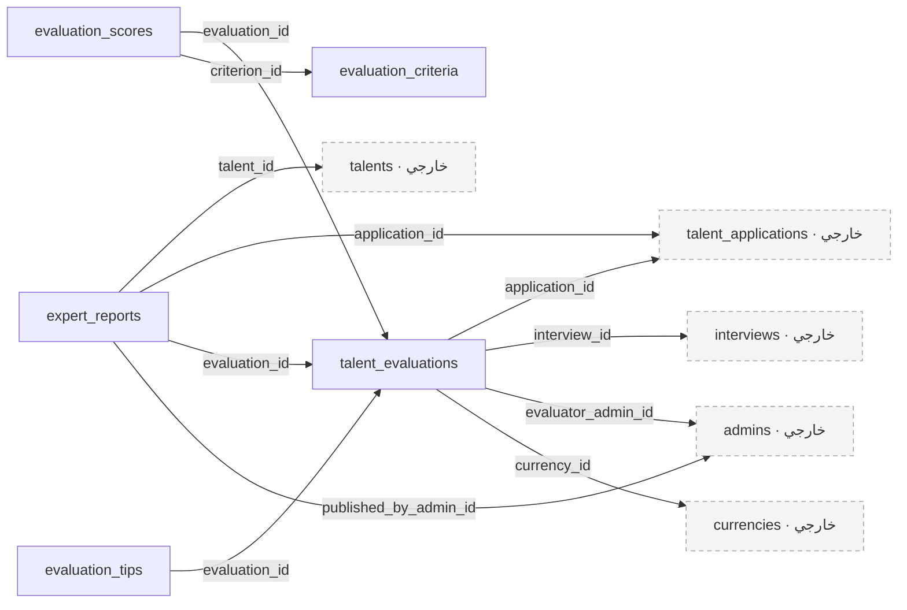

### `evaluation_criteria`

**التصنيف:** جدول جديد مقترح لتدفق ظاهر في التصميم.

معايير التقييم القابلة للتفعيل وضبط الأوزان.

| العمود | النوع | إلزامي | القيود والملاحظات المختصرة | المرجع عند وجوده |
| --- | --- | --- | --- | --- |
| `id` | `bigint` | نعم | مفتاح أساسي؛ ترقيم تلقائي | — |
| `key` | `varchar(100)` | نعم | فريد | — |
| `name_en` | `varchar(255)` | نعم | — | — |
| `name_ar` | `varchar(255)` | لا | — | — |
| `default_weight` | `decimal(5,2)` | لا | — | — |
| `is_active` | `boolean` | نعم | الافتراضي: `true` | — |
| `display_order` | `smallint` | نعم | — | — |
| `created_at` | `timestamp` | لا | — | — |
| `updated_at` | `timestamp` | لا | — | — |
### `talent_evaluations`

**التصنيف:** جدول جديد مقترح لتدفق ظاهر في التصميم.

إصدارات تقييم الملف أو المقابلة، والتقارير الداخلية وتوصيات الرواتب.

| العمود | النوع | إلزامي | القيود والملاحظات المختصرة | المرجع عند وجوده |
| --- | --- | --- | --- | --- |
| `id` | `bigint` | نعم | مفتاح أساسي؛ ترقيم تلقائي | — |
| `application_id` | `bigint` | نعم | — | `talent_applications.id`؛ `RESTRICT` |
| `interview_id` | `bigint` | لا | — | `interviews.id`؛ `RESTRICT` |
| `stage_key` | `varchar(64)` | نعم | — | — |
| `version_number` | `int` | نعم | — | — |
| `evaluator_admin_id` | `bigint` | نعم | — | `admins.id`؛ `RESTRICT` |
| `status` | `varchar(16)` | نعم | القيم: `draft, submitted, superseded` | — |
| `overall_score` | `decimal(5,2)` | لا | — | — |
| `recommended_salary_min` | `decimal(18,4)` | لا | — | — |
| `recommended_salary_max` | `decimal(18,4)` | لا | — | — |
| `currency_id` | `bigint` | لا | — | `currencies.id`؛ `RESTRICT` |
| `salary_period` | `varchar(16)` | لا | القيم: `month, year` | — |
| `hr_report` | `text` | لا | — | — |
| `technical_report` | `text` | لا | — | — |
| `psychology_report` | `text` | لا | — | — |
| `final_feedback` | `text` | لا | — | — |
| `submitted_at` | `timestamp` | لا | — | — |
| `created_at` | `timestamp` | لا | — | — |
| `updated_at` | `timestamp` | لا | — | — |

**الفهارس والقيود المركبة:**

- قيد تفرد: `(application_id, stage_key, version_number)`.
### `evaluation_scores`

**التصنيف:** جدول جديد مقترح لتدفق ظاهر في التصميم.

درجة كل معيار ووزنه واسمه وقت التقييم، لحماية التاريخ من تغييرات الكتالوج.

| العمود | النوع | إلزامي | القيود والملاحظات المختصرة | المرجع عند وجوده |
| --- | --- | --- | --- | --- |
| `id` | `bigint` | نعم | مفتاح أساسي؛ ترقيم تلقائي | — |
| `evaluation_id` | `bigint` | نعم | — | `talent_evaluations.id`؛ `RESTRICT` |
| `criterion_id` | `bigint` | نعم | — | `evaluation_criteria.id`؛ `RESTRICT` |
| `label_snapshot` | `varchar(255)` | نعم | — | — |
| `weight` | `decimal(5,2)` | نعم | — | — |
| `rating` | `tinyint` | نعم | — | — |
| `comment` | `text` | لا | — | — |
| `created_at` | `timestamp` | لا | — | — |
| `updated_at` | `timestamp` | لا | — | — |

**الفهارس والقيود المركبة:**

- قيد تفرد: `(evaluation_id, criterion_id)`.
### `evaluation_tips`

**التصنيف:** جدول جديد مقترح لتدفق ظاهر في التصميم.

نصائح التحسين بعنوان ووصف وأولوية وترتيب.

| العمود | النوع | إلزامي | القيود والملاحظات المختصرة | المرجع عند وجوده |
| --- | --- | --- | --- | --- |
| `id` | `bigint` | نعم | مفتاح أساسي؛ ترقيم تلقائي | — |
| `evaluation_id` | `bigint` | نعم | — | `talent_evaluations.id`؛ `RESTRICT` |
| `title` | `varchar(255)` | نعم | — | — |
| `description` | `text` | نعم | — | — |
| `priority` | `varchar(16)` | نعم | القيم: `low, medium, high` | — |
| `display_order` | `smallint` | نعم | — | — |
| `created_at` | `timestamp` | لا | — | — |
| `updated_at` | `timestamp` | لا | — | — |
### `expert_reports`

**التصنيف:** جدول جديد مقترح لتدفق ظاهر في التصميم.

تقرير منشور مخصص لجمهور محدد؛ محتواه ينتقى دون كشف الملاحظات الداخلية تلقائيًا.

| العمود | النوع | إلزامي | القيود والملاحظات المختصرة | المرجع عند وجوده |
| --- | --- | --- | --- | --- |
| `id` | `bigint` | نعم | مفتاح أساسي؛ ترقيم تلقائي | — |
| `talent_id` | `bigint` | نعم | — | `talents.id`؛ `RESTRICT` |
| `application_id` | `bigint` | نعم | — | `talent_applications.id`؛ `RESTRICT` |
| `evaluation_id` | `bigint` | لا | — | `talent_evaluations.id`؛ `RESTRICT` |
| `audience` | `varchar(16)` | نعم | القيم: `talent, client` | — |
| `kind` | `varchar(32)` | نعم | القيم: `profile_review, rejection_feedback, hiring_opinion` | — |
| `version_number` | `int` | نعم | — | — |
| `status` | `varchar(16)` | نعم | القيم: `draft, published, withdrawn` | — |
| `strengths` | `text` | لا | — | — |
| `improvement_areas` | `text` | لا | — | — |
| `final_feedback` | `text` | لا | — | — |
| `published_content` | `json` | لا | — | — |
| `overall_score` | `decimal(5,2)` | لا | — | — |
| `rank_percentile` | `decimal(5,2)` | لا | — | — |
| `rank_population` | `int` | لا | — | — |
| `ranking_as_of` | `timestamp` | لا | — | — |
| `ranking_method` | `varchar(255)` | لا | — | — |
| `published_at` | `timestamp` | لا | — | — |
| `published_by_admin_id` | `bigint` | لا | — | `admins.id`؛ `RESTRICT` |
| `created_at` | `timestamp` | لا | — | — |
| `updated_at` | `timestamp` | لا | — | — |

**الفهارس والقيود المركبة:**

- قيد تفرد: `(application_id, audience, kind, version_number)`.

<a id="module-support"></a>

## طلبات المساعدة

تضم هذه المجموعة 1 جدولًا.

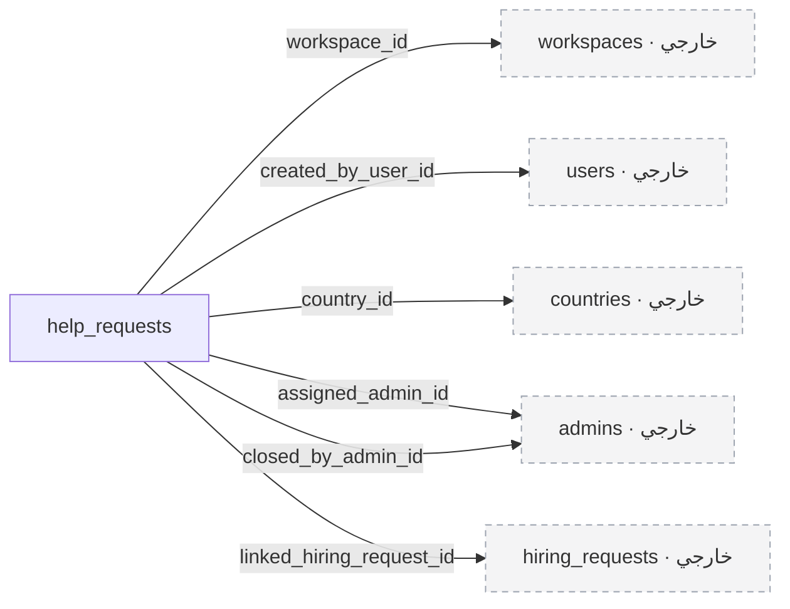

### `help_requests`

**التصنيف:** جدول جديد مقترح لتدفق ظاهر في التصميم.

طلبات المساعدة العامة أو التابعة لمساحة عمل، مع التعيين والمتابعة ونتيجة الإغلاق.

| العمود | النوع | إلزامي | القيود والملاحظات المختصرة | المرجع عند وجوده |
| --- | --- | --- | --- | --- |
| `id` | `bigint` | نعم | مفتاح أساسي؛ ترقيم تلقائي | — |
| `reference` | `varchar(32)` | نعم | فريد | — |
| `workspace_id` | `bigint` | لا | — | `workspaces.id`؛ `RESTRICT` |
| `created_by_user_id` | `bigint` | لا | — | `users.id`؛ `RESTRICT` |
| `source` | `varchar(16)` | نعم | القيم: `public, workspace` | — |
| `contact_name` | `varchar(255)` | نعم | — | — |
| `contact_email` | `varchar(255)` | لا | — | — |
| `contact_phone` | `varchar(32)` | لا | — | — |
| `country_id` | `bigint` | لا | — | `countries.id`؛ `RESTRICT` |
| `preferred_contact` | `varchar(16)` | نعم | القيم: `email, whatsapp, phone` | — |
| `help_type` | `varchar(64)` | نعم | — | — |
| `title` | `varchar(255)` | لا | — | — |
| `description` | `text` | لا | — | — |
| `assigned_admin_id` | `bigint` | لا | — | `admins.id`؛ `RESTRICT` |
| `status` | `varchar(16)` | نعم | الافتراضي: `'new'`؛ القيم: `new, in_progress, closed` | — |
| `started_at` | `timestamp` | لا | — | — |
| `closed_at` | `timestamp` | لا | — | — |
| `closed_by_admin_id` | `bigint` | لا | — | `admins.id`؛ `RESTRICT` |
| `closure_outcome` | `varchar(32)` | لا | القيم: `hiring_request_created, clarified, issue_identified` | — |
| `resolution_details` | `text` | لا | — | — |
| `linked_hiring_request_id` | `bigint` | لا | — | `hiring_requests.id`؛ `RESTRICT` |
| `created_at` | `timestamp` | لا | — | — |
| `updated_at` | `timestamp` | لا | — | — |

**الفهارس والقيود المركبة:**

- فهرس بحث: `(assigned_admin_id, status, created_at)`.
- فهرس بحث: `(workspace_id, status)`.

<a id="module-jobsforms"></a>

## الوظائف ونماذج التقديم

تضم هذه المجموعة 10 جدولًا.

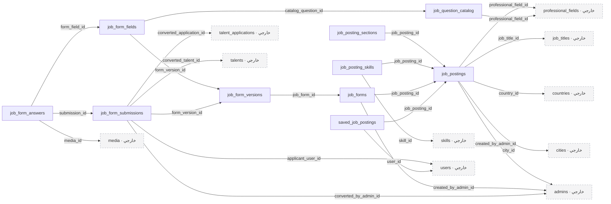

### `job_postings`

**التصنيف:** جدول جديد مقترح لتدفق ظاهر في التصميم.

الوظائف العامة المنشورة. لا يستخدم جدول jobs لأنه مخصص لطابور Laravel.

| العمود | النوع | إلزامي | القيود والملاحظات المختصرة | المرجع عند وجوده |
| --- | --- | --- | --- | --- |
| `id` | `bigint` | نعم | مفتاح أساسي؛ ترقيم تلقائي | — |
| `professional_field_id` | `bigint` | نعم | — | `professional_fields.id`؛ `RESTRICT` |
| `job_title_id` | `bigint` | لا | — | `job_titles.id`؛ `RESTRICT` |
| `title` | `varchar(255)` | نعم | — | — |
| `slug` | `varchar(255)` | نعم | فريد | — |
| `summary` | `text` | نعم | — | — |
| `about_role` | `text` | نعم | — | — |
| `work_type` | `varchar(32)` | نعم | — | — |
| `work_mode` | `varchar(32)` | نعم | — | — |
| `seniority_level` | `varchar(32)` | لا | — | — |
| `country_id` | `bigint` | لا | — | `countries.id`؛ `RESTRICT` |
| `city_id` | `bigint` | لا | — | `cities.id`؛ `RESTRICT` |
| `department` | `varchar(255)` | لا | — | — |
| `status` | `varchar(16)` | نعم | الافتراضي: `'draft'`؛ القيم: `draft, published, closed, archived` | — |
| `published_at` | `timestamp` | لا | — | — |
| `closed_at` | `timestamp` | لا | — | — |
| `created_by_admin_id` | `bigint` | نعم | — | `admins.id`؛ `RESTRICT` |
| `deleted_at` | `timestamp` | لا | — | — |
| `created_at` | `timestamp` | لا | — | — |
| `updated_at` | `timestamp` | لا | — | — |

**الفهارس والقيود المركبة:**

- فهرس بحث: `(status, professional_field_id, published_at)`.
### `job_posting_sections`

**التصنيف:** جدول جديد مقترح لتدفق ظاهر في التصميم.

قوائم المسؤوليات والمتطلبات والمؤهلات والمزايا المعروضة في الوظيفة.

| العمود | النوع | إلزامي | القيود والملاحظات المختصرة | المرجع عند وجوده |
| --- | --- | --- | --- | --- |
| `id` | `bigint` | نعم | مفتاح أساسي؛ ترقيم تلقائي | — |
| `job_posting_id` | `bigint` | نعم | — | `job_postings.id`؛ `CASCADE` |
| `section` | `varchar(32)` | نعم | القيم: `responsibility, requirement, qualification, benefit` | — |
| `content` | `text` | نعم | — | — |
| `display_order` | `smallint` | نعم | — | — |
| `created_at` | `timestamp` | لا | — | — |
| `updated_at` | `timestamp` | لا | — | — |

**الفهارس والقيود المركبة:**

- قيد تفرد: `(job_posting_id, section, display_order)`.
### `job_posting_skills`

**التصنيف:** جدول جديد مقترح لتدفق ظاهر في التصميم.

مهارات الوظيفة المستخدمة في العرض والبحث.

| العمود | النوع | إلزامي | القيود والملاحظات المختصرة | المرجع عند وجوده |
| --- | --- | --- | --- | --- |
| `job_posting_id` | `bigint` | نعم | — | `job_postings.id`؛ `CASCADE` |
| `skill_id` | `bigint` | نعم | — | `skills.id`؛ `RESTRICT` |

**الفهارس والقيود المركبة:**

- مفتاح أساسي مركب: `(job_posting_id, skill_id)`.
### `job_question_catalog`

**التصنيف:** جدول جديد مقترح لتدفق ظاهر في التصميم.

كتالوج الأسئلة الجاهزة التي يختار منها الأدمن عند تكوين نموذج الوظيفة.

| العمود | النوع | إلزامي | القيود والملاحظات المختصرة | المرجع عند وجوده |
| --- | --- | --- | --- | --- |
| `id` | `bigint` | نعم | مفتاح أساسي؛ ترقيم تلقائي | — |
| `key` | `varchar(100)` | نعم | فريد | — |
| `professional_field_id` | `bigint` | لا | — | `professional_fields.id`؛ `RESTRICT` |
| `label` | `varchar(255)` | نعم | — | — |
| `prompt` | `text` | لا | — | — |
| `input_type` | `varchar(32)` | نعم | القيم: `text, textarea, number, select, multiselect, url, file, date` | — |
| `validation_rules` | `json` | لا | — | — |
| `options` | `json` | لا | — | — |
| `is_active` | `boolean` | نعم | الافتراضي: `true` | — |
| `created_at` | `timestamp` | لا | — | — |
| `updated_at` | `timestamp` | لا | — | — |
### `job_forms`

**التصنيف:** جدول جديد مقترح لتدفق ظاهر في التصميم.

النموذج المرتبط بالوظيفة ورابطه العام وحالة تفعيله.

| العمود | النوع | إلزامي | القيود والملاحظات المختصرة | المرجع عند وجوده |
| --- | --- | --- | --- | --- |
| `id` | `bigint` | نعم | مفتاح أساسي؛ ترقيم تلقائي | — |
| `job_posting_id` | `bigint` | نعم | فريد | `job_postings.id`؛ `RESTRICT` |
| `title` | `varchar(255)` | نعم | — | — |
| `description` | `text` | لا | — | — |
| `public_token` | `varchar(100)` | نعم | فريد | — |
| `is_active` | `boolean` | نعم | الافتراضي: `false` | — |
| `created_by_admin_id` | `bigint` | نعم | — | `admins.id`؛ `RESTRICT` |
| `deleted_at` | `timestamp` | لا | — | — |
| `created_at` | `timestamp` | لا | — | — |
| `updated_at` | `timestamp` | لا | — | — |
### `job_form_versions`

**التصنيف:** جدول جديد مقترح لتدفق ظاهر في التصميم.

إصدارات ثابتة للنموذج المنشور، تحفظ الحقول التي شاهدها المتقدم وقت التقديم.

| العمود | النوع | إلزامي | القيود والملاحظات المختصرة | المرجع عند وجوده |
| --- | --- | --- | --- | --- |
| `id` | `bigint` | نعم | مفتاح أساسي؛ ترقيم تلقائي | — |
| `job_form_id` | `bigint` | نعم | — | `job_forms.id`؛ `RESTRICT` |
| `version_number` | `int` | نعم | — | — |
| `status` | `varchar(16)` | نعم | القيم: `draft, published, retired` | — |
| `identity_fields_snapshot` | `json` | نعم | — | — |
| `published_at` | `timestamp` | لا | — | — |
| `created_at` | `timestamp` | لا | — | — |
| `updated_at` | `timestamp` | لا | — | — |

**الفهارس والقيود المركبة:**

- قيد تفرد: `(job_form_id, version_number)`.
### `job_form_fields`

**التصنيف:** جدول جديد مقترح لتدفق ظاهر في التصميم.

الأسئلة الإضافية المختارة وترتيبها وقواعدها وخياراتها المنسوخة من الكتالوج.

| العمود | النوع | إلزامي | القيود والملاحظات المختصرة | المرجع عند وجوده |
| --- | --- | --- | --- | --- |
| `id` | `bigint` | نعم | مفتاح أساسي؛ ترقيم تلقائي | — |
| `form_version_id` | `bigint` | نعم | — | `job_form_versions.id`؛ `RESTRICT` |
| `catalog_question_id` | `bigint` | نعم | — | `job_question_catalog.id`؛ `RESTRICT` |
| `field_key` | `varchar(100)` | نعم | — | — |
| `label` | `varchar(255)` | نعم | — | — |
| `prompt` | `text` | لا | — | — |
| `input_type` | `varchar(32)` | نعم | — | — |
| `is_required` | `boolean` | نعم | الافتراضي: `false` | — |
| `validation_rules` | `json` | لا | — | — |
| `options` | `json` | لا | — | — |
| `display_order` | `smallint` | نعم | — | — |
| `created_at` | `timestamp` | لا | — | — |
| `updated_at` | `timestamp` | لا | — | — |

**الفهارس والقيود المركبة:**

- قيد تفرد: `(form_version_id, field_key)`.
- قيد تفرد: `(form_version_id, display_order)`.
### `job_form_submissions`

**التصنيف:** جدول جديد مقترح لتدفق ظاهر في التصميم.

طلبات التقديم العامة، بما فيها تقديم الزوار، مع حقول الهوية الأربعة ومرجع التحويل الاختياري.

| العمود | النوع | إلزامي | القيود والملاحظات المختصرة | المرجع عند وجوده |
| --- | --- | --- | --- | --- |
| `id` | `bigint` | نعم | مفتاح أساسي؛ ترقيم تلقائي | — |
| `form_version_id` | `bigint` | نعم | — | `job_form_versions.id`؛ `RESTRICT` |
| `applicant_user_id` | `bigint` | لا | — | `users.id`؛ `RESTRICT` |
| `applicant_name` | `varchar(255)` | نعم | — | — |
| `email` | `varchar(255)` | نعم | — | — |
| `mobile_number` | `varchar(32)` | نعم | — | — |
| `job_title_snapshot` | `varchar(255)` | نعم | — | — |
| `status` | `varchar(32)` | نعم | الافتراضي: `'received'`؛ القيم: `received, reviewed, converted, archived` | — |
| `submission_key` | `uuid` | نعم | فريد | — |
| `consent_at` | `timestamp` | نعم | — | — |
| `submitted_at` | `timestamp` | نعم | — | — |
| `converted_talent_id` | `bigint` | لا | — | `talents.id`؛ `RESTRICT` |
| `converted_application_id` | `bigint` | لا | — | `talent_applications.id`؛ `RESTRICT` |
| `converted_by_admin_id` | `bigint` | لا | — | `admins.id`؛ `RESTRICT` |
| `converted_at` | `timestamp` | لا | — | — |
| `created_at` | `timestamp` | لا | — | — |
| `updated_at` | `timestamp` | لا | — | — |

**الفهارس والقيود المركبة:**

- فهرس بحث: `(form_version_id, submitted_at)`.
- فهرس بحث: `email`.
### `job_form_answers`

**التصنيف:** جدول جديد مقترح لتدفق ظاهر في التصميم.

إجابات المتقدم على أسئلة إصدار النموذج، مع مرجع الملف للأسئلة التي تتطلب رفعًا.

| العمود | النوع | إلزامي | القيود والملاحظات المختصرة | المرجع عند وجوده |
| --- | --- | --- | --- | --- |
| `id` | `bigint` | نعم | مفتاح أساسي؛ ترقيم تلقائي | — |
| `submission_id` | `bigint` | نعم | — | `job_form_submissions.id`؛ `RESTRICT` |
| `form_field_id` | `bigint` | نعم | — | `job_form_fields.id`؛ `RESTRICT` |
| `value` | `json` | لا | — | — |
| `media_id` | `bigint` | لا | — | `media.id`؛ `RESTRICT` |
| `created_at` | `timestamp` | لا | — | — |
| `updated_at` | `timestamp` | لا | — | — |

**الفهارس والقيود المركبة:**

- قيد تفرد: `(submission_id, form_field_id)`.
### `saved_job_postings`

**التصنيف:** اقتراح يحتاج اعتماد تفاصيله.

الوظائف المحفوظة للمستخدم؛ طريقة التعامل مع الزائر تحتاج اعتمادًا.

| العمود | النوع | إلزامي | القيود والملاحظات المختصرة | المرجع عند وجوده |
| --- | --- | --- | --- | --- |
| `user_id` | `bigint` | نعم | — | `users.id`؛ `CASCADE` |
| `job_posting_id` | `bigint` | نعم | — | `job_postings.id`؛ `CASCADE` |
| `created_at` | `timestamp` | لا | — | — |
| `updated_at` | `timestamp` | لا | — | — |

**الفهارس والقيود المركبة:**

- مفتاح أساسي مركب: `(user_id, job_posting_id)`.

<a id="module-finance"></a>

## المدفوعات والعملات

تضم هذه المجموعة 11 جدولًا.

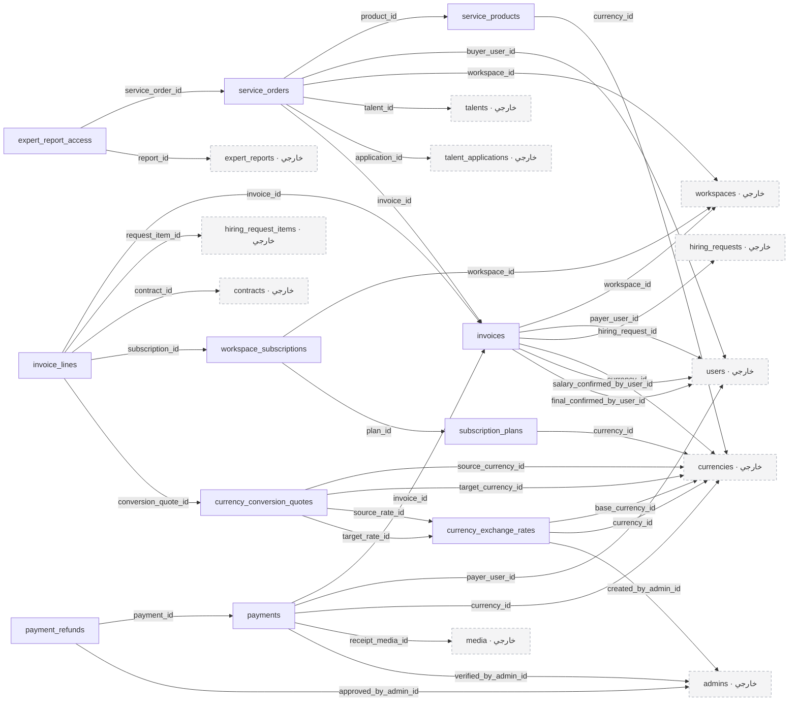

### `currency_exchange_rates`

**التصنيف:** جدول جديد مقترح لتدفق ظاهر في التصميم.

أسعار صرف تاريخية مقابل عملة أساس، دون تعديل الأسعار القديمة.

| العمود | النوع | إلزامي | القيود والملاحظات المختصرة | المرجع عند وجوده |
| --- | --- | --- | --- | --- |
| `id` | `bigint` | نعم | مفتاح أساسي؛ ترقيم تلقائي | — |
| `base_currency_id` | `bigint` | نعم | — | `currencies.id`؛ `RESTRICT` |
| `currency_id` | `bigint` | نعم | — | `currencies.id`؛ `RESTRICT` |
| `rate_to_base` | `decimal(24,12)` | نعم | — | — |
| `source` | `varchar(64)` | نعم | — | — |
| `effective_at` | `timestamp` | نعم | — | — |
| `fetched_at` | `timestamp` | نعم | — | — |
| `created_by_admin_id` | `bigint` | لا | — | `admins.id`؛ `RESTRICT` |

**الفهارس والقيود المركبة:**

- قيد تفرد: `(base_currency_id, currency_id, effective_at)`.
### `currency_conversion_quotes`

**التصنيف:** جدول جديد مقترح لتدفق ظاهر في التصميم.

نسخة عرض التحويل: المبلغ الأصلي والناتج والمعدلات المستخدمة وقت التحويل.

| العمود | النوع | إلزامي | القيود والملاحظات المختصرة | المرجع عند وجوده |
| --- | --- | --- | --- | --- |
| `id` | `bigint` | نعم | مفتاح أساسي؛ ترقيم تلقائي | — |
| `source_currency_id` | `bigint` | نعم | — | `currencies.id`؛ `RESTRICT` |
| `target_currency_id` | `bigint` | نعم | — | `currencies.id`؛ `RESTRICT` |
| `source_rate_id` | `bigint` | نعم | — | `currency_exchange_rates.id`؛ `RESTRICT` |
| `target_rate_id` | `bigint` | نعم | — | `currency_exchange_rates.id`؛ `RESTRICT` |
| `effective_rate` | `decimal(24,12)` | نعم | — | — |
| `original_amount` | `decimal(18,4)` | نعم | — | — |
| `converted_amount` | `decimal(18,4)` | نعم | — | — |
| `quoted_at` | `timestamp` | نعم | — | — |
| `expires_at` | `timestamp` | لا | — | — |
### `invoices`

**التصنيف:** جدول جديد مقترح لتدفق ظاهر في التصميم.

الفاتورة أو دفعة الدفع، مع فصل تأكيد الرواتب عن تأكيد الرسوم والإجمالي والسداد.

| العمود | النوع | إلزامي | القيود والملاحظات المختصرة | المرجع عند وجوده |
| --- | --- | --- | --- | --- |
| `id` | `bigint` | نعم | مفتاح أساسي؛ ترقيم تلقائي | — |
| `reference` | `varchar(32)` | نعم | فريد | — |
| `workspace_id` | `bigint` | لا | — | `workspaces.id`؛ `RESTRICT` |
| `payer_user_id` | `bigint` | نعم | — | `users.id`؛ `RESTRICT` |
| `hiring_request_id` | `bigint` | لا | — | `hiring_requests.id`؛ `RESTRICT` |
| `currency_id` | `bigint` | نعم | — | `currencies.id`؛ `RESTRICT` |
| `status` | `varchar(32)` | نعم | الافتراضي: `'draft'`؛ القيم: `draft, pending_fees, issued, partially_paid, paid, void, refunded` | — |
| `fee_status` | `varchar(16)` | نعم | الافتراضي: `'pending'`؛ القيم: `pending, confirmed, not_applicable` | — |
| `salary_subtotal` | `decimal(18,4)` | نعم | الافتراضي: `0` | — |
| `subtotal` | `decimal(18,4)` | لا | — | — |
| `fees_total` | `decimal(18,4)` | لا | — | — |
| `tax_total` | `decimal(18,4)` | لا | — | — |
| `total_due` | `decimal(18,4)` | لا | — | — |
| `salary_confirmed_by_user_id` | `bigint` | لا | — | `users.id`؛ `RESTRICT` |
| `salary_confirmed_at` | `timestamp` | لا | — | — |
| `final_confirmed_by_user_id` | `bigint` | لا | — | `users.id`؛ `RESTRICT` |
| `final_confirmed_at` | `timestamp` | لا | — | — |
| `issued_at` | `timestamp` | لا | — | — |
| `due_at` | `timestamp` | لا | — | — |
| `paid_at` | `timestamp` | لا | — | — |
| `period_start` | `date` | لا | — | — |
| `period_end` | `date` | لا | — | — |
| `created_at` | `timestamp` | لا | — | — |
| `updated_at` | `timestamp` | لا | — | — |

**الفهارس والقيود المركبة:**

- فهرس بحث: `(workspace_id, status, created_at)`.
- فهرس بحث: `(payer_user_id, created_at)`.
### `invoice_lines`

**التصنيف:** جدول جديد مقترح لتدفق ظاهر في التصميم.

بنود الرواتب والرسوم والخدمات. راتب التوظيف المباشر قد يكون مرجعًا معلوماتيًا لا مبلغًا مستحقًا لقادر.

| العمود | النوع | إلزامي | القيود والملاحظات المختصرة | المرجع عند وجوده |
| --- | --- | --- | --- | --- |
| `id` | `bigint` | نعم | مفتاح أساسي؛ ترقيم تلقائي | — |
| `invoice_id` | `bigint` | نعم | — | `invoices.id`؛ `RESTRICT` |
| `request_item_id` | `bigint` | لا | — | `hiring_request_items.id`؛ `RESTRICT` |
| `contract_id` | `bigint` | لا | — | `contracts.id`؛ `RESTRICT` |
| `subscription_id` | `bigint` | لا | — | `workspace_subscriptions.id`؛ `RESTRICT` |
| `line_type` | `varchar(32)` | نعم | القيم: `managed_salary, salary_reference, management_fee, placement_fee, subscription, premium_service, tax, adjustment` | — |
| `description` | `varchar(255)` | نعم | — | — |
| `quantity` | `decimal(12,4)` | نعم | الافتراضي: `1` | — |
| `unit_amount` | `decimal(18,4)` | لا | — | — |
| `line_total` | `decimal(18,4)` | لا | — | — |
| `included_in_total` | `boolean` | نعم | الافتراضي: `true` | — |
| `pricing_snapshot` | `json` | لا | — | — |
| `conversion_quote_id` | `bigint` | لا | — | `currency_conversion_quotes.id`؛ `RESTRICT` |
| `display_order` | `smallint` | نعم | — | — |
| `created_at` | `timestamp` | لا | — | — |
| `updated_at` | `timestamp` | لا | — | — |

**الفهارس والقيود المركبة:**

- قيد تفرد: `(invoice_id, display_order)`.
### `payments`

**التصنيف:** جدول جديد مقترح لتدفق ظاهر في التصميم.

محاولات الدفع والتحويلات البنكية والإيصالات وقرار التحقق منها. رفع الإيصال لا يثبت السداد.

| العمود | النوع | إلزامي | القيود والملاحظات المختصرة | المرجع عند وجوده |
| --- | --- | --- | --- | --- |
| `id` | `bigint` | نعم | مفتاح أساسي؛ ترقيم تلقائي | — |
| `invoice_id` | `bigint` | نعم | — | `invoices.id`؛ `RESTRICT` |
| `payer_user_id` | `bigint` | نعم | — | `users.id`؛ `RESTRICT` |
| `currency_id` | `bigint` | نعم | — | `currencies.id`؛ `RESTRICT` |
| `amount` | `decimal(18,4)` | نعم | — | — |
| `method` | `varchar(32)` | نعم | القيم: `bank_transfer, gateway` | — |
| `status` | `varchar(32)` | نعم | الافتراضي: `'pending'`؛ القيم: `pending, receipt_submitted, under_review, succeeded, rejected, failed, partially_refunded, refunded` | — |
| `idempotency_key` | `uuid` | نعم | فريد | — |
| `provider` | `varchar(64)` | لا | — | — |
| `provider_reference` | `varchar(255)` | لا | — | — |
| `bank_details_snapshot` | `json` | لا | — | — |
| `receipt_media_id` | `bigint` | لا | — | `media.id`؛ `RESTRICT` |
| `submitted_at` | `timestamp` | لا | — | — |
| `verified_by_admin_id` | `bigint` | لا | — | `admins.id`؛ `RESTRICT` |
| `verified_at` | `timestamp` | لا | — | — |
| `verification_note` | `text` | لا | — | — |
| `created_at` | `timestamp` | لا | — | — |
| `updated_at` | `timestamp` | لا | — | — |

**الفهارس والقيود المركبة:**

- قيد تفرد: `(provider, provider_reference)`.
- فهرس بحث: `(invoice_id, status)`.
### `payment_refunds`

**التصنيف:** اقتراح يحتاج اعتماد تفاصيله.

رد المدفوعات إذا تم اعتماد سياسة الاسترداد والضمان.

| العمود | النوع | إلزامي | القيود والملاحظات المختصرة | المرجع عند وجوده |
| --- | --- | --- | --- | --- |
| `id` | `bigint` | نعم | مفتاح أساسي؛ ترقيم تلقائي | — |
| `payment_id` | `bigint` | نعم | — | `payments.id`؛ `RESTRICT` |
| `amount` | `decimal(18,4)` | نعم | — | — |
| `reason` | `text` | نعم | — | — |
| `status` | `varchar(16)` | نعم | القيم: `requested, approved, succeeded, failed` | — |
| `idempotency_key` | `uuid` | نعم | فريد | — |
| `approved_by_admin_id` | `bigint` | لا | — | `admins.id`؛ `RESTRICT` |
| `refunded_at` | `timestamp` | لا | — | — |
| `created_at` | `timestamp` | لا | — | — |
| `updated_at` | `timestamp` | لا | — | — |
### `service_products`

**التصنيف:** جدول جديد مقترح لتدفق ظاهر في التصميم.

كتالوج الخدمات المدفوعة للمرشح أو العميل وأسعارها ومزاياها.

| العمود | النوع | إلزامي | القيود والملاحظات المختصرة | المرجع عند وجوده |
| --- | --- | --- | --- | --- |
| `id` | `bigint` | نعم | مفتاح أساسي؛ ترقيم تلقائي | — |
| `code` | `varchar(64)` | نعم | فريد | — |
| `audience` | `varchar(16)` | نعم | القيم: `talent, client` | — |
| `name` | `varchar(255)` | نعم | — | — |
| `amount` | `decimal(18,4)` | نعم | — | — |
| `currency_id` | `bigint` | نعم | — | `currencies.id`؛ `RESTRICT` |
| `benefits` | `json` | نعم | — | — |
| `is_active` | `boolean` | نعم | الافتراضي: `true` | — |
| `created_at` | `timestamp` | لا | — | — |
| `updated_at` | `timestamp` | لا | — | — |
### `service_orders`

**التصنيف:** جدول جديد مقترح لتدفق ظاهر في التصميم.

شراء خدمة مدفوعة ومتابعة تنفيذها وتسليمها، مع حفظ شروط المنتج وقت الشراء.

| العمود | النوع | إلزامي | القيود والملاحظات المختصرة | المرجع عند وجوده |
| --- | --- | --- | --- | --- |
| `id` | `bigint` | نعم | مفتاح أساسي؛ ترقيم تلقائي | — |
| `product_id` | `bigint` | نعم | — | `service_products.id`؛ `RESTRICT` |
| `buyer_user_id` | `bigint` | نعم | — | `users.id`؛ `RESTRICT` |
| `workspace_id` | `bigint` | لا | — | `workspaces.id`؛ `RESTRICT` |
| `talent_id` | `bigint` | نعم | — | `talents.id`؛ `RESTRICT` |
| `application_id` | `bigint` | نعم | — | `talent_applications.id`؛ `RESTRICT` |
| `invoice_id` | `bigint` | نعم | فريد | `invoices.id`؛ `RESTRICT` |
| `product_snapshot` | `json` | نعم | — | — |
| `status` | `varchar(32)` | نعم | القيم: `awaiting_payment, paid, in_progress, fulfilled, cancelled, refunded` | — |
| `fulfillment_due_at` | `timestamp` | لا | — | — |
| `fulfilled_at` | `timestamp` | لا | — | — |
| `created_at` | `timestamp` | لا | — | — |
| `updated_at` | `timestamp` | لا | — | — |

**الفهارس والقيود المركبة:**

- فهرس بحث: `(workspace_id, talent_id, status)`.
- فهرس بحث: `(buyer_user_id, status)`.
### `expert_report_access`

**التصنيف:** جدول جديد مقترح لتدفق ظاهر في التصميم.

صلاحية قراءة التقرير التي تمنح بعد تحقق الدفع والنشر، مع إمكانية الإلغاء وفق السياسة.

| العمود | النوع | إلزامي | القيود والملاحظات المختصرة | المرجع عند وجوده |
| --- | --- | --- | --- | --- |
| `id` | `bigint` | نعم | مفتاح أساسي؛ ترقيم تلقائي | — |
| `service_order_id` | `bigint` | نعم | — | `service_orders.id`؛ `RESTRICT` |
| `report_id` | `bigint` | نعم | — | `expert_reports.id`؛ `RESTRICT` |
| `granted_at` | `timestamp` | نعم | — | — |
| `expires_at` | `timestamp` | لا | — | — |
| `revoked_at` | `timestamp` | لا | — | — |
| `created_at` | `timestamp` | لا | — | — |
| `updated_at` | `timestamp` | لا | — | — |

**الفهارس والقيود المركبة:**

- قيد تفرد: `(service_order_id, report_id)`.
### `subscription_plans`

**التصنيف:** مذكور في وثائق البيزنس وتفاصيل الواجهة غير مؤكدة.

باقات اشتراك الوصول المذكورة بالوثائق؛ لا تزال تفاصيل واجهتها وسياساتها غير مؤكدة.

| العمود | النوع | إلزامي | القيود والملاحظات المختصرة | المرجع عند وجوده |
| --- | --- | --- | --- | --- |
| `id` | `bigint` | نعم | مفتاح أساسي؛ ترقيم تلقائي | — |
| `code` | `varchar(64)` | نعم | فريد | — |
| `name` | `varchar(255)` | نعم | — | — |
| `amount` | `decimal(18,4)` | نعم | — | — |
| `currency_id` | `bigint` | نعم | — | `currencies.id`؛ `RESTRICT` |
| `interval_unit` | `varchar(16)` | نعم | — | — |
| `interval_count` | `smallint` | نعم | — | — |
| `entitlements` | `json` | نعم | — | — |
| `is_active` | `boolean` | نعم | الافتراضي: `true` | — |
| `created_at` | `timestamp` | لا | — | — |
| `updated_at` | `timestamp` | لا | — | — |
### `workspace_subscriptions`

**التصنيف:** مذكور في وثائق البيزنس وتفاصيل الواجهة غير مؤكدة.

اشتراكات مساحة العمل ومددها ونسخة المزايا المدفوعة.

| العمود | النوع | إلزامي | القيود والملاحظات المختصرة | المرجع عند وجوده |
| --- | --- | --- | --- | --- |
| `id` | `bigint` | نعم | مفتاح أساسي؛ ترقيم تلقائي | — |
| `workspace_id` | `bigint` | نعم | — | `workspaces.id`؛ `RESTRICT` |
| `plan_id` | `bigint` | نعم | — | `subscription_plans.id`؛ `RESTRICT` |
| `status` | `varchar(16)` | نعم | القيم: `pending, active, expired, cancelled` | — |
| `plan_snapshot` | `json` | نعم | — | — |
| `starts_at` | `timestamp` | نعم | — | — |
| `ends_at` | `timestamp` | نعم | — | — |
| `cancelled_at` | `timestamp` | لا | — | — |
| `created_at` | `timestamp` | لا | — | — |
| `updated_at` | `timestamp` | لا | — | — |

**الفهارس والقيود المركبة:**

- فهرس بحث: `(workspace_id, status, ends_at)`.

<a id="module-contracts"></a>

## العقود والتوظيف الفعلي

تضم هذه المجموعة 4 جدولًا.

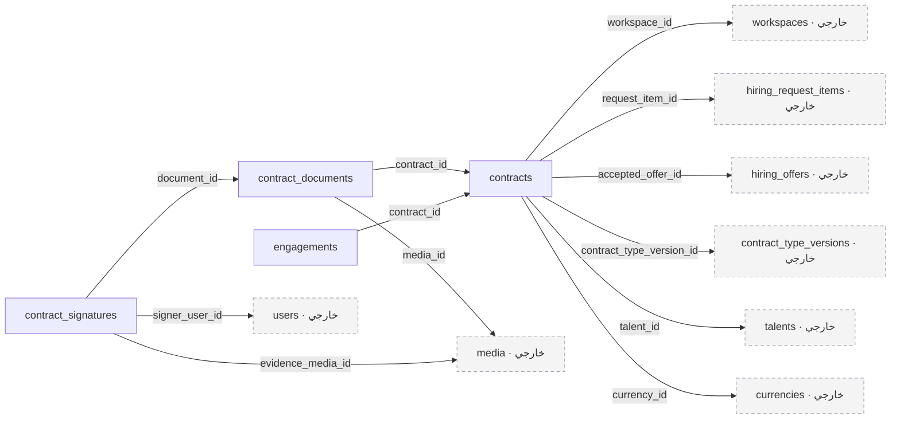

### `contracts`

**التصنيف:** جدول جديد مقترح لتدفق ظاهر في التصميم.

العقد الناتج عن عنصر توظيف ناجح، مع نسخة ثابتة من العرض المقبول وشروطه المالية والتشغيلية.

| العمود | النوع | إلزامي | القيود والملاحظات المختصرة | المرجع عند وجوده |
| --- | --- | --- | --- | --- |
| `id` | `bigint` | نعم | مفتاح أساسي؛ ترقيم تلقائي | — |
| `reference` | `varchar(32)` | نعم | فريد | — |
| `workspace_id` | `bigint` | نعم | — | `workspaces.id`؛ `RESTRICT` |
| `request_item_id` | `bigint` | نعم | فريد | `hiring_request_items.id`؛ `RESTRICT` |
| `accepted_offer_id` | `bigint` | نعم | — | `hiring_offers.id`؛ `RESTRICT` |
| `contract_type_version_id` | `bigint` | نعم | — | `contract_type_versions.id`؛ `RESTRICT` |
| `talent_id` | `bigint` | نعم | — | `talents.id`؛ `RESTRICT` |
| `status` | `varchar(32)` | نعم | القيم: `draft, awaiting_signatures, signed, active, completed, terminated, cancelled` | — |
| `final_salary` | `decimal(18,4)` | نعم | — | — |
| `currency_id` | `bigint` | نعم | — | `currencies.id`؛ `RESTRICT` |
| `salary_period` | `varchar(16)` | نعم | الافتراضي: `'month'` | — |
| `terms_snapshot` | `json` | نعم | — | — |
| `start_date` | `date` | نعم | — | — |
| `end_date` | `date` | لا | — | — |
| `executed_at` | `timestamp` | لا | — | — |
| `terminated_at` | `timestamp` | لا | — | — |
| `termination_reason` | `text` | لا | — | — |
| `created_at` | `timestamp` | لا | — | — |
| `updated_at` | `timestamp` | لا | — | — |

**الفهارس والقيود المركبة:**

- فهرس بحث: `(workspace_id, status, start_date)`.
- فهرس بحث: `(talent_id, status)`.
### `contract_documents`

**التصنيف:** جدول جديد مقترح لتدفق ظاهر في التصميم.

المستندات الخاصة بالعقد وإصداراتها وبصمة كل ملف.

| العمود | النوع | إلزامي | القيود والملاحظات المختصرة | المرجع عند وجوده |
| --- | --- | --- | --- | --- |
| `id` | `bigint` | نعم | مفتاح أساسي؛ ترقيم تلقائي | — |
| `contract_id` | `bigint` | نعم | — | `contracts.id`؛ `RESTRICT` |
| `document_type` | `varchar(16)` | نعم | القيم: `company, talent, amendment` | — |
| `version_number` | `int` | نعم | — | — |
| `media_id` | `bigint` | نعم | — | `media.id`؛ `RESTRICT` |
| `sha256` | `char(64)` | نعم | — | — |
| `status` | `varchar(16)` | نعم | القيم: `draft, issued, executed, superseded` | — |
| `issued_at` | `timestamp` | لا | — | — |
| `created_at` | `timestamp` | لا | — | — |
| `updated_at` | `timestamp` | لا | — | — |

**الفهارس والقيود المركبة:**

- قيد تفرد: `(contract_id, document_type, version_number)`.
### `contract_signatures`

**التصنيف:** جدول جديد مقترح لتدفق ظاهر في التصميم.

توقيع أو إقرار كل طرف على إصدار مستند محدد، مع دليل التوقيع.

| العمود | النوع | إلزامي | القيود والملاحظات المختصرة | المرجع عند وجوده |
| --- | --- | --- | --- | --- |
| `id` | `bigint` | نعم | مفتاح أساسي؛ ترقيم تلقائي | — |
| `document_id` | `bigint` | نعم | — | `contract_documents.id`؛ `RESTRICT` |
| `signer_user_id` | `bigint` | نعم | — | `users.id`؛ `RESTRICT` |
| `party` | `varchar(16)` | نعم | القيم: `qader, client, talent` | — |
| `status` | `varchar(16)` | نعم | القيم: `pending, signed, declined` | — |
| `signed_at` | `timestamp` | لا | — | — |
| `signature_method` | `varchar(32)` | لا | — | — |
| `evidence_media_id` | `bigint` | لا | — | `media.id`؛ `RESTRICT` |
| `provider_reference` | `varchar(255)` | لا | — | — |
| `created_at` | `timestamp` | لا | — | — |
| `updated_at` | `timestamp` | لا | — | — |

**الفهارس والقيود المركبة:**

- قيد تفرد: `(document_id, signer_user_id, party)`.
### `engagements`

**التصنيف:** جدول جديد مقترح لتدفق ظاهر في التصميم.

التوظيف الفعلي بعد العقد: انتظار البداية أو العمل أو التعليق أو الانتهاء.

| العمود | النوع | إلزامي | القيود والملاحظات المختصرة | المرجع عند وجوده |
| --- | --- | --- | --- | --- |
| `id` | `bigint` | نعم | مفتاح أساسي؛ ترقيم تلقائي | — |
| `contract_id` | `bigint` | نعم | فريد | `contracts.id`؛ `RESTRICT` |
| `status` | `varchar(32)` | نعم | القيم: `waiting_to_start, active, on_hold, ended, cancelled` | — |
| `actual_start_date` | `date` | لا | — | — |
| `actual_end_date` | `date` | لا | — | — |
| `end_reason` | `text` | لا | — | — |
| `created_at` | `timestamp` | لا | — | — |
| `updated_at` | `timestamp` | لا | — | — |

<a id="module-postcontract"></a>

## التسليم بعد التعاقد

تضم هذه المجموعة 1 جدولًا.

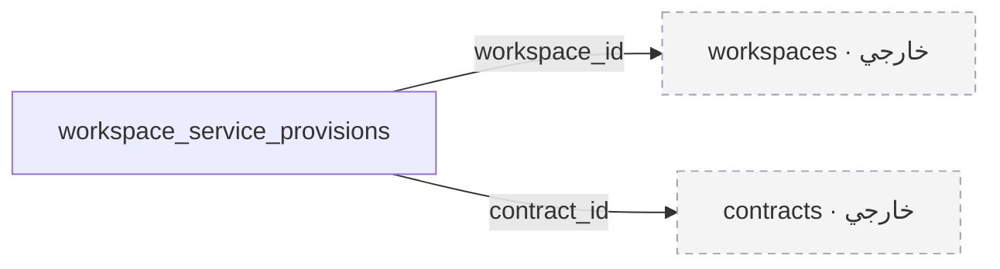

### `workspace_service_provisions`

**التصنيف:** مؤجل إلى مرحلة لاحقة.

حد تسليم مقترح لنظام إدارة العمل بعد التعاقد؛ لا يمثل نظام المشروعات والحضور نفسه.

| العمود | النوع | إلزامي | القيود والملاحظات المختصرة | المرجع عند وجوده |
| --- | --- | --- | --- | --- |
| `id` | `bigint` | نعم | مفتاح أساسي؛ ترقيم تلقائي | — |
| `workspace_id` | `bigint` | نعم | — | `workspaces.id`؛ `RESTRICT` |
| `contract_id` | `bigint` | نعم | — | `contracts.id`؛ `RESTRICT` |
| `service_code` | `varchar(64)` | نعم | — | — |
| `external_tenant_id` | `varchar(255)` | لا | — | — |
| `portal_url` | `varchar(2048)` | لا | — | — |
| `status` | `varchar(16)` | نعم | القيم: `pending, provisioning, active, suspended, failed, revoked` | — |
| `provisioned_at` | `timestamp` | لا | — | — |
| `revoked_at` | `timestamp` | لا | — | — |
| `created_at` | `timestamp` | لا | — | — |
| `updated_at` | `timestamp` | لا | — | — |

**الفهارس والقيود المركبة:**

- قيد تفرد: `(workspace_id, contract_id, service_code)`.

<a id="module-operations"></a>

## سجل العمليات والإشعارات

تضم هذه المجموعة 6 جدولًا.

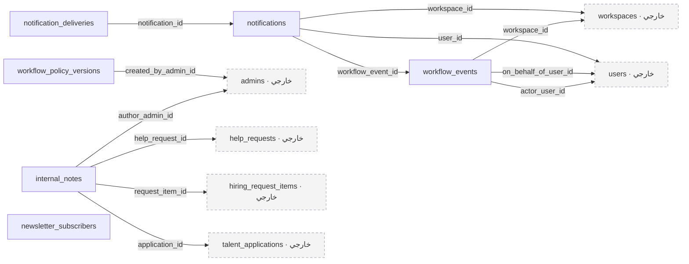

### `internal_notes`

**التصنيف:** جدول جديد مقترح لتدفق ظاهر في التصميم.

الملاحظات الداخلية على التقديم أو المساعدة أو عنصر التوظيف. لا تظهر للمستخدمين الخارجيين.

| العمود | النوع | إلزامي | القيود والملاحظات المختصرة | المرجع عند وجوده |
| --- | --- | --- | --- | --- |
| `id` | `bigint` | نعم | مفتاح أساسي؛ ترقيم تلقائي | — |
| `application_id` | `bigint` | لا | — | `talent_applications.id`؛ `RESTRICT` |
| `help_request_id` | `bigint` | لا | — | `help_requests.id`؛ `RESTRICT` |
| `request_item_id` | `bigint` | لا | — | `hiring_request_items.id`؛ `RESTRICT` |
| `author_admin_id` | `bigint` | نعم | — | `admins.id`؛ `RESTRICT` |
| `body` | `text` | نعم | — | — |
| `edited_at` | `timestamp` | لا | — | — |
| `deleted_at` | `timestamp` | لا | — | — |
| `created_at` | `timestamp` | لا | — | — |
| `updated_at` | `timestamp` | لا | — | — |

**الفهارس والقيود المركبة:**

- فهرس بحث: `(application_id, created_at)`.
- فهرس بحث: `(help_request_id, created_at)`.
- فهرس بحث: `(request_item_id, created_at)`.
### `workflow_events`

**التصنيف:** جدول جديد مقترح لتدفق ظاهر في التصميم.

سجل أعمال غير قابل للمحو الصامت، يحفظ التحولات والفاعل والأسباب والحقول المعدلة.

| العمود | النوع | إلزامي | القيود والملاحظات المختصرة | المرجع عند وجوده |
| --- | --- | --- | --- | --- |
| `id` | `bigint` | نعم | مفتاح أساسي؛ ترقيم تلقائي | — |
| `aggregate_type` | `varchar(64)` | نعم | — | — |
| `aggregate_id` | `bigint` | نعم | — | — |
| `workspace_id` | `bigint` | لا | — | `workspaces.id`؛ `RESTRICT` |
| `actor_user_id` | `bigint` | لا | — | `users.id`؛ `RESTRICT` |
| `actor_kind` | `varchar(16)` | نعم | القيم: `user, system` | — |
| `on_behalf_of_user_id` | `bigint` | لا | — | `users.id`؛ `RESTRICT` |
| `event_type` | `varchar(100)` | نعم | — | — |
| `from_status` | `varchar(32)` | لا | — | — |
| `to_status` | `varchar(32)` | لا | — | — |
| `reason` | `text` | لا | — | — |
| `changes` | `json` | لا | — | — |
| `correlation_id` | `uuid` | لا | — | — |
| `deduplication_key` | `varchar(255)` | لا | فريد | — |
| `occurred_at` | `timestamp` | نعم | — | — |

**الفهارس والقيود المركبة:**

- فهرس بحث: `(aggregate_type, aggregate_id, occurred_at)`.
- فهرس بحث: `(workspace_id, occurred_at)`.
### `notifications`

**التصنيف:** جدول جديد مقترح لتدفق ظاهر في التصميم.

إشعارات المستخدم داخل المنصة وحالة قراءتها، مع محتوى آمن حسب الصلاحية.

| العمود | النوع | إلزامي | القيود والملاحظات المختصرة | المرجع عند وجوده |
| --- | --- | --- | --- | --- |
| `id` | `bigint` | نعم | مفتاح أساسي؛ ترقيم تلقائي | — |
| `user_id` | `bigint` | نعم | — | `users.id`؛ `RESTRICT` |
| `workspace_id` | `bigint` | لا | — | `workspaces.id`؛ `RESTRICT` |
| `workflow_event_id` | `bigint` | لا | — | `workflow_events.id`؛ `RESTRICT` |
| `type` | `varchar(100)` | نعم | — | — |
| `safe_payload` | `json` | نعم | — | — |
| `read_at` | `timestamp` | لا | — | — |
| `deduplication_key` | `varchar(255)` | نعم | فريد | — |
| `created_at` | `timestamp` | لا | — | — |
| `updated_at` | `timestamp` | لا | — | — |

**الفهارس والقيود المركبة:**

- فهرس بحث: `(user_id, read_at, created_at)`.
### `notification_deliveries`

**التصنيف:** جدول جديد مقترح لتدفق ظاهر في التصميم.

توصيل الإشعار عبر القنوات المختلفة وإعادة المحاولة بعد حفظ العملية الأساسية.

| العمود | النوع | إلزامي | القيود والملاحظات المختصرة | المرجع عند وجوده |
| --- | --- | --- | --- | --- |
| `id` | `bigint` | نعم | مفتاح أساسي؛ ترقيم تلقائي | — |
| `notification_id` | `bigint` | نعم | — | `notifications.id`؛ `RESTRICT` |
| `channel` | `varchar(16)` | نعم | القيم: `database, email` | — |
| `status` | `varchar(16)` | نعم | الافتراضي: `'pending'`؛ القيم: `pending, processing, sent, failed` | — |
| `attempt_count` | `smallint` | نعم | الافتراضي: `0` | — |
| `next_attempt_at` | `timestamp` | لا | — | — |
| `sent_at` | `timestamp` | لا | — | — |
| `last_error` | `text` | لا | — | — |
| `created_at` | `timestamp` | لا | — | — |
| `updated_at` | `timestamp` | لا | — | — |

**الفهارس والقيود المركبة:**

- قيد تفرد: `(notification_id, channel)`.
- فهرس بحث: `(status, next_attempt_at)`.
### `workflow_policy_versions`

**التصنيف:** اقتراح يحتاج اعتماد تفاصيله.

إصدارات سياسات المهل والمحاولات وإعادة التقديم، بدل أرقام ثابتة موزعة في الكود.

| العمود | النوع | إلزامي | القيود والملاحظات المختصرة | المرجع عند وجوده |
| --- | --- | --- | --- | --- |
| `id` | `bigint` | نعم | مفتاح أساسي؛ ترقيم تلقائي | — |
| `key` | `varchar(100)` | نعم | — | — |
| `version_number` | `int` | نعم | — | — |
| `value` | `json` | نعم | — | — |
| `effective_at` | `timestamp` | نعم | — | — |
| `created_by_admin_id` | `bigint` | نعم | — | `admins.id`؛ `RESTRICT` |
| `created_at` | `timestamp` | لا | — | — |
| `updated_at` | `timestamp` | لا | — | — |

**الفهارس والقيود المركبة:**

- قيد تفرد: `(key, version_number)`.
### `newsletter_subscribers`

**التصنيف:** اقتراح يحتاج اعتماد تفاصيله.

اشتراك القائمة البريدية الظاهر في الصفحة العامة؛ يحتاج اعتماد سياسة التأكيد والإلغاء.

| العمود | النوع | إلزامي | القيود والملاحظات المختصرة | المرجع عند وجوده |
| --- | --- | --- | --- | --- |
| `id` | `bigint` | نعم | مفتاح أساسي؛ ترقيم تلقائي | — |
| `email` | `varchar(255)` | نعم | فريد | — |
| `status` | `varchar(16)` | نعم | القيم: `pending, subscribed, unsubscribed` | — |
| `consented_at` | `timestamp` | لا | — | — |
| `confirmed_at` | `timestamp` | لا | — | — |
| `unsubscribed_at` | `timestamp` | لا | — | — |
| `created_at` | `timestamp` | لا | — | — |
| `updated_at` | `timestamp` | لا | — | — |

## المصادر وطريقة تحديث النسخ

- [تصميم الويب في Figma](https://www.figma.com/design/Ey9gKqsJd8qx1aBMgefEQB/qader-app?node-id=629-4923).
- [متطلبات العمل](BRD-V1.pdf)، [متطلبات المنتج](PRD-V1.pdf)، [المتطلبات الوظيفية](SRS-V1.pdf).
- [تدفق التسجيل والاعتماد](Qader_Flow_01_Talent_Application_Approval.pdf).
- [تفاصيل مراجعة طلبات المواهب](Qader_Admin_Portal_Talent_Applications_Flow_Specification.pdf).
- [منهجية تقسيم البوابات](Methodology_Portals_Modules.pdf).
- [ملفات migrations الحالية](../database/migrations/) و[توثيق البنية](architecture/README.md).

أسماء الجداول والأعمدة والعلاقات هنا مولّدة من نسخة DBML، مع شرح عربي للمراجعة. لا يشغّل هذا الملف أي تغييرات على قاعدة البيانات.

لتحديث نسخة HTML بعد تعديل DBML:

```bash
python3 docs/render_schema_diagram.py
```

النسخة العربية نسخة مراجعة ثابتة؛ حدّثها أيضًا إذا تغيرت السكيما. المخطط التفاعلي وMarkdown لا يمثلان تنفيذًا للمقترح أو موافقة عليه.
