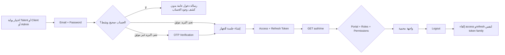
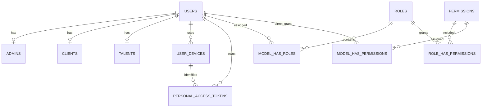

# S00 — تأسيس المشروع

الحالة: **قيد التنفيذ — الـBackend منفذ، وتكامل Web/Mobile وFirebase وفحص القبول متبقٍ**
النطاق: تسجيل الدخول والخروج والصلاحيات، وتجهيز Web وMobile وBackend وFirebase/FCM.  
عرض التسليم: تسجيل دخول حقيقي وواجهة محمية حسب البورتال والدور والصلاحيات.

> اعتمد المستخدم شكل `user_devices` وتأجيل `auth_sessions` وإرسال FCM token مع Login فقط. أضيفت migrations المركزة الخاصة بهذا القرار.

## 1. نتيجة السبرنت المطلوبة

بنهاية السبرنت يستطيع Talent أوClient إنشاء حساب والتحقق من بريده، ثم يسجل المستخدم الدخول من البورتال الصحيح ويحصل على access/refresh tokens. الواجهة لا تفتح إلا للبورتال والدور والصلاحيات المسموحة. يرسل التطبيق `fcm_token` مع Login ويحفظه الـBackend للجهاز، بدون endpoint منفصلة. عند Logout تُلغى مجموعة tokens الحالية ولا يستمر إرسال إشعارات الحساب إلى هذا الجهاز.

## 2. ما ظهر في Figma

تمت مراجعة صفحتي `Qader web` و`App` مع التركيز على عناصر المصادقة والصلاحيات.

### شاشات الويب

- تسجيل دخول منفصل للـTalent.
- تسجيل دخول منفصل للـCompany، وهو `client` في الـBackend.
- تسجيل دخول للـAdmin مع رسالة تخص إدارة talent pipeline.
- الحقول الأساسية: البريد الإلكتروني وكلمة المرور.
- رابط نسيان كلمة المرور.
- بدائل تسجيل الدخول الاجتماعي ظاهرة في التصميم تحت `Or sign in with`.
- شاشات إدخال verification code وإعادة تعيين كلمة المرور موجودة.
- زر Logout ظاهر داخل الـdashboards.
- شاشة Permissions موجودة ضمن Admin Portal، والتصميم يعرض ربط الصلاحيات بالأدوار.
- لم يظهر خيار `Remember me` كنتيجة واضحة في تصميم الويب.

### تطبيق الموبايل

- صفحة `App` تحتوي نسخًا من شاشات Sign in وتستخدم نفس رحلة المصادقة الأساسية.
- الـBackend يجب أن يبقى channel-agnostic ويخدم Web وMobile بنفس عقد الـBearer tokens.

### إنشاء الحساب في Figma

- Talent لديه شاشة `sign up as talent` لإنشاء الحساب، ثم ينتقل إلى email verification قبل onboarding.
- حقول حساب Talent هي: first name، last name، email، password، password confirmation.
- Client يظهر في التصميم باسم Company. إنشاء حسابه يخص ممثل الشركة، ثم تأتي بيانات الشركة واحتياجات التوظيف كـClient onboarding منفصل.
- حقول حساب Client في S00 تظل: first name، last name، email، password، password confirmation.
- `company_name` وCompany URL وباقي بيانات الشركة لا توضع في `users` ولا في طلب auth الحالي؛ تُراجع مع سبرنت Client profile/workspace.
- Admin لا يملك public register؛ ينشئه Owner من Admin Portal ويربطه بدور.

### الـflow الذي سنبنيه على التصميم



## 3. الموجود حاليًا في الـBackend

### موجود ويمكن البناء عليه

- `POST /api/v1/auth/{type}/login` يدعم `talent` و`client` و`admin`.
- `POST /api/v1/auth/{type}/register` متاح للـTalent والـClient فقط.
- Register يستخدم request وhandler مستقلين لكل بورتال، وينشئ `users` ومعه `talents` أو`clients` داخل transaction واحدة.
- بعد نجاح Register يُرسل OTP، ويُرجع verification token محدود الصلاحيات.
- تسجيل الخروج وتجديد الـtoken والتحقق بالبريد واستعادة كلمة المرور موجودة.
- Sanctum يصدر access وrefresh tokens بمدة صلاحية وabilities تشمل نوع الـtoken والبورتال.
- الدخول يفحص البريد داخل البورتال المطلوب، كلمة المرور، وحالة `is_active`.
- الحساب غير الموثق يُحوّل إلى verification flow بدل منحه access token كاملًا.
- Rate limiting موجود لمحاولات الدخول والخروج والتجديد والـOTP.
- مسارات Talent وAdmin محمية بـ`auth:sanctum` وportal abilities.
- RBAC الخاص بالـAdmin موجود باستخدام roles وpermissions وSpatie pivots.
- APIs عرض الصلاحيات وإدارة الأدوار وإنشاء Admin وربطه بالأدوار موجودة.
- دور `owner` محمي من التعديل والحذف، ويتم إنشاؤه مع أول Admin من أمر bootstrap.
- يوجد Notification controller لإشعارات Laravel المخزنة في قاعدة البيانات، لكنه غير مربوط حاليًا بـFirebase أوFCM ولا توجد routes مفعلة له في إعداد الموديولات.

### فجوات يجب إغلاقها في S00

1. **`api.key` مطلوب على الـroutes الحالية:** اعتمد المشروع إرسال المفتاح النشط في `X-Authorization` مع كل طلب، بالإضافة إلى Bearer token في المسارات المحمية.
2. **Logout الحالي يحذف الـtoken المستخدم فقط:** عند الخروج بالـaccess token يظل refresh token صالحًا. سنربط الزوج بـ`token_family_id` داخل `personal_access_tokens` بدل إنشاء جدول جلسات في S00.
3. **لا يوجد endpoint ثابت لاستعادة هوية الجلسة بعد reload:** يوجد `/api/user` الافتراضي ويرجع User خامًا خارج عقد V1. سنستبدله بعقد `GET /api/v1/auth/me` يرجع resource آمنًا وموحدًا.
4. **استجابة المستخدم ترجع `unassigned_permissions`:** الواجهة المحمية تحتاج الصلاحيات الممنوحة فعلًا. سنرجع `permissions` الممنوحة للأدوار مع `roles`.
5. **لا يوجد ربط بين token pair والجهاز:** سنربط access وrefresh بنفس `token_family_id` وبسجل واحد من `user_devices`.
6. **حذف Role مستخدم:** الحذف الحالي قد يفصل الدور عن Admins المرتبطين به. يجب منع حذف الدور المرتبط بمستخدمين وإرجاع خطأ business واضح.
7. **اعتماد OTP يحتاج مراجعة تشغيلية:** الكود يعتمد على package للـOTP، بينما migration الخاصة بجدول OTP غير ظاهرة ضمن migrations المشروع. سنثبت مصدر الجدول وحالته قبل اعتبار verification/reset جاهزين للتسليم.
8. **Firebase وFCM غير مجهزين:** لا توجد credentials أو Firebase Admin integration أو مكان لحفظ FCM registration المرسل مع Login.

## 4. حدود S00

### داخل السبرنت

- Register للـTalent والـClient مع OTP verification.
- Login للـTalent وClient وAdmin.
- Refresh token rotation.
- Logout حقيقي لجلسة الجهاز.
- `auth/me` لاستعادة المستخدم والأدوار والصلاحيات.
- حماية routes حسب البورتال.
- حماية Admin features حسب permissions.
- إنشاء owner الأول ومزامنة permissions بطريقة قابلة للتكرار.
- Web route guards وMobile auth state باستخدام نفس API contract.
- إعداد Firebase apps للـWeb وAndroid وiOS لكل بيئة مستخدمة.
- إرسال `fcm_token` و`platform` داخل Login وحفظهما مباشرة، بدون endpoint منفصلة.
- إرسال FCM test notification إلى جهاز محدد وإبطال registration غير الصالحة.
- حالات 401 و403 وتعطيل الحساب وانتهاء الجلسة.
- توثيق endpoints في Scribe ومصادر Apidog الثلاثة.

### خارج السبرنت

- Talent onboarding والـapplication.
- Client workspace وطلبات التوظيف.
- إدارة بيانات البورتالات غير اللازمة لعرض شاشة محمية تجريبية.
- تفعيل Google sign-in في بيئة حقيقية قبل توفير credentials المعتمدة؛ الكود الحالي يمكن الاحتفاظ به لكن لا يدخل Acceptance Criteria.
- جدول `auth_sessions` وشاشة إدارة جلسات الأجهزة و`logout all`؛ تؤجل لسبرنت مستقل عند الحاجة.
- business notification events والقوالب وموضوعات FCM العامة؛ S00 يجهز قناة الإرسال وتسجيل الأجهزة فقط.
- أي تعديل شامل للسكيما المقترحة خارج جداول الهوية والجلسات والصلاحيات.

### قرار Firebase في S00

- مصادقة Qader تظل داخل Laravel Sanctum؛ لا نستخدم Firebase Authentication بدل `users` وroles وpermissions.
- Firebase Cloud Messaging هو قناة Push فقط.
- الـBackend وحده يحتفظ بـFirebase server credentials ويستخدم Firebase Admin/HTTP v1 من بيئة موثوقة.
- Web يأخذ public VAPID key فقط ويستخدم service worker، ولا يحصل على service-account credentials.
- Android وiOS يستخدمان ملفات إعداد التطبيق الخاصة بكل بيئة، مع إعداد APNs داخل Firebase لتوصيل رسائل iOS.
- التسجيل يكون per user/device، وليس token واحدًا داخل جدول `users`.
- S00 يخزن `fcm_token` الحالي فقط بصورة بسيطة. Firebase Installation ID وإدارة registrations المتقدمة مؤجلان حتى تظهر حاجة فعلية.
- Credentials والإرسال يعملان من trusted server environment فقط وفق [متطلبات FCM للخادم](https://firebase.google.com/docs/cloud-messaging/server-environment).
- إعداد الويب يتبع [Firebase Web Messaging](https://firebase.google.com/docs/cloud-messaging/web/get-started)، بما فيه service worker وVAPID public key.

## 5. عقد الـAPI المقترح

### تسجيل الدخول

`POST /api/v1/auth/{portal}/login`

الـbody:

```json
{
  "email": "user@example.com",
  "password": "********",
  "fcm_token": "current-fcm-token",
  "platform": "web"
}
```

- `portal`: واحدة من `talent`, `client`, `admin`.
- `fcm_token`: يرسل مع Login عندما يكون متاحًا، ويظل Login ناجحًا إذا رفض المستخدم إذن الإشعارات.
- `platform`: واحدة من `web`, `ios`, `android`، وتكون مطلوبة فقط عند إرسال `fcm_token`.
- النجاح يرجع `user`, `access_token`, `refresh_token`.
- `user` يرجع `type`, `roles`, `permissions` الممنوحة فقط.
- الخطأ في البريد أو كلمة المرور أو الحساب غير النشط يرجع رسالة عامة واحدة.

### إنشاء حساب Talent

`POST /api/v1/auth/talent/register`

```json
{
  "first_name": "Ahmed",
  "last_name": "Ali",
  "email": "talent@example.com",
  "password": "********",
  "password_confirmation": "********"
}
```

- ينشئ `users.type = talent` وسجل `talents` فارغًا داخل transaction واحدة.
- لا يستقبل حقول البروفايل أوCV أوskills؛ هذه تخص onboarding.
- يرسل OTP بعد نجاح transaction ويرجع verification token فقط، بدون access كامل قبل التحقق.

### إنشاء حساب Client

`POST /api/v1/auth/client/register`

```json
{
  "first_name": "Mona",
  "last_name": "Hassan",
  "email": "client@example.com",
  "password": "********",
  "password_confirmation": "********"
}
```

- ينشئ `users.type = client` وسجل `clients` فارغًا داخل transaction واحدة.
- البيانات هنا لصاحب الحساب. اسم الشركة وبياناتها لا تضاف إلى `users` ضمن S00.
- يرسل OTP بعد نجاح transaction ويرجع verification token محدودًا.

### استعادة المستخدم الحالي

`GET /api/v1/auth/me`

- يحتاج access token.
- يرجع نفس شكل `user` الموجود في login.
- هو المصدر الذي تعتمد عليه الواجهة بعد refresh للصفحة.
- يتحقق أن portal ability داخل الـtoken يطابق `users.type`.

### تجديد الجلسة

`POST /api/v1/auth/{portal}/refresh`

- يحتاج refresh token.
- يلغي زوج الـtokens القديم داخل transaction.
- يصدر زوجًا جديدًا مرتبطًا بنفس جلسة الجهاز.
- يرفض الجلسة الملغاة أو المنتهية أو الحساب غير النشط.

### تسجيل الخروج

`DELETE /api/v1/auth/logout`

- يقبل access token.
- يحذف كل personal access tokens التي تحمل نفس `token_family_id`، وبذلك يُلغى access وrefresh معًا.
- تكرار الطلب بعد نجاحه ينتج 401 لأن الـtoken أصبح غير صالح.
- يحذف `user_devices` المرتبط بهذه token family إذا لم تعد هناك جلسة أخرى تستخدمه.

### الأدوار والصلاحيات

نحتفظ بالـAdmin endpoints الحالية:

```text
GET    /api/v1/admin/access-control/permissions
GET    /api/v1/admin/access-control/roles
POST   /api/v1/admin/access-control/roles
PUT    /api/v1/admin/access-control/roles/{role}
PATCH  /api/v1/admin/access-control/roles/{role}
DELETE /api/v1/admin/access-control/roles/{role}
```

الـTalent والـClient يستخدمان portal ability في S00. لا ننشئ custom roles لهما قبل وجود flow يطلب ذلك.

## 6. الجداول المقترحة للسبرنت

### مخطط العلاقات



### `users` — موجود ونحتفظ به

| العمود | النوع | القرار في S00 |
| --- | --- | --- |
| `id` | bigint | Primary key |
| `first_name` | varchar(100) | مطلوب |
| `last_name` | varchar(100) | مطلوب |
| `email` | varchar(255) | مطلوب |
| `email_verified_at` | timestamp nullable | حالة التحقق |
| `password` | varchar(255) | hash فقط |
| `type` | varchar(20) | `talent`, `client`, `admin` |
| `avatar` | varchar nullable | كما هو |
| `is_active` | boolean | تعطيل الحساب يمنع الدخول والتجديد |
| `last_login_at` | timestamp nullable | يتحدث بعد دخول ناجح |
| `remember_token` | varchar nullable | غير مستخدم في Bearer flow |
| timestamps | timestamps | كما هو |

القيود:

- `UNIQUE(email, type)` لأن نفس البريد يمكن أن يملك هوية مختلفة في أكثر من بورتال، والـlogin URL يحدد البورتال.
- Index على `type` موجود.
- لا نضيف status جديدًا في S00؛ `is_active` يكفي لحالة الحساب في هذا النطاق.

### `user_devices` — جدول جديد مقترح لـWeb وMobile وFCM

| العمود | النوع | القيود والغرض |
| --- | --- | --- |
| `id` | bigint | Primary key |
| `user_id` | bigint | FK إلى `users.id`, cascade on delete |
| `platform` | varchar(20) | `web`, `ios`, `android` |
| `fcm_token` | text | القيمة الحالية، تخزن encrypted at rest |
| `fcm_token_hash` | char(64) | SHA-256 للبحث ومنع التكرار دون فك القيمة |
| timestamps | timestamps | الإنشاء والتحديث |

القيود والفهارس:

- `UNIQUE(fcm_token_hash)` لمنع تكرار نفس token وربطه بحسابين.
- Index على `(user_id, platform)`.

لا يُنشأ سجل في هذا الجدول إذا لم يرسل Login قيمة `fcm_token`. عند إرسالها تكون `platform` مطلوبة معها، ويعمل الـBackend upsert باستخدام `fcm_token_hash`. لا نحفظ FCM token على `users` لأن المستخدم قد يملك عدة أجهزة، ولأن registration قد تتغير أوتنتهي. عند رد Firebase بـ`UNREGISTERED` أوinvalid registration مؤكدة، يُحذف السجل ولا تعاد المحاولة عليه.

### `personal_access_tokens` — موجود مع تعديل مقترح

نحتفظ بأعمدة Sanctum الحالية، ونضيف:

| العمود | النوع | القيود والغرض |
| --- | --- | --- |
| `token_family_id` | uuid nullable أثناء الترحيل | نفس القيمة للـaccess والـrefresh الصادرين معًا |
| `user_device_id` | bigint nullable | FK إلى `user_devices.id`, null on delete |

بعد إلغاء الرموز القديمة يصبح `token_family_id` مطلوبًا للـaccess والـrefresh الجديدة. نوع الـtoken والبورتال يظلان داخل `abilities`، لذلك لا نكرر أعمدة إضافية لهما.

### جداول الصلاحيات — موجودة ونحتفظ بها

#### `permissions`

- `id`, `name`, `guard_name`, `portal`, timestamps.
- القيد `UNIQUE(name, guard_name, portal)`.
- أسماء الصلاحيات machine-readable مثل `admin.admins.view`.

#### `roles`

- `id`, `name`, `guard_name`, `portal`, timestamps.
- القيد `UNIQUE(name, guard_name, portal)`.
- `owner` دور system محجوز وغير قابل للتعديل أو الحذف من الـAPI.

#### الجداول الوسيطة

- `model_has_roles`: ربط المستخدم بالأدوار.
- `role_has_permissions`: ربط الدور بالصلاحيات.
- `model_has_permissions`: يبقى لدعم المنح المباشر، لكن S00 يعتمد role-based grants ولا يضيف UI للمنح المباشر.

لا نحتاج `role_translations` في S00؛ اسم الدور يدخله الـAdmin، أما labels الخاصة بالصلاحيات فتأتي من ملفات الترجمة بناءً على enum ثابت.

### جداول موجودة لا تدخل في تعديل S00

- `admins`, `clients`, `talents`: علاقات 1:1 مع `users` وتبقى كما هي في جزء المصادقة.
- `social_accounts`: يبقى كما هو، وتفعيله الفعلي مؤجل للـcredentials.
- `password_reset_tokens`: لا نعتمد عليه في OTP flow الحالي ولا نعدله ضمن السبرنت.
- `sessions`: جدول Laravel cookie sessions، ولا يستخدمه Bearer-token flow للويب والموبايل.
- `api_keys` وسجلاتها: تستخدم للتحقق من `X-Authorization` المطلوب على الـAPI الحالية.

### مواءمة جداول الإشعارات المقترحة لاحقًا

عند تنفيذ notification module الكامل، يتغير `notification_deliveries.channel` إلى `database`, `email`, `fcm`، ويضاف `user_device_id` للـFCM deliveries. لا ننشئ هذه الجداول في S00 لأن business notification events ليست ضمن نطاقه.

## 7. خطة التنفيذ

### المرحلة A — تثبيت عقد المصادقة

1. اعتماد request/response الخاص بـregister وlogin وrefresh وlogout وme.
2. تحديد TTL للـaccess والـrefresh والحد الأقصى للجلسة من config.
3. إضافة `fcm_token` و`platform` إلى Login فقط، بدون endpoint مزامنة منفصل في S00.
4. تثبيت الفرق بين Client account registration وClient company onboarding.
5. توحيد 401 و403 ورسائل الحساب غير النشط وانتهاء الـtoken.

### المرحلة B — السكيما بعد اعتمادها

1. إنشاء migration مركزة لـ`user_devices` فقط.
2. إضافة `token_family_id` و`user_device_id` إلى `personal_access_tokens`.
3. تحديد سياسة الرموز القديمة عند النشر: إلغاؤها أو backfill محدود.
4. عدم إنشاء `notifications` أو`notification_deliveries` قبل سبرنت الإشعارات.
5. عدم تعديل أي جدول business خارج نطاق S00.

### المرحلة C — Backend

1. تعديل `TokenIssuer` ليصدر token pair بنفس `token_family_id` ويربطه بـ`user_device_id`.
2. جعل refresh rotation عملية ذرية داخل transaction.
3. جعل logout يلغي جلسة الجهاز بالكامل.
4. إضافة `GET /api/v1/auth/me` وحذف route `/api/user` الافتراضي.
5. إرجاع `permissions` الممنوحة بدل `unassigned_permissions`.
6. التحقق من تطابق `user.type`, route portal, token portal ability.
7. تفعيل `api.key` على user-facing routes وتوثيق `X-Authorization` في ملفات OpenAPI وPostman.
8. منع حذف role مرتبط بمستخدمين.
9. تثبيت وتشغيل dependency/migration الخاصة بالـOTP دون اختراع جدول بديل.
10. إضافة `fcm_token` و`platform` لقواعد Login وعمل upsert في `user_devices` بعد نجاح الدخول فقط.
11. إضافة Firebase config وPush provider خلف interface مستقل، مع Queue للإرسال وHTTP v1 credentials من secrets.
12. معالجة invalid registrations بحذف device token غير الصالح.
13. إضافة أمر محلي لإرسال FCM test notification دون إنشاء business event وهمي.
14. تحديث Scribe وأسماء وطلبات endpoints في مصادر Apidog الثلاثة.

### المرحلة D — Web

1. ربط صفحات Talent وCompany وAdmin بالـportal login endpoint الصحيح.
2. حفظ auth state في طبقة واحدة واستدعاء `auth/me` عند تشغيل التطبيق.
3. حماية routes أولًا بالبورتال ثم بالصلاحية المطلوبة.
4. استخدام `permissions` لإخفاء الأفعال غير المسموحة، مع بقاء الـBackend هو صاحب القرار النهائي.
5. عند 401: محاولة refresh واحدة فقط، ثم إعادة المستخدم إلى Sign in عند الفشل.
6. Logout يمسح حالة العميل بعد نجاح إلغاء الجلسة أو بعد تأكد أن الـtoken غير صالح.
7. إرسال `X-Authorization` في كل طلب بالقيمة المخصصة لبيئة التشغيل.
8. إعداد Firebase Web Messaging وservice worker وVAPID public key، ثم إرسال `fcm_token` داخل Login عندما يكون متاحًا.

### المرحلة E — Mobile

1. استخدام نفس login/refresh/me/logout contract.
2. تخزين الرموز في secure storage الخاص بالنظام، وليس تخزينًا نصيًا عاديًا.
3. إرسال `platform=ios|android` و`fcm_token` داخل Login.
4. تنفيذ single-flight refresh حتى لا ترسل عدة refresh requests متزامنة.
5. مسح الجلسة المحلية والعودة إلى Sign in عند logout أو refresh failure.
6. إعداد Firebase app لكل platform، وتحديث `fcm_token` عند تسجيل الدخول التالي إذا تغير.
7. ربط APNs بمشروع Firebase لتوصيل iOS Push وعدم وضع Firebase server credentials داخل التطبيق.

### المرحلة F — فحص عرض التسليم

1. Admin owner يسجل الدخول ويرى واجهة Admin المحمية.
2. Admin بدور محدود لا يرى ولا ينفذ action بلا permission.
3. Talent token لا يفتح Client أوAdmin routes، والعكس.
4. تعطيل المستخدم يمنع login وrefresh.
5. refresh token يُدوّر مرة واحدة ولا يقبل reuse.
6. logout يلغي access وrefresh لنفس الجهاز.
7. الجلسة على جهاز آخر تظل فعالة.
8. reload على Web وrestart على Mobile يستعيدان المستخدم من `auth/me`.
9. Register ينشئ User وprofile الصحيح ويرسل OTP لكل من Talent وClient.
10. جهاز أرسل `fcm_token` مع Login يستقبل رسالة اختبار.
11. الجهاز الذي سجل Logout لا يستقبل رسائل عبر registration القديمة.

لن نضيف اختبارات آلية ضمن التنفيذ إلا إذا طلب المستخدم ذلك؛ يتم توثيق فحص runtime مركز لكل بند في عرض التسليم.

## 8. ترتيب التنفيذ المقترح

1. مراجعة واعتماد هذه الخطة وشكل `user_devices` وتعديلات `personal_access_tokens`.
2. تحديث السكيما المقترحة DBML فقط لتعكس القرار المعتمد.
3. تجهيز Firebase projects/apps وsecrets لكل بيئة.
4. إنشاء migrations الخاصة بـS00 بعد الاعتماد.
5. إصلاح Backend contract والـtoken family والصلاحيات وFCM registration.
6. ربط Web وMobile.
7. توليد Scribe/Apidog.
8. تنفيذ عرض التسليم وتسجيل نتيجته في هذا الملف.

## 9. القرار المعتمد وحالة التنفيذ

تم اعتماد جدول `user_devices` لحفظ `user_id`, `platform`, `fcm_token`, `fcm_token_hash` عند Login، وتأجيل `auth_sessions`. أضيف `token_family_id` و`user_device_id` إلى `personal_access_tokens` حتى يلغي Logout access وrefresh معًا. Register للـTalent والـClient ظل لإنشاء الحساب الأساسي فقط؛ بيانات الشركة وTalent profile تبدأ في flows لاحقة. تم تحديث DBML والديجرام، وإنشاء migrations، وربط Login وRefresh وLogout و`auth/me` وFCM HTTP v1 وتوثيق Scribe. تفعيل الإرسال الحقيقي ينتظر Firebase project credentials وتسجيل تطبيقات Web وAndroid وiOS.

## 10. المتبقي لإغلاق S00

هذه البنود لم تكتمل بعد، ولذلك لا يعتبر السبرنت مقفولًا كعرض تسليم نهائي:

### Firebase وFCM

- [ ] إنشاء Firebase project المعتمد لكل بيئة مطلوبة.
- [ ] تسجيل تطبيقات Web وAndroid وiOS وتنزيل ملفات إعدادها.
- [ ] إنشاء Service Account ووضع ملف credentials في السر الخاص ببيئة الـBackend.
- [ ] إعداد Web Push service worker وVAPID public key.
- [ ] ربط APNs لتوصيل إشعارات iOS.
- [ ] إرسال FCM notification إلى جهاز حقيقي والتحقق من حذف registration عند `UNREGISTERED`.
- [ ] التأكد عمليًا أن الجهاز الذي نفذ Logout لا يستقبل إشعارات على registration الملغاة.

### Web وMobile

- [ ] ربط شاشات Login وRegister وVerification وReset Password بالـAPI الفعلي.
- [ ] استعادة المستخدم عند تشغيل التطبيق من خلال `GET /api/v1/auth/me`.
- [ ] تطبيق route guards حسب البورتال والدور والصلاحيات.
- [ ] تنفيذ refresh مرة واحدة عند 401 ومنع طلبات refresh المتزامنة.
- [ ] حفظ Tokens في التخزين المناسب لكل عميل، واستخدام secure storage على Mobile.
- [ ] إرسال `fcm_token` و`platform` مع Login ومسح auth state عند Logout أوفشل Refresh.

### التشغيل وفحص القبول

- [ ] إعداد Mail provider وQueue worker في بيئة التسليم والتحقق من وصول OTP فعليًا.
- [ ] إنهاء وضع OTP الثابت `123456` وإعادة التوليد العشوائي قبل الإنتاج.
- [ ] نشر إصلاح توافق OTP مع Carbon 3 وإعادة تجربة Email Verification على بيئة testing.
- [ ] فحص المسار الكامل: Register ثم Verification ثم Login ثم `auth/me` ثم Refresh ثم Logout.
- [ ] التحقق من منع Token خاص ببورتال من فتح بورتال آخر.
- [ ] التحقق من منع الحساب غير النشط من Login وRefresh.
- [ ] التحقق من رفض إعادة استخدام Refresh token بعد تدويره.
- [ ] التحقق من صلاحيات Admin owner وAdmin محدود الصلاحيات من الواجهة والـAPI.
- [ ] التحقق من أن Logout جهاز واحد لا يلغي جلسة جهاز آخر.
- [ ] تسجيل نتيجة عرض التسليم في هذا الملف ثم تغيير حالة السبرنت إلى مكتمل.
