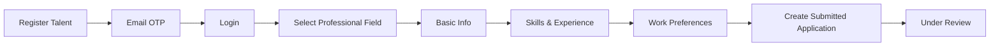

# S01 — تسجيل المواهب واستكمال الملف المهني

الحالة: **تم التنفيذ**  
آخر مراجعة: 18 أكتوبر 2026  
النطاق: تسجيل حساب الموهبة، اختيار المجال المهني، استكمال الملف عبر ثلاث خطوات، وتطبيق الحقول المتغيرة حسب المجال.  
عرض التسليم: موهبة تسجل، تتحقق من بريدها، تستكمل ملفها، وترى رسالة نجاح إنشاء طلب المراجعة.

> نُفذت السكيما والـflow بتاريخ 18 أكتوبر 2026. تفاصيل التسليم وعقد الـAPI موجودة في `S01-talent-registration-implementation.ar.md`.

## 1. الخلاصة التنفيذية

الـBackend الحالي يحتوي بالفعل على أغلب الهيكل اللازم لـS01: تسجيل Talent، إنشاء سجل `talents`، البيانات المرجعية، خطوات onboarding الثلاث، الخبرات والمشاريع والمهارات، رفع الملفات، حساب اكتمال الملف، وإنشاء `talent_application` عند اكتمال الخطوة الأخيرة.

مع ذلك، الـflow ليس جاهزًا للتسليم من البداية للنهاية بالشكل الموجود في Figma. أهم الفجوات هي:

1. شاشة اختيار المجال المهني منفصلة في Figma، بينما الـAPI الحالي لا يوفّر عملية واضحة تحفظ الاختيار وحده قبل الخطوة الأولى.
2. الـCV ظاهر في `Basic Info` في Figma، لكنه موجود في `work-preferences` في الكود.
3. `Professional Summary` ظاهر في `Skills & Experience` في Figma، لكنه مصنف ضمن `personal-information` في الكود.
4. حفظ خطوة onboarding موصوف في التوثيق كحفظ جزئي، لكن validation الحالي يفرض الحقول المطلوبة عند استدعاء endpoint الخطوة؛ يجب الفصل بوضوح بين حفظ Draft وبين الضغط على Next/Submit.
5. محرك الحقول المتغيرة موجود، لكنه أعقد من المطلوب؛ المطلوب أن يرجع الـBackend قائمة `input keys` المختارة للمجال فقط.
6. Figma يعرض 8 مجالات مهنية، بينما الـseed الحالي يحتوي 4 فقط.
7. إنشاء الطلب لا يحفظ snapshot فعليًا رغم أن توثيق المشروع ينص على ذلك؛ السجل الحالي يحتوي الحالة ووقت الإرسال فقط.
8. ملفات CV تُرجع URL مباشرًا من disk افتراضي عام، وهذا لا يحقق شرط حماية بيانات المواهب الحساسة في وثائق البيزنس.
9. تعديل الملف يسمح حاليًا بتغيير البريد وإلغاء توثيقه مع بقاء جلسة الدخول؛ تغيير البريد يحتاج flow تحقق مستقل، ولذلك سيظل البريد للعرض فقط في S01.

القرار المقترح هو استكمال الموجود بدل إعادة بنائه، مع تعديلات محدودة في عقد الـAPI، توزيع الحقول، إعدادات الحقول المهنية، وحفظ نسخة الطلب وقت الإرسال.

## 2. الـflow المعتمد من Figma

المرجع الأساسي هو صفحة `Qader web`، مع استخدام تطبيق الموبايل للتأكد أن نفس عقد الـAPI يخدم القناتين.



### 2.1 إنشاء الحساب

شاشة `sign up as talent` (`634:15746`) تحتوي:

- First Name
- Last Name
- Email
- Password
- Confirm Password
- التسجيل باستخدام مزود اجتماعي

الموجود في S00 يطابق هذه الشاشة: ينشأ `users` و`talents` داخل transaction واحدة، ثم يبدأ تحقق البريد بالـOTP.

### 2.2 اختيار المجال المهني

شاشة `Select your Professional Field` (`3735:49023`) تأتي قبل خطوات الملف، وتسمح باختيار مجال واحد فقط. المجالات الظاهرة:

| الترتيب | المجال | الوصف الظاهر في Figma |
| --- | --- | --- |
| 1 | Software Development | Roles related to coding, engineering, and software architecture. |
| 2 | Design | Graphic, UI/UX, and product design roles. |
| 3 | Sales | Business development, account management, and sales operations. |
| 4 | Marketing | Digital marketing, brand management, and growth strategies. |
| 5 | Customer Service | Support, success, and customer experience roles. |
| 6 | Human Resources | Talent acquisition, people operations, and HR management. |
| 7 | Finance & Accounting | Financial planning, accounting, and treasury roles. |
| 8 | Operations | Supply chain, logistics, and business operations management. |

الـseed الحالي يحتوي Software Development وMarketing وSales و`Customer Service & Call Center` فقط؛ الاسم الأخير يحتاج محاذاة مع `Customer Service` في Figma أو اعتماد الاسم الأطول كقرار منتج معلن.

بعد الحفظ يستخدم السيرفر المجال في تحديد المسميات والمهارات والأدوات، ويرجع للفرونت قائمة `input keys` الخاصة بالمجال. الفرونت مسؤول عن توزيعها على الخطوات وترتيبها وعرض علامة Required.

### 2.3 الخطوة الأولى — Basic Info

شاشة `671:9328` تحتوي:

- CV، بحد أقصى 10 MB
- Full Name
- Email
- Gender
- Date of Birth
- Phone Number
- WhatsApp Number
- Nationality
- Religion
- Residence Country
- Residence City
- Languages مع Proficiency Level

الاسم يمكن تحديثه في هذه الخطوة. البريد يظهر ضمن الملف، لكن تغييره يؤجل إلى flow مستقل لتغيير البريد والتحقق منه.

### 2.4 الخطوة الثانية — Skills & Experience

شاشة `676:10812` تحتوي:

- Professional Summary
- Job Title
- Level
- Years of Experience
- Skills
- Tools
- LinkedIn
- Behance
- Portfolio
- GitHub
- Work Experiences
- Projects
- حتى 5 صور لكل مشروع، PNG/JPG بحد أقصى 5 MB للصورة

### 2.5 الخطوة الثالثة — Work Preferences

شاشة `676:11369` تحتوي:

- Work Types: Full Time / Part Time
- Work Modes: On Site / Remote / Hybrid
- Notice Period
- Willing to Relocate
- Expected Salary Min/Max مع العملة
- Current Salary مع العملة

زر الشاشة هو `Submit`، ولذلك نجاح هذه الخطوة بعد اكتمال الخطوات السابقة ينشئ طلب المراجعة.

### 2.6 نهاية المسار

شاشة `676:12276` تعرض `Profile Submitted!` وتوضح أن الملف أُرسل للمراجعة. إذًا نتيجة S01 لا تتوقف عند حفظ profile؛ يجب أن يوجد `talent_applications` بحالة `submitted` ويمكن للموهبة الانتقال إلى حالة Under Review.

## 3. الموجود حاليًا في الكود

### منفذ ويمكن البناء عليه

- `POST /api/v1/auth/talent/register` وتحقق البريد وتسجيل الدخول من S00.
- إنشاء `users` و`talents` معًا عند التسجيل.
- حماية Talent routes باستخدام Sanctum ability الخاصة بالبوابة.
- `GET /api/v1/talent/master-data/*` للدول والمدن واللغات والعملات والمجالات والمسميات والمهارات والأدوات والـenums.
- `GET /api/v1/talent/onboarding` لإرجاع حالة الاستكمال والبيانات المحفوظة وinput keys الخاصة بالمجال.
- `GET /api/v1/talent/onboarding/form-fields?professional_field_id=...` لإرجاع إعداد الحقول للمجال.
- `POST /api/v1/talent/onboarding/{step}` لحفظ الخطوات الثلاث.
- `GET /api/v1/talent/profile` و`PATCH /api/v1/talent/profile` لقراءة الملف وتحديث أجزاء منه.
- جداول وعلاقات اللغات والمهارات والأدوات والخبرات والمشاريع وأنواع وطرق العمل.
- التحقق أن المدينة تتبع دولة الإقامة.
- التحقق أن Job Title والمهارات والأدوات تتبع المجال المهني.
- رفع CV باستخدام Spatie Media Library، ورفع حتى 5 صور لكل مشروع.
- حساب `profile_completion_percentage` وحالة كل خطوة والحقول الناقصة.
- اشتراط إكمال الخطوات السابقة قبل إرسال خطوة لاحقة.
- إنشاء `talent_applications` بصورة idempotent عند اكتمال `work-preferences`.
- منح `talent.platform.access` بعد اكتمال الملف ووجود الطلب حتى يصل المستخدم إلى شاشة Under Review.
- Admin APIs لإدارة Professional Fields واختيار input keys لكل مجال.

### منفذ جزئيًا ويحتاج ضبطًا

| الجزء | الموجود | الفجوة |
| --- | --- | --- |
| اختيار المجال | `professional_field_id` موجود داخل بيانات الخطوة الأولى | لا توجد عملية مستقلة تناسب شاشة الاختيار السابقة للـstepper، والحفظ الحالي قد يطلب بقية حقول الخطوة |
| الحقول المتغيرة | `professional_form_fields` وpivot لكل مجال | الجداول تخزن إعدادات step/default/required لا نحتاجها؛ المطلوب keys مختارة فقط |
| Basic Info | أغلب الحقول والعلاقات موجودة | CV في خطوة أخرى، والبريد قابل للتعديل بطريقة غير مكتملة أمنيًا |
| Skills & Experience | أغلب الحقول والتفاصيل موجودة | Professional Summary مصنف في خطوة أخرى، وبعض حقول التصميم مخفية افتراضيًا |
| Work Preferences | الأنواع والطرق والرواتب والعملات موجودة | يلزم تثبيت قائمة Notice Period وكيفية تحويلها إلى `notice_period_days` |
| Submit | ينشئ Application بحالة `submitted` | لا يحفظ snapshot، ولا يثبت نسخة الـCV المرسلة |
| ملفات CV | Media Library موجودة | التخزين الافتراضي عام ولا توجد download policy خاصة بالمالك والأدمن |
| Professional Fields | CRUD وعلاقات موجودة | 4 مجالات فقط في seed، وإعداد input keys يحتاج تبسيطًا |
| التوثيق | Scribe/Apidog مجهزان | أسماء methods والـrequest examples ستحتاج regeneration بعد تثبيت العقد النهائي |

## 4. معنى «الحقول الديناميكية» في S01

المعنى المعتمد للحقول الديناميكية في S01:

- يوجد كتالوج ثابت من `input keys` في `professional_form_fields`.
- كل Professional Field يختار مجموعة keys من هذا الكتالوج.
- الـAPI يرجع للفرونت keys فقط.
- الفرونت يعرف كل key تظهر في أي خطوة، ترتيبها، label الخاص بها، نوع الـinput، وهل يعرض عليها علامة Required.
- الـBackend يحتفظ بقواعد validation والحفظ الأساسية لكل key في الكود، ولا يثق في الفرونت لتأمين الحفظ أو Submit.

هذا لا يعني إنشاء حقول اعتباطية بأنواع وخيارات وإجابات جديدة من لوحة الأدمن. الـForm Generator الظاهر في Admin Figma يخص نماذج الوظائف العامة، وهو flow مختلف عن Talent onboarding ومؤجل لسبرنت الوظائف.

بهذا الشكل لا نحتاج في S01 إلى جداول generic مثل `field_definitions` و`talent_field_answers`. نحتفظ بـ`professional_form_fields` و`professional_field_form_field` بعد تبسيطهما.

## 5. Master Data داخل نطاق S01

شاشات Admin في Figma تعرض Countries وCities وLanguages وCurrencies وProfessional Fields وJob Titles وSkills وTools. الموديولات الثمانية موجودة بالفعل في الكود مع List/Create/Update، البحث، الفلاتر، pagination، التفعيل والتعطيل، وصلاحيات View/Manage مستقلة.

| الموديول | الموجود | الناقص في S01 |
| --- | --- | --- |
| Countries | جداول وترجمات وAdmin CRUD وبحث وحالة | مراجعة seed المطلوب للتجربة |
| Cities | جداول وترجمات وAdmin CRUD وفلتر الدولة والحالة | مراجعة seed وربطه بالدول الفعالة |
| Languages | جداول وترجمات وAdmin CRUD وبحث وحالة | تثبيت codes وقيم proficiency |
| Currencies | جداول وترجمات وAdmin CRUD والاسم والكود والرمز | الموجود كافٍ؛ أسعار التحويل خارج S01 |
| Professional Fields | CRUD وترجمات وربط input keys | إضافة المجالات الثمانية وتبسيط إعداد الحقول إلى keys فقط |
| Job Titles | CRUD وربط متعدد بالمجالات وفلاتر | استكمال بيانات المجالات الأربعة الناقصة |
| Skills | CRUD وربط متعدد بالمجالات وفلاتر | استكمال مهارات المجالات الجديدة |
| Tools | CRUD وربط متعدد بالمجالات وفلاتر | استكمال أدوات المجالات الجديدة |

الـseed الحالي للمجالات يحتوي Software Development وMarketing وSales وCustomer Service & Call Center. سنضيف Design وHuman Resources وFinance & Accounting وOperations، ونحسم اسم Customer Service عند التنفيذ.

الـAPI الخاص بالـform fields يرجع input keys فقط، مثل:

```json
[
  "job_title_id",
  "skill_ids",
  "tool_ids",
  "projects",
  "work_types",
  "work_modes"
]
```

لن يرجع الـBackend `step` أو`is_default` أو`is_required` أوlabel أوinput type. هذه إعدادات عرض يحتفظ بها الفرونت.

لا يوجد Delete فعلي للـMaster Data في S01؛ التعطيل باستخدام `is_active=false` يحافظ على العلاقات والملفات القديمة.

## 6. مراجعة الجداول

### 6.1 جداول سنحتفظ بها كما هي في S01

- `users`
- `talents`
- `countries`, `country_translations`
- `cities`, `city_translations`
- `languages`, `language_translations`
- `currencies`, `currency_translations`
- `job_titles`
- `skills`
- `tools`
- `professional_fields`, `professional_field_translations`
- `job_title_professional_field`
- `professional_field_skill`
- `professional_field_tool`
- `professional_form_fields`
- `professional_field_form_field`
- `talent_languages`
- `talent_skills`
- `talent_tools`
- `talent_experiences`
- `talent_projects`
- `talent_work_types`
- `talent_work_modes`
- `media`

توزيع CV وProfessional Summary بين الخطوات لا يحتاج أعمدة في قاعدة البيانات؛ الفرونت يحدد الخطوة، والـBackend يحدد validation والحفظ في الكود.

### 6.2 تعديلات سكيما مقترحة للاعتماد

#### `professional_fields` و`professional_field_translations`

لا نضيف `display_order`. أُعيد اعتماد `description` مترجمة داخل `professional_field_translations` حتى يرجع الـBackend نص بطاقة المجال الموجود في Figma، بينما يظل الفرونت مسؤولًا عن ترتيب البطاقات.

#### `professional_form_fields`

نحذف من السكيما النهائية:

- `step`
- `is_default`
- `is_required_by_default`

ويبقى الجدول كتالوج keys فقط:

```text
id
key UNIQUE
created_at
updated_at
```

#### `professional_field_form_field`

نحذف `is_required`، ويبقى الـpivot لتحديد keys التابعة لكل Professional Field فقط:

```text
professional_field_id
professional_form_field_id
created_at
updated_at
PRIMARY KEY (professional_field_id, professional_form_field_id)
```

#### `talent_applications`

إضافة الحد الأدنى الذي يثبت ما أرسلته الموهبة:

| العمود | النوع المقترح | السبب |
| --- | --- | --- |
| `submission_snapshot` | json nullable مؤقتًا ثم required للتقديمات الجديدة | نسخة ثابتة من بيانات الملف والقيم المرجعية وقت Submit |
| `profile_completion_at_submission` | unsigned tiny integer | تسجيل نسبة الاكتمال وقت الإرسال |
| `snapshot_version` | unsigned small integer default 1 | السماح بتطوير شكل الـsnapshot لاحقًا |
| `snapshot_captured_at` | timestamp nullable | وقت تثبيت النسخة |

سيُنسخ CV المرسل إلى media collection مملوكة بالـApplication مثل `submitted_cv`، لذلك لا نحتاج جدول ملفات جديد. سنبقي `UNIQUE(talent_id)` في S01 لأن إعادة التقديم ومحاولاتها جزء من سبرنت دورة المراجعة والرفض، ثم نراجع `attempt_number` وactive application constraint في ذلك السبرنت.

### 6.3 تغييرات مؤجلة

- دورة حالات Admin الكاملة، أسباب الرفض، reviewer، priority وreapply.
- Marketplace profile وظهور الموهبة للعملاء.
- Availability كحالة تشغيل مستقلة.
- تقييمات ومقابلات وتقارير مدفوعة.
- نماذج الوظائف وأسئلتها وإجاباتها الديناميكية.

## 7. عقد الـAPI المقترح لـS01

### الحساب والتحقق — موجود من S00

```text
POST  /api/v1/auth/talent/register
PATCH /api/v1/auth/talent/email-verification
POST  /api/v1/auth/talent/login
GET   /api/v1/auth/me
```

### اختيار المجال وتهيئة النموذج

```text
GET   /api/v1/talent/master-data/professional-fields
PATCH /api/v1/talent/onboarding/professional-field
GET   /api/v1/talent/onboarding/form-fields?professional_field_id={id}
```

الـPATCH المقترح يحفظ `professional_field_id` فقط، يعيد إعداد الحقول للخطوات الثلاث، ولا يعتبر Basic Info مكتملًا.

### onboarding والملف

```text
GET   /api/v1/talent/onboarding
POST  /api/v1/talent/onboarding/personal-information
POST  /api/v1/talent/onboarding/skills-and-experiences
POST  /api/v1/talent/onboarding/work-preferences

GET   /api/v1/talent/profile
PATCH /api/v1/talent/profile
GET   /api/v1/talent/onboarding/application
```

سنثبت الفرق التالي:

- `PATCH /profile`: حفظ Draft جزئي لأي حقول مسموحة بدون اعتبار الخطوة مكتملة.
- `POST /onboarding/{step}`: ضغط Next أو Submit؛ يطبق Required fields ويمنع تخطي الخطوات.
- حفظ `work-preferences` مكتملة هو Submit، وينشئ Application مرة واحدة داخل نفس transaction.

الطلبات التي تحتوي ملفات ستظل `multipart/form-data`، لذلك الإبقاء على `POST` للخطوات أوضح وأضمن في رفع الملفات من Web وMobile.

## 8. خطة التنفيذ بعد اعتماد السكيما

### المرحلة 1 — تثبيت العقد والـMaster Data

1. اعتماد تعديلات الجداول الصغيرة المذكورة أعلاه.
2. تحديث مستندات architecture القديمة لإزالة التعارض بين «إرسال ملف ناقص» و«Submit بعد إكمال الخطوات المطلوبة».
3. تبسيط professional form fields إلى keys فقط في الجداول والاستجابات.
4. تثبيت validation والحفظ لكل key داخل كود الـBackend.
5. إضافة المجالات الثمانية إلى seed data.
6. استكمال Job Titles وSkills وTools للمجالات الجديدة بالحد الأدنى اللازم للعرض التجريبي.

### المرحلة 2 — محاذاة onboarding مع Figma

1. إضافة عملية مستقلة لاختيار المجال المهني.
2. نقل CV إلى `personal-information` في field policy والـvalidation والـwriter والـresponse.
3. نقل Professional Summary إلى `skills-and-experiences`.
4. إبقاء Full Name قابلًا للتحديث، وجعل Email للعرض فقط في S01.
5. تثبيت Draft save مقابل Next/Submit validation.
6. ضبط Notice Period options وتحويلها إلى عدد أيام ثابت في الـAPI.
7. التأكد أن تغيير المجال يمسح أو يرفض Job Title/Skills/Tools القديمة غير التابعة للمجال الجديد برسالة واضحة.

### المرحلة 3 — إرسال الطلب وحماية الملفات

1. إنشاء snapshot ثابت داخل `talent_applications` وقت Submit.
2. تثبيت نسخة CV المرسلة على الـApplication.
3. نقل CV وملفات المشاريع إلى private media disk.
4. إضافة endpoint تنزيل محمي يسمح لصاحب الملف، ثم للأدمن صاحب الصلاحية في سبرنت المراجعة.
5. إبقاء إنشاء Application idempotent وإرجاع `application_created` وحالة `submitted` بوضوح.

### المرحلة 4 — التوثيق وفحص التسليم

1. تحديث أسماء endpoints وrequest bodies والأمثلة في Scribe.
2. تشغيل `scribe:generate` لتحديث Talent OpenAPI في Apidog.
3. تنفيذ فحص يدوي واحد للمسار الكامل: Register → OTP → Login → Select Field → Basic Info → Skills & Experience → Work Preferences → Submitted.
4. التحقق يدويًا من الرجوع للخطوات وحفظ Draft ومنع تخطي خطوة مطلوبة.
5. التحقق أن المجال يغير الحقول والـmaster data المتاحة فعليًا.
6. التحقق أن CV لا يفتح بدون token وصلاحية مناسبة.

لن تُضاف اختبارات آلية ضمن السبرنت إلا بطلب صريح، وفق طريقة العمل المتفق عليها.

## 9. شروط قبول S01

- تستطيع الموهبة إنشاء حساب والتحقق من البريد وتسجيل الدخول.
- ينشأ سجل Talent واحد مرتبط بالحساب.
- تختار الموهبة مجالًا مهنيًا واحدًا قبل بدء النموذج.
- يرجع السيرفر input keys المختارة لهذا المجال فقط.
- تستطيع حفظ Draft والعودة دون فقد البيانات.
- لا يمكن الضغط على Next مع نقص حقل مطلوب في الخطوة الحالية.
- الحقول وترتيب الخطوات يطابقان Figma، وخاصة CV وProfessional Summary.
- Job Titles وSkills وTools المعروضة تنتمي إلى المجال المختار.
- تحفظ الخبرات والمشاريع والصور واللغات بدون إنشاء سجلات مكررة أو تعديل سجلات Talent آخر.
- لا يتجاوز المشروع 5 صور، ولا يتجاوز CV 10 MB.
- لا يمكن Submit قبل اكتمال الخطوات الثلاث المطلوبة.
- ينشأ Application واحد بحالة `submitted` مع snapshot ونسخة CV ثابتة.
- تظهر رسالة نجاح الإرسال، ثم يمكن عرض حالة Under Review.
- ملفات CV لا يمكن الوصول إليها برابط عام.

## 10. خارج S01

- مراجعة الأدمن والقبول والرفض وطلب التعديلات.
- المقابلات والتقييم النهائي.
- إعادة التقديم بعد الرفض.
- ظهور الموهبة في Marketplace.
- تعديل البريد الإلكتروني.
- نماذج الوظائف العامة والـForm Generator.
- الإشعارات التفصيلية للأدمن؛ تربط مع بداية سبرنت المراجعة، بينما يكفي في S01 إنشاء Application صحيح قابل للاستهلاك.
