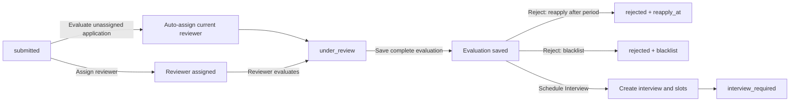

# S02 — تقييم طلبات المواهب وجدولة المقابلة

الحالة: **تم تنفيذ Backend السبرنت**  
آخر مراجعة: 20 أكتوبر 2026  
النطاق: قائمة طلبات المواهب، تعيين المراجع وإعادة تعيينه، تقييم الطلب، رفضه أو إنشاء تفاصيل المقابلة ومواعيدها.  
عرض التسليم: طلب موهبة يمكن مراجعته وتقييمه بالكامل، ثم رفضه بسياسة إعادة تقديم واضحة أو نقله إلى مرحلة المقابلة مع حفظ تفاصيل المقابلة.

توثيق التنفيذ والتشغيل والأمثلة: [S02 Talent Evaluation Implementation](S02-talent-evaluation-implementation.ar.md).

## 1. القرارات المعتمدة

1. Figma هو المرجع الأساسي، ولن نضيف حقولًا أو flows غير مطلوبة في الشاشات.
2. التقييم يتكون من أربعة معايير ثابتة، وكل معيار يأخذ قيمة صحيحة من 1 إلى 5.
3. لا يمكن حفظ التقييم ناقصًا؛ يجب إرسال المعايير الأربعة كاملة.
4. حقول توصية الراتب والتقارير والنصائح اختيارية، لكن عند إرسالها يطبق عليها Validation كامل.
5. الضغط على `Evaluate` لطلب غير معيّن يعيّن المستخدم الحالي مراجعًا تلقائيًا ثم يبدأ المراجعة.
6. إذا كان الطلب معيّنًا لمراجع آخر فلا يستطيع المستخدم تقييمه قبل إعادة تعيينه. زر `Reassign` يظهر لمن لديه صلاحية التعيين.
7. كل مستخدمي Admin Portal الذين لديهم صلاحية عرض الطلبات يرون `All Applications` و`My Applications`؛ التحكم يعتمد على permissions وليس أسماء الأدوار.
8. `Schedule Interview` يفتح مودال `Interview Details` ويحفظ المقابلة والـslots المعروضة في التصميم.
9. سياسة إعادة التقديم تستقبل عدد الأشهر، والسيرفر يحسب `reapply_at` من وقت الرفض.
10. سبب الرفض مطلوب فقط عند اختيار blacklist، واسمه `blacklist_reason`.
11. نحفظ أقل قدر مطلوب من البيانات مع تاريخ التعيين والقرارات والأحداث المهمة لحماية التشغيل والمراجعة لاحقًا.
12. `Automatic Slots` ملغي؛ المواعيد تُضاف يدويًا فقط من `Add Slots`.
13. كل slot يُحفظ بوقت بداية ونهاية. الواجهة لا تتغير؛ السيرفر يحسب النهاية افتراضيًا بعد 60 دقيقة من البداية.
14. لا يُنشأ Google Calendar Event ولا Google Meet لكل slot معروض. بعد اختيار الموهبة لموعد واحد فقط، ننشئ الحدث ونحفظ `google_calendar_event_id` و`meeting_url` على المقابلة.

## 2. الموجود حاليًا

### جاهز للبناء عليه

- S01 ينشئ `talent_applications` بحالة `submitted`.
- الطلب يحتوي `submission_snapshot` ثابتًا ونسخة CV مستقلة.
- إدارة أعضاء فريق الأدمن والأدوار والصلاحيات جاهزة.
- الصلاحيات التالية موجودة:
  - `admin.talent-applications.view`
  - `admin.talent-applications.assign-reviewer`
  - `admin.talent-applications.review`
  - `admin.talent-applications.decide`
- دورا `admin` و`reviewer` موجودان في قاعدة البيانات، والأدوار الإضافية ينشئها Super Admin.

### غير موجود

- Admin routes لطلبات المواهب.
- قائمة الطلبات والإحصائيات والفلاتر.
- تعيين المراجع وإعادة التعيين.
- تقييم الطلب.
- قرار الرفض وسياسة إعادة التقديم والحظر.
- إنشاء تفاصيل المقابلة والـslots.
- تاريخ العمليات المهمة.

## 3. حدود السبرنت

يدخل في S02:

- `All Applications` و`My Applications`.
- إحصائيات All، Pending، Accepted، Rejected كما في التصميم.
- البحث والفلترة والترتيب وpagination.
- عرض تفاصيل الطلب من الـsnapshot والـCV المرسل.
- تعيين مراجع لطلب واحد أو عدة طلبات.
- إعادة تعيين المراجع مع الاحتفاظ بالتاريخ.
- التعيين الذاتي تلقائيًا عند Evaluate لطلب غير معيّن.
- حفظ وتحديث التقييم الكامل.
- رفض الطلب مع مدة إعادة تقديم أو blacklist.
- إنشاء المقابلة واختيار نوعها والمقابلين والـslots.
- سجل مختصر للأحداث الأساسية.
- توثيق Admin OpenAPI وApidog كاملًا.

خارج S02:

- اختيار الموهبة للـslot أو تأكيده.
- إعادة جدولة المقابلة.
- بدء المقابلة أو تسجيل الحضور والغياب.
- تقييم المقابلة والقرار النهائي بالقبول.
- نشر الموهبة للعملاء.
- التقارير المدفوعة.
- فك الحظر وتعديل قرار نهائي.
- Internal Notes العامة ورسائل الرفض الظاهرة للموهبة.

## 4. الـflow



حالة `interview_required` تعني أن تفاصيل المقابلة والـslots أُنشئت، وأن الخطوة التالية الخاصة باختيار أو تأكيد الموعد ستُنفذ في سبرنت المقابلات.

## 5. الصلاحيات وسلوك الأزرار

| الصلاحية | السلوك |
| --- | --- |
| `view` | مشاهدة All Applications وMy Applications والتفاصيل |
| `assign-reviewer` | Assign وReassign لطلب واحد أو مجموعة |
| `review` | Evaluate والتعيين الذاتي وحفظ أو تحديث التقييم |
| `decide` | Reject وSchedule Interview |

القواعد:

- أي مستخدم Admin لديه `view` يرى كل الطلبات، ويستطيع استخدام `scope=all` أو `scope=my`.
- `scope=my` يعتمد على المراجع الحالي، وليس اسم الـrole.
- أي مستخدم لديه `review` يستطيع الضغط على Evaluate إذا كان الطلب غير معيّن؛ السيرفر يعيّنه لنفسه داخل transaction واحدة.
- إذا كان الطلب معيّنًا للمستخدم الحالي، يظهر Evaluate أو Update Evaluation.
- إذا كان الطلب معيّنًا لمستخدم آخر، لا يظهر Evaluate. يظهر Reassign فقط لمن لديه `assign-reviewer`.
- أي role إضافي يستطيع استخدام نفس الأزرار عند منحه permissions المناسبة.
- دور `reviewer` الافتراضي يحصل على `view`, `review`, `decide`.
- دور `admin` يحصل على صلاحيات الطلبات الأربع.
- لا توجد شروط في الكود تعتمد على أسماء `admin`, `manager`, `reviewer` أو غيرها.
- قائمة المراجعين تعيد حسابات Admin النشطة التي لديها صلاحية `review` فعليًا من role نشط.
- Assign وReassign يرفضان أي مراجع غير نشط أو لا يملك صلاحية `review`.

## 6. السكيما المطلوبة

### 6.1 تعديل `talent_applications`

نحتفظ بكل الأعمدة الحالية ونضيف فقط:

| العمود | النوع | الغرض |
| --- | --- | --- |
| `assigned_admin_id` | nullable FK → `admins.id` | المراجع الحالي |
| `review_decided_by_admin_id` | nullable FK → `admins.id` | منفذ الرفض أو الجدولة |
| `review_decided_at` | nullable timestamp | وقت القرار |
| `reapply_at` | nullable timestamp | التاريخ المحسوب من وقت الرفض |

الفهارس:

- index على `(status, submitted_at)`.
- index على `(assigned_admin_id, status)`.
- index على `reapply_at`.

لن نغير قيد `unique(talent_id)` في S02؛ إنشاء محاولة تقديم جديدة بعد انتهاء الانتظار له flow مستقل عند تنفيذ إعادة التقديم.

الحالات المستخدمة:

- `submitted`
- `under_review`
- `interview_required`
- `rejected`

### 6.2 جدول `talent_application_reviewer_assignments`

مطلوب لعرض المراجع الحالي والسابق ومن قام بالتعيين ووقته كما في التصميم.

| العمود | النوع |
| --- | --- |
| `id` | bigint |
| `application_id` | FK → `talent_applications.id` |
| `reviewer_admin_id` | FK → `admins.id` |
| `assigned_by_admin_id` | FK → `admins.id` |
| `assigned_at` | timestamp |
| `ended_at` | nullable timestamp |

`talent_applications.assigned_admin_id` هو المراجع الحالي. عند Reassign نضع `ended_at` للسجل الحالي وننشئ سجلًا جديدًا، داخل transaction واحدة.

التعيين الذاتي يُعرف عندما يكون `reviewer_admin_id` مساويًا لـ`assigned_by_admin_id`، لذلك لا نحتاج عمودًا إضافيًا له.

### 6.3 جدول `talent_evaluations`

يوجد تقييم واحد للطلب، ويمكن تحديثه قبل الانتقال للمقابلة أو الرفض.

| العمود | النوع | الإلزام |
| --- | --- | --- |
| `id` | bigint | مطلوب |
| `application_id` | unique FK → `talent_applications.id` | مطلوب |
| `evaluator_admin_id` | FK → `admins.id` | مطلوب |
| `technical_skills_rating` | unsigned tiny integer | مطلوب، 1 إلى 5 |
| `communication_skills_rating` | unsigned tiny integer | مطلوب، 1 إلى 5 |
| `problem_solving_rating` | unsigned tiny integer | مطلوب، 1 إلى 5 |
| `soft_skills_rating` | unsigned tiny integer | مطلوب، 1 إلى 5 |
| `recommended_salary_min` | nullable decimal(18,4) | اختياري |
| `recommended_salary_max` | nullable decimal(18,4) | اختياري |
| `currency_id` | nullable FK → `currencies.id` | مطلوب عند إرسال راتب |
| `hr_report` | nullable text | اختياري |
| `technical_report` | nullable text | اختياري |
| `psychology_report` | nullable text | اختياري |
| timestamps | timestamps | — |

لا نحتاج:

- جدول `evaluation_criteria` لأن المعايير الأربعة ثابتة في التصميم.
- أوزان للمعايير؛ التصميم المطلوب تقييم من 1 إلى 5 لكل معيار.
- `version_number`, `draft`, `submitted` أو `superseded`.
- عمود overall score؛ يمكن للـAPI إرجاع المتوسط المحسوب عند الحاجة دون تخزينه.

### 6.4 جدول `evaluation_tips`

| العمود | النوع |
| --- | --- |
| `id` | bigint |
| `evaluation_id` | FK → `talent_evaluations.id` |
| `title` | varchar(255) |
| `priority` | varchar(16): `low`, `medium`, `high` |
| `description` | text |
| `display_order` | unsigned small integer |

النصائح اختيارية، لكن إذا أُرسلت نصيحة تكون حقولها الثلاثة مطلوبة.

### 6.5 جدول `talent_blacklist_entries`

ينشأ فقط عند اختيار سياسة blacklist.

| العمود | النوع |
| --- | --- |
| `id` | bigint |
| `talent_id` | FK → `talents.id` |
| `application_id` | FK → `talent_applications.id` |
| `blacklist_reason` | text مطلوب |
| `blocked_by_admin_id` | FK → `admins.id` |
| `blocked_at` | timestamp |
| `removed_at` | nullable timestamp |
| `removed_by_admin_id` | nullable FK → `admins.id` |

حقول فك الحظر موجودة لحفظ التاريخ عندما يُنفذ زر Remove From Blacklist الظاهر في شاشات الإدارة، لكن endpoint فك الحظر خارج S02.

### 6.6 جدول `interviews`

ينشأ عند Submit من مودال Interview Details.

| العمود | النوع |
| --- | --- |
| `id` | bigint |
| `application_id` | FK → `talent_applications.id` |
| `type` | `hr`, `technical`, `general`, `final` |
| `status` | `awaiting_slot_selection` |
| `created_by_admin_id` | FK → `admins.id` |
| `google_calendar_event_id` | nullable varchar(255)، يُحفظ بعد اختيار الموهبة للموعد |
| `meeting_url` | nullable text، يُحفظ بعد نجاح إنشاء Google Meet |
| timestamps | timestamps |

S02 ينشئ مقابلة واحدة من قرار المراجعة. الجولات أو المقابلات التالية ستُضاف من موديول المقابلات لاحقًا.

### 6.7 جدول `interview_admin`

المودال يسمح باختيار Interviewers، ولذلك العلاقة many-to-many.

| العمود | النوع |
| --- | --- |
| `interview_id` | FK → `interviews.id` |
| `admin_id` | FK → `admins.id` |

القيد unique على `(interview_id, admin_id)`.
يوجد index على `(admin_id, interview_id)` لدعم فحص جدول المقابل ومنع التعارض.

### 6.8 جدول `interview_slots`

يمثل كروت `Interview #1`, `Interview #2` التي يضيفها المستخدم من `Add Slots`.

| العمود | النوع |
| --- | --- |
| `id` | bigint |
| `interview_id` | FK → `interviews.id` |
| `mode` | `online` أو `offline` |
| `starts_at` | timestamp |
| `ends_at` | timestamp؛ افتراضيًا `starts_at + 60 minutes` |
| `location` | nullable varchar(500)، مطلوب عند offline |
| `latitude` | nullable decimal(10,7) |
| `longitude` | nullable decimal(10,7) |
| `status` | `available` |
| timestamps | timestamps |

الواجهة تظل كما في التصميم وتعرض مدخلات التاريخ والوقت الحالية. السيرفر يكوّن منها `starts_at` ويحسب `ends_at` بعد 60 دقيقة تلقائيًا. عقد الاستجابة يعرض القيمتين باسم `start` و`end`. إحداثيات الخريطة تُرسل كـ`latitude` و`longitude` بدل رابط خريطة.

يوجد index على `(starts_at, ends_at, status)` لتسريع فحص انشغال المقابلين.

لا يرسل مودال الإنشاء meeting link ولا ينشئ اجتماعًا لكل slot. بعد اختيار الموهبة slot واحدًا، ينشئ السيرفر Google Calendar Event مع Google Meet ثم يحفظ المعرف والرابط في `interviews`.

### 6.9 جدول `talent_application_events`

سجل صغير append-only للأحداث التي يجب ألا تضيع عند التحديث.

| العمود | النوع |
| --- | --- |
| `id` | bigint |
| `application_id` | FK → `talent_applications.id` |
| `admin_id` | FK → `admins.id` |
| `action` | varchar(64) |
| `data` | nullable json |
| `created_at` | timestamp |

الأحداث المطلوبة فقط:

- `reviewer_assigned`
- `reviewer_reassigned`
- `review_started`
- `evaluation_saved`
- `application_rejected`
- `interview_scheduled`

## 7. الـValidation

### التقييم

- المعايير الأربعة `required|integer|between:1,5`.
- حقول التقارير اختيارية، وعند إرسالها تكون strings بحد أقصى مناسب للنصوص.
- إذا أُرسل أي جزء من توصية الراتب تصبح `min`, `max`, `currency_id` مطلوبة معًا.
- `recommended_salary_min <= recommended_salary_max`.
- العملة يجب أن تكون موجودة وفعالة.
- النصائح اختيارية.
- عند وجود tips: العنوان والأولوية والوصف مطلوبة لكل عنصر.

### الرفض

للسماح بإعادة التقديم:

```json
{
  "reapply_policy": "allowed_after_period",
  "reapply_after_months": 6
}
```

- `reapply_after_months` عدد صحيح موجب.
- السيرفر يحسب `reapply_at = review_decided_at + reapply_after_months`.
- لا يرسل `blacklist_reason` مع هذه السياسة.
- سياسة الرد تُستنتج من `reapply_at` أو سجل blacklist، لذلك لا نكررها في عمود إضافي داخل الطلب.

للحظر:

```json
{
  "reapply_policy": "blacklisted",
  "blacklist_reason": "Repeated submission of invalid information."
}
```

- `blacklist_reason` مطلوب وغير فارغ فقط مع `blacklisted`.
- لا يرسل `reapply_after_months` مع blacklist.

### المقابلة

- `type` واحدة من `hr`, `technical`, `general`, `final`.
- `interviewer_admin_ids` مصفوفة غير فارغة وبدون تكرار، وكل عضو Admin نشط.
- `slots` مصفوفة غير فارغة وبدون أوقات بداية مكررة.
- كل slot يحتوي `mode` ومدخلات التاريخ والوقت الموجودة في الواجهة، ويجب أن يكون `start` الناتج في المستقبل.
- السيرفر يحسب `end = start + 60 minutes`؛ لا تحتاج الواجهة إلى حقل مدة أو حقل نهاية.
- يجب دائمًا أن يكون `end > start`، وأي تعديل داخلي لاحق للمدة يخضع لنفس فحص التعارض.
- `location` مطلوب فقط عند `offline`.
- إذا أُرسل أحد `latitude` أو`longitude` يجب إرسال الآخر معه.
- `latitude` بين -90 و90، و`longitude` بين -180 و180.
- قبل الحفظ يتحقق السيرفر أن كل interviewer مختار غير مرتبط بأي slot قائم تتقاطع فترته مع الفترة الجديدة: `existing.starts_at < new.ends_at` و`existing.ends_at > new.starts_at`.
- تعتبر الحالات `available` و`selected` حجزًا لوقت المقابل. تُستبعد الحالات `expired`, `cancelled`, `rejected_by_talent` من التعارض.
- فحص التعارض يتم داخل transaction بعد قفل سجلات الـAdmins المختارين بترتيب IDs ثابت، لمنع إنشاء مقابلتين متعارضتين من طلبين متزامنين.
- الطلب يجب أن يكون `under_review` وله تقييم كامل قبل الجدولة أو الرفض.

## 8. الـAPI

كل المسارات تحت:

```text
/api/v1/admin/talent-applications
```

كل الطلبات تحتاج:

```http
X-Authorization: {{api_key}}
Authorization: Bearer {{access_token}}
Accept: application/json
```

### القراءة

| Method | Endpoint | الصلاحية |
| --- | --- | --- |
| GET | `/` | view |
| GET | `/reviewers` | view |
| GET | `/{application}` | view |
| GET | `/{application}/reviewer-history` | view |
| GET | `/{application}/activity` | view |

فلاتر القائمة:

- `scope=all|my`
- `search`
- `status[]`
- `reviewer_admin_id`
- `submitted_from`, `submitted_to`
- `sort=newest|oldest`
- `per_page`

لن نضيف فلاتر غير ظاهرة أو غير مطلوبة في أول نسخة. الفلاتر الإضافية تُنفذ عندما تعتمد شاشة Filter تفاصيلها.

`meta.summary`:

```json
{
  "all": 655,
  "pending": 65,
  "accepted": 12,
  "rejected": 65
}
```

`accepted` يمثل القبول النهائي مستقبلًا. الطلب الذي انتقل إلى المقابلة يظل ضمن `pending`.

### الأوامر

| Method | Endpoint | الصلاحية | السلوك |
| --- | --- | --- | --- |
| POST | `/assign-reviewer` | assign-reviewer | Assign أوReassign فردي/جماعي |
| POST | `/{application}/start-review` | review | Evaluate: يعيّن المستخدم تلقائيًا إذا كان الطلب غير معيّن |
| PUT | `/{application}/evaluation` | review | حفظ أو تحديث التقييم الكامل |
| POST | `/{application}/reject` | decide | رفض وإعادة تقديم أو blacklist |
| POST | `/{application}/schedule-interview` | decide | إنشاء المقابلة والمقابلين والـslots |

Body التعيين:

```json
{
  "application_ids": [10, 11, 12],
  "reviewer_admin_id": 4
}
```

Body التقييم:

```json
{
  "technical_skills_rating": 4,
  "communication_skills_rating": 5,
  "problem_solving_rating": 4,
  "soft_skills_rating": 3,
  "recommended_salary_min": 20000,
  "recommended_salary_max": 30000,
  "currency_id": 1,
  "hr_report": "Strong communication and clear career progression.",
  "technical_report": "Meets the expected technical level.",
  "psychology_report": null,
  "tips": [
    {
      "title": "Improve system design",
      "priority": "high",
      "description": "Practice explaining architecture trade-offs."
    }
  ]
}
```

Body جدولة المقابلة:

```json
{
  "type": "technical",
  "interviewer_admin_ids": [4, 7],
  "slots": [
    {
      "mode": "online",
      "start": "2026-10-25T12:00:00+03:00"
    },
    {
      "mode": "offline",
      "start": "2026-10-26T15:00:00+03:00",
      "location": "Qader Office, Giza",
      "latitude": 30.0444200,
      "longitude": 31.2357120
    }
  ]
}
```

لا ترسل الواجهة `end` في طلب الجدولة؛ السيرفر يحسبها بعد 60 دقيقة. استجابات الـslots تعيد `start` و`end` بصيغة ISO 8601.

## 9. استجابة التفاصيل

`GET /{application}` يعيد ما تحتاجه شاشة واحدة:

- بيانات الطلب والحالة وتاريخ التقديم.
- بيانات الموهبة من `submission_snapshot`.
- رابط CV محمي.
- المراجع الحالي.
- التقييم إن وجد.
- `average_rating` محسوب من المعايير الأربعة.
- النصائح.
- المقابلة والـslots إن وُجدت.
- `available_actions` طبقًا للحالة والصلاحيات والتعيين الحالي:
  - `evaluate`
  - `update_evaluation`
  - `assign`
  - `reassign`
  - `reject`
  - `schedule_interview`

`available_actions` ضروري حتى يطابق الفرونت قواعد الأزرار ولا يعيد تنفيذ منطق الصلاحيات والحالات بنفسه.

## 10. قواعد العمليات

- `start-review` على طلب غير معيّن ينشئ assignment للمستخدم الحالي، يضع `assigned_admin_id`، ويحوّل الحالة إلى `under_review` في transaction واحدة.
- `start-review` على طلب معيّن للمستخدم الحالي يعيد البيانات دون إنشاء assignment مكرر.
- `start-review` على طلب معيّن لمستخدم آخر يرجع `409` ويحتاج Reassign.
- Reassign يغلق سجل المراجع السابق ويضيف الجديد ويحدث الطلب في transaction واحدة.
- التعيين الجماعي عملية واحدة: إذا كان أي طلب غير صالح للتعيين تُرفض المجموعة كلها دون تعديل جزئي.
- المراجع الحالي فقط يستطيع حفظ أو تحديث التقييم.
- لا يمكن Reject أوSchedule Interview قبل وجود تقييم كامل.
- Reject وSchedule Interview يحتاجان `decide`، بالإضافة إلى أن منفذ القرار هو المراجع الحالي. إذا أراد مسؤول آخر اتخاذ القرار يعيد تعيين الطلب لنفسه أولًا.
- Reject يحفظ القرار والسياسة، ويضيف blacklist عند الحاجة داخل transaction واحدة.
- Schedule Interview ينشئ interview والمقابلين والـslots ويحوّل الحالة إلى `interview_required` داخل transaction واحدة.
- إذا كان أي interviewer مشغولًا في أي slot مرسل، تُرفض العملية كلها بـ`422` مع المواعيد والمقابلين المتعارضين، ولا يُنشأ جزء من المقابلة.
- بعد `rejected` أو`interview_required` لا يمكن تعديل تقييم S02.
- تكرار قرار بعد انتقال الحالة يرجع `409 Conflict`.

## 11. تنفيذ قاعدة البيانات بدون فقد البيانات

- لن نستخدم `migrate:fresh`.
- سنعدّل migration الأصلية لـ`talent_applications` لتحتوي الشكل النهائي عند إنشاء قاعدة جديدة.
- سننشئ migration واحدة لـS02 لأن جداول التقييم والمقابلات والتاريخ غير موجودة أصلًا.
- نفس migration تضيف أعمدة S02 إلى `talent_applications` فقط إذا كانت غير موجودة، حتى تعمل على السيرفر الحالي دون حذف الطلبات.
- لن ننشئ migrations تصحيحية منفصلة لكل تعديل.
- لا نحتاج Seeder لمعايير التقييم لأن المعايير ثابتة في الكود والجدول.

## 12. التنفيذ البرمجي

داخل `TalentApplications`:

- Enums للحالة، قرار المراجعة، سياسة إعادة التقديم، ratings، tip priority، interview type/mode/status.
- Models وعلاقات الجداول المعتمدة فقط.
- List filters للقائمة الحالية.
- Use Cases للقائمة، التفاصيل، التعيين، بدء المراجعة، حفظ التقييم، الرفض، وجدولة المقابلة.
- Resources للقائمة والتفاصيل والتقييم والمراجع والمقابلة.
- Form Requests بكل قواعد الـvalidation السابقة.
- Admin Controller وroute file جديد.
- توسيع تنزيل CV للأدمن صاحب `view`.
- رسائل عربية وإنجليزية واضحة للأخطاء والنجاح.

في Access Control:

- تعديل صلاحيات دور `reviewer` الافتراضي ليحصل على `view`, `review`, `decide`.
- لا نضيف roles أو permissions جديدة.

## 13. الاختبارات الضرورية

1. كل مستخدم لديه `view` يستطيع استخدام All وMy Applications.
2. Evaluate على طلب غير معيّن يعيّن المستخدم الحالي تلقائيًا.
3. منع Evaluate عندما يكون الطلب معيّنًا لمراجع آخر.
4. Reassign يحفظ المراجع السابق وتاريخ انتهاء تعيينه.
5. منع تعيين Admin غير نشط أو لا يملك صلاحية review، والتأكد أن التعيين الجماعي لا يحفظ جزءًا من المجموعة.
6. رفض تقييم ناقص أو rating خارج 1–5.
7. Validation الحقول الاختيارية عند إرسالها.
8. منع غير المراجع الحالي من تعديل التقييم أو اتخاذ القرار.
9. حساب `reapply_at` من وقت الرفض وعدد الأشهر.
10. اشتراط `blacklist_reason` مع blacklist فقط.
11. إنشاء interview والمقابلين والـslots داخل transaction واحدة.
12. رفض الجدولة إذا كان أي interviewer مرتبطًا بموعد قائم في أي slot مرسل.
13. اختبار طلبين متزامنين لنفس interviewer والتأكد أن واحدًا فقط يُحفظ.
14. اشتراط location للـoffline slot.
15. منع قرار مكرر أو تعديل التقييم بعد القرار.
16. قراءة بيانات الطلب من snapshot بدل الملف الحي.

## 14. التوثيق وApidog

بعد التنفيذ:

1. تحديث `api-enums-reference.ar.md` بالقيم الفعلية.
2. إنشاء `S02-talent-evaluation-implementation.ar.md`.
3. إضافة أمثلة JSON ثابتة لكل POST وPUT.
4. توثيق `X-Authorization`, Bearer token، وكل query/path/body parameter.
5. تشغيل `php artisan scribe:generate`.
6. التأكد أن endpoints تظهر في Apidog داخل `admin/talent-applications` بأسمائها الصحيحة.

## 15. ترتيب التنفيذ

1. تحديث Enums والصلاحيات الافتراضية.
2. تنفيذ migration S02 الآمنة.
3. بناء Models والعلاقات.
4. تنفيذ القائمة والإحصائيات والتفاصيل.
5. تنفيذ Assign وReassign وEvaluate auto-assignment.
6. تنفيذ حفظ وتحديث التقييم.
7. تنفيذ الرفض وإعادة التقديم والـblacklist.
8. تنفيذ Interview Details والـslots.
9. إضافة سجل الأحداث والاستجابات النهائية.
10. تشغيل الاختبارات.
11. كتابة توثيق التنفيذ وتوليد Admin OpenAPI وApidog.

