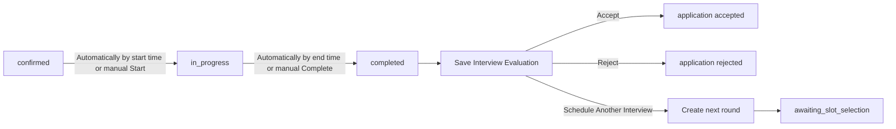

# S02B — استكمال المقابلات والقرار النهائي لطلب الموهبة

الحالة: **معتمدة وتم تنفيذها**  
تاريخ الإعداد: 26 أكتوبر 2026  
النطاق: استكمال دورة `Talent Application` من المقابلة المؤكدة حتى تقييم المقابلة والقرار النهائي بقبول الموهبة أو رفضها أو إضافتها إلى الـBlacklist، مع إدارة حالة الموهبة بعد القرار.  
عرض التسليم: مقابلة حقيقية تنتقل بين حالاتها، تُقيّم بعد انتهائها، ثم يُحفظ القرار النهائي وتظهر حالة الموهبة الصحيحة للأدمن والموهبة.

## 1. مرجع التصميم

تمت مراجعة شاشات الويب والموبايل داخل ملف Figma في:

- `Portal(talent - admin - client)`.
- `Application(talent-client)`.

الشاشات التي يعتمد عليها السبرنت:

- Admin: `All Interviews` و`My Interviews`.
- Admin: تفاصيل المقابلة بحالات Scheduled وConfirmed وIn Progress وCompleted وCancelled.
- Admin: تقييم المقابلة وأزرار Reject وAccept وSchedule Interview.
- Admin: Interview History وعرض كل Round ونتيجتها.
- Talent: المقابلة المؤكدة وزر Join.
- Talent: Interview Completed وانتظار القرار.
- Talent: الرفض بعد المقابلة.
- Talent: Talent Accepted.

## 2. نقطة البداية الحالية

ينتهي التنفيذ الحالي عند:

```text
talent_application.status = interview_required
interview.status = confirmed
interview_slot.status = selected
```

الموجود حاليًا:

- إنشاء المقابلة الأولى والمواعيد اليدوية.
- اختيار الموهبة لموعد.
- إنشاء Google Calendar Event وGoogle Meet للمقابلة Online.
- رفض المواعيد مرتين كحد أقصى.
- إلغاء الموعد المؤكد وطلب إعادة الجدولة مرة واحدة.
- إرسال مواعيد بديلة من الأدمن.
- إرجاع `screen_state` وFAQs والأفعال المتاحة للموهبة.

المشكلة الأساسية أن `interviews.application_id` فريد، والعلاقة الحالية `hasOne`، بينما التصميم يدعم عدة جولات مقابلات لكل طلب.

## 3. هدف السبرنت



يبقى `talent_application.status = interview_required` طوال جولات المقابلات، ثم يتحول فقط إلى `accepted` أو `rejected` عند القرار النهائي.

## 4. القرارات المقترحة في الخطة

1. المقابلة الأولى والجولات التالية تستخدم نفس جدول `interviews` ونفس دورة المواعيد الحالية.
2. كل طلب يمكن أن يحتوي عدة Interviews مرتبة بواسطة `round_number`.
3. لا يُنشأ Round جديد قبل اكتمال وتقييم الـRound السابق.
4. لكل Interview تقييم واحد فقط، ويمكن تحديثه قبل اتخاذ القرار النهائي.
5. تقييم المقابلة يستخدم المعايير الأربعة الظاهرة في شاشة التقييم:
   - Technical Skills.
   - Communication Skills.
   - Problem Solving.
   - Soft Skills.
6. كل معيار قيمة صحيحة من 1 إلى 5، ويجب إرسال المعايير الأربعة كاملة.
7. التقارير الثلاثة اختيارية مع Validation كامل، أما `final_feedback` فمطلوب في تقييم المقابلة طبقًا لعلامة الإلزام في Figma.
8. `overall_score` لا يُخزن؛ يُحسب من المعايير الأربعة كنسبة مئوية عند بناء الاستجابة.
9. لا نخزن أوزانًا للمعايير؛ النسب الظاهرة في بعض Mockups لا تمثل إعدادات قابلة للتغيير.
10. القبول يتطلب أن تكون آخر مقابلة `completed` ولها تقييم كامل.
11. Schedule Another Interview يغلق قرار الجولة الحالية وينشئ Round تالية بمواعيد جديدة.
12. القبول في S02B يغير حالة الطلب فقط؛ إنشاء Marketplace Profile خارج هذا السبرنت.
13. كل انتقال حالة يتم داخل Transaction مع `lockForUpdate` لمنع تكرار أو تعارض القرارات.
14. الانتقال الزمني يعمل تلقائيًا، مع الإبقاء على Start وComplete كإجراءات يدوية محمية للأدمن.
15. تتم مزامنة الحالة بطريقتين معًا: Scheduled Job كل دقيقة، وReconciliation عند قراءة أو تنفيذ أي إجراء على المقابلة حتى لا تعتمد صحة الحالة على عمل الـScheduler وحده.
16. زر Join يعتمد على الوقت الفعلي لا على انتظار تحديث الحالة في قاعدة البيانات؛ يظل ظاهرًا طوال نافذة الانضمام المسموحة.
17. `final_feedback` وتقارير HR وTechnical وPsychology ظاهرة للموهبة داخل Interview Evaluations كما في Figma، وليست ملاحظات داخلية.
18. لا نضيف `decision_feedback` مستقلًا؛ القبول يعرض رسالة النظام الموجودة في التصميم، والرفض يعرض `final_feedback` الخاص بتقييم آخر جولة.
19. `blacklisted` ليست قيمة في `TalentApplicationStatusEnum`؛ يظل الطلب `accepted` أو`rejected` ويُستنتج `effective_status = blacklisted` من وجود Blacklist Entry فعال.
20. كل Response للأدمن يعيد `available_actions` محسوبة من حالة السجل وصلاحيات المستخدم الحالي، بنفس Pattern المستخدم في `assign` و`reassign` و`evaluate`.
21. المسؤول المعيّن في `talent_applications.assigned_admin_id` هو الوحيد الذي يدير مقابلات الطلب ويتخذ قراراتها، بشرط امتلاك الصلاحية المطلوبة. باقي من لديهم صلاحية العرض يرون التفاصيل بدون Actions.

## 5. الحالات والانتقالات

### 5.1 حالات المقابلة

الحالات الحالية:

- `awaiting_slot_selection`
- `awaiting_new_slots`
- `confirmed`
- `completed`
- `cancelled`

تُضاف:

- `in_progress`

الانتقالات المسموحة:

| من | الإجراء | إلى |
| --- | --- | --- |
| `awaiting_slot_selection` | Talent selects slot | `confirmed` |
| `confirmed` | وصول الوقت إلى `starts_at` أو Admin starts interview يدويًا | `in_progress` |
| `in_progress` | وصول الوقت إلى `ends_at` أو Admin completes interview يدويًا | `completed` |
| `confirmed` | Talent requests reschedule | `awaiting_new_slots` |
| `awaiting_new_slots` | Admin offers replacement slots | `awaiting_slot_selection` |
| `completed` | Schedule another round | تظل الجولة `completed` وتُنشأ جولة جديدة |

لا يسمح بتعديل تقييم المقابلة بعد قبول أو رفض الـTalent Application.

### 5.2 المزامنة التلقائية مع الوقت

- إذا كانت المقابلة `confirmed` ووصل الوقت إلى بداية الـselected slot، تتحول تلقائيًا إلى `in_progress` ويسجل `started_at`.
- إذا كانت المقابلة `in_progress` ووصل الوقت إلى نهاية الـselected slot، تتحول تلقائيًا إلى `completed` ويسجل `completed_at`.
- إذا تأخر الـScheduler وكانت المقابلة ما زالت `confirmed` بعد نهاية الموعد، ينفذ الـReconciliation الانتقالين بالترتيب داخل نفس Transaction ويسجل الحدثين بدون تكرار.
- عند الانتقال التلقائي تكون قيمة `started_at` أو`completed_at` هي وقت الموعد المقابل، وعند الانتقال اليدوي تكون القيمة هي وقت تنفيذ الإجراء فعليًا.
- الـScheduled Job يعمل كل دقيقة، لكن كل List وDetails وTalent Application response وأي Action تستدعي نفس خدمة المزامنة قبل بناء الاستجابة أو التحقق من الانتقال.
- الإجراءات اليدوية Idempotent، ولا تنشئ حدثًا جديدًا إذا كانت الحالة وصلت بالفعل لنفس النتيجة تلقائيًا.

### 5.3 حالات Talent Application

| الحالة الحالية | القرار | الحالة الجديدة |
| --- | --- | --- |
| `interview_required` | Accept | `accepted` |
| `interview_required` | Reject | `rejected` |
| `interview_required` | Schedule another round | `interview_required` |

## 6. تعديلات قاعدة البيانات المقترحة

تم تعديل migration جداول تقييم المواهب الموجودة بعد اعتماد الخطة، بدون إنشاء migration إضافية لنفس الجداول.

### 6.1 تعديل `interviews`

إزالة التفرد الحالي من:

```text
application_id unique
```

وإضافة:

| العمود | النوع | الغرض |
| --- | --- | --- |
| `round_number` | unsigned small integer | ترتيب الجولة داخل الطلب |
| `started_at` | nullable timestamp | وقت بدء المقابلة فعليًا |
| `completed_at` | nullable timestamp | وقت إنهاء المقابلة |

القيود والفهارس:

- Unique على `(application_id, round_number)`.
- Index على `(application_id, status, round_number)` لدعم الوصول إلى الجولة الحالية والتاريخ.
- لا نضيف `overall_score` أو `final_decision` إلى جدول المقابلات.

### 6.2 جدول `interview_evaluations`

| العمود | النوع | الإلزام |
| --- | --- | --- |
| `id` | bigint | مطلوب |
| `interview_id` | unique FK → `interviews.id` | مطلوب |
| `evaluator_admin_id` | FK → `admins.id` | مطلوب |
| `technical_skills_rating` | unsigned tiny integer | مطلوب، 1 إلى 5 |
| `communication_skills_rating` | unsigned tiny integer | مطلوب، 1 إلى 5 |
| `problem_solving_rating` | unsigned tiny integer | مطلوب، 1 إلى 5 |
| `soft_skills_rating` | unsigned tiny integer | مطلوب، 1 إلى 5 |
| `hr_report` | nullable text | اختياري |
| `technical_report` | nullable text | اختياري |
| `psychology_report` | nullable text | اختياري |
| `final_feedback` | text | مطلوب، ويظهر للموهبة طبقًا للتصميم |
| timestamps | timestamps | — |

لا نحتاج جدول criteria أو weights؛ المعايير ثابتة في التصميم.

### 6.3 Feedback القرار ورفض الطلب

- لا نضيف عمود `decision_feedback` إلى `talent_applications` لأنه غير موجود في Figma وسيكرر بيانات التقييم.
- `final_feedback` في تقييم آخر جولة هو النص العام الذي يظهر للموهبة كتقييم نهائي، ويستخدم في شاشة الرفض بعد المقابلة.
- تقارير `hr_report` و`technical_report` و`psychology_report` تظهر للموهبة داخل تفاصيل Interview Evaluations كما في Figma.
- رسالة القبول نص نظام مترجم ثابت مطابق لشاشة Talent Accepted، ولا تحتاج عمودًا جديدًا.
- يظل `blacklist_reason` داخليًا للأدمن فقط ولا يظهر ضمن Feedback العام.

### 6.4 حالة الـBlacklist

- نستخدم جدول `talent_blacklist_entries` الحالي؛ لا نضيف `blacklisted` إلى `TalentApplicationStatusEnum` ولا ننشئ عمود حالة مكررًا على `talents`.
- السجل الفعال هو الذي تكون فيه `removed_at = null`.
- الحقول الحالية `blacklist_reason`, `blocked_by_admin_id`, `blocked_at`, `removed_at`, `removed_by_admin_id` كافية للأكشنز المعتمدة.
- النتيجة التاريخية للطلب تظل `accepted` أو`rejected`، بينما `effective_status` محسوبة في الـResources والـQueries.

## 7. العلاقات المطلوبة

### `TalentApplication`

تتغير:

```php
interview(): HasOne
```

إلى:

```php
interviews(): HasMany
```

مع Helpers للوصول إلى:

- `latestInterview`
- `currentInterview`

### `Interview`

تُضاف:

- `evaluation(): HasOne`
- Casts لـ`started_at` و`completed_at`.

## 8. الصلاحيات

نضيف صلاحيات مستقلة لموديول المقابلات بدل ربط كل الإجراءات بصلاحية مراجعة الملف:

- `admin.interviews.view`
- `admin.interviews.manage`
- `admin.interviews.evaluate`
- `admin.interviews.decide`

ونضيف لإدارة حالات المواهب بعد القرار:

- `admin.talents.view`
- `admin.talents.manage-blacklist`
- `admin.talents.manage-reapply`

السلوك:

- `view`: All Interviews وMy Interviews والتفاصيل.
- `manage`: Start وComplete وReschedule وإدارة المواعيد.
- `evaluate`: حفظ وتحديث تقييم المقابلة.
- `decide`: Accept وReject وSchedule Another Interview.
- `admin.talents.view`: قوائم Accepted وRejected وBlacklisted وتفاصيل Talent Profile.
- `admin.talents.manage-blacklist`: أكشنا Figma المسميان Add to Blacklist وRemove from Blacklist.
- `admin.talents.manage-reapply`: أكشن Edit Reapply للموهبة المرفوضة.

`My Interviews` تعني مقابلات الطلبات المعيّنة للمستخدم الحالي في `assigned_admin_id`، وليست كل مقابلة أضيف فيها كـInterviewer. Start وComplete وEvaluate وAccept وReject وSchedule Another Interview متاحة فقط لهذا المسؤول مع الصلاحية المناسبة.

تُضاف الصلاحيات إلى `AdminPermissionEnum` و`PermissionSeeder` و`AdminRoleSeeder`، بدون الاعتماد على اسم الـRole.

## 9. Admin API

### 9.1 قائمة المقابلات

```http
GET /api/v1/admin/interviews
```

Query parameters:

```text
scope=all|my
search=
status[]=
type[]=
interviewer_admin_id=
scheduled_from=
scheduled_to=
sort=newest|oldest
per_page=20
```

ترجع:

- بيانات الموهبة والطلب.
- رقم الجولة.
- نوع وحالة المقابلة.
- الموعد المختار.
- المقابلين.
- الأفعال المتاحة للمستخدم الحالي.

### 9.2 تفاصيل المقابلة

```http
GET /api/v1/admin/interviews/{interview}
```

تشمل:

- معلومات Talent Application.
- تفاصيل الجولة والموعد المختار.
- Interviewers.
- Evaluation إن وُجدت.
- Interview History لكل الجولات.
- `available_actions`.

### 9.3 بدء المقابلة

```http
POST /api/v1/admin/interviews/{interview}/start
```

بدون Body.

الشروط:

- الحالة `confirmed`.
- يوجد selected slot.
- المستخدم لديه `admin.interviews.manage`.
- يسمح بالبدء اليدوي من بداية نافذة Join: قبل `starts_at` بـ15 دقيقة، وحتى `ends_at`.
- يسجل `started_at = now()` في البدء اليدوي.
- العملية Idempotent إذا كانت المقابلة بالفعل `in_progress` نتيجة البدء اليدوي أو التلقائي.

### 9.4 إنهاء المقابلة

```http
POST /api/v1/admin/interviews/{interview}/complete
```

بدون Body.

الشروط:

- الحالة `in_progress`.
- يسمح للأدمن بإنهائها يدويًا قبل نهاية الموعد إذا انتهت المقابلة فعليًا.
- يسجل `completed_at = now()` في الإنهاء اليدوي.
- العملية Idempotent إذا كانت المقابلة أصبحت `completed` تلقائيًا.

### 9.5 المزامنة التلقائية

لا تحتاج Endpoint عامة. تُنفذ من Service واحدة تستخدم في:

- Scheduled Job كل دقيقة لمزامنة المقابلات المستحقة.
- `GET /admin/interviews` و`GET /admin/interviews/{interview}`.
- `GET /talent/application`.
- كل Start وComplete وEvaluation وقرار نهائي قبل التحقق من الحالة.

تستخدم الخدمة Query محددة للحالات المفتوحة مع Batch processing و`lockForUpdate`، وتكتب أحداث الانتقال مرة واحدة فقط.

### 9.6 حفظ تقييم المقابلة

```http
PUT /api/v1/admin/interviews/{interview}/evaluation
```

```json
{
  "technical_skills_rating": 4,
  "communication_skills_rating": 5,
  "problem_solving_rating": 4,
  "soft_skills_rating": 3,
  "hr_report": "Strong communication and ownership.",
  "technical_report": "Meets the expected technical level.",
  "psychology_report": null,
  "final_feedback": "Recommended to continue."
}
```

الشروط:

- المقابلة `completed`.
- الطلب ما زال `interview_required`.
- المعايير الأربعة و`final_feedback` مطلوبة، والتقارير الثلاثة اختيارية.
- التقييم Update-or-Create قبل القرار النهائي.

### 9.7 قبول الطلب

```http
POST /api/v1/admin/talent-applications/{application}/accept
```

بدون Body؛ رسالة القبول نص نظام مترجم ثابت مطابق لشاشة Figma.

العملية:

- تقفل Talent Application.
- تتحقق أن آخر Interview مكتملة ومقيّمة.
- تحول الحالة إلى `accepted`.
- تسجل منفذ القرار ووقته.
- تسجل event باسم `application_accepted`.

### 9.8 الرفض بعد المقابلة

نستخدم Endpoint الرفض الحالي:

```http
POST /api/v1/admin/talent-applications/{application}/reject
```

مع السماح به بعد مقابلة مكتملة ومقيّمة وإضافة:

```json
{
  "reapply_policy": "allowed_after_period",
  "reapply_after_months": 6
}
```

الـFeedback الظاهر للموهبة يأتي من `final_feedback` في تقييم آخر مقابلة، وليس من حقل مكرر داخل طلب الرفض.

### 9.9 جدولة جولة جديدة

نستخدم عقد جدولة المقابلة الحالي:

```http
POST /api/v1/admin/talent-applications/{application}/schedule-interview
```

إذا كان الطلب في `under_review` ينشئ Round #1.  
إذا كان في `interview_required` وآخر Round مكتملة ومقيّمة ينشئ Round التالية.

لا يُسمح بإنشاء Round جديدة إذا كانت هناك مقابلة مفتوحة أو لم تُقيّم الجولة السابقة.

### 9.10 قائمة وتفاصيل المواهب بعد القرار

طبقًا لموديول `Talents` المستقل في Figma:

```http
GET /api/v1/admin/talents
GET /api/v1/admin/talents/{talent}
```

تدعم القائمة:

```text
state[]=accepted|rejected|blacklisted
rejection_stage=before_interview|after_interview
search=
sort=newest|oldest
per_page=20
```

وترجع الإحصائيات الظاهرة في Figma:

- `accepted`.
- `rejected_before_interview`.
- `rejected_after_interview`.
- `blacklisted`.

كل عنصر وتفاصيل الموهبة يعيدان:

- `application_status`: القيمة الأصلية `accepted` أو`rejected`.
- `effective_status`: تصبح `blacklisted` عند وجود Blacklist Entry فعال، وإلا تساوي حالة الطلب.
- بيانات القرار و`reapply_at` وحالة الـBlacklist بدون إظهار `blacklist_reason` للموهبة.
- `available_actions` طبقًا للصلاحيات والحالة الحالية.

أسماء الأكشنز مطابقة قدر الإمكان للأزرار في Figma:

| `available_actions` | شرط الظهور |
| --- | --- |
| `add_to_blacklist` | الحالة Accepted أوRejected، ولا يوجد حظر فعال، ولديه `admin.talents.manage-blacklist` |
| `remove_from_blacklist` | يوجد حظر فعال، ولديه `admin.talents.manage-blacklist` |
| `edit_reapply` | الطلب Rejected وغير محظور، ولديه `admin.talents.manage-reapply` |

### 9.11 Add to Blacklist

اسم المسار قريب من نص الزر في Figma:

```http
POST /api/v1/admin/talents/{talent}/add-to-blacklist
```

```json
{
  "blacklist_reason": "Repeated policy violations."
}
```

- يقبل Talent حالتها الأصلية `accepted` أو`rejected`.
- لا يغير `talent_applications.status`، بل ينشئ Blacklist Entry فعالًا ويصبح `effective_status = blacklisted`.
- `blacklist_reason` مطلوب وداخلي للأدمن فقط.
- العملية محمية بـ`lockForUpdate` وترفض وجود حظر فعال آخر.

### 9.12 Remove from Blacklist

```http
POST /api/v1/admin/talents/{talent}/remove-from-blacklist
```

إذا كان الطلب الأصلي `accepted` لا يحتاج Body، وتعود `effective_status` إلى `accepted`.

إذا كان الطلب الأصلي `rejected` يرسل الأدمن اختيار Figma الخاص بالسماح بإعادة التقديم:

```json
{
  "reapply_after_months": 6
}
```

- يحدث `removed_at` و`removed_by_admin_id` بدون حذف سجل الحظر.
- للطلب المرفوض يحسب `reapply_at` من وقت إزالة الحظر.
- العملية Idempotent إذا كان الحظر مزالًا بالفعل، ولا تنشئ Events مكررة.

### 9.13 Edit Reapply

```http
PATCH /api/v1/admin/talents/{talent}/edit-reapply
```

```json
{
  "reapply_after_months": 6
}
```

- متاح فقط لطلب `rejected` بدون Blacklist Entry فعال.
- يعاد حساب `reapply_at` من `review_decided_at` طبقًا لسياسة الرفض الأصلية.
- لا يسمح بتعديل موعد إعادة التقديم لموهبة محظورة.

## 10. Talent API

يظل Endpoint الرئيسي:

```http
GET /api/v1/talent/application
```

ويُحدّث ليعيد:

- `application_status` كحالة الطلب الأصلية.
- `effective_status = blacklisted` عند وجود حظر فعال، وإلا تساوي حالة الطلب.
- `current_interview` بدل مقابلة واحدة ثابتة.
- `interview_history` مرتبًا حسب `round_number`.
- `evaluation` لكل جولة مكتملة: المعايير والدرجة المحسوبة وتقارير HR وTechnical وPsychology و`final_feedback`، طبقًا لشاشة Interview Evaluations في Figma.
- رسالة حالة مترجمة للقبول أو الرفض؛ لا يوجد `decision_feedback` مستقل.

الحالات الجديدة المستخدمة للواجهة:

- `interview_confirmed`
- `interview_in_progress`
- `interview_completed`
- `accepted`
- `rejected`
- `blacklisted`، ويمكن للواجهة إعادة استخدام Layout الرفض مع إخفاء Apply Again والعدّاد وإظهار رسالة عدم الأهلية.

زر Join يظهر فقط عندما:

- المقابلة Online.
- يوجد `meeting_url`.
- الوقت الحالي من 15 دقيقة قبل `starts_at` وحتى قبل `ends_at`.
- المقابلة غير `cancelled` والطلب لم يُغلق بالرفض.

تعيد الاستجابة دائمًا:

- `join_window_starts_at = starts_at - 15 minutes`.
- `join_window_ends_at = ends_at`.
- `can_join` محسوبة من الوقت الحالي.

لا تعتمد `can_join` على انتظار الـScheduler لتغيير `confirmed` إلى `in_progress`؛ لذلك يظل الزر ظاهرًا طوال نافذته حتى لو تأخرت مزامنة الحالة لثوانٍ.

## 11. الأحداث المطلوبة

يُستكمل `talent_application_events` بالأحداث:

- `interview_started`
- `interview_completed`
- `interview_evaluation_saved`
- `next_interview_round_scheduled`
- `application_accepted`
- `application_rejected_after_interview`
- `talent_added_to_blacklist`
- `talent_removed_from_blacklist`
- `talent_reapply_updated`

يحتوي `data` عند الحاجة على `interview_id` و`round_number` و`transition_source = automatic|manual`.

## 12. قواعد الحماية

- لا يمكن بدء Interview غير مؤكدة.
- لا يمكن إنهاء Interview لم تبدأ.
- البدء اليدوي لا يتاح قبل نافذة Join، بينما الإنهاء اليدوي متاح بعد البدء بمجرد انتهاء المقابلة فعليًا.
- لا يمكن تقييم Interview قبل اكتمالها.
- لا يمكن قبول أو رفض الطلب قبل وجود تقييم لآخر Round مكتملة.
- لا يمكن وجود أكثر من Round مفتوحة لنفس الطلب.
- لا يمكن إنشاء Round جديدة بعد قبول أو رفض الطلب.
- لا يمكن تعديل تقييم مقابلة بعد القرار النهائي.
- تكرار Accept أو Reject لا ينشئ أحداثًا أو قرارات مكررة.
- الـScheduler وطلبات الـAPI يستخدمان نفس خدمة المزامنة ونفس Locks، فلا ينشئان انتقالات أو Events مكررة عند العمل معًا.
- `can_join` محسوبة بالوقت من الـselected slot ولا تعتمد على قيمة Status قديمة في قاعدة البيانات.
- لا يمكن إنشاء أكثر من Blacklist Entry فعال للموهبة نفسها.
- إضافة الموهبة للـBlacklist لا تغير النتيجة التاريخية للطلب؛ الأولوية في العرض تكون لـ`effective_status = blacklisted`.
- الموهبة المحظورة لا تستطيع إعادة التقديم، حتى لو كان `reapply_at` قد مر.
- إزالة الحظر Soft Removal بواسطة `removed_at` و`removed_by_admin_id` وليست حذفًا للسجل.
- `blacklist_reason` يظهر فقط لمن يملك صلاحية إدارة الـBlacklist، ولا يرجع في Talent API.
- كل `available_actions` تبنى من الصلاحيات والحالة على السيرفر، ولا يعتمد الحماية على إخفاء الزر في الواجهة.
- كل فحص يعتمد على Enums ومقارنة IDs موحدة، بدون strict comparison بين integer وstring قادمين من Driver مختلف.

## 13. خارج نطاق S02B

- إنشاء `talent_marketplace_profiles`.
- ظهور الموهبة في بحث العملاء.
- Active Hiring Processes بعد القبول.
- Offers وCounter Offers.
- مقابلات التوظيف الخاصة بالعميل.
- العقود والمدفوعات.
- Unlock Detailed Rejection Feedback والمدفوعات المرتبطة به.
- إعادة تقديم Talent Application جديدة بعد انتهاء مدة الانتظار.
- Attendance وNo-show المتقدم للمقابلات، ما لم يُطلب ضمن مراجعة الخطة.

## 14. ترتيب التنفيذ بعد اعتماد الخطة

1. تعديل Enums والعلاقات والسكيما المعتمدة.
2. إضافة Interview Evaluation model وrequests وresources.
3. تنفيذ state transitions وخدمة المزامنة الزمنية المشتركة وخدمات القفل والمعاملات.
4. تنفيذ Admin Interviews list/details/actions.
5. تنفيذ Accept ورفض ما بعد المقابلة وجدولة Round جديدة.
6. تنفيذ قوائم Admin Talents وأكشنز Add to Blacklist وRemove from Blacklist وEdit Reapply.
7. تحديث Talent Application response والـscreen states و`effective_status`.
8. إضافة الصلاحيات وتحديث Seeders.
9. إضافة الرسائل العربية والإنجليزية.
10. إضافة اختبارات transitions اليدوية والتلقائية ونافذة Join والـBlacklist و`available_actions` والتزامن والصلاحيات.
11. تحديث توثيق التنفيذ وAPI enums.
12. توليد Admin وTalent OpenAPI بأمثلة كاملة للـBody والHeaders والParameters.
13. مراجعة Apidog والتأكد من ظهور endpoints داخل:
    - `admin/interviews`
    - `admin/talent-applications`
    - `admin/talents`
    - `talent/application`

## 15. معايير القبول

- الأدمن يرى All Interviews وMy Interviews طبقًا لصلاحياته.
- كل الأدمن أصحاب صلاحية العرض يمكنهم رؤية المقابلات، لكن `available_actions` وتنفيذ Actions الإدارة والقرار مقصوران على المسؤول المعيّن للطلب.
- المقابلة تنتقل من Confirmed إلى In Progress ثم Completed تلقائيًا حسب الموعد أو يدويًا بإجراءات محمية.
- لا يمكن حفظ Interview Evaluation ناقص.
- يمكن جدولة Round جديدة بعد تقييم الجولة السابقة فقط.
- Interview History يعرض كل الجولات بترتيبها وحالاتها ودرجاتها.
- Accept يحول Talent Application إلى `accepted` مرة واحدة فقط.
- Talent API يعيد `screen_state = accepted` بعد القرار مباشرة.
- Reject بعد المقابلة يعيد `final_feedback` ومدة إعادة التقديم بشكل واضح.
- تقييمات الجولات المكتملة تعرض للموهبة المعايير والتقارير و`final_feedback` كما في Figma.
- يظهر Join من 15 دقيقة قبل البداية وحتى نهاية الموعد فقط، ويظل ظاهرًا طوال النافذة دون الاعتماد على تأخر تحديث Status.
- قوائم Admin Talents تطابق تبويبات وإحصائيات Accepted وRejected وBlacklisted في Figma.
- `available_actions` يعيد `add_to_blacklist` و`remove_from_blacklist` و`edit_reapply` فقط عندما تسمح الحالة والصلاحية معًا.
- إضافة موهبة Accepted إلى الـBlacklist لا تمحو قرار قبولها؛ تعرض كـBlacklisted حتى إزالة الحظر ثم تعود Accepted.
- إزالة الحظر عن موهبة Rejected تضبط `reapply_at` حسب المدة المختارة.
- لا يحدث تعارض أو قرار مزدوج عند إرسال طلبات متزامنة.

## 16. القرارات المعتمدة

1. `in_progress` و`completed` ينتقلان تلقائيًا حسب وقت الـselected slot، ويمكن للأدمن تنفيذ Start وComplete يدويًا أيضًا.
2. التشغيل التلقائي يجمع بين Scheduled Job كل دقيقة وReconciliation عند استخدام الـAPI لضمان صحة الحالة حتى عند تأخر الـScheduler.
3. نافذة Join تبدأ قبل الموعد بـ15 دقيقة وتنتهي عند `ends_at`، و`can_join` تعتمد مباشرة على الوقت حتى يظل الزر ظاهرًا طوال النافذة.
4. طبقًا لمراجعة Figma، تقارير HR وTechnical وPsychology و`final_feedback` تظهر للموهبة في Interview Evaluations. `final_feedback` مطلوب، ولا نضيف `decision_feedback` مستقلًا.
5. رسالة القبول ثابتة ومترجمة طبقًا لشاشة Talent Accepted، والرفض يعرض `final_feedback` من تقييم آخر جولة. `blacklist_reason` يظل داخليًا فقط.
6. Interviews موديول مستقل وله الصلاحيات الأربع: `view`, `manage`, `evaluate`, `decide`، ولا يعاد استخدام صلاحيات Talent Applications بدلًا منها.
7. إدارة المواهب بعد القرار تستخدم Permissions مستقلة، وكل Action يرجع من `available_actions` مثل Pattern التعيين والتقييم الحالي.
8. أسماء الأكشنز والمسارات قريبة من Figma: `add_to_blacklist` و`remove_from_blacklist` و`edit_reapply`، مع مسارات `add-to-blacklist` و`remove-from-blacklist` و`edit-reapply`.
9. الـBlacklist حالة فعالة مستقلة فوق نتيجة الطلب، وليست قيمة جديدة في `TalentApplicationStatusEnum`.

