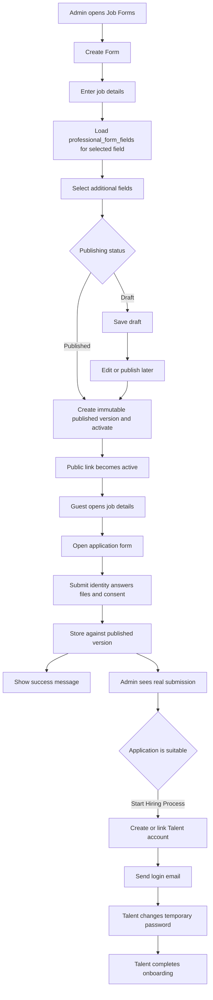

# S03 — النماذج الخارجية للوظائف

الحالة: **خطة معتمدة وجاهزة للتنفيذ**  
آخر مراجعة: 22 أكتوبر 2026  
النطاق: إنشاء نموذج وظيفة من لوحة الأدمن، اختيار حقوله من `professional_form_fields` حسب المجال، نشر الرابط العام، واستقبال وعرض التقديمات الحقيقية.  
عرض التسليم: مشرف ينشر نموذجًا، يرسل زائر تقديمًا حقيقيًا من الرابط العام، ثم يرى المشرف التقديم وإجاباته والـCV.

## 1. شاشات Figma التي تمت مراجعتها

| الجزء | Node | ما يظهر في التصميم |
| --- | --- | --- |
| قائمة Job Forms | `4387:64364` | Search، Filter، Create Form، Application Count، Activation، View، Edit، Copy Link، Delete |
| إعداد النموذج | `4541:62666` | Field، Job title، Job Description، About the role، Work Type، Work Mode، الأقسام المتكررة، Publishing status |
| اختيار الحقول | `4549:64576`, `4549:65134`, `4549:66081` | أربعة حقول ثابتة، كتالوج حقول المجال، بحث واختيار وملخص الحقول المختارة |
| نجاح الإنشاء والحذف | `4401:72622`, `4401:72376` | Success message وDelete confirmation |
| قائمة التقديمات | `4414:76208`, `4432:59238` | Search، Filter، Export، حالة التقديم، View submission |
| تفاصيل التقديم | `4414:76117`, `4397:68203` | بيانات المتقدم، الأسئلة والإجابات، CV، Start Hiring Process |
| الوظائف العامة | `4528:95062`, `4528:95530` | قائمة الوظائف وصفحة التفاصيل العامة |
| نموذج التقديم العام | `4528:96153` | معلومات المتقدم، الأسئلة المختارة، رفع CV، consent، Submit application |
| نجاح التقديم | `4401:75924` | رسالة نجاح وما سيحدث لاحقًا |

النتائج المؤكدة من التصميم:

1. لا توجد شاشة لإنشاء سؤال حر؛ الأدمن يختار حقولًا موجودة مسبقًا.
2. الحقول المتاحة تعتمد على `Professional Field`.
3. التصميم الأصلي يعرض Applicant Name وEmail وMobile Number وJob Title، لكن القرار المعتمد يستبدل Job Title بـCV؛ الحقول الثابتة النهائية هي Applicant Name وEmail وMobile Number وCV ولا تحذف.
4. كتالوج الحقول يعرض label وprompt وinput type مثل Dropdown وMultiple choice وURL وFile upload وNumber.
5. `Publishing status` داخل إعداد النموذج مختلف عن `Activation` في القائمة.
6. التقديم العام متاح للزائر بدون حساب.
7. الـflow العام الظاهر هو: قائمة وظائف، تفاصيل وظيفة، نموذج تقديم، رسالة نجاح.

## 2. قرارات التصميم المعتمدة والقرارات التقنية المقترحة

### 2.1 قرارات أكدها المستخدم

1. مصدر الأسئلة هو `professional_form_fields`؛ لن ننشئ `job_question_catalog`.
2. عنوان النموذج لا يرسل في input مستقل؛ السيرفر يولده من المسمى الوظيفي المختار ويحفظه كـsnapshot للعرض.
3. `Copy Link` يفتح صفحة تفاصيل الوظيفة الموجودة ضمن `Explore Open Positions`، ومنها ينتقل الزائر إلى نموذج التقديم من زر `Apply Now`.
4. إلزامية كل سؤال ثابتة حسب تصميم الحقل في Figma؛ الـFrontend يعرضها ويتحقق منها، والـBackend يطبق Validation مطابقًا باعتباره المرجع النهائي. لا يوجد toggle للإلزامية داخل Form Generator.
5. يسمح لنفس البريد بالتقديم أكثر من مرة على نفس النموذج.
6. `professional_field_form_field` يحدد الحقول المتاحة لكل مجال.
7. عندما يختار الأدمن تقديمًا مناسبًا ويضغط `Start Hiring Process` ينشئ النظام حساب Talent ويرسل بيانات الدخول إلى بريد المتقدم ليكمل ملفه.
8. يسمح بنشر النموذج بالحقول الأربعة الثابتة فقط؛ اختيار الأسئلة الإضافية اختياري.

### 2.2 قرارات تقنية مقترحة لحماية التنفيذ

1. يظل جدول `professional_form_fields` الحالي بسيطًا ويخزن الـkey فقط.
2. اختيار حقول Job Form يعمل مثل الفورمز الداخلية: الـAPI يرجع keys من `professional_form_fields`، والFrontend يعرف العرض والترتيب، والBackend يطبق Validation خاصًا بالنموذج الخارجي حسب الـkey.
3. لا نعيد استخدام شكل الحقل أو إلزاميته في Talent Onboarding تلقائيًا؛ السياقان مختلفان.
4. عند النشر ننسخ تفاصيل الوظيفة والأقسام، ونثبت IDs الحقول المختارة داخل version ثابت يحمي التقديمات القديمة. ترتيب الحقول يملكه Frontend حسب الـkeys مثل الفورمز الداخلية.
5. تعديل نموذج منشور ينشئ Draft version جديدًا، ولا يغير النسخة التي استقبلت تقديمات.
6. `status=draft|published` يمثل النشر، و`is_active` يمثل إتاحة الرابط مؤقتًا.
7. الحذف Soft Delete دائمًا لحماية التقديمات.
8. Export submissions يدخل في S03 لأنه ظاهر في شاشة التقديمات.
9. إنشاء الحساب لا يحدث تلقائيًا عند التقديم؛ يحدث فقط بعد قرار الأدمن من `Start Hiring Process`.
10. كلمة المرور المرسلة بالبريد تكون عشوائية ومؤقتة، ولا يحصل الحساب على Access Token كامل قبل تغييرها في أول دخول.
11. إذا كان البريد مرتبطًا بالفعل بحساب Talent، لا ننشئ حسابًا مكررًا ولا نغير كلمة مروره؛ نربط التقديم بالحساب الموجود ونرسل له رسالة دخول واستكمال الملف.
12. لا تتحول الاستجابة الخارجية مباشرة إلى `talent_applications`؛ الموهبة تنشئ Talent Application من Onboarding الحالي بعد استكمال بياناتها.
13. لا نضيف Captcha أو Scoring أو Notifications عامة في هذه النسخة؛ نضيف فقط بريد دعوة الموهبة المطلوب لهذا الـflow.
14. لا ننشئ جدول `job_forms` منفصلًا بعلاقة one-to-one؛ `job_postings` هو الـaggregate الذي تسميه الواجهة Job Form، وترتبط به versions مباشرة. هذا يمنع تكرار العنوان والحالة والمنشئ والحذف في جدولين.

### 2.3 قرارات الحقول والنشر المعتمدة

1. اختيار `Publishing status = Published` أثناء الإنشاء ينشر الإصدار ويفعّل الرابط مباشرة، ويمكن للأدمن تعطيله لاحقًا من القائمة.
2. لا يدخل المتقدم مسمى وظيفيًا؛ الوظيفة معروفة من الرابط والـpublished snapshot. يحل `cv` محل Job Title كحقل ثابت.
3. `years_of_experience` يستخدم `JobExperienceRangeEnum` بالقيم: `less_than_1`, `1_to_3`, `3_to_5`, `5_to_10`, `more_than_10`، وتعود labels مترجمة للواجهة.
4. `notice_period_days` حقل نصي يكتب فيه المتقدم مدة الإشعار بصياغته، مثل `30 days` أو `شهر`، ولا يعتمد على enum أو قائمة اختيارات.
5. إذا اختار الأدمن حقل `expected_salary` يظهر للمتقدم المبلغ واختيار العملة معًا، وتكون العملة من جدول `currencies` الفعال.
6. الحقول الأربعة الثابتة Applicant Name وEmail وMobile Number وCV مطلوبة، و`skill_ids` مطلوب عند اختياره ضمن الأسئلة. أما `years_of_experience`, `portfolio_url`, `notice_period_days`, و`expected_salary` فاختيارية. عند إرسال راتب متوقع يجب إرسال المبلغ والعملة معًا.

### 2.4 تفاصيل حُسمت في المراجعة النهائية لـFigma

1. صفحة `Explore Open Positions` تعرض البحث بالمهارة وفلاتر Department وJob Type وWork Location وExperience Level، وتعرض بطاقات الوظائف Skills وLocation. شاشة Form Setup لا تحتوي inputs لاختيار Job Skills أوExperience Level أوCountry/City.
   - Skills الوظيفة تؤخذ من المهارات الفعالة المرتبطة بـ`professional_field_id` من خلال `professional_field_skill`، من غير `job_posting_skills` أوinput إضافي. نفس المصدر يوفر خيارات سؤال `skill_ids` للمتقدم.
   - كل وظائف المجال تعرض مجموعة مهارات المجال الحالية؛ لا توجد مهارات مخصصة لكل وظيفة في S03.
   - لن نضيف `seniority_level`, `country_id` أو`city_id` في S03 لأنها غير موجودة في شاشة الإنشاء.
   - Department في القائمة العامة يطابق `professional_field_id`، وJob Type يطابق `work_type`، وWork Location يطابق `work_mode`.
   - البحث العام في S03 يكون بالعنوان والوصف ومهارات المجال، والفلاتر المفعلة هي المجال والمهارة ونوع العمل ونمط العمل. ترجع خيارات Experience Level من الـenum لتجهيز الواجهة، لكن تطبيقها على النتائج مؤجل حتى يظهر لها input واضح في Form Setup وتخزن على الوظيفة. Country/City مؤجلة أيضًا.
2. الكادران الخاصان بقائمة التقديمات يمثلان حالتين مكملتين وليسا تصميمين متعارضين:
   - Node `4414:76208`: حالة Submission مستلمة، وتعرض Export وStatus وView وملخص التقديم.
   - Node `4432:59238`: قائمة متعددة الصفوف، وتحتوي في بنيتها Export وFilter وحذفًا فرديًا وView. عند تحديد rows تتبدل أداة Export في الواجهة إلى `Clear all selected`.
   - التنفيذ يجمع كل الأكشنز الظاهرة: Search وFilter وExport وStatus وView وتنزيل CV والحذف الفردي و`Start Hiring Process`.
   - تحديد الصفوف و`Clear all selected` حالة UI يديرها Frontend ولا تحتاج endpoint. لا نضيف Bulk Delete لأن التصميم لا يعرض زر تنفيذ حذف جماعي.

## 3. الموجود حاليًا

### جاهز للبناء عليه

- `professional_fields` وترجماته ووصفه.
- `job_titles` وربطه بالمجالات.
- Master Data مثل Skills وTools.
- `professional_form_fields` وفيه `id`, `key`, timestamps.
- `professional_field_form_field` لربط الحقول بالمجال.
- `ProfessionalFormFieldEnum` وقائمة المفاتيح الحالية.
- `GET /api/v1/admin/fields/form-fields` لإرجاع available وselected keys حسب المجال.
- جدول `media` وprivate disk لحفظ الملفات.
- Admin roles والـpermissions الديناميكية.
- Scribe وAdmin/Website OpenAPI وأمثلة Apidog الثابتة.

### غير موجود

- Module للـJob Forms.
- جداول الوظائف والنماذج والإصدارات والتقديمات والإجابات.
- Validation خاص بـJob Forms لكل key.
- Admin APIs للإدارة والنشر والتفعيل والتقديمات.
- Public APIs للوظائف والنموذج وإرسال التقديم.

## 4. اختلاف الحقول بين Onboarding وJob Forms

| المفتاح | Talent Onboarding | Job Form في Figma |
| --- | --- | --- |
| `years_of_experience` | integer | Dropdown بنطاقات مثل `3–5 years` |
| `skill_ids` | IDs | Multiple choice من Skills الخاصة بالمجال |
| `portfolio_url` | URL مستقل | Portfolio / GitHub link |
| `notice_period_days` | string | Text input |
| `expected_salary` | min وmax وعملة | Amount مع Currency selector عند اختيار الحقل |
| `cv` | ملف الموهبة | حقل ثابت مطلوب مع كل submission، ولا يظهر ضمن الأسئلة الإضافية القابلة للاختيار |

لن نغير `ProfessionalFieldFormValidationFactory`. سننشئ `JobFormValidationFactory` منفصلًا يطبق قواعد النموذج الخارجي حسب الـkey، لأن شكل بعض القيم يختلف عن Talent Onboarding. الـFrontend يستقبل keys فقط مثل الفورمز الداخلية ويحدد label وprompt وinput type وعلامة الإلزامية. الخيارات الديناميكية مثل Skills وCurrencies ترجع من Master Data، وخيارات enums ترجع من endpoints الخاصة بها.

## 5. حدود السبرنت

يدخل في S03:

- قائمة Job Forms والبحث والفلترة وpagination.
- إنشاء النموذج على خطوتي Figma.
- بيانات الوظيفة والأقسام المتكررة.
- اختيار الحقول المتاحة للمجال.
- حفظ Draft أو النشر مباشرة.
- تعديل النموذج بإصدار جديد عند الحاجة.
- التفعيل والتعطيل وCopy Link وSoft Delete.
- قائمة الوظائف العامة وتفاصيلها.
- نموذج تقديم عام بدون تسجيل دخول.
- رفع CV وإرسال تقديم حقيقي ورسالة النجاح.
- قائمة التقديمات وتفاصيلها وتنزيل الملفات.
- Export CSV.
- Soft Delete فردي للتقديمات التي لم يبدأ لها Hiring Process.
- تحويل التقديم المناسب إلى حساب Talent من `Start Hiring Process`.
- إرسال بريد يحتوي كلمة مرور مؤقتة للحساب الجديد وتعليمات الدخول واستكمال البيانات.
- إجبار الحساب المنشأ من الأدمن على تغيير كلمة المرور في أول Login.
- توثيق Admin OpenAPI لإدارة النماذج، وWebsite OpenAPI للوظائف والتقديم العام، كاملين بالأمثلة والـheaders والـparameters.

الأكشنز المطلوبة كاملة:

- Job Forms: Create، View، Edit، Publish، Activate/Deactivate، Copy Link، وSoft Delete.
- Submissions: Search، Filter، Export CSV، View، Status، Download CV، Soft Delete فردي، وStart Hiring Process.
- Public: Search، Filter، View Details، Apply Now، Submit Application، Back to Home، وExplore More Opportunities. آخر ثلاثة أزرار تنقلات Frontend وتستهلك الـPublic APIs ولا تحتاج endpoints إضافية مستقلة.

خارج S03:

- إنشاء Talent Application تلقائيًا من التقديم الخارجي.
- نسخ كل إجابات النموذج الخارجي أو الـCV تلقائيًا إلى ملف Talent؛ في S03 ينشأ الحساب بالبيانات الأساسية ثم تكمل الموهبة Onboarding.
- إنشاء Hiring Request أو بدء تعاقد من التقديم الخارجي.
- إنشاء أسئلة حرة أو إدارة تعريفات الحقول من لوحة الأدمن.
- رسائل البريد والإشعارات العامة وScreening وRanking؛ بريد دعوة Talent فقط داخل النطاق.
- Saved jobs وتخصيص تصميم الرابط.

## 6. الـFlow



## 7. السكيما المقترحة

سنحدّث قسم JobsForms في DBML عند بدء التنفيذ، ونحذف `job_question_catalog` منه.

### 7.1 `job_postings`

بيانات الوظيفة العامة:

| العمود | النوع |
| --- | --- |
| `id` | bigint |
| `professional_field_id` | FK → professional_fields |
| `job_title_id` | FK → job_titles |
| `title` | varchar(255)، يولده السيرفر من المسمى الوظيفي ويحفظه كـsnapshot |
| `slug` | unique varchar(255) |
| `summary` | text |
| `about_role` | text |
| `work_type` | varchar(32) |
| `work_mode` | varchar(32) |
| `status` | `draft` أو `published` |
| `is_active` | boolean default false |
| `published_at` | nullable timestamp |
| `created_by_admin_id` | FK → admins |
| `deleted_at` | nullable timestamp |
| timestamps | timestamps |

لا نضيف seniority أو country أو city أو department لأنها غير موجودة في شاشة الإنشاء الحالية.

### 7.2 `job_posting_sections`

| العمود | النوع |
| --- | --- |
| `id` | bigint |
| `job_posting_id` | FK → job_postings |
| `section` | `responsibility`, `requirement`, `qualification` |
| `content` | text |
| `display_order` | unsigned small integer |
| timestamps | timestamps |

قيد unique على `(job_posting_id, section, display_order)`. لا نضيف Benefits لأن شاشة الإنشاء لا تحتويه.

الرابط العام يستخدم `slug` لأن الوظيفة عامة أصلًا؛ لا نضيف `public_token` زائدًا.

### 7.3 `job_form_versions`

| العمود | النوع |
| --- | --- |
| `id` | bigint |
| `job_posting_id` | FK → job_postings |
| `version_number` | unsigned integer |
| `status` | `draft`, `published`, `retired` |
| `job_details_snapshot` | json لبيانات الوظيفة والأقسام وقت النشر |
| `identity_fields_snapshot` | json |
| `published_at` | nullable timestamp |
| timestamps | timestamps |

- unique على `(job_posting_id, version_number)`.
- الإصدار المنشور immutable.
- عند نشر إصدار جديد يتحول السابق إلى `retired` في transaction واحدة.
- تعرض Public APIs بيانات الوظيفة والأسئلة من الـpublished version snapshot، وبذلك لا يغير تعديل Draft جديد تفاصيل التقديمات القديمة.

### 7.4 `job_form_fields`

اختيارات الحقول لكل version بنفس أسلوب pivot الفورمز الداخلية:

| العمود | النوع |
| --- | --- |
| `form_version_id` | FK → job_form_versions |
| `professional_form_field_id` | FK → professional_form_fields |
| timestamps | timestamps |

- primary key مركب على `(form_version_id, professional_form_field_id)`.
- الـkey يؤخذ من علاقة `professional_form_field_id` ولا يكرر في العمود نفسه.
- لا نخزن ترتيبًا أوlabel أوprompt أوinput type أوrequired أوvalidation أوoptions؛ نفس key contract المستخدم في الفورمز الداخلية.
- الحقول الأربعة الثابتة تحفظ في `identity_fields_snapshot` ولا تكرر هنا.

### 7.5 `job_form_submissions`

| العمود | النوع |
| --- | --- |
| `id` | bigint |
| `form_version_id` | FK → job_form_versions |
| `applicant_name` | varchar(255) |
| `email` | varchar(255) |
| `phone_country_code` | varchar(5) |
| `phone_number` | varchar(20) |
| `status` | `received` أو `hiring_started` |
| `idempotency_key` | unique uuid |
| `consent_at` | timestamp |
| `submitted_at` | timestamp |
| `converted_talent_id` | nullable FK → talents |
| `converted_by_admin_id` | nullable FK → admins |
| `converted_at` | nullable timestamp |
| `deleted_at` | nullable timestamp |
| timestamps | timestamps |

- البريد غير unique؛ الـidempotency يمنع تكرار محاولة الإرسال نفسها فقط.
- الأعمدة الثلاثة تحفظ نتيجة `Start Hiring Process` وتمنع إنشاء أكثر من حساب من نفس التقديم.
- لا نضيف `converted_application_id`؛ Talent Application لا ينشأ إلا بعد إكمال Onboarding الحالي.
- الـCV لا يحتاج عمودًا في الجدول؛ يرتبط بالتقديم نفسه في Spatie Media Library داخل collection باسم `cv` وعلى private disk.
- عمود Job title الظاهر في قائمة وتفاصيل التقديمات يأتي من عنوان الوظيفة داخل `job_details_snapshot`، وليس input من المتقدم.
- يسمح بحذف `received` فقط كـSoft Delete؛ التقديم المرتبط بـTalent بعد `Start Hiring Process` لا يحذف ويرجع `409 Conflict`.

### 7.6 `job_form_answers`

| العمود | النوع |
| --- | --- |
| `id` | bigint |
| `submission_id` | FK → job_form_submissions |
| `professional_form_field_id` | FK → professional_form_fields |
| `value` | nullable json |
| timestamps | timestamps |

- unique على `(submission_id, professional_form_field_id)`.
- الـBackend يتأكد أن `professional_form_field_id` مختار ضمن version الخاص بالتقديم.
- الملفات ترتبط بـ`job_form_answers` من خلال Spatie Media Library؛ لا نضيف `media_id` لأن جدول `media` الحالي polymorphic.

## 8. حالات النظام

### Job posting

```text
draft -> published
```

- Draft غير ظاهر للعامة.
- Published له version منشور.
- الحذف يمثله `deleted_at` وليس status إضافية.

### Activation

- `false`: الرابط غير متاح ولا يظهر في القائمة العامة.
- `true`: متاح بشرط وجود version منشور.
- لا يمكن تفعيل Draft.
- نشر النموذج، سواء أثناء الإنشاء أو من Draft موجود، يضبط `is_active=true` تلقائيًا؛ ويمكن تعطيله لاحقًا من القائمة.

### Form version

```text
draft -> published -> retired
```

### Submission

```text
received -> hiring_started
```

- `received`: التقديم وصل وينتظر مراجعة الأدمن.
- `hiring_started`: الأدمن اختاره وأنشأ أو ربط حساب Talent.

### حساب Talent المنشأ من التقديم

- ينشأ `users` بنوع `talent` مع `email_verified_at=null` و`must_change_password=true`.
- ينشأ `talents` من خلال `CreateTalentAccountUseCase` الحالي.
- ينسخ الاسم والبريد والهاتف والمجال والمسمى الوظيفي فقط كبداية.
- أول Login ناجح بكلمة المرور المؤقتة يثبت أن المتقدم يملك البريد؛ عندها فقط يضبط السيرفر `email_verified_at` ويرجع `requires_password_change=true` و`reset_password_token` محدود الصلاحية بدل Access Token أو Verification OTP.
- تستخدم الواجهة endpoint تغيير كلمة المرور الحالي، وبعد نجاحه تصبح `must_change_password=false` وتحذف الجلسات والتوكنات المؤقتة.
- بعدها تسجل الموهبة الدخول بشكل طبيعي وتكمل Onboarding الموجود.

## 9. الـValidation

### إعداد النموذج

- المجال والمسمى موجودان وفعالان، والمسمى مرتبط بالمجال.
- `summary`, `about_role`, `work_type`, `work_mode` مطلوبة، أما `title` فيولده السيرفر من `job_title_id` ولا يقبله كقيمة مستقلة من الواجهة.
- عناصر الأقسام نصوص غير فارغة، والسيرفر يحفظ ترتيبها.
- `selected_field_keys` بدون تكرار.
- كل key موجود في الجدول ومربوط بالمجال وله Backend validation مدعوم للنموذج الخارجي.
- مفاتيح الحقول الثابتة، ومنها `cv`، لا ترسل ضمن `selected_field_keys` ولا تظهر في available additional fields.
- يسمح بصفر أسئلة إضافية؛ الحقول الثابتة تظل موجودة.
- النشر يرفض إذا كانت بيانات الوظيفة أو تعريف أي حقل غير مكتملة.

### التقديم العام

- النموذج Published وActive وغير محذوف.
- الاسم والبريد وكود الدولة ورقم الهاتف والـCV مطلوبة.
- لا يقبل السيرفر مسمى وظيفيًا من المتقدم.
- اسم الوظيفة المنشورة يؤخذ دائمًا من الـpublished snapshot ولا يثق السيرفر بقيمة يرسلها الزائر.
- `consent=accepted` مطلوبة.
- يقبل answers الخاصة بالversion المنشور فقط ويرفض أي key زائد.
- الحقول المطلوبة غير فارغة.
- select وmultiselect يقبلان قيم enum أوMaster Data الخاصة بالـkey فقط.
- `years_of_experience` يقبل فقط قيم `JobExperienceRangeEnum`.
- `notice_period_days` نص مطلوب عند اختيار الحقل، وبحد أقصى 100 حرف.
- عند إرسال `expected_salary` يجب أن تكون الإجابة object تحتوي `amount` رقمًا موجبًا و`currency_id` لعملة فعالة، ولا يقبل أحدهما دون الآخر.
- الـCV الثابت يقبل PDF وDOC وDOCX بحد أقصى 10MB كما في Figma.
- الملفات على private disk ولا تعرض بروابط عامة مباشرة.
- Header باسم `Idempotency-Key` وقيمته UUID مطلوب.
- يطبق rate limit مخصص على POST العام.

### Start Hiring Process

- التقديم موجود وينتمي للنموذج الموجود في المسار.
- الأدمن يملك صلاحية البدء.
- يقفل السيرفر submission داخل transaction.
- إذا كان `status=hiring_started` يعيد نفس Talent ولا ينشئ حسابًا أو كلمة مرور جديدة.
- إذا كان Talent بنفس البريد موجودًا، يربط التقديم به دون تعديل كلمة مروره.
- إذا لم يوجد، يولد Password قويًا عشوائيًا ولا يحفظ النص الصريح في قاعدة البيانات؛ يحفظ Laravel hash فقط ويرسل النص المؤقت مرة واحدة في البريد.
- تقسيم Applicant Name إلى first name وlast name يتم في Service موحد، مع دعم الاسم المكوّن من كلمة واحدة.
- ينشأ User وTalent وتحديث submission في transaction واحدة.
- يرسل البريد بعد نجاح commit حتى لا تصل دعوة لحساب فشل إنشاؤه.
- فشل Queue البريد لا يرجع عملية التحويل ولا ينشئ حسابًا آخر.
- لأن كلمة المرور المؤقتة لا تحفظ كنص صريح، فإن إعادة إرسال دعوة حساب جديد ما زال `must_change_password=true` تولد كلمة مرور مؤقتة جديدة وتستبدل الـhash ثم ترسلها. لا يطبق هذا على Talent كان موجودًا قبل التحويل ولا تتغير كلمة مروره.

## 10. الصلاحيات

| الصلاحية | الاستخدام |
| --- | --- |
| `admin.job-forms.view` | القائمة والتفاصيل والـavailable fields |
| `admin.job-forms.manage` | create, edit, publish, activation, delete |
| `admin.job-form-submissions.view` | القائمة والتفاصيل والتنزيل والتصدير |
| `admin.job-form-submissions.delete` | Soft Delete لتقديم لم يبدأ له Hiring Process |
| `admin.job-form-submissions.start-hiring` | إنشاء أو ربط حساب Talent من تقديم مناسب |

لا يعتمد أي سلوك على اسم role. دور `admin` يحصل عليها من Seeder الحالي، وباقي الأدوار من إدارة الصلاحيات.

## 11. الـAPI المقترح

### Admin

Base path:

```text
/api/v1/admin/job-forms
```

Headers:

```http
X-Authorization: {{api_key}}
Authorization: Bearer {{access_token}}
Accept: application/json
```

يستخدم Form Generator الـendpoint الموجود `GET /api/v1/admin/fields/form-fields?professional_field_id={id}` للحصول على keys المتاحة للمجال بنفس طريقة الفورمز الداخلية، لذلك لا ننشئ endpoint مكررًا للـavailable fields داخل Job Forms.

| Method | Endpoint | الغرض |
| --- | --- | --- |
| GET | `/` | القائمة والفلاتر |
| GET | `/publishing-statuses` | Draft وPublished |
| GET | `/work-types` | Work Type options |
| GET | `/work-modes` | Work Mode options |
| GET | `/experience-ranges` | نطاقات سنوات الخبرة |
| POST | `/` | إنشاء Draft أو إنشاء ونشر |
| GET | `/{jobForm}` | التفاصيل والإصدار الحالي |
| PATCH | `/{jobForm}` | تعديل Draft أو إنشاء Draft version جديد |
| POST | `/{jobForm}/publish` | نشر الإصدار الحالي |
| PATCH | `/{jobForm}/activation` | تفعيل أو تعطيل |
| DELETE | `/{jobForm}` | Soft delete |
| GET | `/{jobForm}/submissions` | قائمة التقديمات |
| GET | `/{jobForm}/submissions/export` | CSV export |
| GET | `/{jobForm}/submissions/{submission}` | تفاصيل التقديم |
| GET | `/{jobForm}/submissions/{submission}/media/{media}/download` | تنزيل محمي |
| DELETE | `/{jobForm}/submissions/{submission}` | Soft Delete لتقديم Received |
| POST | `/{jobForm}/submissions/{submission}/start-hiring-process` | إنشاء أو ربط حساب Talent وإرسال الدعوة |

فلاتر النماذج: `search`, `status`, `is_active`, `professional_field_id`, `created_from`, `created_to`, `sort`, `per_page`.

فلاتر التقديمات: `search`, `status`, `submitted_from`, `submitted_to`, `sort`, `per_page`.

### Public

Base path:

```text
/api/v1/public/jobs
```

Headers:

```http
X-Authorization: {{api_key}}
Accept: application/json
```

لا يوجد Bearer token.

| Method | Endpoint | الغرض |
| --- | --- | --- |
| GET | `/` | الوظائف المنشورة والنشطة |
| GET | `/{slug}` | تفاصيل الوظيفة |
| GET | `/{slug}/application-form` | تعريف النموذج المنشور |
| POST | `/{slug}/submissions` | إرسال JSON أو multipart |

توضع Public endpoints في Website OpenAPI مستقل تحت `website/jobs` لأن موقع المنصة مستهلك API مستقل عن بوابات الأدوار. يظل Admin OpenAPI مخصصًا لإدارة النماذج والتقديمات.

فلاتر قائمة الوظائف العامة المفعلة في S03: `search` في العنوان والوصف وأسماء مهارات المجال، `professional_field_id`, `skill_id`, `work_type`, `work_mode`, `sort`, و`per_page`. فلتر `skill_id` يطابق `professional_field_skill` ولا يحتاج علاقة Skills خاصة بالوظيفة. يعيد `/filters` خيارات `experience_ranges` لتجهيز الواجهة، لكن لا نضيف query filter فعالًا أو أعمدة Experience Level/Country/City من غير مدخلات مقابلة في شاشة الإنشاء.

`GET /{slug}/application-form` يرجع `selected_field_keys`، ومعها `field_options` الحالية للحقول التي تعتمد على Master Data أوenum. ترتيب وعرض الحقول يملكهما Frontend مثل الفورمز الداخلية.

## 12. الحماية والتزامن

- Create مع publish الاختياري داخل transaction.
- Publish يقفل `job_postings` والإصدار الحالي لمنع نشر إصدارين متزامنين.
- Activation يتأكد من وجود published version.
- Submission يثبت `form_version_id` قبل التحقق والحفظ.
- `idempotency_key` unique يمنع التكرار عند إعادة المحاولة.
- Start Hiring Process يقفل submission، ويستخدم `converted_talent_id` كحماية إضافية من التكرار.
- تنزيل الملف يفحص permission وانتماء media للتقديم.
- Admin Frontend يرسل `selected_field_keys` فقط، ولا يرسل input type أوrequired أوvalidation.
- لا يسمح HTML خام في النصوص العامة في S03.

## 13. ترتيب التنفيذ

1. تحديث DBML والمراجعة العربية: حذف `job_question_catalog` والربط بـ`professional_form_fields`.
2. إضافة Enums و`JobFormValidationFactory`.
3. إضافة migrations واضحة للجداول الجديدة فقط.
4. إنشاء Module `JobForms` وتسجيل provider.
5. إضافة Models والعلاقات والـcasts.
6. إضافة permissions ومزامنتها من Seeder الحالي.
7. تنفيذ available fields وendpoints خيارات enums.
8. تنفيذ CRUD والنشر والتفعيل والحذف.
9. تنفيذ Public jobs وapplication form.
10. تنفيذ submission والملفات والـidempotency.
11. تنفيذ Admin submissions والتنزيل والتصدير.
12. تنفيذ Start Hiring Process وإنشاء/ربط Talent وإرسال بريد الدعوة.
13. إضافة `must_change_password` وتكامل أول Login مع reset-password الحالي.
14. إضافة الرسائل العربية والإنجليزية.
15. إضافة أسماء وأمثلة Scribe كاملة.
16. توليد Admin وWebsite OpenAPI والتحقق من استيرادهما في Apidog.
17. إنشاء ملف تنفيذ S03 وتحديث project memory وAPI enums reference.

## 14. سياسة الـmigrations

- جداول S03 غير موجودة، ولذلك تنشأ في migrations جديدة بأسماء واضحة.
- لأن جدول `users` موجود ومشغل على البيئات، يضاف `must_change_password` من خلال migration ترقية مركزة ولا نعدل migration الإنشاء القديمة.
- لا ننشئ migration عامة باسم `finalize_s03`.
- لا نعدل migration S01 لأن `professional_form_fields` لا تحتاج أعمدة جديدة في الخطة.
- بعد تشغيل أي migration على بيئة مشتركة لا نعدلها؛ أي تغيير لاحق يكون migration ترقية مركزة.

## 15. التوثيق وApidog

- المجلدات: `Admin / Job Forms` و`Public / Job Forms`.
- توثيق body وquery وpath parameters لكل endpoint.
- أمثلة JSON كاملة للإنشاء والتعديل.
- مثال multipart حقيقي للتقديم مع CV.
- `Accept: application/json` و`X-Authorization: {{api_key}}` ثابتان.
- Admin يستخدم `Bearer {{access_token}}` وPublic بدون Bearer.
- Publishing status وWork Type وWork Mode وExperience Ranges وNotice Periods لها endpoints منفصلة.
- الأمثلة ثابتة ولا تعتمد على Faker حتى لا تتغير عند كل import.

## 16. التحقق المطلوب

لا نضيف اختبارات آلية إلا عند طلبها. نتحقق من:

- PHP syntax و`route:list` وmigrate status.
- migrations على SQLite داخل الكونتينر ثم قاعدة التطوير.
- إنشاء Draft، ثم نشره وتفعيله تلقائيًا، ورفض تفعيل Draft.
- ظهور نفس الحقول المنشورة في الرابط العام.
- إرسال JSON وmultipart حقيقيين.
- عدم تكرار السجل مع نفس Idempotency Key.
- رفض answer keys غير المختارة أو قيم enum/Master Data غير الصحيحة.
- عرض التقديم وتنزيل CV بالصلاحية الصحيحة.
- Soft Delete يخفي التقديم المستلم، ويرفض حذف تقديم بدأ له Hiring Process.
- Start Hiring Process ينشئ حساب Talent مرة واحدة ويربطه بالتقديم.
- البريد المرسل يحتوي كلمة مرور مؤقتة للحساب الجديد فقط.
- الحساب الموجود لا تتغير كلمة مروره.
- أول Login بالحساب الجديد يطلب تغيير كلمة المرور ولا يصدر Access Token كاملًا.
- بعد تغيير كلمة المرور يستطيع Talent الدخول وإكمال Onboarding.
- تعطيل النموذج وإرجاع 404 مع بقاء التقديمات.
- نشر version جديد وبقاء تقديم قديم مرتبطًا بالسابق.
- CSV export.
- ظهور bodies والheaders والparameters في Admin وWebsite OpenAPI بحسب المستهلك.

## 17. تعريف الاكتمال

يعتبر S03 مكتملًا عندما:

1. ينشئ Admin نموذجًا مطابقًا لخطوتي Figma.
2. تأتي الحقول من `professional_form_fields` المرتبطة بالمجال.
3. يحفظ Draft أو ينشر ويفعّل وينسخ الرابط.
4. يعرض الرابط العام تفاصيل الوظيفة والنموذج بدون تسجيل دخول.
5. يرسل زائر تقديمًا حقيقيًا مع CV ويحصل على رسالة نجاح.
6. يرى Admin التقديم والإجابات وينزل الملف.
7. يحول Admin التقديم المناسب إلى حساب Talent، ويصل للمتقدم بريد بكلمة مرور مؤقتة.
8. يغير Talent كلمة المرور في أول دخول ثم يكمل بياناته من Onboarding الحالي.
9. تحافظ versions على التقديمات القديمة بعد التعديل.
10. لا يؤدي التعطيل أو الحذف إلى فقد البيانات.
11. تظهر endpoints الإدارة في Admin OpenAPI والـPublic Jobs في Website OpenAPI بأمثلة قابلة للاستيراد في Apidog.
