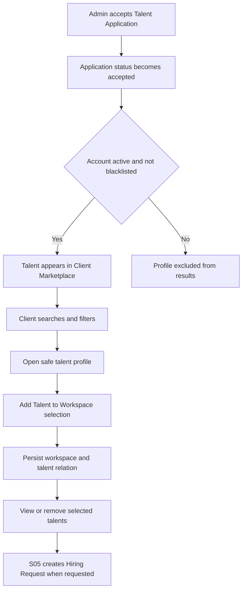

# S04 — اكتشاف المواهب وبناء الفريق

الحالة: **معتمدة ومنفذة**
آخر مراجعة: 27 أكتوبر 2026
الدور الأساسي: `client` داخل Workspace فعالة
النطاق: إتاحة المواهب المقبولة في Marketplace داخل Workspace اختارها العميل، البحث والفلترة وعرض التفاصيل، واختيار أكثر من موهبة وحفظ الاختيارات داخل الـWorkspace.
عرض التسليم: عميل يختار Workspace من الصفحة الرئيسية، يجد مواهب مقبولة، يفتح تفاصيلها، ويضيف أو يحذف مواهب من قائمته المحفوظة بنجاح.

## 1. شاشات Figma التي تمت مراجعتها

| الجزء | Node | ما يظهر في التصميم |
| --- | --- | --- |
| نتائج Talent Marketplace | `3223:17399` | بحث، فلاتر سريعة، Sort، Currency، Pagination، بطاقات المواهب، View Profile، Add to Squad |
| تفاصيل الموهبة | `3260:24102` | بيانات مهنية كاملة، الراتب، الخبرة، التخصص، المجالات، المهارات، الأدوات، الخبرات، المشاريع، اللغات، Add to Squad، Get Qader Expert Opinion |
| تفاصيل مشروع موسعة | `4263:57666` | Project Details داخل صفحة الملف المهني |
| شراء رأي خبير | `3260:26964` | شرح الخدمة المدفوعة، محتويات التقرير، السعر، Buy Expert Review |
| تقرير الخبير بعد الشراء | `3260:27929` | درجات التقييم، نقاط القوة، نقاط المراجعة، Final Expert Feedback |
| نتائج فارغة | `3265:30365` | No talents found وClear All Filters |
| كل الفلاتر | `3275:33653` | Job Title، Level، Years، Salary، Skills، Tools، Work Preferences، Notice Period، Availability، Country، City، Languages |
| Build Your Team | `3730:38377` | عرض المواهب المختارة يبدأ من S04؛ تأكيد الفريق وإنشاء الطلب وإعداد المقابلة والعقد والعرض ينتقل إلى S05/S06 |
| نجاح إرسال الفريق | `3890:38225` | إنشاء وإرسال Hiring Request ضمن S05، وليس S04 |

### النتيجة المؤكدة من التصميم

1. الـMarketplace جزء من Client Portal ومربوط بالـWorkspace الحالية.
2. العميل يستطيع اختيار أكثر من موهبة في فريق واحد.
3. بطاقة الموهبة لا تعرض الاسم الحقيقي أو البريد أو الهاتف أو الصورة الشخصية؛ تعرض كودًا عامًا مثل `QDR-9102`. الصورة/Avatar الظاهرة في التصميم صورة افتراضية ثابتة يعرضها الـFrontend وليست صورة الموهبة.
4. تفاصيل الموهبة المعروضة مهنية، ولا تعرض بيانات الاتصال أو CV قبل انتقال دورة التوظيف إلى المرحلة المسموح بها.
5. S04 يتوقف عند حفظ المواهب المختارة داخل الـWorkspace.
6. إعداد المقابلة ونوع العقد والعرض وشروط العمل وإنشاء الطلب تبدأ في S05، والمقابلات والعروض والتفاوض تستكمل في S06.
7. حالات Empty State وPagination وClear Filters جزء من قائمة الـMarketplace نفسها.

## 2. الوضع الحالي في الكود وقاعدة البيانات

### 2.1 الموجود ويمكن البناء عليه

- Talent profile وبياناته الأساسية والمهنية.
- `professional_fields`, `job_titles`, `skills`, `tools`, `languages`, `countries`, `cities`, و`currencies`.
- اختيارات الموهبة للمهارات محفوظة بالفعل في `talent_skills`.
- خبرات ومشاريع وتفضيلات عمل الموهبة.
- `talent_applications` وقرار القبول النهائي.
- التقييم الأولي وتقييمات المقابلات وتقاريرها.
- `talent_blacklist_entries` وحالة الحظر الفعالة.
- Workspaces وأعضاؤها وأدوارهم وصلاحياتهم المحلية.
- الـWorkspace تدعم حاليًا أكثر من Industry وأكثر من Professional Field عبر pivots.
- الموهبة تدعم اختيار Industries متعددة بجانب Skills داخل `skills-and-experiences`.
- Industries كـMaster Data مستقلة.
- Client OpenAPI منفصل وتجهيز Scribe/Apidog والـheaders المشتركة.

### 2.2 غير الموجود

- لا يوجد Marketplace module أو Client Marketplace routes.
- قبول الطلب يغير `talent_applications.status` إلى `accepted`، وهذه الحالة ستكون بوابة الظهور المباشر في Marketplace دون إنشاء نسخة أخرى من بيانات Talent.
- لا توجد صلاحيات Client خاصة بالـMarketplace أوقائمة اختيار المواهب.
- لا توجد قائمة مواهب محفوظة للـWorkspace.
- Client Dashboard ترجع أرقام Hiring Requests وContracts وProjects بقيم صفرية ثابتة.
- لا يوجد Currency conversion أوFee calculation منفذ.
- لا يوجد شراء لخدمة Qader Expert Opinion أوصلاحية وصول للتقرير من جانب العميل.

الجداول الموسعة المتعلقة بهذا الـflow موجودة في `docs/database-schema-proposal.dbml` كمقترح فقط، وليست جزءًا من قاعدة البيانات الحالية.

## 3. القرارات المعتمدة في الخطة

1. الموهبة المقبولة تظهر في Marketplace تلقائيًا بعد نجاح قرار القبول.
2. الموهبة لا تظهر إذا كان الحساب غير فعال أو يوجد لها Blacklist entry نشط.
3. لا نضيف حالة `marketplace` إلى `TalentApplicationStatusEnum`؛ حالة الطلب تبقى `accepted`.
4. لا ننشئ `talent_marketplace_profiles` أوأي جداول وسيطة للـMarketplace؛ مصدر البيانات هو `talents` وعلاقاتها الحالية.
5. كود الموهبة العام يحفظ في عمود `talents.talent_code` بصيغة ثابتة وفريدة مثل `QDR-9102`.
6. الاسم الحقيقي والصورة الشخصية والبريد والهاتف وWhatsApp وCV لا ترجع في Marketplace APIs. الـFrontend مسؤول عن عرض Avatar افتراضية ثابتة لا تكشف هوية الموهبة.
7. العميل يختار Workspace من الصفحة الرئيسية أولًا، وكل عملية Marketplace أواختيار Talent بعدها مربوطة صراحة بـ`workspace_id` في المسار.
8. لكل Workspace قائمة اختيار مشتركة واحدة في S04؛ أعضاء الـWorkspace ذوو الصلاحية يرون القائمة نفسها.
9. حفظ الاختيارات لا ينشئ Hiring Request ولا Draft Request؛ إنشاء الطلب وعناصره يبدأ في S05.
10. لا نغير أي endpoint موجودة؛ التنفيذ يضيف endpoints وحقولًا جديدة فقط.
11. الفلاتر والـsorting والـpagination تنفذ في Backend، ولا يعتمد Frontend على تنزيل القائمة كلها.
12. لا يسمح بإضافة نفس الموهبة مرتين إلى قائمة الاختيار نفسها داخل الـWorkspace.
13. تعديلات Talent بعد القبول تظهر مباشرة في Marketplace؛ لا توجد نسخة Snapshot مستقلة في S04.
14. `Skills & Proficiency` هو اسم سكشن المهارات في التصميم، ولا يعني وجود مستوى مستقل لكل Skill. الموهبة تختار Skills الخاصة بها وتحفظ في `talent_skills`، بينما `professionalField.skills` هي مصدر الاختيارات المسموحة.
15. لا نضيف Availability؛ `notice_period_days` الموجود هو المرجع الذي يوضح متى تستطيع الموهبة بدء العمل.
16. `Industry Experience` حقل Multi-select تختار قيمه الموهبة من Master Data `industries`، وتحفظ الاختيارات في pivot بسيطة مرتبطة بالموهبة.
17. `Highest Match` ترتيب بسيط يعتمد أولًا على تقاطع Professional Fields وIndustries المفضلة للـWorkspace، ثم تطابق الفلاتر النشطة مثل Job Title وSeniority/Years، ثم حداثة القبول، دون Match Score مخزن أوRecommendation Engine.
18. تحفظ قيمة الراتب وعملته الأصلية. تحويل العرض لعملة يختارها العميل سيتم لاحقًا من خلال Exchange Rate API بعد اختيار المزود، دون تخزين أسعار تحويل داخل Talent.
19. `Qader Expert Opinion` يرجع ككائن كامل فقط إذا كان للـWorkspace إثبات دفع/صلاحية وصول؛ وإلا تكون قيمته `null`. حتى تنفيذ الدفع ستعود `null`.
20. الموهبة تختار `industry_ids[]` كـMulti-select داخل خطوة `skills-and-experiences` نفسها، بنفس أسلوب اختيار `skill_ids[]`.
21. الـWorkspace تختار `industry_ids[]` و`professional_field_ids[]` كـMulti-select عند الإنشاء والتعديل؛ لا نخزن القيم في JSON ولا ننشئ Master Data جديدة.
22. اختيارات الـWorkspace تستخدم في عرض بياناتها وتحسين `Highest Match` والاقتراحات، لكنها لا تخفي باقي المواهب من Marketplace تلقائيًا.

### 3.1 مصادر بيانات Marketplace الحالية

| بيانات Figma | المصدر الحالي |
| --- | --- |
| Talent Code | `talents.talent_code` |
| Job Title | `talents.job_title_id` |
| Main Specialization | Job Title مع Professional Field الحالية |
| Professional Field | `talents.professional_field_id` |
| Seniority وYears of Experience | أعمدة `talents` الحالية |
| Professional Summary | `talents.professional_summary` |
| Gender وRelocate وNotice Period | أعمدة `talents` الحالية |
| Country وCity | `residenceCountry` و`residenceCity` |
| Indicative Salary | `expected_salary_min`, `expected_salary_max`, و`expected_currency_id` |
| Work Type وWork Mode | `talent_work_types` و`talent_work_modes` |
| Skills | اختيارات الموهبة المحفوظة في `talent_skills` |
| Tools | `talent.tools`، ويمكن تقييدها بأدوات المجال الحالية |
| Industry Experience | علاقة `talent.industries` وقيمها من Master Data `industries` |
| Languages | `talent_languages` مع `proficiency_level` |
| Work Experience | `talent_experiences` |
| Projects & Portfolio | `talent_projects` والروابط المهنية الحالية |
| Qader Evaluation | `talent_evaluations` وآخر `interview_evaluations` |

## 4. نقاط التكامل المؤجلة

لا توجد قرارات Business مفتوحة تمنع تنفيذ S04. التكاملات الخارجية المؤجلة هي:

1. اختيار Exchange Rate API وبيانات اعتماده وسياسة Cache؛ إلى أن يتم اختياره تعرض القيم بالعملة الأصلية.
2. تنفيذ الدفع وإثبات الوصول إلى Qader Expert Opinion؛ إلى أن يتم ذلك تكون `expert_opinion = null` لكل العملاء.

### فروق مقصودة عن Figma بسبب القرارات وحدود السبرنت

- `Availability` ظاهر في Drawer الفلاتر، لكنه لن ينفذ لأن القرار المعتمد هو استخدام `notice_period_days` بدلًا منه.
- الصورة/Avatar الظاهرة على بطاقة الموهبة Placeholder افتراضية من الـFrontend؛ لا ترجع Marketplace APIs صورة الموهبة أوأي بديل مشتق من هويتها.
- زر `New Hiring Request` الظاهر في Empty State، وتأكيد Build Your Team، وإنشاء الطلب ليست ضمن S04؛ تبدأ في S05.
- إعداد المقابلة والعرض والتفاوض الظاهر بعد اختيار الفريق ضمن S06.
- Currency selector يمكن عرضه في الواجهة، لكن التحويل الفعلي مؤجل؛ الـAPI تعرض الراتب بعملته الأصلية حاليًا.
- شاشة Qader Expert Opinion موجودة في التصميم، لكن التقرير يظل `null` حتى تنفيذ إثبات الدفع/الوصول.

## 5. حدود السبرنت

### داخل S04

- إظهار الموهبة المقبولة مباشرة من `talents` دون مزامنة أوBackfill لبيانات Marketplace؛ الـBackfill الوحيد هو توليد `talent_code` للمواهب القديمة.
- قائمة Marketplace مع البحث والفلترة والsorting والpagination.
- خيارات الفلاتر من Master Data والـenums.
- حالة النتائج الفارغة.
- صفحة تفاصيل Marketplace المهنية الآمنة.
- الاعتماد على Multi-select Industries المنفذة للموهبة وعلى Industries وProfessional Fields المنفذة للـWorkspace.
- إضافة وإزالة المواهب من قائمة الاختيار المشتركة داخل الـWorkspace.
- عرض المواهب المختارة وعددها مع استمرار عزل البيانات حسب الـWorkspace.
- صلاحيات Client الجديدة.
- توثيق Client OpenAPI كاملًا بالـheaders والـbody والـquery/path parameters والأمثلة.

### خارج S04

- إنشاء Hiring Request وعناصرها وإرسالها وإجراءات الأدمن عليها؛ ضمن S05.
- نوع العقد والعرض المبدئي وشروط العمل و`interview_required`؛ ضمن S05.
- جدولة المقابلات والتأكيد والعروض والتفاوض؛ ضمن S06.
- العقود والتوقيع والفواتير والدفع.
- إظهار بيانات الاتصال وCV للعميل.
- دفع Qader Expert Opinion؛ S04 يجهز الحقل المشروط فقط ولا يكشف التقرير دون دفع.
- تنفيذ Currency conversion قبل اختيار Exchange Rate API؛ تحفظ وتعرض العملة الأصلية حاليًا.
- حساب رسوم Qader وإجماليات Managed وOne-Time.
- إدارة المواهب يدويًا من Marketplace بواسطة الأدمن إذا لم توجد شاشة واضحة لذلك.
- Recommendation engine أوMachine Learning؛ Highest Match في S04 ترتيب deterministic فقط.

## 6. الـFlow المقترح



## 7. السكيما المقترحة

لا نضيف أي جدول خاص بعرض Marketplace. الاستعلام يبدأ من `talents` ويربط الطلب المقبول والحساب والحظر والعلاقات المهنية الموجودة. S04 يضيف جدولًا بسيطًا لحفظ اختيارات كل Workspace، بالإضافة إلى pivots بيانات Talent وWorkspace المتعددة.

التعديلات على ملف Talent تقتصر على كود العرض وpivot اختيار Industry Experience، وليسا نسخة Marketplace.

### 7.1 تعديل `talents`

| العمود | النوع |
| --- | --- |
| `talent_code` | unique varchar(32)، بصيغة `QDR-*` |

- يولد السيرفر الكود مرة واحدة عند إنشاء Talent ولا يتغير.
- يتم Backfill للمواهب الحالية عند تطبيق migration التحديثية.

### 7.2 `talent_industries` — منفذ كتأسيس قبل S04

| العمود | النوع |
| --- | --- |
| `talent_id` | FK → talents |
| `industry_id` | FK → industries |
| timestamps | timestamps |

- primary key أوunique مركب على `(talent_id, industry_id)`.
- الحذف من Talent يعمل Cascade، وحذف Industry المستخدمة يكون Restrict.
- خيارات الإدخال تأتي من Industries الفعالة فقط.
- تعرض القيم في Marketplace من علاقة `Talent::industries()` دون جدول عرض وسيط.

### 7.3 `workspace_industries` — منفذ كتأسيس قبل S04

| العمود | النوع |
| --- | --- |
| `workspace_id` | FK → workspaces |
| `industry_id` | FK → industries |
| timestamps | timestamps |

- unique مركب على `(workspace_id, industry_id)`.
- عند تطبيق التحديث، تنقل قيمة `workspaces.industry_id` الحالية إلى الـpivot ثم يحذف العمود القديم بعد نجاح النقل.
- إنشاء Workspace جديدة يتطلب اختيار Industry واحدة على الأقل.

### 7.4 `workspace_professional_fields` — منفذ كتأسيس قبل S04

| العمود | النوع |
| --- | --- |
| `workspace_id` | FK → workspaces |
| `professional_field_id` | FK → professional_fields |
| timestamps | timestamps |

- unique مركب على `(workspace_id, professional_field_id)`.
- إنشاء Workspace جديدة يتطلب اختيار Professional Field واحدة على الأقل.
- الـWorkspaces القديمة تظل صالحة، ويطلب منها استكمال الاختيارات عند تعديل بياناتها بدل افتراض قيم غير معروفة.

### 7.5 `workspace_talent_selections`

| العمود | النوع والملاحظات |
| --- | --- |
| `workspace_id` | FK → workspaces |
| `talent_id` | FK → talents |
| `added_by_member_id` | FK → workspace_members |
| timestamps | timestamps |

- primary key أوunique مركب على `(workspace_id, talent_id)`.
- لا يحتوي حالات أوعروض أوبيانات مقابلات.
- حذف Talent من الاختيارات يحذف سجل الربط فقط ولا يؤثر في Talent نفسها.
- S05 تستطيع قراءة هذه الاختيارات عند إنشاء Hiring Request، دون أن تكون السجلات نفسها Request Items.

## 8. صلاحيات العميل

تضاف إلى `ClientPermissionEnum` وتظهر تلقائيًا داخل إدارة Roles الخاصة بالـWorkspace:

```text
client.marketplace.view
client.talent-selections.view
client.talent-selections.manage
```

قواعدها:

- `marketplace.view`: القائمة والتفاصيل والفلاتر فقط.
- `talent_selections.view`: عرض قائمة المواهب المختارة داخل Workspace.
- `talent_selections.manage`: إضافة Talent إلى القائمة أوإزالتها منها.
- دور `owner` داخل Workspace يتجاوز الفحص التفصيلي للصلاحيات مثل السلوك الحالي، دون منحه صلاحيات خارج مساحته.

## 9. الـEndpoints المقترحة

كل المسارات تتطلب:

```text
Accept: application/json
X-Authorization: {{api_key}}
Authorization: Bearer {{access_token}}
```

### 9.1 Marketplace

```text
GET /api/v1/client/workspaces/{workspace}/talent-marketplace
GET /api/v1/client/workspaces/{workspace}/talent-marketplace/filters
GET /api/v1/client/workspaces/{workspace}/talent-marketplace/{talent}
```

قائمة الفلاتر المقترحة:

```text
search
job_title_id
seniority_level[]
years_of_experience_min
salary_min
salary_max
currency_id
skill_ids[]
tool_ids[]
work_types[]
work_modes[]
notice_period_days_max
country_id
city_id
language_id
language_proficiency_level
sort
per_page
page
```

- `skill_ids[]` يفلتر عبر `talent_skills` حتى تكون النتيجة مبنية على اختيارات الموهبة الفعلية.
- بطاقة الموهبة وصفحة التفاصيل تعرضان Skills الموهبة الفعلية كـchips؛ `Skills & Proficiency` هو عنوان السكشن ولا يحتاج درجة أوحقلًا إضافيًا.
- لا نرجع Availability ضمن filters/options؛ فلتر Notice Period يغطي وقت بدء العمل.
- Industry Experience ترجع في التفاصيل من `talent.industries`. لا نضيف لها فلتر Marketplace ما لم يظهر الفلتر في التصميم.
- حقل Years of Experience الظاهر في Figma يعامل كحد أدنى ويرسل `years_of_experience_min`.
- اختيار اللغة في Figma مرتبط بمستوى الإتقان؛ لذلك يرسل `language_id` مع `language_proficiency_level` من enum الحالية.
- إلى أن ينفذ Currency Conversion، استخدام `salary_min` أو`salary_max` يتطلب `currency_id`، وتطبق المقارنة فقط على المواهب التي راتبها محفوظ بالعملة نفسها.

إكمال مصدر Industry Experience في ملف الموهبة يستخدم:

```text
GET /api/v1/talent/master-data/industries
```

ويرسل Talent Frontend `industry_ids[]` كـMulti-select ضمن `skills-and-experiences` في Onboarding/Profile الحالية، بجانب `skill_ids[]`؛ لا ننشئ endpoint حفظ مستقلة لهذا الحقل.

إنشاء وتعديل الـWorkspace يرسلان:

```text
industry_ids[]
professional_field_ids[]
```

وتضاف Professional Fields الفعالة إلى Client Master Data بجانب Industries الحالية:

```text
GET /api/v1/client/master-data/countries
GET /api/v1/client/master-data/cities?country_id={country_id}
GET /api/v1/client/master-data/industries
GET /api/v1/client/master-data/professional-fields
```

ويرجع `WorkspaceResource` القائمتين `industries` و`professional_fields` بدل `industry` المفردة.

قيم `sort` المبدئية:

```text
highest_match
newest
experience_high_to_low
salary_low_to_high
salary_high_to_low
```

### 9.2 قائمة المواهب المختارة داخل Workspace

```text
GET    /api/v1/client/workspaces/{workspace}/talent-selections
POST   /api/v1/client/workspaces/{workspace}/talent-selections
DELETE /api/v1/client/workspaces/{workspace}/talent-selections/{talent}
```

Body الإضافة بسيط:

```json
{
  "talent_id": 15
}
```

كل Endpoint تتحقق من عضوية المستخدم وصلاحيته داخل `{workspace}` الموجودة في المسار، ولا تعتمد على Workspace محفوظة عالميًا في session أوtoken.

### 9.3 Response القائمة

كل بطاقة ترجع فقط:

- Talent ID للاستخدام الداخلي في الـAPI و`talent_code` العام المحفوظ.
- Job Title وProfessional Field وSeniority.
- سنوات الخبرة ومكان الإقامة العام.
- Work Types وWork Modes.
- Indicative salary وعملتها.
- Top Skills.
- `is_selected` محسوبة بالنسبة إلى `{workspace}` الحالية.
- `available_actions` حسب صلاحيات المستخدم وحالة الطلب.

ويرجع response القائمة داخل `meta` عدد المواهب المختارة في الـWorkspace الحالية باسم `selected_talents_count` لاستخدام Badge الانتقال إلى الفريق المختار.

لا ترجع User Resource أوحقول اتصال داخل هذا response.

صفحة التفاصيل ترجع كذلك:

- `expert_opinion: null` ما لم يوجد إثبات دفع/صلاحية وصول للـWorkspace.
- كائن التقييم الكامل فقط عند وجود الصلاحية؛ لا يرجع Preview أوجزء من التقرير قبل الدفع.

## 10. قواعد الـValidation والـBusiness

1. الـWorkspace يجب أن تكون موجودة وعضوية المستخدم فيها `active` وغير محذوفة.
   عدم وجود عضوية فعالة يعامل كـ`404`، أما وجود العضوية مع نقص الصلاحية فيعامل كـ`403`.
2. Talent تظهر فقط إذا كان طلبها `accepted` والحساب فعالًا ولا يوجد Blacklist نشط.
3. لا يسمح بإضافة Talent غير مقبولة أو محظورة أو حسابها غير فعال.
4. لا يسمح بإضافة Talent نفسها مرتين إلى اختيارات Workspace نفسها.
5. عضو Workspace A لا يقرأ أو يعدل اختيارات Workspace B حتى لو عرف IDs الخاصة بها.
6. البحث لا يرجع PII حتى لو تم البحث بالاسم أوالبريد؛ البحث مهني فقط.
7. إذا أصبحت Talent محظورة أوغير فعالة بعد اختيارها، لا تظهر ضمن القائمة المتاحة، ويعيد S05 التحقق قبل إنشاء أي طلب منها.
8. `industry_ids` الخاصة بالموهبة تكون array من IDs فريدة، وكل Industry مطلوبة أن تكون فعالة وموجودة.
9. عند إنشاء Workspace تكون `industry_ids` و`professional_field_ids` مطلوبتين، وكل منهما array غير فارغة من IDs فريدة وفعالة.
10. عند تعديل Workspace، وجود أي من القائمتين يستبدل اختياراتها الحالية بـ`sync`، ولا يسمح بإرسال array فارغة.
11. عند إرسال `language_proficiency_level` يجب إرسال `language_id` معها، وتكون قيمة المستوى من `LanguageProficiencyEnum`.
12. إلى أن يربط Exchange Rate API، أي Salary filter أوSalary sort يتطلب `currency_id` ولا يقارن قيمًا محفوظة بعملات مختلفة.

## 11. استعلام Marketplace وحماية البيانات

لا نعدل `AdminInterviewWorkflow::accept` ولا ننشئ عملية نشر منفصلة. الظهور يعتمد لحظيًا على الاستعلام التالي:

1. يبدأ من `Talent::query()`.
2. يتحقق من وجود `TalentApplication` حالتها `accepted`.
3. يتحقق من `user.is_active = true`.
4. يستبعد Talent التي لها `talent_blacklist_entries` فعال (`removed_at = null`).
5. يحمل فقط العلاقات اللازمة للقائمة أوالتفاصيل باستخدام eager loading محدد.
6. يستخدم Resource مخصصة لا تمرر User Resource ولا بيانات الاتصال أوCV.
7. يأخذ Skills من `Talent::skills()`؛ وتظل `professionalField.skills` مرجع التحقق من أن اختيارات الموهبة تتبع مجالها.
8. يحمل Industry Experience من `Talent::industries()`.
9. يرجع `talent_code` المحفوظ ولا يشتقه من Talent ID أوApplication ID.

هذا القرار يعني أن:

- المواهب المقبولة سابقًا تظهر بعد توليد `talent_code` لها في Migration التحديثية، دون نسخ أوBackfill لبيانات Marketplace.
- تعديل الملف بعد القبول ينعكس مباشرة على Marketplace.
- إلغاء نشاط الحساب أوإضافة Blacklist يخفي الموهبة في الاستعلام التالي فورًا.
- لا توجد بيانات Marketplace مكررة يمكن أن تصبح قديمة أوغير متسقة.

## 12. تحديث Client Dashboard

لا نغير أرقام Hiring Requests أوContracts أوProjects في S04. يمكن إرجاع `selected_talents_count` فقط إذا كانت شاشة الـWorkspace تحتاجه؛ أرقام الطلبات الحقيقية تبدأ مع S05.

## 13. خطة التنفيذ المرحلية

### المرحلة 1 — Marketplace query foundation

- إضافة علاقات Talent اللازمة للوصول إلى الطلب والحظر إن كانت غير موجودة في الموديل.
- التحقق من العلاقات المنفذة `Talent::industries()`, `Workspace::industries()` و`Workspace::professionalFields()` واستخدامها في الاستعلام.
- إنشاء Query Service يبدأ من `talents` الحالية.
- إضافة عمود `talent_code` وتوليده للمواهب الجديدة وعمل Backfill آمن للمواهب الحالية.
- تطبيق شروط القبول والحظر ونشاط الحساب.
- اختبارات الظهور والحظر وعدم نشاط الحساب وحماية البيانات.

### المرحلة 2 — Marketplace read APIs

- Query service للقائمة والتفاصيل.
- Search وfilters وsort وpagination.
- Resources آمنة تمنع PII.
- Filters/options endpoint.
- Client permissions وroute middleware.

### المرحلة 3 — Workspace Talent Selection

- إنشاء `workspace_talent_selections`.
- List/Add/Delete داخل Workspace.
- `is_selected` و`available_actions` حسب الـWorkspace والصلاحية.

### المرحلة 4 — Documentation and verification

- تحديث `docs/api-enums-reference.ar.md`.
- إنشاء `S04-talent-discovery-implementation.ar.md` بعد التنفيذ.
- تحديث `docs/project-memory.ar.md`.
- توليد Client OpenAPI داخل Docker.
- مراجعة Apidog bodies والheaders والparameters والأمثلة.
- Feature tests لكل permissions والfilters وحماية البيانات وقائمة الاختيارات.
- Migration tests على MySQL/SQLite بالقدر الذي يدعمه المشروع.

## 14. حالات الاختبار الأساسية

1. Talent accepted تظهر مباشرة دون سجل Marketplace إضافي.
2. Talent rejected لا تظهر.
3. Talent blacklisted أوUser غير فعال لا تظهر.
4. تعديل بيانات Talent مقبولة ينعكس في Marketplace.
5. Skills المعروضة تأتي من `talent_skills` الفعلية، ولا تقبل الموهبة Skill خارج Professional Field الخاصة بها.
6. `industry_ids` تحفظ للموهبة بجانب Skills وتظهر في تفاصيل Marketplace.
7. Industry غير فعالة أوID مكرر يرفضه الـValidation.
8. إنشاء Workspace يحفظ أكثر من Industry وأكثر من Professional Field ويرجعهما في الـResource.
9. تحديث إحدى قوائم Workspace يعمل `sync` دون التأثير على القائمة الأخرى.
10. نقل `workspaces.industry_id` القديم يحافظ على كل القيم الموجودة قبل حذف العمود.
11. Search وfilters وsorting وpagination تعمل مجتمعة.
12. فلتر اللغة يطابق اللغة ومستوى الإتقان معًا، وYears of Experience يعمل كحد أدنى.
13. Salary filtering وsorting لا يقارنان عملات مختلفة، ويرفضان الطلب دون `currency_id` برسالة Validation واضحة.
14. Marketplace responses لا تحتوي email أوphone أوCV أوالاسم الحقيقي.
15. عضو بلا `client.marketplace.view` لا يستطيع التصفح.
16. عضو Workspace A لا يقرأ أو يعدل اختيارات Workspace B.
17. إضافة Talent مرتين إلى Workspace نفسها ترفض برسالة واضحة.
18. يمكن اختيار Talent نفسها داخل Workspace مختلفة مستقلة.
19. حذف Talent من الاختيارات لا يحذف Talent ولا يؤثر في Workspaces أخرى.
20. Talent محظورة أوغير فعالة لا تقبل الإضافة ولا تظهر في القائمة المتاحة.

## 15. Definition of Done

- Talent مقبولة تظهر تلقائيًا من جدول `talents` الحالي دون جدول Marketplace جديد ولا تظهر بياناتها الخاصة.
- كل Talent لها `talent_code` ثابت وفريد لا يعتمد على Application ID.
- Industry Experience تحفظ للموهبة كـMulti-select بجانب Skills وتظهر في تفاصيلها.
- الـWorkspace تحفظ أكثر من Industry وأكثر من Professional Field، وتظهر القيم في create/update/show دون كسر البيانات القديمة.
- القائمة والتفاصيل والفلاتر مطابقة لشاشات Figma ضمن القرارات المعتمدة.
- الراتب يعرض بعملته الأصلية إلى أن يتم ربط Exchange Rate API.
- `expert_opinion` لا يكشف أي تقرير قبل إثبات الدفع، ويعود `null` حاليًا.
- العميل يحفظ أكثر من Talent في قائمة الاختيار المشتركة الخاصة بالـWorkspace.
- S04 لا تنشئ Hiring Request ولا تحفظ عقدًا أوعرضًا أومقابلة؛ تبدأ هذه الدورة في S05.
- كل العمليات معزولة بالـWorkspace ومحكومة بالصلاحيات.
- لا تتكسر endpoints الحالية.
- migrations قابلة للتطبيق على قاعدة بيانات بها بيانات سابقة.
- Client OpenAPI وApidog يعرضان bodies وheaders وparams وأمثلة كاملة.
- الاختبارات الأساسية تمر داخل Docker.
