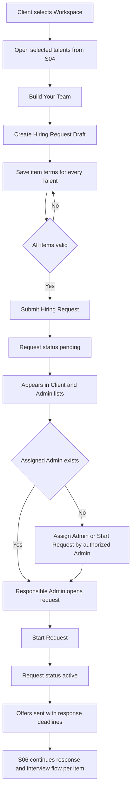

# S05 — طلبات التوظيف

الحالة: **تم التنفيذ**  
آخر مراجعة: 29 أكتوبر 2026  
الأدوار التي تمت مراجعة شاشاتها: `client` داخل Workspace فعالة، و`admin` داخل Admin Portal، و`talent` في المراحل التي تبدأ بعد إرسال العرض  
النطاق: إنشاء Hiring Request من المواهب المختارة، حفظ عناصر الطلب وشروطها المبدئية، إرسال الطلب، وصوله للأدمن، تعيين المسؤول وبدء التعامل معه.  
عرض التسليم: عميل يرسل طلب توظيف حقيقي يحتوي Talent واحدة أوأكثر، فيظهر للأدمن، ويستطيع أدمن مخول تعيينه أوإعادة تعيينه ثم تنفيذ `Start Request` مع حفظ الإجراء.

## 1. شاشات Figma التي تمت مراجعتها

### 1.1 Client Portal

| الجزء | Node | ما يظهر في التصميم |
| --- | --- | --- |
| Build Your Team | `3730:38377` | المواهب المختارة، Apply to All، Contract Type (`managed`/`one_time`)، Interview/No Interview، شروط أيام العمل، Work Type، Your Monthly Offer، Currency، Team Summary، Confirm |
| نجاح إرسال الطلب | `3890:38225` | Team Submitted Successfully، توضيح أن Qader سيراجع الطلب، View Hiring Request |
| قائمة Hiring Requests | `3286:35280` | البحث بـRequest ID، Status، Date، عدد المواهب، Progress، Created Date، Action |
| تفاصيل Hiring Request | `3290:38355` | Request reference، Workspace، عدد العناصر، التقسيم حسب Contract Type، تبويبات حالات العناصر، Offer، Offered Salary، Interview Preference، Last Update، View Details |
| حالة انتظار رد الموهبة | `3342:26065` | بداية دورة العرض ورد الموهبة؛ مرجع لـS06 وليس تنفيذ S05 |
| Hold/Resume/Cancel | `3437:31764`, `4350:77749`, `3437:32402`, `4350:78037`, `3437:33001` | إجراءات على عملية توظيف جارية بعد إرسال العرض؛ خارج S05 وتدخل مع دورة S06 |

### 1.2 Admin Portal

| الجزء | Node | ما يظهر في التصميم |
| --- | --- | --- |
| قائمة Hiring Requests | `3955:50546` | البحث بـRequest ID أوClient أوWorkspace، Created Date، Status، Assigned Admin، Total Talents، Action |
| تفاصيل الطلب قبل البدء | `3955:51181` | بيانات العميل والـWorkspace، Assigned/Reassigned Admin، Total Talents، Requested Talent Lineup، Start Request |
| تفاصيل الطلب بعد الإسناد | `3961:52754` | حالة الطلب، المسؤول، عناصر الطلب، Offered Salary، Contract Type، Interview Preference، حالة كل عنصر |
| تفاصيل عنصر متقدم | `3971:44951` وما بعدها | العرض الرسمي، الردود، المقابلات، القبول والرفض؛ مرجع لـS06/S07 وليس تنفيذ S05 |
| Contract Type Defaults | `3916:42854`, `3951:41901`, `3953:42501` | النوعان `managed` و`one_time` ما زالا مطلوبين؛ الاختيار يحدد مسار الرسوم والتعاقد لاحقًا دون تغيير شكل ساعات العمل |

### 1.3 النتيجة المؤكدة من التصميم

1. الـHiring Request تابع لـWorkspace واحدة ويحتوي Talent واحدة أوأكثر.
2. كل Talent داخل الطلب عنصر مستقل، وله `contract_type` وInterview Preference وشروط عرض مبدئية خاصة به.
3. `Apply to All Talents` وظيفة واجهة لتعبئة القيم نفسها؛ الـBackend يستقبل القيم النهائية الكاملة لكل عنصر.
4. ضغط `Confirm` يرسل الطلب إلى Qader، ولا يرسل العرض مباشرة إلى الموهبة؛ شاشة النجاح تنص على أن فريق Qader سيراجع الطلب أولًا.
5. الطلب له Reference ظاهر مثل `HR-2024-001`، وكل عنصر له Reference مستقل ظاهر لاحقًا مثل `RI-2024-0045`.
6. الإسناد للأدمن على مستوى الطلب، بينما تقدم كل Talent يستمر بشكل مستقل في السبرنتات التالية.
7. المقابلات، العرض الرسمي، رد الموهبة، التفاوض، Hold/Resume بعد بدء دورة التوظيف، والقرار بين الطرفين ضمن S06.
8. العقود والتوقيع والرسوم والدفع ضمن S07.
9. شاشة Work Preferences الخاصة بالموهبة (`676:11369`, `3331:25083`) لا تطلب أيام العمل أوساعات العمل؛ الموهبة تختار Work Type وWork Mode وNotice Period فقط.
10. مدى أيام العمل يحفظ في `work_start_day` و`work_end_day`. وعند اختيار `work_mode=hybrid` فقط ترسل `hybrid_work_days` كـArray بأيام الـRemote؛ باقي أيام المدى تكون On-site.
11. ساعات العمل تحفظ في حقل واحد `work_hours` كعدد ساعات يومية فقط، مثل `8`.
12. بيانات الجدول تحفظ مباشرة على صف العرض حتى يحتفظ كل عرض بالشروط التي أرسلت معه.

### 1.4 Talent Portal

| الجزء | Nodes | ما يظهر في التصميم |
| --- | --- | --- |
| قائمة وتفاصيل العروض | `3662:29653`, `3670:31371` | العرض بعد إرساله، بيانات الشركة، الراتب، Work Mode، Notice Period، Working Days وWorking Hours |
| الرد والتفاوض | `3733:40359`, `3733:40688` | قبول/رفض العرض وSubmit Counter Offer وسجل نسخ عرض العميل والموهبة |
| انتظار وجدولة المقابلة | `3718:30338`, `3670:36686` | انتظار 3 مواعيد، الموعد المؤكد، Meeting Link، وحالة المقابلة |
| الاعتذار وإعادة الجدولة | `4315:68038`, `3670:37137` | اعتذار الموهبة، إلغاء الموعد الحالي، ثم انتظار مواعيد بديلة |
| النهايات | `3670:33590`, `3670:34090`, `4318:73133` | رفض الموهبة، إغلاق بسبب عدم الرد مع Warning، أوContracted/Waiting to Start |

مراجعة Talent Portal هنا للتأكد من أن بيانات S05 تسمح باستكمال الدورة بدون إعادة بناء السكيما. لا ترى Talent الطلب وهو `pending`؛ أول ظهور للعرض يكون عند تنفيذ `Start Request` وتحول الطلب إلى `active`.

### 1.5 الفصل بين ما يراه كل دور

| المرحلة | Client | Admin | Talent |
| --- | --- | --- | --- |
| Draft | ينشئ ويعدل شروط كل عنصر | لا يراه | لا يراه |
| Submitted/Pending | يرى الطلب وعناصره كطلب قيد مراجعة Qader | يراه في All Requests ويعين المسؤول | لا يراه |
| Active | يرى أن Qader بدأ التعامل ويتابع العرض | المسؤول يرى التفاصيل ويدير التفاوض | يظهر العرض للموهبة |
| Offer Sent وما بعدها | يتابع كل Talent مستقلة | يدير العرض والمواعيد والحالات | يرى العرض الخاص به فقط ويتفاعل معه |
| Contracted | تظهر بيانات الاتصال بعد اكتمال التعاقد | يرى الحالة النهائية | يرى الشروط النهائية وموعد البدء |

لا ترجع أي API حالة عامة واحدة للثلاثة أدوار؛ نفس `request_item` له بيانات مشتركة، لكن الـResource والـ`available_actions` يختلفان حسب الدور والصلاحية والمرحلة.

## 2. الوضع قبل تنفيذ السبرنت في الكود وقاعدة البيانات

> هذا القسم يوثق نقطة البداية التي بنيت عليها الخطة. الوضع بعد التنفيذ موثق في
> `docs/sprints/S05-hiring-requests-implementation.ar.md`.

### 2.1 الموجود ويمكن البناء عليه

- Workspaces وأعضاؤها وأدوارهم وصلاحياتهم المحلية.
- `WorkspaceAccessService` لعزل كل عملية بالـWorkspace والتحقق من العضوية والصلاحية.
- قائمة المواهب المختارة في `workspace_talent_selections` من S04.
- Marketplace يجب أن تسمح فقط بالمواهب المقبولة، `is_marketplace_available=true`، ذات الحساب الفعال، وغير الموجودة في Blacklist نشطة.
- `talents.talent_code` كمعرف ظاهر للعميل دون كشف الهوية.
- بيانات Talent الحالية: Job Title، الراتب المتوقع وعملته، Notice Period، Work Types، Work Modes، والبيانات المهنية.
- Master Data للعملات والمسميات الوظيفية.
- `WorkTypeEnum` بقيم `full_time`, `part_time`، و`WorkModeEnum` بالقيم الحالية.
- لا يوجد Work Day enum أوحقول جدول عمل على Talent؛ وهذا متوافق مع Figma لأن الموهبة لا تدخلها في Onboarding.
- نظام Admin roles/permissions والتعامل مع `super_admin`.
- نمط إرجاع `available_actions` حسب الصلاحيات والحالة منفذ في موديولات الأدمن الحالية.
- Client/Admin OpenAPI منفصلان وتجهيز Scribe/Apidog والـheaders المشتركة.

### 2.2 غير الموجود حاليًا

- لا يوجد موديول Hiring Requests في الكود.
- لا توجد جداول `hiring_requests`, `hiring_request_items`, أو`hiring_offers`.
- لا توجد حالات Request أوRequest Item في Enums فعلية.
- لا توجد صلاحيات Client/Admin خاصة بطلبات التوظيف.
- لا توجد Client أوAdmin endpoints لطلبات التوظيف.
- لا يوجد تعيين أوإعادة تعيين Admin مسؤول عن Hiring Request.
- لا يوجد Audit trail لإرسال الطلب أوإسناده أوبدء التعامل معه.
- لا يوجد Currency conversion أوحساب رسوم Qader.
- الكود الحالي لا يحتوي `talents.is_marketplace_available` ولا يطبقه في Marketplace query؛ هذا Follow-up مطلوب من S04 قبل اعتماد Eligibility في S05.

ملفا `docs/database-schema-proposal.dbml` و`docs/database-schema-review.ar.md` يحتويان تصورًا أوسع لدورة S05–S07، لكنه غير منفذ، وبعض أجزائه أكبر من نطاق S05 الحالي.

## 3. حدود السبرنت

### 3.1 داخل S05

- بناء الطلب من المواهب المحفوظة في `workspace_talent_selections`.
- حفظ Draft للطلب وعناصره قبل الإرسال حتى لا تضيع شروط العميل.
- حفظ Contract Type وInterview Preference والعرض المبدئي وشروط العمل لكل Talent.
- تعديل Draft فقط قبل الإرسال.
- Submit ذري للطلب بعد التحقق من كل العناصر.
- قائمة وتفاصيل الطلبات للعميل داخل Workspace الحالية.
- قائمة وتفاصيل الطلبات للأدمن مع All Requests وMy Requests.
- تعيين وإعادة تعيين Admin مسؤول.
- `Start Request` بواسطة المسؤول المخول.
- Audit events لعمليات الإنشاء والإرسال والتعيين وإعادة التعيين والبدء.
- `available_actions` حسب الحالة والصلاحيات.
- Enums/options endpoints الخاصة بالموديول.
- توثيق Client/Admin OpenAPI واختبارات Feature كاملة.

### 3.2 خارج S05

- رد Talent على العرض وإدارة التفاوض؛ مدة الرد ليست Input داخل الطلب، بل إعداد ثابت يديره الأدمن ويحسب منه Deadline كل عرض بعد إرساله.
- قبول العرض أوفضه أوCounter Offer والتفاوض وإصدارات العرض المرسلة.
- جدولة مقابلات التوظيف بين Client وTalent وإعادة الجدولة.
- قرارات الطرفين بعد المقابلة.
- Hold/Resume/Cancel لنشاط توظيف بدأ بالفعل وما يترتب عليه من إلغاء مواعيد أوعروض.
- اقتراح واختيار Replacement Talent.
- تحويل العملات من مزود خارجي.
- رسوم Qader والتسعير والمدفوعات.
- العقود والتوقيع والفواتير والمدفوعات.
- كشف بيانات الاتصال أوCV للعميل قبل المرحلة المعتمدة لذلك.
- إدارة تسعير ورسوم Contract Types؛ S05 يحفظ الاختيار فقط، والتنفيذ المالي ضمن S07.

## 4. الـFlow المقترح



### 4.1 Client flow

1. المستخدم يدخل Workspace يملك عضوية فعالة بها.
2. يفتح المواهب المختارة من S04.
3. يحدد لكل Talent:
   - `contract_type`: `managed` أو`one_time`.
   - `interview_required`.
   - `work_type`.
   - `work_start_day` و`work_end_day` لتحديد مدى أيام العمل.
   - `hybrid_work_days` عند اختيار Hybrid فقط، وتحتوي أيام الـRemote.
   - `work_mode` العامة: `onsite`, `remote` أو`hybrid`.
   - `work_hours` كعدد ساعات يومية فقط، مثل `8`.
   - قيمة العرض الشهري والعملة.
4. يمكن للواجهة تطبيق نفس القيم على جميع العناصر، لكن ترسل مصفوفة عناصر مكتملة.
5. ينشئ أو يحدث Draft داخل Transaction.
6. عند `Submit` يتحقق الـBackend من الطلب كله، ثم يحوله إلى `pending` ويثبت `submitted_at`.
7. بعد نجاح Submit تحذف اختيارات المواهب التي تحولت إلى عناصر في الطلب من `workspace_talent_selections` داخل نفس الـTransaction.
8. الطلب يظهر للعميل في القائمة والتفاصيل، ولا يمكن تعديل شروطه بعد الإرسال في S05.

### 4.2 Admin flow

1. الأدمن المخول يرى All Requests، ويمكنه اختيار My Requests.
2. البحث والفلاتر تشمل Reference وClient وWorkspace وStatus وAssigned Admin وCreated Date.
3. الأدمن المخول يستطيع Assign أوReassign الطلب.
4. `Start Request`:
   - إذا كان الطلب غير معين، يعين للأدمن الحالي ثم يبدأه داخل نفس Transaction.
   - إذا كان معينًا لأدمن آخر، يحتاج Reassign أولًا.
   - يحول الحالة من `pending` إلى `active` ويسجل `started_at` وAudit event.
5. `Start Request` يحول الطلب إلى `active` ويرسل عروض عناصره للمواهب في نفس الـTransaction.
6. لكل عرض يثبت `sent_at` وقت الإرسال و`response_due_at = sent_at + offer_response_duration_hours`، باستخدام قيمة الإعداد وقت الإرسال.
7. تغيير مدة الرد لاحقًا من Platform Settings يؤثر على العروض التي سترسل بعد التغيير فقط، ولا يعيد حساب Deadline للعروض المرسلة.

### 4.3 Talent flow المرتبط بالدورة الكاملة

هذه الخطوات ليست Actions داخل S05، لكنها حدود لازمة حتى لا ننفذ حالة تمنع استكمال S06/S07:

1. لا يظهر شيء للموهبة حتى يرسل الأدمن العرض الرسمي.
2. عند ظهور العرض تستطيع الموهبة القبول أوالرفض أوإرسال Counter Offer.
3. Counter Offer يعيد العنصر إلى التفاوض وينشئ عرضًا جديدًا بعد تسجيل الرد على العرض السابق.
4. إذا قبلت الموهبة عرضًا و`interview_required=false`، تتخطى دورة المقابلة وتنتقل إلى خطوة الاتفاق النهائي التي ستحدد في S06.
5. إذا كان `interview_required=true`، تنتقل إلى انتظار المواعيد ثم اختيار موعد وجدولته.
6. الموهبة أوالعميل قد يعتذر عن الموعد؛ الموعد القديم يلغى ويعود العنصر لانتظار مواعيد جديدة، ولا يعاد تنشيط الموعد الملغي.
7. بعد اكتمال المقابلة يقدم العميل والموهبة قرارين مستقلين.
8. استمرار الطرفين ينقل العنصر إلى Final Agreement؛ رفض أي طرف ينهي العنصر مع حفظ الطرف والسبب.
9. اكتمال العقد فقط هو الذي يسمح بكشف بيانات الاتصال للعميل ويحول العنصر إلى `completed`؛ وتظهر Label `waiting_to_start` حتى يحين Start Date.

### 4.4 مصفوفة الاحتمالات بين الأدوار

| حالة العنصر المنطقية | سبب الدخول | Client actions | Admin actions | Talent actions | النطاق |
| --- | --- | --- | --- | --- | --- |
| `draft` | اختيار Talent وحفظ الشروط | تعديل، Submit | — | — | S05 |
| `pending` | Submit ناجح | عرض فقط | Assign/Reassign، Start Request | — | S05 |
| `awaiting_talent_response` | Start Request؛ أصبح العرض ظاهرًا للموهبة | متابعة الحالة فقط | Follow up أورد Talent بالنيابة | Accept/Reject/Counter | يبدأ في S05 والرد في S06 |
| `negotiating` | Counter Offer | متابعة الحالة فقط؛ التواصل مع الأدمن خارج المنصة | مراجعة Counter مع العميل خارجيًا ثم إرسال عرض معدل أوتسجيل القرار | قبول/رفض/Counter جديد | S06 |
| `awaiting_interview_slots` | قبول العرض مع مقابلة مطلوبة | انتظار | إنشاء/استبدال المواعيد | انتظار | S06 |
| `interview_scheduled` | اختيار موعد | Join/طلب تغيير داخل النافذة | متابعة/إلغاء/إعادة جدولة | Join/Apologize & Reschedule | S06 |
| `awaiting_decisions` | اكتمال سجل المقابلة | Continue/Decline | متابعة القرارين أوتسجيل قرار أي طرف بالنيابة | Continue/Decline | S06 |
| `ready_to_proceed` | الطرفان مستمران، أوقبول عرض لا يحتاج مقابلة | عرض الاتفاق | بدء Final Agreement | عرض الاتفاق | نهاية S06 |
| `ready_for_contract` | اعتماد الاتفاق النهائي وتجهيز العقد | مراجعة العقد عند إتاحته | إنشاء/إرسال العقد | مراجعة العقد عند إتاحته | S07 |
| `on_hold` | العميل أوقف عنصرًا نشطًا مؤقتًا | Resume/Cancel | عرض السبب والحالة السابقة | يرى التوقف دون Actions | S06 |
| `rejected` | رفض عرض أوقرار نهائي سلبي | عرض السبب | عرض actor والسبب | عرض النتيجة المناسبة | S06 |
| `cancelled` | العميل أنهى عملية Talent نهائيًا | — | عرض تفاصيل الإلغاء | إشعار بالحالة | S06 |
| `completed` | اكتمال توقيع العقد واستيفاء شروط S07؛ `waiting_to_start` Label تشغيلية مشتقة من تاريخ البداية | عرض بيانات الاتصال والشروط | عرض الحالة | عرض الشروط النهائية | S07 |

`on_hold` حالة مؤقتة وليست نتيجة نهائية؛ عند تنفيذها يجب حفظ الحالة التي تم الإيقاف منها حتى يعود `Resume` للمسار الصحيح. أما `cancelled` و`rejected` فنهائيتان ولا يعاد فتحهما من نفس العنصر.

`waiting_to_start` ليست حالة Item مستقلة؛ هي Label بعد اكتمال العقد وقبل Start Date. أما Overdue فهي حالة عرض مشتقة عندما يكون `status=pending` ويمر `response_due_at`، وليست Status جديدة مخزنة. كذلك `in_progress` و`completed` الخاصة بالمقابلة تبقيان في سجل Interview، بينما ملخص العنصر ينتقل إلى `awaiting_decisions`. إلغاء مقابلة وانتظار مواعيد بديلة يعيد العنصر إلى `awaiting_interview_slots` ولا يحتاج حالة Item ثانية باسم `awaiting_new_slots`.

## 5. الحالات

### 5.1 Hiring Request status

| القيمة | المعنى في S05 |
| --- | --- |
| `draft` | شروط الفريق محفوظة ولم ترسل بعد |
| `pending` | أرسلها العميل وتنتظر بدء التعامل من Qader |
| `active` | بدأ الأدمن المسؤول التعامل مع الطلب |
| `completed` | قيمة محجوزة للدورة اللاحقة عندما تنتهي كل العناصر |
| `cancelled` | قيمة محجوزة للإلغاء في الدورة اللاحقة |

الـClient list تعرض Labels قريبة من Figma: Draft، Pending، Active، Completed، Cancelled.

### 5.2 Hiring Request Item status

| القيمة | الملكية والمعنى |
| --- | --- |
| `draft` | العنصر محفوظ داخل Draft العميل |
| `pending` | الطلب أرسل ولم يبدأه مسؤول Qader بعد |
| `awaiting_talent_response` | بدأ المسؤول الطلب وأصبح العرض ظاهرًا وينتظر رد الموهبة |
| `negotiating` | توجد دورة Offer/Counter Offer نشطة |
| `awaiting_interview_slots` | مطلوب نشر مواعيد أول مرة أوبعد إلغاء الموعد السابق |
| `interview_scheduled` | توجد مقابلة فعالة مؤكدة أوقيد التأكيد |
| `awaiting_decisions` | المقابلة اكتملت وننتظر قرار العميل وقرار الموهبة |
| `ready_to_proceed` | الطرفان مستمران، أوقبلت الموهبة عرضًا لا يحتاج مقابلة |
| `ready_for_contract` | تم اعتماد الاتفاق النهائي وأصبح العنصر جاهزًا للعقد |
| `on_hold` | توقف مؤقت مع حفظ `resume_status` |
| `rejected` | نتيجة نهائية بالرفض مع حفظ الطرف والسبب |
| `cancelled` | ألغى العميل مسار هذه الموهبة نهائيًا |
| `completed` | اكتمل العقد واستوفيت شروط الإغلاق في S07 |

داخل S05 تنفذ `draft`, `pending` و`awaiting_talent_response`، بينما الرد وباقي الانتقالات تدخل في S06/S07. لا نضيف `accepted` لأن القبول يخص رد العرض أوقرار طرف، ولا `contracted` لأن النتيجة النهائية للعنصر هي `completed` مع بيانات العقد كمصدر تفصيلي.

### 5.3 إرسال العرض والرد عليه

- `status` في العرض يمثل رد Talent فقط، ولا نضيف حالات منفصلة مثل `draft`, `sent` أو`overdue`؛ الإرسال يعرف من `sent_at` والتأخير يحسب من `response_due_at`.
- قبل Start Request لا يظهر العرض للموهبة لأن الطلب ليس `active`.
- عند Start Request يظهر العرض ويثبت عليه `sent_at` مستقل لأن الطلب قد يحتوي أكثر من عرض، ولأن العروض المعدلة قد ترسل لاحقًا.
- يحسب `response_due_at` وقت الإرسال من مدة الرد الثابتة التي يديرها الأدمن؛ لا يدخلها Client ولا Talent.
- العرض يبدأ بحالة `pending`، ثم يحفظ رد الموهبة في `status`: `accepted`, `rejected` أو`countered`. وقت الرد هو `updated_at` لأن العرض لا يعدل إلا مرة واحدة بالرد.
- إذا ظل العرض `pending` بعد `response_due_at` ترجع الـAPI `is_overdue=true`، مع بقاء `status=pending` حتى يسجل رد أوإجراء إداري.
- إذا كان الرد `countered` يظل العرض السابق محفوظًا برده، ويمكن للعميل/Qader إرسال عرض معدل كصف جديد دون ربط Versions.
- إلغاء Item يجعل العرض غير قابل للرد من خلال حالة العنصر، ولا يحتاج `withdrawn` أو`expired` أو`superseded` على العرض.

### 5.4 حالة الطلب الأم مقابل حالات العناصر

- حالات مثل `awaiting_talent_response`, `on_hold`, `rejected`, `interview_scheduled` و`completed` تخص `hiring_request_items`، وليست حالة الطلب كله.
- الطلب يظل `active` طالما يوجد عنصر واحد على الأقل غير نهائي، حتى لو كان عنصر آخر مرفوضًا أوتم التعاقد معه.
- عندما تصبح كل العناصر نهائية يتحول الطلب إلى `completed`، مع إرجاع Counts محسوبة لكل نتيجة.
- لا نخزن `progress_percentage` ولا أعداد التبويبات؛ تحسب من العناصر حتى لا تتعارض الأرقام.
- زر `Cancel Hiring` في شاشة Talent واحدة يلغي العنصر فقط، ولا يلغي بقية الطلب.
- الإلغاء الكامل للطلب لا يعتمد إلا إذا ظهرت له شاشة أوقرار Business مستقل؛ لا نستنتجه من إلغاء عنصر واحد.

### 5.5 بيانات العرض والتفاوض في كل Portal

| البيانات/الإجراء | Client Portal | Admin Portal | Talent Portal |
| --- | --- | --- | --- |
| Draft العرض المبدئي | ينشئ الراتب والعملة وشروط العمل وInterview Preference لكل Talent | لا يراه قبل Submit | لا يراه |
| الطلب بعد Submit | يرى الشروط التي قدمها وحالة معالجة Qader | يرى الشروط الأصلية وبيانات الطلب والعنصر | لا يراه |
| Formal Offer | يرى العرض الحالي للمتابعة فقط | يراجع شروط Draft ثم ينفذ Start Request لإظهار العرض | يرى العرض بمجرد Active |
| Talent response | يرى حالة الرد فقط | يرى الرد، يرجع للعميل خارجيًا، ثم يدير الإجراء التالي | Accept أوReject أوCounter Offer |
| Negotiation history | يرى ملخص العروض والردود للمتابعة دون Actions أوبيانات داخلية | يرى كل العروض والردود والـactors والـtimestamps ويدير التفاوض | يرى العروض التي وصلته وردوده عليها |
| Internal admin notes | لا يراها | يراها حسب الصلاحية | لا يراها |

#### النموذج المبسط للعروض

- كل صف هو عرض واحد يرسله الأدمن باسم Qader بعد الرجوع للعميل، ثم تسجل الموهبة ردها؛ لا يوجد Versioning أومخطط حالات إضافي.
- أحدث عرض تابع لطلب `active` وحالته `pending` فقط هو القابل للرد.
- الفاعل الحقيقي لإنشاء العرض وإرساله والرد عليه يحفظ في `hiring_request_events` بدل تكراره داخل العرض.
- حالات العرض: `pending`, `accepted`, `rejected`, و`countered`.
- تسجيل أي رد يستخدم Lock ويتحقق أن العرض هو الأحدث، والطلب `active`، و`status=pending`، وأن حالة العنصر ما زالت تسمح بالرد.
- قبول العرض مع `interview_required=false` يتجاوز المقابلة، أما `true` فينقل العنصر إلى انتظار المواعيد.
- تفاصيل مثل Internal follow-up وسبب الإجراء الإداري لا تظهر في Client/Talent resources.

### 5.6 ملكية الحالات والبيانات

| الكيان | الحالات التي يملكها | أهم البيانات التي يملكها | لا يجب وضعه عليه |
| --- | --- | --- | --- |
| `hiring_requests` | `draft`, `pending`, `active`, `completed`؛ و`cancelled` فقط إذا اعتمد لاحقًا إلغاء الطلب كله | Workspace، المنشئ، المسؤول، Submit/Start timestamps | حالة تفاوض Talent واحدة أوحالة مقابلة واحدة |
| `hiring_request_items` | ملخص المسار: `draft`, `pending`, `awaiting_talent_response`, `negotiating`, `awaiting_interview_slots`, `interview_scheduled`, `awaiting_decisions`, `ready_to_proceed`, `ready_for_contract`, `on_hold`, `rejected`, `cancelled`, `completed` | Talent، Job Title snapshot، Contract Type، Interview Required | تفاصيل كل عرض أوكل موعد مقابلة |
| `hiring_offers` | `pending`, `accepted`, `rejected`, `countered` | الراتب والعملة وشروط العمل وحالة الرد | الحالة العامة للطلب أوحالة المقابلة |
| Interview record في S06 | `pending_confirmation`, `confirmed`, `in_progress`, `completed`, `cancelled` وما يعتمد في S06 | الموعد، الأطراف، النوع، الرابط/الموقع، سبب الإلغاء | نتيجة التفاوض أوContract status |
| Party decision في S06 | قرار Client وقرار Talent كل منهما مستقل | party، decision، reason، decided_at، actor | تغيير Item إلى نتيجة نهائية قبل تطبيق قاعدة القرارين |

الـItem status عبارة عن Summary للتنقل في الواجهة، لكن المصدر التفصيلي يبقى Offer/Interview/Decision records. لذلك لا نستنتج تاريخ التفاوض أوصاحبه من Item status وحدها.

## 6. السكيما المقترحة لـS05

الخطة تقلل الجداول والأعمدة إلى ما يحتاجه التصميم الحالي ويحمي الدورة اللاحقة. لا ننفذ جداول المقابلات والقرارات والبدائل والعقود الآن.

### 6.1 `hiring_requests`

| العمود | النوع | الملاحظات |
| --- | --- | --- |
| `id` | bigint PK | — |
| `workspace_id` | FK → workspaces | عزل Tenant |
| `reference` | unique varchar(32) | مثل `HR-2026-000001` |
| `created_by_member_id` | FK → workspace_members | عضو الـWorkspace الذي أنشأ الطلب |
| `assigned_admin_id` | nullable FK → admins | المسؤول الحالي |
| `status` | varchar(32) | `draft`, `pending`, `active`, `completed`, `cancelled` |
| `submitted_at` | nullable timestamp | وقت Submit |
| `started_at` | nullable timestamp | وقت Start Request |
| timestamps | timestamps | `updated_at` يغطي Last Update |

الفهارس:

- `(workspace_id, status, created_at)`.
- `(assigned_admin_id, status, created_at)`.
- `reference` فريد.

لا نضع `currency_id` على الطلب لأن كل Talent قد يكون عرضها بعملة مختلفة، ولا يوجد تحويل عملات حاليًا.

### 6.2 `hiring_request_items`

| العمود | النوع | الملاحظات |
| --- | --- | --- |
| `id` | bigint PK | — |
| `hiring_request_id` | FK → hiring_requests | — |
| `talent_id` | FK → talents | Talent المقبولة والمتاحة في Marketplace وقت الإضافة |
| `reference` | unique varchar(32) | مثل `RI-2026-000001` |
| `job_title_id` | FK → job_titles | Snapshot relational للمسمى وقت إنشاء العنصر |
| `contract_type` | varchar(32) | `managed` أو`one_time` |
| `interview_required` | boolean | من Build Your Team |
| `status` | varchar(32) | `draft` أو`pending` في S05 |
| `rejection_reason` | nullable text | مطلوب عندما تكون الحالة `rejected` |
| `hold_reason` | nullable text | مطلوب أثناء الحالة `on_hold` |
| `cancellation_reason` | nullable text | مطلوب عندما تكون الحالة `cancelled` |
| timestamps | timestamps | `updated_at` هو Last Update |

القيود:

- Unique على `(hiring_request_id, talent_id)` لمنع تكرار Talent داخل الطلب نفسه.
- لا يسمح بعنصر لموهبة `is_marketplace_available=false` أوغير مقبولة أوحسابها غير فعال أوBlacklisted وقت الإنشاء ووقت Submit.
- لا نحفظ الاسم أوالصورة أوبيانات الاتصال كنسخة للعميل.
- `rejection_reason`, `hold_reason`, و`cancellation_reason` لا تقبل نصًا فارغًا عند Action الحالة المقابلة.
- عند Resume يزال `hold_reason` من الحالة الحالية، بينما يبقى السبب السابق محفوظًا في Audit Event.

### 6.3 `hiring_offers`

كل صف يمثل عرضًا واحدًا يرسله الأدمن باسم Qader بعد اعتماد العميل خارج المنصة، ثم رد الموهبة عليه. بعد Counter يرجع الأدمن للعميل خارجيًا، ويمكنه إرسال عرض معدل كصف جديد دون أعمدة Versioning أوربط إضافية.

| العمود | النوع | الملاحظات |
| --- | --- | --- |
| `id` | bigint PK | — |
| `request_item_id` | FK → hiring_request_items | — |
| `salary_amount` | decimal(18,4) | Your Monthly Offer |
| `currency_id` | FK → currencies | العملة الأصلية المختارة |
| `work_type` | varchar(32) | القيم الحالية من `WorkTypeEnum` |
| `work_mode` | varchar(32) | `onsite`, `remote` أو`hybrid` |
| `work_start_day` | varchar(16) | أول يوم عمل من `WorkDayEnum` |
| `work_end_day` | varchar(16) | آخر يوم عمل من `WorkDayEnum` |
| `hybrid_work_days` | nullable JSON array | مطلوب فقط للـHybrid؛ Array من أيام الـRemote |
| `work_hours` | unsigned tinyint | عدد ساعات العمل اليومية، مثل `8` |
| `status` | varchar(16) | الافتراضي `pending`؛ ثم `accepted`, `rejected` أو`countered` |
| `sent_at` | nullable timestamp | يثبت عند إرسال العرض بعد تحول الطلب إلى `active` |
| `response_due_at` | nullable timestamp | يحسب من `sent_at` ومدة الرد المعتمدة وقت الإرسال |
| timestamps | timestamps | — |

القيود:

- Index على `(request_item_id, created_at)` لاختيار أحدث عرض.
- `work_hours` رقم صحيح مطلوب من 1 إلى 24؛ لا يحوله Backend إلى Start/End.
- `work_start_day` و`work_end_day` مطلوبان ومن `WorkDayEnum`.
- إذا كان `work_mode=hybrid` تصبح `hybrid_work_days` مطلوبة كـArray أيام فريدة من `WorkDayEnum`؛ هذه الأيام Remote وباقي أيام المدى On-site.
- في `onsite` أو`remote` لا ترسل `hybrid_work_days`؛ الـMode العامة تطبق على المدى كله.
- `work_mode` مطلوبة وتقبل `onsite`, `remote` أو`hybrid`.
- العملة يجب أن تكون فعالة.
- قيمة العرض أكبر من صفر.
- `salary_amount` راتب شهري دائمًا؛ لا نرسل أونخزن `salary_period`.
- `sent_at` و`response_due_at` يكونان `null` في Draft، ويثبتان معًا عند الإرسال ولا يعاد حسابهما إذا تغير إعداد المدة لاحقًا.
- Notice Period لا يخزن في `hiring_offers`؛ يعاد في تفاصيل العرض من بيانات Talent الحالية.
- لا نحسب رسوم Qader أوConsolidated Total في Backend حاليًا.

### 6.4 إعداد مهلة الرد على العرض

نحتاج إعدادًا عامًا في Platform Settings باسم `offer_response_duration_hours`:

- القيمة الافتراضية `48` ساعة بما يطابق التصميم.
- يديره الأدمن المخول من موديول Platform Settings عند تنفيذه، وليس من Hiring Requests endpoints.
- يجب أن يكون عددًا صحيحًا موجبًا.
- يستخدم فقط عند إرسال عرض جديد لحساب `response_due_at`.
- العروض المرسلة تحتفظ بالـDeadline المحفوظ عليها حتى لو تغير الإعداد.
- لا نضيف `expired` إلى حالات العرض؛ الـOverdue تحسب من `status=pending` و`response_due_at < now()`.

إلى أن ينفذ موديول Platform Settings تستخدم قيمة افتراضية مركزية `48` ساعة. لا ننشئ جدول Settings أوEndpoints مؤقتة داخل موديول Hiring Requests، وعند تنفيذ إعدادات المنصة يربط الحساب بها مباشرة.

### 6.5 الفرق بين تفضيلات الموهبة وشروط العميل

| المرحلة | البيانات |
| --- | --- |
| Talent Onboarding | Work Types متعددة، Work Modes متعددة، Notice Period، دون أيام أوساعات |
| Client Build Your Team في S05 | Work Type، Work Mode، يوم بداية ونهاية، و`hybrid_work_days` للـHybrid فقط، ثم `work_hours` كعدد ساعات يومية |
| Formal Offer في S06 | ينشئ صف عرض جديد عند Counter أوإرسال شروط مختلفة، ويظل الصف السابق محفوظًا برده |
| Contract في S07 | يحتفظ بنسخة نهائية ثابتة من مدى الأيام و`hybrid_work_days` للـHybrid و`work_mode` و`work_hours` المتفق عليها |

لا يحول Backend قيمة `work_hours` إلى Start/End times؛ الشروط الموجودة في صف مرسل لا تعدل بعد الإرسال.

### 6.6 `hiring_request_events`

| العمود | النوع | الملاحظات |
| --- | --- | --- |
| `id` | bigint PK | — |
| `hiring_request_id` | FK → hiring_requests | — |
| `request_item_id` | nullable FK → hiring_request_items | يظل nullable لأحداث الطلب العامة |
| `actor_user_id` | FK → users | الفاعل الحقيقي |
| `action` | varchar(64) | S05: `created`, `updated`, `submitted`, `assigned`, `reassigned`, `started`, `offer_sent`؛ ثم S06: `offer_created`, `offer_responded` |
| `data` | nullable JSON | IDs والحالة السابقة والجديدة دون بيانات حساسة غير لازمة |
| `created_at` | timestamp | Audit append-only |

لا يوجد `updated_at` لأن الحدث لا يعدل بعد إنشائه.

## 7. التحقق وقواعد العمل

### 7.1 Draft

- لا ينشئ العميل Draft إلا داخل Workspace يملك فيها صلاحية الإدارة.
- العناصر يجب أن تكون من اختيارات نفس الـWorkspace الحالية.
- يمكن استبدال عناصر وشروط Draft كاملة داخل Transaction.
- لا يمكن تعديل Draft بعد Submit.
- `Apply to All` لا يحتاج حقلًا في قاعدة البيانات.
- `work_start_day` و`work_end_day` وعناصر `hybrid_work_days` تستخدم قيمًا كاملة مثل `sunday`, `monday`, `tuesday`, `wednesday`, `thursday`, `friday`, و`saturday`. القيمة `Tus` الظاهرة في نموذج Figma تعامل كاختصار تصميمي غير دقيق لـ`tuesday` ولا تحفظ كما هي.

### 7.2 Submit

- Talent واحدة على الأقل.
- كل العناصر مكتملة وصالحة.
- إعادة التحقق من `is_marketplace_available` وقبول Talent ونشاط حسابها وBlacklist.
- منع تكرار Talent داخل الطلب.
- منع وجود Item غير نهائية لنفس Talent داخل Hiring Request أخرى في نفس Workspace؛ يسمح بها مجددًا بعد أن تصبح السابقة `completed`, `rejected` أو`cancelled`.
- منع Submit مرتين لنفس Draft عبر Lock على الطلب والتحقق من الحالة.
- تتحول حالة الطلب وكل عناصره في Transaction واحدة.
- تحذف صفوف `workspace_talent_selections` الخاصة بالمواهب المرسلة بعد نجاح التحويل فقط وداخل نفس الـTransaction؛ إذا فشل Submit لا يحذف أي اختيار.
- لا يتغير أي Offer إلى `sent` في هذه الخطوة.

### 7.3 Assignment وStart Request

- التعيين لأدمن فعال لديه صلاحية التعامل مع Hiring Requests.
- Reassign يسجل المسؤول السابق والجديد في Event.
- Start متاح فقط في `pending`.
- المسؤول الحالي فقط يبدأ الطلب، إلا إذا كان غير معين فيعين الفاعل نفسه ذريًا.
- Start يحول عناصر الطلب من `pending` إلى `awaiting_talent_response` ويجعل عروضها ظاهرة للمواهب في نفس Transaction.
- Start يثبت `sent_at` و`response_due_at` على كل عرض أرسل فعليًا، بعد قراءة `offer_response_duration_hours` من Platform Settings أوالقيمة الافتراضية `48` ساعة إذا لم ينفذ الموديول بعد.
- الضغط المتزامن على Start يعالج عبر Row Lock؛ ينجح إجراء واحد فقط.

### 7.4 العزل والخصوصية

- أي Client endpoint تبدأ بالتحقق من عضوية الـWorkspace ثم الصلاحية.
- استخدام ID صحيح من Workspace أخرى يرجع `404` ولا يكشف وجود الطلب.
- العميل يرى `talent_code` والبيانات المهنية المسموحة فقط.
- الأدمن المخول يرى بيانات التشغيل اللازمة للتعامل مع الطلب.
- لا يكشف Submit الطلب تلقائيًا Contact أوCV للعميل.

### 7.5 حماية الانتقالات بين الأدوار

- كل Action يتحقق من Actor، Permission، الحالة الحالية، والـWorkspace/المسؤول قبل تنفيذ الانتقال.
- لا يعتمد Backend على اسم زر أوحالة مرسلة من Frontend؛ الـFrontend يرسل Action فقط والـBackend يحسب الحالة التالية.
- أي رد متزامن من طرفين يستخدم Row Lock وIdempotency مناسب حتى لا يقبل عرضًا تم رفضه أويطبق قرارًا بعد إلغاء العنصر.
- يمنع الرد إذا لم يكن الطلب `active`، أوسبق الرد على العرض، أوليس أحدث عرض، أوأصبحت حالة العنصر لا تسمح بالرد.
- Hold أوCancel يلغي المواعيد النشطة ذريًا، لكن Resume ينشئ مسار مواعيد جديدًا ولا يعيد الموعد الملغي.
- الانتقال إلى `rejected`, `on_hold` أو`cancelled` يتطلب السبب المقابل ويحفظه على العنصر وفي Event الإجراء.
- قرار العميل وقرار Talent بعد المقابلة يسجلان كسجلين مستقلين؛ النتيجة النهائية تحسب بعد وجود القرارين أوتطبيق سياسة انتهاء المهلة.
- `available_actions` ترجع لكل Role على مستوى الطلب وعلى مستوى العنصر، ولا تستنتج من الـstatus وحدها دون الصلاحية.

### 7.6 تفاوض الأدمن والتصرف بالنيابة

- الأدمن هو الطرف التشغيلي الوحيد الذي ينشئ ويرسل العروض ويتفاوض مع الموهبة داخل المنصة؛ العميل يتابع فقط، والتشاور التجاري معه يتم خارج المنصة.
- بعد Counter Offer يرجع الأدمن للعميل خارجيًا، ثم يسجل الإجراء الذي اتفقا عليه ويرسل العرض المعدل عند الحاجة.
- عند تسجيل قرار مصدره العميل نحفظ `party=client` والـAdmin كفاعل حقيقي، مع سبب/ملاحظة تفيد أن التأكيد تم خارج المنصة.
- رد العرض هنا يخص الموهبة. ويسجل `offer_responded` داخل Events الـactor الحقيقي والسبب، وإذا نفذه Admin بالنيابة عن الموهبة يسجل ذلك في الحدث.
- في قرار ما بعد المقابلة تحفظ `party` مع `decided_by_user_id` للـAdmin actor و`on_behalf_of_user_id` الاختياري والسبب والوقت.
- لا ينتحل الأدمن Token العميل أوالموهبة، ولا تسجل الـAPI الإجراء كأنه صدر منهما فعليًا.
- لا يسمح به إلا للأدمن المسؤول عن الطلب، أوبعد Reassign، مع تجاوز `super_admin` وفق السياسة العامة.
- كل إجراء بالنيابة يضاف إلى Audit Events ويظهر للأدمن، بينما يعرض للعميل والموهبة النص الآمن المناسب فقط.
- الرد يتطلب أن يكون هذا أحدث عرض داخل طلب `active`، و`status=pending`، وحالة العنصر تسمح بالرد.

## 8. الصلاحيات المقترحة

### 8.1 Client

```text
client.hiring-requests.view
client.hiring-requests.manage
```

- `view`: القائمة والتفاصيل.
- `manage`: إنشاء Draft وتعديله وإرساله.
- Owner يتجاوز فحص الصلاحيات التفصيلية داخل Workspace فقط، بنفس السلوك الحالي.

### 8.2 Admin

```text
admin.hiring-requests.view
admin.hiring-requests.assign
admin.hiring-requests.handle
admin.hiring-requests.respond-on-behalf
```

- `view`: All Requests وMy Requests والتفاصيل.
- `assign`: Assign وReassign.
- `handle`: Start Request.
- `respond-on-behalf`: تسجيل رد Talent بالنيابة، أوقرار Client تم تأكيده خارج المنصة، مع سبب وAudit إلزاميين؛ لا تمنح تلقائيًا مع `handle`.
- `super_admin` يتجاوز فحص الصلاحيات، وباقي الأدوار تأخذها من Role permissions.

## 9. الـEndpoints المقترحة

### 9.1 Client Portal

```text
GET    /api/v1/client/workspaces/{workspace}/hiring-requests/options
GET    /api/v1/client/workspaces/{workspace}/hiring-requests
POST   /api/v1/client/workspaces/{workspace}/hiring-requests
GET    /api/v1/client/workspaces/{workspace}/hiring-requests/{hiringRequest}
PUT    /api/v1/client/workspaces/{workspace}/hiring-requests/{hiringRequest}
POST   /api/v1/client/workspaces/{workspace}/hiring-requests/{hiringRequest}/submit
```

- `POST` ينشئ Draft مع العناصر والعروض المبدئية.
- `options` يعيد Contract Types وWork Types وWork Modes وWork Days اللازمة للنموذج؛ `work_hours` Number input ولا يحتاج Options endpoint.
- `PUT` يستبدل محتوى Draft بالكامل ويمنع partial states بين العناصر.
- `submit` Action واضح وقريب من زر Confirm دون دمج غير قابل للاسترجاع مع إنشاء Draft.
- لا نضيف Delete/Cancel Draft قبل اعتماد ظهوره في التصميم.

### 9.2 Admin Portal

```text
GET  /api/v1/admin/hiring-requests/options
GET  /api/v1/admin/hiring-requests
GET  /api/v1/admin/hiring-requests/assignees
GET  /api/v1/admin/hiring-requests/{hiringRequest}
POST /api/v1/admin/hiring-requests/{hiringRequest}/assign
POST /api/v1/admin/hiring-requests/{hiringRequest}/reassign
POST /api/v1/admin/hiring-requests/{hiringRequest}/start
```

الـresponses ترجع `available_actions` مثل:

```json
{
  "can_assign": true,
  "can_reassign": false,
  "can_start": true
}
```

ولا يعتمد الـBackend على إخفاء الزر في Frontend وحده.

## 10. شكل Body المقترح للـDraft

```json
{
  "items": [
    {
      "talent_id": 12,
      "contract_type": "managed",
      "interview_required": true,
      "offer": {
        "salary_amount": 6500,
        "currency_id": 1,
        "work_type": "full_time",
        "work_mode": "hybrid",
        "work_start_day": "sunday",
        "work_end_day": "thursday",
        "hybrid_work_days": ["thursday"],
        "work_hours": 8
      }
    },
    {
      "talent_id": 18,
      "contract_type": "one_time",
      "interview_required": false,
      "offer": {
        "salary_amount": 4200,
        "currency_id": 1,
        "work_type": "full_time",
        "work_mode": "remote",
        "work_start_day": "sunday",
        "work_end_day": "thursday",
        "work_hours": 6
      }
    }
  ]
}
```

## 11. الاستجابات المطلوبة للواجهة

### 11.1 Client list

- Request ID.
- Status وLabel.
- Number of Talents.
- Progress summary محسوب من حالات العناصر، وليس عمود نسبة مخزن.
- Created Date.
- `available_actions`.

### 11.2 Client/Admin details

- بيانات الطلب والـWorkspace والمسؤول الحالي.
- Counts حسب حالة العناصر وحسب `contract_type`.
- العناصر مع Talent Code وJob Title والعرض المبدئي والعملة وInterview Preference وLast Update.
- العرض المرسل يرجع `sent_at`, `response_due_at`, و`is_overdue`، ويرجع Notice Period من بيانات Talent دون تخزينه داخل العرض.
- لا يجمع Backend مبالغ عملات مختلفة؛ يرجع `totals_by_currency`.
- رسوم Qader وConsolidated Total تكون `null` أوغير موجودة حتى تنفيذ سياسة الرسوم، ولا تستخدم أرقام Figma التجريبية.

### 11.3 Admin list

- Search بـReference وClient وWorkspace.
- Filters: `status`, `assigned_admin_id`, `scope=all|mine`, `created_from`, `created_to`.
- Assigned Admin وTotal Talents وCreated Date.
- Pagination.

## 12. خطة التنفيذ بعد الاعتماد

1. اعتماد القرارات المفتوحة في القسم التالي.
2. إنشاء موديول `HiringRequests` مستقل.
3. إنشاء migration جديدة لجداول S05 فقط؛ لا نضع جداول S06/S07 في نفس migration.
4. إضافة Models والعلاقات والEnums.
5. إضافة Client/Admin permissions وتحديث Seeder الآمن.
6. تنفيذ Draft وSubmit داخل Transactions مع Locks.
7. تنفيذ Client list/details/options.
8. تنفيذ Admin list/details/assignees/assign/reassign/start.
9. حساب `sent_at` و`response_due_at` عند Start Request باستخدام Platform Settings أوالقيمة الافتراضية `48` ساعة.
10. إضافة Events و`available_actions`.
11. تنظيم routes وScribe داخل:
    - `client/hiring-requests`
    - `admin/hiring-requests`
12. تحديث ملف enums العربي وProject Memory وملف التنفيذ.
13. تشغيل الاختبارات داخل Docker باستخدام SQLite in-memory فقط.
14. توليد Client/Admin OpenAPI والتحقق من bodies والheaders والparams والأمثلة.

## 13. الاختبارات الأساسية

- إنشاء وتعديل Draft داخل Workspace صحيحة.
- رفض Talent غير مختارة أوغير متاحة في Marketplace أوغير مؤهلة أوBlacklisted.
- منع Talent مكررة داخل الطلب.
- منع Talent لها Item غير نهائية في طلب آخر داخل نفس Workspace، والسماح بها بعد نهاية العنصر السابق.
- قبول `managed` و`one_time` فقط ورفض أي Contract Type أخرى.
- قبول `work_start_day` و`work_end_day` من `WorkDayEnum`، واشتراط `hybrid_work_days` فقط للـHybrid كـArray أيام فريدة مع رفض التكرار أوأي Day غير معروفة.
- التحقق أن `work_hours` عدد صحيح مطلوب من 1 إلى 24.
- منع عضو من Workspace أخرى من رؤية أوتعديل الطلب.
- منع عضو بلا permission من الإنشاء أوالإرسال.
- Submit ذري وفشل عنصر واحد لا يرسل أي عنصر.
- نجاح Submit يحذف اختيارات المواهب المستخدمة من `workspace_talent_selections`، وفشل العملية يبقيها دون تغيير.
- منع تعديل أوSubmit الطلب مرة ثانية بعد الإرسال.
- Client list/details لا تكشف بيانات Talent الشخصية.
- Admin All/My Requests والفلاتر والpagination.
- Assign/Reassign لا يقبل Admin غير فعال أوغير مخول.
- Start يعين الفاعل تلقائيًا إذا كان الطلب غير معين.
- منع أدمن غير المسؤول من Start دون Reassign.
- منع تنفيذ Start مرتين بالتزامن.
- التحقق أن Start يثبت `sent_at` ويحسب `response_due_at` من الإعداد الحالي لكل عرض مرسل.
- التحقق أن تعديل مدة الرد لا يغير Deadline عرض سبق إرساله، ويطبق على العرض التالي فقط.
- التحقق أن `is_overdue` لا يصبح `true` إلا بعد الموعد النهائي مع بقاء حالة العرض `pending`.
- منع الرد بالنيابة دون `admin.hiring-requests.respond-on-behalf` أومن أدمن غير مسؤول.
- حفظ الطرف صاحب القرار والـAdmin actor والسبب بصورة منفصلة عند كل رد بالنيابة.
- منع الرد بالنيابة على عرض قديم، أوطلب غير `active`، أوسبق الرد عليه.
- قبول/رفض/Counter بالنيابة يطبق نفس Transition وLock المطبقين على رد الطرف الأصلي.
- رفض Item أووضعه On Hold أوإلغاؤه بدون السبب المطلوب مرفوض Validation.
- Assign/Reassign لا يغيران Status الطلب، وStart يحوله من `pending` إلى `active` ويحول عناصره إلى `awaiting_talent_response` ويظهر عروضها.
- يظل الطلب `active` مع خليط من حالات العناصر، ويتحول إلى `completed` فقط عندما تصبح كلها `completed`, `rejected` أو`cancelled`.
- Events تسجل actor والحالة السابقة والجديدة.
- OpenAPI يعرض `Accept`, `X-Authorization`, وBearer token الصحيحين.

## 14. ملاحظات Figma والقرارات المؤجلة

- الأرقام والأسماء والتواريخ والمبالغ داخل الشاشات Dummy Data؛ الـBackend يعتمد نوع الحقل والـActions وتسلسل الحالات، ويحسب Counts والتواريخ من البيانات الفعلية.
- القرارات المحسومة من مراجعة التصميم مدمجة بالفعل في أقسام الحالات والسكيما والتحقق، ولا تعامل كتعارضات مفتوحة.
- الرسوم وManagement Fee والتحويل بين العملات لا تنفذ في S05، ويعاد `totals_by_currency` فقط.

### 14.1 قرارات مؤجلة إلى S06

1. تحديد الإجراء الآلي إذا انتهت نافذة قرار ما بعد المقابلة ولم يرد أحد الطرفين أوكلاهما.
2. هل نعتمد `rejected` كحالة موحدة مع `rejected_by` والسبب، أم ننشئ حالة مختلفة لكل طرف؟ المقترح هو الحالة الموحدة.
3. هل يبدأ Hold فقط بعد إرسال العرض ودخول العنصر `awaiting_talent_response`؟ المقترح نعم، وتنفيذ Hold/Resume نفسه ضمن S06.

هذه النقاط لا تمنع تنفيذ S05، ولا تضاف لها Actions في هذا السبرنت.

## 15. القرارات المعتمدة قبل التنفيذ

1. **مصير اختيارات S04 بعد Submit:** تحذف المواهب التي تحولت إلى Request من `workspace_talent_selections` بعد نجاح Submit داخل نفس الـTransaction، حتى تصبح القائمة Squad جديدة ولا يعاد إرسال العناصر بالخطأ. الطلب يحتفظ بعناصره مستقلًا.
2. **تكرار Talent في طلب فعال لنفس Workspace:** يمنع ما دام لها Item غير نهائية في Request أخرى داخل نفس Workspace، ويسمح بها بعد أن تصبح السابقة `completed`, `rejected` أو`cancelled`.
3. **Contract Types:** استخدام `managed` و`one_time` في S05، مع تأجيل حساب الرسوم والتنفيذ المالي إلى S07.
4. **Draft:** الخطة تفترض حفظ Draft فعلي قبل Submit كما تمت مناقشته، رغم أن Figma تعرض زر Confirm ولا تعرض زر Save Draft منفصلًا. يمكن للواجهة إنشاء/تحديث Draft تلقائيًا.
5. **عملات مختلفة داخل الطلب:** المقترح السماح بها وإرجاع totals مجمعة لكل عملة بدل رقم Consolidated غير صحيح، حتى ربط Exchange Rate API.
6. **Start Request:** المقترح أن يعين الأدمن الحالي تلقائيًا إذا كان الطلب غير معين، أما الطلب المعين لأدمن آخر فيحتاج Reassign صريحًا.
7. **Client Hold/Cancel:** المقترح تأجيلهما إلى S06 لأن شاشاتهما مرتبطة بعرض مرسل ومقابلات قد تحتاج إلغاء ذري، وليس بطلب Pending في S05.
8. **مهلة رد العرض:** مصدرها Platform Settings باسم `offer_response_duration_hours`، والقيمة الافتراضية `48` ساعة حتى تنفيذ الموديول. لا ننشئ Settings endpoint داخل Hiring Requests.

