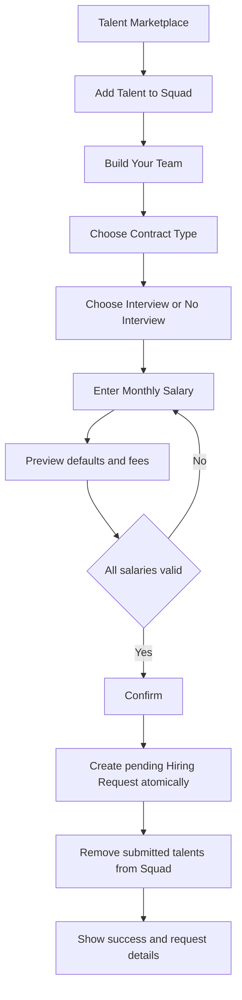

# S05B — إعدادات أنواع العقود وتبسيط طلب التعيين

الحالة: **خطة مقترحة للمراجعة قبل التنفيذ**  
آخر مراجعة: 2 نوفمبر 2026  
النطاق: تنفيذ إعدادات أنواع العقود الظاهرة في Admin Portal، واستخدام إعدادات العقد الفعالة لبناء العرض المبدئي عند إرسال Hiring Request، وتبسيط Flow العميل ليتطابق مع Figma.  
عرض التسليم: الأدمن يضبط عقد `managed`، والعميل يختار Talent ونوع العقد وخيار المقابلة ويدخل الراتب فقط، ثم يصل طلب مكتمل إلى الأدمن مع عرض يحتوي نسخة ثابتة من إعدادات العقد.

## 1. سبب التعديل

التنفيذ الحالي يسمح للعميل بإرسال كل شروط العرض يدويًا:

- العملة.
- Work Type.
- Work Mode.
- بداية ونهاية أيام العمل.
- Hybrid Work Days.
- عدد ساعات العمل.
- Notice Period.
- Work Location.

هذا لا يطابق Figma بعد اعتماد شاشة `Contract Types & Configuration List`. في التصميم تكون إعدادات العمل والرسوم معرفة من الأدمن على نوع العقد، والعميل في شاشة `Build Your Team` يحدد لكل Talent:

- نوع العقد `managed` أو`one_time`.
- هل المقابلة مطلوبة.
- الراتب الشهري فقط.

ثم يعرض النظام شروط العقد المحسوبة وملخص الرسوم قبل التأكيد.

## 2. مراجع Figma المعتمدة

| الجزء | Node | النتيجة |
| --- | --- | --- |
| Contract Types & Configuration List | `3916:38786` | نوعا العقد System Defined، مع عرض الحالة والمميزات ونوع الرسوم |
| Managed Contract Configuration | `3916:42854` | Basic Information، Fees، Benefits، Professional Field Overrides، Terms، Managed Contract Defaults |
| Build Your Team | `3730:38377` | نوع العقد، Interview Preference، Salary Range، Notice Period، شروط العمل، Monthly Offer، Confirm |
| Build Your Team — Contract selection | `3890:38225` | Apply to All، `managed/one_time`، Interview/No Interview، الراتب والرسوم ونجاح إرسال الطلب |

التصميم التفصيلي المتاح حاليًا لإعدادات العمل يخص `managed`. نوع `one_time` ظاهر في القائمة والاختيار، لكن لا توجد له شاشة تفاصيل مستقلة مكتملة بنفس وضوح `managed`.

## 3. القرارات المعتمدة

1. نوعا العقد ثابتان ولا ينشئ الأدمن أنواعًا جديدة:
   - `managed`
   - `one_time`
2. الأدمن يستطيع تفعيل أوتعطيل النوع وتعديل إعداداته، ولا يحذفه.
3. إعدادات العقد تحفظ وقت بداية ونهاية العمل:
   - `work_start_time`
   - `work_end_time`
4. عند إنشاء Hiring Request يحسب الباك `work_hours` من الفرق بين الوقتين، ويحفظ العدد فقط في `hiring_offers`.
5. Fee Override يحفظ:
   - `min_employees`
   - `max_employees`
6. العميل لا يرسل شروط العمل داخل العرض.
7. العميل يرسل الراتب فقط كقيمة مالية، والعملة تؤخذ من `talents.expected_currency_id`.
8. يجب أن يكون الراتب داخل `expected_salary_min` و`expected_salary_max` لنفس Talent.
9. Notice Period يؤخذ من بيانات الموهبة.
10. Work Location وإحداثياته تؤخذ من Contract Configuration وتنسخ إلى العرض وقت إنشاء الطلب.
11. `Add Talent to Squad` يبقى؛ لأنه جزء مستقل ومعتمد في S04 وFigma.
12. ضغط `Confirm` ينشئ ويرسل الطلب مباشرة، ولا توجد شاشة Draft منفصلة في Figma.
13. تعديل إعدادات العقد لاحقًا لا يغير عروض أوطلبات سبق إنشاؤها.

## 4. حدود التنفيذ

### 4.1 داخل S05B

- موديول Admin لإدارة Contract Types Configuration.
- Seed idempotent لنوعي العقد.
- Basic Information والترجمة عربي/إنجليزي.
- Active/Inactive.
- Default Fee Configuration.
- What You Get.
- Professional Field Fee Overrides مع Employee Range.
- Terms & Conditions عربي/إنجليزي.
- Managed Contract Defaults.
- إرجاع الإعدادات الفعالة للعميل.
- التحقق من Salary Range.
- اشتقاق عملة العرض من Talent Profile.
- حساب `work_hours` من إعدادات العقد.
- إنشاء Hiring Request وإرساله في عملية واحدة.
- الحفاظ على نسخة شروط العقد المستخدمة داخل الطلب والعرض.
- تحديث Admin/Client OpenAPI وأمثلة Apidog.
- اختبارات Feature وValidation وAuthorization.

### 4.2 خارج S05B

- إنشاء العقد القانوني وتوقيعه؛ يظل ضمن S07.
- الفواتير والدفع والتحويل البنكي؛ ضمن S07.
- Currency conversion من API خارجي.
- تغيير إعدادات عرض أُرسل بالفعل للموهبة؛ يتم من دورة التفاوض في S06.
- اختراع إعدادات `one_time` غير الموجودة في التصميم.
- إضافة أنواع عقود مخصصة من الأدمن.

## 5. السكيما المقترحة

### 5.1 `contract_types`

| العمود | النوع | المطلوب | الملاحظات |
| --- | --- | --- | --- |
| `id` | bigint | نعم | PK |
| `type` | varchar(32) | نعم | Unique: `managed`, `one_time` |
| `is_active` | boolean | نعم | النوع غير الفعال لا يقبل طلبات جديدة |
| `name_en` | varchar(255) | نعم | اسم العرض بالإنجليزية |
| `name_ar` | varchar(255) | نعم | اسم العرض بالعربية |
| `description_en` | text | لا | — |
| `description_ar` | text | لا | — |
| `fee_type` | varchar(32) | نعم | `fixed`, `percentage`, `fixed_percentage` |
| `fixed_amount` | decimal(18,4) | لا | حسب `fee_type` |
| `fixed_currency_id` | bigint | لا | FK إلى `currencies` |
| `percentage` | decimal(7,4) | لا | من 0 إلى 100 |
| `work_start_day` | varchar(16) | لا | مطلوب لإعدادات `managed` |
| `work_end_day` | varchar(16) | لا | لا يسبق البداية وفق ترتيب الأيام المعتمد |
| `work_start_time` | time | لا | مطلوب لإعدادات `managed` |
| `work_end_time` | time | لا | يجب أن يكون بعد البداية |
| `work_type` | varchar(32) | لا | القيمة الافتراضية للعقد |
| `work_mode` | varchar(32) | لا | القيمة الافتراضية للعقد |
| `hybrid_work_days` | json | لا | مسموح فقط عند `work_mode=hybrid` |
| `work_location` | varchar(500) | لا | وصف أوعنوان مكان العمل |
| `work_latitude` | decimal(10,7) | لا | من `-90` إلى `90` |
| `work_longitude` | decimal(10,7) | لا | من `-180` إلى `180` |
| timestamps | timestamps | نعم | — |

لا نخزن `work_hours` في هذا الجدول؛ لأنه قيمة مشتقة من وقت البداية والنهاية.

### 5.2 `contract_type_benefits`

| العمود | النوع | المطلوب | الملاحظات |
| --- | --- | --- | --- |
| `id` | bigint | نعم | PK |
| `contract_type_id` | bigint | نعم | FK |
| `name_en` | varchar(255) | نعم | — |
| `name_ar` | varchar(255) | لا | — |
| `display_order` | unsigned smallint | نعم | ترتيب الظهور |
| timestamps | timestamps | نعم | — |

يستبدل الأدمن القائمة كاملة داخل عملية Update واحدة، مع منع تكرار `display_order` داخل النوع.

### 5.3 `contract_type_terms`

| العمود | النوع | المطلوب | الملاحظات |
| --- | --- | --- | --- |
| `id` | bigint | نعم | PK |
| `contract_type_id` | bigint | نعم | FK |
| `content_en` | text | نعم | نص الشرط بالإنجليزية |
| `content_ar` | text | لا | نص الشرط بالعربية |
| `display_order` | unsigned smallint | نعم | ترتيب الظهور |
| timestamps | timestamps | نعم | — |

كل Contract Type له قائمة شروط متعددة ومرتبة، وليست خانة نص واحدة. يستبدل الأدمن القائمة كاملة داخل Update واحدة، مع منع تكرار `display_order` داخل النوع.

### 5.4 `contract_type_fee_overrides`

| العمود | النوع | المطلوب | الملاحظات |
| --- | --- | --- | --- |
| `id` | bigint | نعم | PK |
| `contract_type_id` | bigint | نعم | FK |
| `professional_field_id` | bigint | نعم | FK إلى `professional_fields` |
| `min_employees` | unsigned integer | نعم | أكبر من صفر |
| `max_employees` | unsigned integer | نعم مبدئيًا | أكبر من أومساوٍ لـ`min_employees` |
| `fee_type` | varchar(32) | نعم | نفس قيم النوع الأساسي |
| `fixed_amount` | decimal(18,4) | لا | حسب `fee_type` |
| `fixed_currency_id` | bigint | لا | FK إلى `currencies` |
| `percentage` | decimal(7,4) | لا | حسب `fee_type` |
| `is_active` | boolean | نعم | تعطيل بدل الحذف التشغيلي |
| timestamps | timestamps | نعم | — |

يمنع وجود نطاقين متداخلين لنفس `contract_type_id + professional_field_id` عندما يكونان فعالين.

### 5.5 تعديل `hiring_request_items`

يضاف:

| العمود | النوع | الغرض |
| --- | --- | --- |
| `contract_type_id` | bigint | ربط العنصر بنوع العقد المختار |
| `contract_configuration_snapshot` | json | نسخة الاسم والشروط والمميزات والرسوم المطبقة وقت الإرسال |

يظل `contract_type` الحالي خلال Migration الانتقالية لحماية البيانات الموجودة، ثم تقرر إزالته بعد Backfill والتحقق من عدم وجود مستهلك يعتمد عليه. الـAPI تظل ترجع قيمة النوع باسم `contract_type` (`managed` أو`one_time`) حتى لا ينكسر الفرونت، بينما العلاقة الداخلية تعتمد على `contract_types.type`.

### 5.6 `hiring_offers`

لا نضيف حقول وقت البداية والنهاية. الصف النهائي يحتفظ بالقيم المستخدمة فعلًا:

- `salary_amount`
- `currency_id`
- `work_type`
- `work_mode`
- `work_start_day`
- `work_end_day`
- `hybrid_work_days`
- `work_hours` كعدد ساعات محسوب
- `notice_period_days`
- `work_location`
- `work_latitude`
- `work_longitude`

هذا يجعل تعديل إعدادات العقد لاحقًا غير مؤثر على العرض القديم.

## 6. قواعد الإعدادات والرسوم

### 6.1 Fee Type

- `fixed`: يتطلب `fixed_amount` و`fixed_currency_id` ويمنع `percentage`.
- `percentage`: يتطلب `percentage` ويمنع Fixed Amount.
- `fixed_percentage`: يتطلب القيمتين.
- القيم الموجودة في Figma أمثلة فقط ولا تثبت في الكود.

### 6.2 اختيار Fee Override

عند تجهيز Preview أوSubmit:

1. يحدد النظام Professional Field الخاصة بالموهبة.
2. يحدد عدد موظفي Workspace وفق القرار النهائي الموضح في قسم النقاط المفتوحة.
3. يبحث عن Override فعال يغطي العدد.
4. عند وجوده يستخدمه بدل Default Fee.
5. عند عدم وجوده يستخدم Default Fee الموجود على Contract Type.
6. تحفظ القاعدة والقيم المستخدمة داخل Snapshot العنصر.

### 6.3 حساب ساعات العمل

مثال:

```text
work_start_time = 09:00
work_end_time   = 17:00
work_hours      = 8
```

الحساب يتم في Backend ولا يقبل `work_hours` من العميل. في المرحلة الحالية لا نفترض شيفتًا يعبر منتصف الليل حتى يصدر قرار صريح بذلك.

### 6.4 Hybrid Days

- مطلوبة فقط عند `work_mode=hybrid`.
- Array بدون تكرار.
- كل يوم يجب أن يقع بين `work_start_day` و`work_end_day`.
- تكون `null` في `remote` و`onsite`.

### 6.5 Work Location

- في `onsite` و`hybrid`: تكون `work_location`, `work_latitude` و`work_longitude` مطلوبة معًا.
- في `remote`: تكون الحقول اختيارية ويمكن أن تكون `null`.
- لا يسمح بإرسال Latitude دون Longitude أوالعكس.
- تنسخ القيم من Contract Configuration إلى `hiring_offers` ولا يرسلها العميل.
- تعديل موقع العقد لاحقًا لا يغير العروض الموجودة.

## 7. Salary Validation

قبل Preview وقبل Submit يجب التحقق من أن Talent:

- حسابها فعال.
- طلبها مقبول.
- ليست في Blacklist فعالة.
- ما زالت متاحة في Marketplace.
- موجودة في Squad الخاصة بنفس Workspace.
- لديها `expected_salary_min` و`expected_salary_max`.
- لديها `expected_currency_id` فعال.

ثم يطبق:

```text
expected_salary_min <= salary_amount <= expected_salary_max
```

العميل لا يرسل `currency_id`. العرض يأخذ `expected_currency_id`، وتظهر رسالة Validation خاصة بالعنصر عند خروج الراتب عن الرينج.

لا نحول العملات في هذا السبرنت. عند وجود مواهب بعملات مختلفة ترجع الإجماليات مجمعة حسب العملة، كما يفعل Resource الحالي.

## 8. Flow العميل بعد التعديل



## 9. الـAPI المقترحة

### 9.1 Admin Contract Types

```text
GET   /api/v1/admin/contract-types
GET   /api/v1/admin/contract-types/{contractType}
PUT   /api/v1/admin/contract-types/{contractType}
PATCH /api/v1/admin/contract-types/{contractType}/status
```

لا توجد Endpoints لـCreate أوDelete. `PUT` يحفظ Basic Info وFees وBenefits وOverrides وTerms وDefaults داخل Transaction واحدة.

### 9.2 Client Squad

تبقى بدون تغيير:

```text
GET    /api/v1/client/workspaces/{workspace}/talent-selections
POST   /api/v1/client/workspaces/{workspace}/talent-selections
DELETE /api/v1/client/workspaces/{workspace}/talent-selections/{talent}
```

### 9.3 Client Hiring Request

الشكل النهائي المقترح:

```text
POST /api/v1/client/workspaces/{workspace}/hiring-requests/preview
POST /api/v1/client/workspaces/{workspace}/hiring-requests
```

- `preview`: لا يحفظ بيانات؛ يتحقق من العناصر ويعيد Defaults والرسوم والإجماليات لعرض شاشة Figma بدقة.
- `POST hiring-requests`: يعيد نفس التحقق ثم ينشئ الطلب مباشرة بحالة `pending` داخل Transaction واحدة.

Body مشترك:

```json
{
  "items": [
    {
      "talent_id": 12,
      "contract_type": "managed",
      "interview_required": true,
      "salary_amount": 6500
    }
  ]
}
```

### 9.4 Endpoints الحالية المرشحة للإلغاء

```text
PUT  /api/v1/client/workspaces/{workspace}/hiring-requests/{hiringRequest}
POST /api/v1/client/workspaces/{workspace}/hiring-requests/{hiringRequest}/submit
```

كما تتغير دلالة:

```text
POST /api/v1/client/workspaces/{workspace}/hiring-requests
```

من Create Draft إلى Confirm & Submit.

الحذف أوتغيير الدلالة Breaking Change. قبل التنفيذ يجب التأكد أن Frontend لم يربط Create/Update/Submit الحالية. إن كانت مرتبطة، تنفذ مرحلة توافق مؤقتة بدل حذفها مباشرة.

## 10. Flow الحفظ الذري

عند Confirm:

1. Authorize عضو Workspace بصلاحية إدارة Hiring Requests.
2. Lock على Workspace والاختيارات المستخدمة.
3. تحميل Contract Types الفعالة.
4. تحميل Talents والتحقق من Eligibility والرواتب.
5. التحقق من عدم وجود Hiring Request فعال مكرر.
6. اختيار Fee Override أوDefault Fee.
7. حساب `work_hours` من Contract Configuration.
8. إنشاء `hiring_requests` مباشرة بحالة `pending` وتثبيت `submitted_at`.
9. إنشاء Item لكل Talent مع Contract Snapshot.
10. إنشاء Offer أولي بالقيم المحسوبة والمنسوخة.
11. حذف Talents المرسلة من Squad.
12. تسجيل Event واحد واضح `submitted` مع البيانات المرجعية اللازمة.
13. Commit وإرجاع Hiring Request كاملة.

أي فشل يعيد العملية كلها ولا يحذف Squad جزئيًا.

## 11. صلاحيات الأدمن

تضاف صلاحيات مستقلة لأن Contracts موديول ظاهر مستقل في Admin Portal:

```text
admin.contract-types.view
admin.contract-types.update
admin.contract-types.toggle-status
```

`super_admin` يتجاوزها كالمعتاد، وتزامن الصلاحيات يتم من Seeder idempotent يحافظ على الأدوار والبيانات الحالية.

## 12. خطة Migration والحفاظ على البيانات

لأن S05 منفذ بالفعل وقد توجد بيانات على السيرفر، ننشئ Migration ترقية جديدة ولا نعدل Migration مطبقة:

1. إنشاء جداول Contract Types.
2. Seed نوعي `managed` و`one_time` باستخدام `updateOrCreate`.
3. إضافة `contract_type_id` وSnapshot إلى Items كـNullable مؤقتًا.
4. Backfill حسب قيمة `hiring_request_items.contract_type` الحالية.
5. التحقق من اكتمال Backfill قبل تفعيل القيود المطلوبة.
6. عدم حذف أي Draft أوRequest أوOffer موجود.
7. عدم إسقاط `contract_type` القديم في نفس الإصدار.
8. إضافة `work_latitude` و`work_longitude` إلى `hiring_offers` مع الحفاظ على `work_location` الحالي.

## 13. حالات الاختبار المطلوبة

### Admin

- List/Show للنوعين.
- تحديث Managed Configuration كاملًا.
- حفظ وإرجاع عدة Terms بالترتيب والترجمة.
- رفض Fee Type ناقص القيم التابعة له.
- رفض أوقات غير صحيحة.
- رفض Hybrid Days خارج مدى أيام العمل.
- رفض موقع ناقص أوإحداثيات خارج النطاق في `onsite` و`hybrid`.
- رفض Employee Range غير صحيح أومتداخل.
- تعطيل النوع يمنع استخدامه في طلب جديد ولا يكسر الطلبات القديمة.
- Authorization لكل صلاحية.

### Client

- Preview ناجح يعيد Defaults والرسوم.
- Salary أقل من الحد الأدنى.
- Salary أعلى من الحد الأقصى.
- Talent بلا Salary Range أوCurrency.
- Contract Type غير فعال.
- Talent ليست في Squad أوWorkspace مختلفة.
- Submit ناجح ينشئ `pending` مباشرة.
- شروط العرض لا يمكن حقنها من Body العميل.
- `work_hours` يحسب بشكل صحيح.
- Snapshot لا يتغير بعد تعديل Contract Configuration.
- Transaction rollback يحافظ على Squad عند أي خطأ.
- منع الطلب الفعال المكرر تحت Concurrency.

### Regression

- Admin Assign/Reassign/Start Request.
- S06 Offer/Interview/Decision flows.
- Resources و`available_actions` الحالية.
- OpenAPI للـAdmin والـClient.

## 14. ترتيب التنفيذ

1. اعتماد النقاط المفتوحة أدناه.
2. Migration + Models + Seeder.
3. Admin Contract Types service والـvalidation.
4. Admin endpoints والصلاحيات والتوثيق.
5. Contract resolver لاختيار Defaults وFee Override وحساب الساعات.
6. Preview endpoint.
7. تبسيط Submit flow وإلغاء مدخلات العرض غير المسموحة.
8. Backward compatibility أوإزالة Draft endpoints حسب حالة ربط الفرونت.
9. تحديث Resources وExamples وApidog.
10. تشغيل اختبارات SQLite داخل Docker، ثم Regression لسبرنتي S05 وS06.
11. كتابة ملف تنفيذ يوضح ما تغير وطريقة تحديث السيرفر.

## 15. نقاط مفتوحة قبل التنفيذ

1. **مطابقة Employee Range:** Workspace تحفظ `size_band` مثل `1-10` ولا تحفظ عددًا دقيقًا. لا يمكن اختيار Override مثل `1-5` بدقة من `size_band=1-10`. نحتاج قرارًا: إضافة `employee_count` للـWorkspace، أم تقييد Overrides بنفس حدود Size Bands؟
2. **One-Time Defaults:** لا توجد شاشة تفاصيل واضحة له. هل ننفذ Basic Info وFees وBenefits وTerms فقط، ونترك Work Defaults `null` حتى اعتماد تصميمه؟
3. **Fee Percentage Basis:** التصميم يعرض Percentage لكنه لا يحدد صراحة هل تحسب على الراتب الشهري فقط. المثال يوحي بذلك، لكن يجب اعتماده صراحة قبل الحساب.
4. **Overnight Work:** الخطة ترفض `end_time <= start_time`. إذا كانت الشيفتات الليلية مطلوبة نحتاج قاعدة حساب مختلفة.
5. **Breaking endpoints:** هل الـFrontend الحالي مرتبط بالفعل بـCreate Draft وUpdate Draft وSubmit، أم يمكن استبدالها مباشرة بالـConfirm الواحد؟

