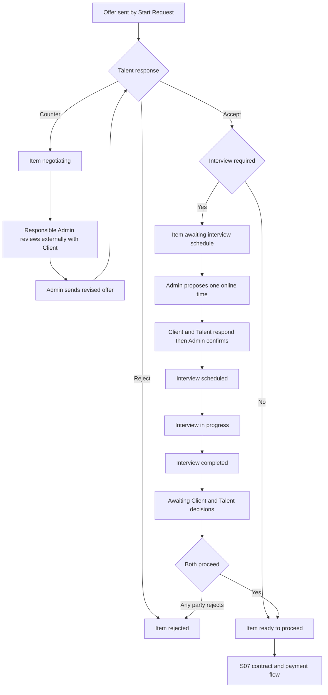

# S06 — المقابلات والعروض

الحالة: **معتمدة وجاهزة للتنفيذ**  
آخر مراجعة: 1 نوفمبر 2026  
النطاق: رد الموهبة على العرض، التفاوض الذي يديره الأدمن، جدولة المقابلة وتأكيدها، ثم توثيق قرار العميل والموهبة بعد المقابلة.  
عرض التسليم: مقابلة موثقة وقرار عرض موثق لكل عنصر داخل Hiring Request.

> القرارات التنفيذية والتعارضات التي ظهرت في التصميم حسمت في قسم **القرارات المعتمدة**، ولا توجد حاليًا نقطة Business مفتوحة تمنع التنفيذ.

## 1. حدود السبرنت

### داخل S06

- إظهار العرض المرسل للموهبة وقائمة عروضها وتفاصيل العرض.
- قبول الموهبة للعرض أو رفضه أو إرسال Counter Offer.
- تمكين الأدمن المسؤول من متابعة التفاوض وإرسال نسخة عرض معدلة وتسجيل رد بالنيابة عند امتلاك الصلاحية.
- انتقال عنصر الطلب إلى المقابلة إذا كان `interview_required=true`.
- إنشاء مواعيد مقابلة، اختيار/تأكيد الموعد، إنشاء أو حفظ رابط المقابلة، وإعادة الجدولة.
- ظهور المقابلة المناسبة لكل من Client وTalent وAdmin مع Actions مختلفة حسب الحالة والصلاحية.
- انتقال المقابلة زمنيًا إلى `in_progress` و`completed` مع السماح للأدمن المسؤول بالتنفيذ اليدوي عند الحاجة.
- حفظ قرار مستقل للعميل وقرار مستقل للموهبة بعد المقابلة، مع دعم رد الأدمن بالنيابة.
- وصول العنصر إلى `ready_to_proceed` عند اتفاق الطرفين.
- Hold وResume وCancel للعملية النشطة بالآثار التي سيعتمدها صاحب المشروع.
- Audit trail لكل رد أوتغيير عرض أوموعد أوقرار.
- `available_actions` حسب البورتال والصلاحية والحالة.
- توثيق OpenAPI كامل للـTalent والـClient والـAdmin واختبارات Feature.

### خارج S06

- إنشاء العقد وتوقيعه وحفظ ملفات العقد.
- الرسوم والفواتير والمدفوعات.
- تحويل العنصر إلى `ready_for_contract` أو`contracted` كتدفق كامل؛ هذا نطاق S07.
- كشف بيانات التواصل المحمية قبل النقطة المعتمدة في S07.
- حساب رسوم `managed` أو`one_time`.
- إدارة المشروعات والمهام بعد التعاقد.

## 2. ما تمت مراجعته في Figma

### 2.1 Talent Portal

| الجزء | Node | ما يظهر في التصميم |
| --- | --- | --- |
| قائمة العروض | `3662:29653` | البحث والفلاتر والحالات |
| تفاصيل العرض | `3670:31371` | الشركة والراتب ونظام العمل وNotice Period وأيام وساعات العمل، ثم Accept / Reject / Negotiate |
| Counter Offer | `3733:40359` | راتب وعملة ونظام عمل وأيام Hybrid وموقع، ويظهر به أيضًا Availability/Notice Period |
| سجل التفاوض | `3733:40688` | نسخ متتابعة ظاهرة كـClient Offer وTalent Offer |
| رفض العرض | `3670:33590` | نهاية العنصر من جهة الموهبة |
| غلق لعدم الرد | `3670:34090` | Warning للموهبة وعبارة عن فرصة متبقية قبل الإيقاف |
| انتظار المواعيد | `3718:30338` | الموهبة تنتظر 3 مواعيد مقترحة |
| مقابلة مؤكدة | `3670:36686` | موعد مدته 60 دقيقة، Meeting URL، Join وApologize |
| الاعتذار وإعادة الجدولة | `4315:68038` | سبب مطلوب وإلغاء الموعد الحالي، دون إدخال موعد بديل من الموهبة |
| انتظار موعد جديد | `3670:37137` | الموعد ألغي وتنتظر الموهبة مواعيد جديدة |

### 2.2 Client Portal

| الجزء | Node | ما يظهر في التصميم |
| --- | --- | --- |
| انتظار رد الموهبة | `3342:26065` | العميل يتابع فقط، ويظهر مثال مدة 48 ساعة |
| Hold / Cancel | `3437:31764`, `4350:77749`, `4350:78037` | إيقاف مؤقت أوإلغاء للعملية، والسبب مكتوب في التصميم Optional |
| On Hold / Cancelled | `3437:32402`, `3437:33001` | Resume أوCancel، ثم توضيح سبب الإلغاء |
| عرض جديد ينتظر الرد | `4350:78329` | العميل يرى أن العرض المعدل أرسل للموهبة |
| انتظار المواعيد | `3454:34531` | العميل ينتظر تجهيز المواعيد، ولا يظهر Action واضح لاختيارها في هذه الشاشة |
| مقابلة مؤكدة | `3460:28552` | رابط Meet وJoin، والنص يقول إن الرابط يتاح قبل الموعد بـ10 دقائق |
| الاعتذار عن المقابلة | `3461:36078` | طلب موعد جديد وسبب Optional |
| إلغاء الموهبة للموعد | `3535:23725` | العميل ينتظر مواعيد بديلة |
| بعد اكتمال المقابلة | `3535:23827` | `Reject Talent` أو`Proceed with Talent` |

### 2.3 Admin Portal

| الجزء | Node | ما يظهر في التصميم |
| --- | --- | --- |
| تفاصيل العرض والمهلة | `3971:44951`, `3971:46912` | العرض وOverdue، وتظهر قيمة Contract Duration في إحدى الشاشات فقط |
| رد بالنيابة | `4292:111785` | رفض بالنيابة عن الموهبة مع سبب Required وتسجيل الأدمن المنفذ |
| إدارة التفاوض | `3984:47541`, `4292:113232`, `4292:113764` | Timeline، Counter Offer، Accept/Reject، Hold/Cancel |
| إنشاء مواعيد | `4007:47631` | النص يطلب 3 مواعيد، لكن النموذج المرئي يحتوي Date وTime واحدة فقط |
| مقابلة مؤكدة | `4024:53721` | Meet، المشاركون Client وTalent، Reschedule وJoin |
| طلب إعادة الجدولة | `4315:68393` | الأدمن يراجع سببًا وموعدًا مقترحًا ثم Approve/Decline |
| نهاية المقابلة | `4032:56278` | الطرفان أمامهما يوم واحد لاتخاذ القرار، والأدمن يستطيع التسجيل بالنيابة |
| انتظار قرار الطرف الآخر | `4032:57814`, `4032:58772` | حفظ قرار كل طرف بشكل مستقل |
| سحب القرار | `4308:55492` | يظهر Action باسم Cancel Decision |
| اتفاق الطرفين | `4032:61781` | العنصر ينتقل إلى Ready to Proceed |

## 3. الوضع الحالي في الكود وقاعدة البيانات

### 3.1 ما نفذه S05 ويمكن البناء عليه

- `hiring_requests` مرتبط بـWorkspace وله Admin مسؤول وحالات `draft`, `pending`, `active`, `completed`, `cancelled`.
- `hiring_request_items` يفصل تقدم كل Talent ويحتوي `interview_required` وأسباب الرفض والإيقاف والإلغاء.
- حالات العنصر المحجوزة بالفعل تشمل:
  - `awaiting_talent_response`
  - `negotiating`
  - `awaiting_interview_slots`
  - `interview_scheduled`
  - `awaiting_decisions`
  - `ready_to_proceed`
  - `on_hold`, `rejected`, `cancelled`, `completed`
- `hiring_offers` يحفظ الراتب والعملة وشروط العمل وحالة العرض و`sent_at` و`response_due_at`.
- حالات العرض الحالية: `pending`, `accepted`, `rejected`, `countered`، ويضاف في S06 `expired`.
- `hiring_request_events` يسجل المستخدم الحقيقي الذي نفذ الإجراء والبيانات المصاحبة له.
- `Start Request` يرسل أول عرض ويحسب Deadline من `config('hiring.offer_response_duration_hours')`، والقيمة الحالية 48 ساعة.
- صلاحية `admin.hiring-requests.respond-on-behalf` موجودة بالفعل.
- لا توجد حاليًا APIs للموهبة لعرض عروض التوظيف أوالرد عليها.
- لا توجد حاليًا APIs للعميل أوالأدمن لقرارات ما بعد المقابلة أوHold/Resume/Cancel.

### 3.2 نظام المقابلات الموجود من S02

الموجود حاليًا مخصص لمقابلة **تقييم طلب انضمام الموهبة للمنصة** وليس Hiring Request:

- جدول `interviews` مرتبط إجباريًا بـ`talent_applications.application_id`.
- جدول `interview_slots` يدعم Online/Offline، بداية ونهاية، Location وLat/Lng، وحالات الموعد.
- المدة الحالية 60 دقيقة.
- إنشاء Google Calendar/Meet عند اختيار الموعد، مع دعم `meeting_url` اليدوي.
- التحقق من تداخل مواعيد الـAdmin interviewers.
- حالات المقابلة: `awaiting_slot_selection`, `awaiting_new_slots`, `confirmed`, `in_progress`, `completed`, `cancelled`.
- انتقال `confirmed → in_progress → completed` تلقائيًا حسب الوقت، مع Start/Complete يدويين.
- رفض كل المواعيد محدود بمرتين في مقابلة تقييم الموهبة.
- Talent يستطيع الاعتذار عن الموعد المؤكد مرة واحدة في فلو S02.
- Audit الخاص به يحفظ في `talent_application_events`، لذلك لا يصلح مباشرة لأحداث Hiring Request.

### 3.3 قرار الفصل بين نوعي المقابلات

تم اعتماد أن مقابلات S06 **لا علاقة وظيفية أوبيانية** لها بمقابلات تقييم الموهبة في S02:

- لا نضيف `request_item_id` إلى جدول `interviews` الحالي.
- لا نجعل `application_id` nullable، ولا نغير Contract أوRelations الخاصة بمقابلات S02.
- ننشئ Models وEnums وServices وResources وEndpoints مستقلة تحت موديول Hiring Requests.
- Events الخاصة بها تسجل في `hiring_request_events` ولا تستخدم `talent_application_events`.
- يمكن إعادة استخدام مكونات تقنية عامة فقط، وليست Business flow مشتركة:
  - Google Calendar gateway وإنشاء Meet أوالرابط اليدوي.
  - Helper عام لحساب نهاية الموعد من البداية والمدة.
  - آلية عامة لكشف تداخل الوقت، بشرط أن تفحص المواعيد المحجوزة المطلوبة دون ربط الموديلين ببعضهما.

الهدف أن تظل كل Endpoints واختبارات S02 دون أي تغيير، وألا يؤدي تعديل دورة التوظيف مستقبلًا إلى التأثير على تقييم قبول الموهبة في المنصة.

## 4. الفلو الذي يؤكده التصميم حتى الآن

### 4.1 العرض والتفاوض

1. Talent يرى فقط العروض الخاصة به التي لها `sent_at`.
2. Talent يختار Accept أوReject أوCounter.
3. Reject المباشر من Talent ينهي العنصر دون طلب سبب، كما في Figma. رفض الأدمن بالنيابة عن Talent هو الحالة الوحيدة التي يظهر فيها حقل سبب داخل تصميم العرض.
4. Counter يغلق نسخة العرض الحالية كـ`countered` وينشئ نسخة عرض جديدة تمثل شروط الموهبة.
5. الأدمن المسؤول يراجع Counter مع العميل خارج المنصة، ثم يرسل عرضًا معدلًا للموهبة.
6. كل نسخة عرض تحدد الطرف الذي تمثل شروطه: `client` أو`talent`، بينما يسجل الـEvent المستخدم الحقيقي الذي أنشأها.
7. حاليًا الأدمن هو من ينشئ نسخة `client` بعد التنسيق خارجيًا مع العميل، لكن السكيما تسمح مستقبلًا أن ينشئها العميل مباشرة دون تغيير الـTimeline.
8. `notice_period_days` جزء من كل نسخة عرض وقابل للتعديل:
   - إذا أرسله العميل أوالأدمن تستخدم القيمة المرسلة.
   - إذا لم يرسل، تنسخ القيمة الحالية من ملف الموهبة إلى نسخة العرض.
   - تحفظ القيمة المحسوبة على العرض نفسه حتى لا تتغير العروض القديمة إذا تغير ملف الموهبة لاحقًا.
9. `work_location` جزء من كل نسخة عرض ويعامل بنفس طريقة Notice Period:
   - إذا أرسل في العرض أوCounter Offer تحفظ القيمة المرسلة.
   - إذا لم يرسل، تنسخ قيمة مكونة من City وCountry الحاليين للـWorkspace.
   - تحفظ القيمة المحسوبة كنص Snapshot على العرض نفسه حتى لا تتغير النسخة القديمة إذا تغير موقع الـWorkspace لاحقًا.
   - يمكن أن تكون `null` فقط إذا لم ترسل قيمة ولا توجد بيانات موقع مكتملة في الـWorkspace.
10. Admin يمكنه تنفيذ رد بالنيابة، ويسجل الـEvent المستخدم الحقيقي والطرف الذي مثله.
11. عند انتهاء `response_due_at` دون رد:
   - يتحول العرض إلى `expired`.
   - يمنع Talent من الرد على النسخة المنتهية.
   - يظل الأدمن قادرًا على تسجيل رد بالنيابة أوإرسال نسخة عرض جديدة بمهلة جديدة.
   - يسجل `offer_response_deadline_expired` في `hiring_request_events`.
   - يزيد عداد عدم الرد على Talent مرة واحدة فقط لنفس العرض.
   - يظل العنصر في `awaiting_talent_response` ولا يغلق تلقائيًا؛ لأن الأدمن قد يسجل ردًا بالنيابة أويرسل نسخة عرض جديدة أويلغي العنصر يدويًا.
   - إذا وصل Talent إلى حد عدم الرد، يعطل حساب المستخدم ويمنع Talent من الدخول والرد بنفسه، لكن العنصر يظل مفتوحًا للأدمن المسؤول ولا يتحول تلقائيًا إلى `rejected` أو`cancelled`.
   - إذا تواصل Talent خارجيًا بعد الانتهاء، يستطيع الأدمن تحويل **نفس نسخة العرض** من `expired` إلى `accepted` أو`rejected` بالنيابة دون إنشاء نسخة جديدة، ويسجل Event واضحًا أن الرد تم بعد انتهاء المهلة.
   - لا ينقص `offer_no_response_count` بعد رد الأدمن المتأخر؛ لأن واقعة عدم الرد داخل المهلة حدثت بالفعل. إذا تغيرت الشروط ينشئ الأدمن نسخة Offer جديدة بدل تعديل النسخة القديمة.

### 4.2 المقابلة

1. بعد قبول العرض:
   - `interview_required=false`: ينتقل العنصر مباشرة إلى `ready_to_proceed`.
   - `interview_required=true`: ينتقل إلى `awaiting_interview_slots`.
2. الأدمن المسؤول يقترح **موعدًا Online واحدًا فقط في كل محاولة** وموجهًا للعميل والموهبة معًا.
   - ممثل العميل في الموعد وGoogle Calendar هو عضو الـWorkspace الموجود في `hiring_requests.created_by_member_id`.
   - يستطيع عضو آخر داخل نفس Workspace تسجيل رد جهة العميل إذا امتلك الصلاحية، ويسجل المستخدم الفعلي في Event، لكن ذلك لا يغير ممثل العميل المسجل للموعد.
3. يسجل كل طرف رده على الموعد بشكل مستقل:
   - `accepted`: الموعد مناسب.
   - `change_requested`: يطلب تغيير الموعد ويوضح السبب.
   - `apologized`: يعتذر ويوضح السبب.
4. لا يقترح Client أوTalent موعدًا بديلًا؛ الأدمن هو الذي يحدد الموعد الجديد عند طلب التغيير أوالاعتذار.
5. إذا وافق الطرفان، يظل الموعد في انتظار التأكيد النهائي من الأدمن.
6. عند تأكيد الأدمن:
   - يحفظ Google event/Meet URL أوالرابط اليدوي.
   - ينتقل الموعد إلى `confirmed` والعنصر إلى `interview_scheduled`.
7. إذا طلب أي طرف تغيير الموعد أواعتذر، تغلق محاولة الموعد الحالية ويحدد الأدمن موعدًا واحدًا جديدًا للطرفين.
8. زر Join لا يتاح قبل الموعد؛ يتاح من `starts_at` وحتى `ends_at` فقط.
9. تبدأ وتنتهي المقابلة تلقائيًا حسب الوقت، ويمكن للأدمن Start/Complete يدويًا.
10. بعد `completed` ينتقل العنصر إلى `awaiting_decisions` ويبدأ Deadline قرار الطرفين من إعداد المنصة.

### 4.3 القرار بعد المقابلة

1. Client يسجل `proceed` أو`reject`.
2. Talent يسجل `proceed` أو`reject`.
3. يسجل القراران مستقلين مع actor ووقت القرار، لأن أحدهما قد يسبق الآخر.
4. الأدمن المسؤول متاح له كل Actions الخاصة بالدورة عندما تسمح الحالة بها، ومنها تسجيل قرار أي طرف بالنيابة، مع حفظ المنفذ والطرف الممثل.
5. موافقة الطرفين تنقل العنصر إلى `ready_to_proceed`.
6. رفض أي طرف ينقل العنصر إلى `rejected` ويحفظ الطرف، وسبب الرفض Optional.
7. انتهاء Deadline يمنع Client أوTalent من تنفيذ القرار، لكنه لا يمنع الأدمن المسؤول من تنفيذ Action أوالرد بالنيابة.
8. يمكن للطرف سحب قراره في أي وقت داخل دورة S06، حتى بعد وصول العنصر إلى `rejected` أو`ready_to_proceed`، طالما لم يبدأ تنفيذ S07 أوينشأ عقد، مع الاحتفاظ بالـAudit trail.
   - يسحب قرار الطرف فقط وتبقى نتيجة الطرف الآخر كما هي.
   - يعاد العنصر إلى `awaiting_decisions` وتنتظر النتيجة الناقصة من جديد.
   - هذا Reopen مقصود داخل S06 ويعامل كاستثناء من كون `rejected` حالة نهائية في التدفقات الأخرى.
9. الوصول إلى عقد أوحالة `ready_for_contract` يبدأ في S07 ولا ينفذ ضمن S06 إلا إذا اعتمد انتقال تقني محدد بين السبرنتين.

## 5. السكيما المعتمدة

هذا القسم يعرض أقل بيانات لازمة للتنفيذ.

### 5.1 التفاوض على العرض

سيضاف إلى `hiring_offers` الحد الأدنى التالي:

- `proposed_by`: الطرف الذي تمثل النسخة شروطه، بقيم `client` أو`talent`.
- `notice_period_days`: قيمة الأيام المثبتة على نسخة العرض بعد تطبيق fallback من ملف الموهبة.
- `work_location`: نص موقع العمل المثبت على نسخة العرض بعد تطبيق fallback من City وCountry للـWorkspace.

لا توجد قيمة `admin` داخل `proposed_by`؛ لأن الأدمن ينفذ الإجراء لكنه يمثل شروط Client أوTalent. المستخدم الحقيقي يسجل في `hiring_request_events`. بهذه الطريقة يمكن تفعيل تفاوض Client المباشر مستقبلًا دون تغيير هيكل نسخ العروض.

مراجعة Figma الدقيقة أثبتت الآتي:

- شاشة رفض Talent المباشر (`3670:33590`) لا تحتوي حقل سبب؛ تعرض فقط أن العرض رفض وتاريخ الرفض.
- مودال رفض Admin بالنيابة (`4292:111785`) يحتوي `Reason for Rejection` كحقل Required، ويوضح أن الإجراء سيسجل بتاريخ ووقت التنفيذ الحاليين.
- Timeline (`3733:40688`) يعرض `Sent` لكل نسخة عرض، لكنه لا يعرض `responded_at` مستقلًا.

لذلك لا نضيف `responded_at` أو`response_reason` إلى `hiring_offers`. وقت الرد يؤخذ من `hiring_request_events.created_at`، وسبب الرفض يحفظ في Event data وفي `hiring_request_items.rejection_reason` فقط عند رفض الأدمن بالنيابة. رفض Talent المباشر لا يطلب سببًا.

تضاف قيمة `expired` إلى `HiringOfferStatusEnum`. عملية انتهاء العرض يجب أن تكون Idempotent حتى لا تزيد عداد عدم الرد أكثر من مرة عند إعادة تشغيل الـScheduler أوإعادة قراءة العرض.

يسمح للأدمن المسؤول فقط، مع صلاحية الرد بالنيابة، بانتقال استثنائي من `expired` إلى `accepted` أو`rejected`. يسجل Event أن الرد تم بالنيابة وبعد انتهاء المهلة، ولا يعكس زيادة `offer_no_response_count`. تعديل أي شرط لا يحدث العرض المنتهي، بل ينشئ نسخة Offer جديدة.

### 5.2 مقابلات التوظيف

تم اعتماد جدول واحد مستقل عن مقابلات S02 لأن الفلو يحتوي مقابلة واحدة، وموعدًا Online واحدًا فقط في كل محاولة، وطرفين ثابتين للرد.

#### `hiring_interviews`

يرتبط بـ`hiring_request_items` ويحفظ المقابلة والموعد الحالي ورد الطرفين:

- `request_item_id`: عنصر طلب التوظيف، Unique في الفلو الحالي.
- `status`: حالة المقابلة.
- `starts_at`, `ends_at`: الموعد الحالي الذي اقترحه الأدمن.
- `proposed_by_admin_id`, `proposed_at`: من اقترح الموعد ومتى.
- `client_response`: `pending`, `accepted`, `change_requested`, `apologized`.
- `client_response_reason`: سبب طلب التغيير أوالاعتذار.
- `client_responded_at`: وقت رد العميل.
- `talent_response`: نفس حالات العميل.
- `talent_response_reason`: سبب طلب التغيير أوالاعتذار.
- `talent_responded_at`: وقت رد الموهبة.
- `confirmed_by_admin_id`, `confirmed_at`: تأكيد الأدمن بعد موافقة الطرفين.
- `google_calendar_event_id`, `meeting_url`: تنشأ عند التأكيد.
- `started_at`, `completed_at`: الوقت الفعلي لدورة المقابلة.

عند تحديد موعد جديد:

1. يسجل الموعد القديم وردود الطرفين في `hiring_request_events`.
2. يحدث `starts_at` و`ends_at` بالقيم الجديدة.
3. يعاد `client_response` و`talent_response` إلى `pending` وتمسح أسباب وأوقات الرد الحالي.
4. إذا كان الموعد السابق Confirmed، يلغى Google Calendar event السابق قبل إنشاء موعد جديد.

بهذا نحفظ الحالة الحالية في جدول بسيط، بينما يظل تاريخ كل محاولات المواعيد والردود متاحًا من الـEvents دون إنشاء جدولي Slots وResponses.

#### مبدأ التنفيذ

- Models وEnums وWorkflows مستقلة باسم Hiring Interview.
- لا توجد Polymorphic relation ولا Context column يجمع النوعين.
- Calendar integration يمكن حقنه في الفلو الجديد كاعتماد تقني فقط.
- كشف التعارض يطبق على `starts_at` و`ends_at` الجديدين قبل إرسالهما، مع مراعاة Client وTalent وأي مشارك مطلوب حضوره حسب البيانات المتاحة.
- في S06 ممثل Client الذي يفحص تعارضه ويرسل له Calendar invitation هو `created_by_member_id` الخاص بالطلب، بالإضافة إلى Talent. الأدمن المسؤول منسق للعملية ولا يعتبر Attendee إلا إذا أضيف مستقبلًا بقرار صريح.

### 5.3 قرارات الطرفين

لن ننشئ جدول `hiring_request_item_decisions`. بما أن الطرفين ثابتان، تحفظ الحالة الحالية للقرارين مباشرة داخل `hiring_request_items`:

- `client_decision`: `proceed`, `reject` أو`null`.
- `client_decision_reason`: سبب اختياري.
- `client_decided_at`: وقت القرار.
- `talent_decision`: `proceed`, `reject` أو`null`.
- `talent_decision_reason`: سبب اختياري.
- `talent_decided_at`: وقت القرار.
- `decision_due_at`: Deadline المشترك لرد الطرفين بعد اكتمال المقابلة.

عند سحب أحد الطرفين قراره، تعاد أعمدة قراره إلى `null` ويعاد العنصر إلى `awaiting_decisions` حتى لو كان وصل داخل S06 إلى `rejected` أو`ready_to_proceed`. تبقى أعمدة قرار الطرف الآخر دون تغيير. القرار المسحوب ووقت السحب والحالة السابقة والمستخدم الذي نفذه أوالأدمن الذي نفذه بالنيابة يحفظون في `hiring_request_events`. يمنع السحب بعد بدء S07 أوإنشاء عقد.

### 5.4 Hold / Resume / Cancel

الأسباب الموجودة على `hiring_request_items` تكون Optional. السلوك المعتمد:

1. عند Hold يتوقف Deadline الحالي.
2. إذا توجد مقابلة مؤكدة، تلغى ويلغى Google Calendar event المرتبط بها.
3. عند Resume يبدأ Deadline كامل جديد من إعداد المنصة، ولا يستكمل الوقت القديم.
4. يرجع العنصر إلى مرحلته التشغيلية قبل Hold، لكن المقابلة الملغاة لا تعاد ويحدد الأدمن موعدًا جديدًا.
5. Client وAdmin يستطيعان Hold في أي حالة تشغيلية غير نهائية داخل S06، وResume متاح من `on_hold` فقط.
6. Client وAdmin يستطيعان Cancel في أي وقت قبل بدء S07. Talent لا ينفذ Hold أوCancel للعنصر نفسه؛ لديه Actions رفض العرض والاعتذار وقراره بعد المقابلة.
7. تحفظ الحالة السابقة والـDeadline السابق وإجراءات الإيقاف والاستئناف في `hiring_request_events` دون إضافة `status_before_hold`. يعتمد Resume على آخر Event من نوع Hold داخل Transaction وLock على العنصر.

### 5.5 إعدادات الـDeadlines

- مدة رد Talent على العرض قيمة ثابتة قابلة للتعديل من Platform Settings، وتحسب منها `response_due_at` عند الإرسال أوResume.
- مدة قرار Client وTalent بعد المقابلة قيمة ثابتة قابلة للتعديل من Platform Settings، وتحسب من `completed_at`.
- تغيير الإعداد يؤثر على Deadlines الجديدة فقط ولا يعيد حساب المهل التي بدأت بالفعل.
- انتهاء المهلة يقيد Client أوTalent صاحب الرد فقط، ولا يقيد الأدمن المسؤول أوActions التنفيذ بالنيابة.
- حد عدم رد Talent على العروض يحفظ في Platform Settings باسم مثل `talent_offer_no_response_limit`، وقيمته الافتراضية `2` ويمكن للأدمن تغييرها.
- لا ينتظر تنفيذ S06 موديول Platform Settings: تستخدم قيم `config` الافتراضية `48`, `24`, `2` من خلال Service قابلة لتغيير مصدرها لاحقًا إلى Spatie Settings.

### 5.6 عداد عدم رد Talent

يضاف إلى `talents`:

- `offer_no_response_count`: عدد العروض التي انتهت دون رد، يبدأ من `0`.

عند انتهاء عرض دون رد، تنفذ العملية داخل Transaction مع Lock على العرض والموهبة:

1. يتحول العرض من `pending` إلى `expired`.
2. يسجل Event باسم `offer_response_deadline_expired`.
3. يزيد `offer_no_response_count` مرة واحدة.
4. إذا وصل العداد إلى قيمة `talent_offer_no_response_limit`، يصبح `users.is_active = false` ويسجل Event تعطيل الحساب.
5. الأدمن لا يتقيد بانتهاء المهلة أوتعطيل الحساب، ويمكنه تسجيل الرد بالنيابة أوإنشاء عرض جديد.

التنفيذ يكون من Scheduled Command دوري، مع مزامنة احتياطية عند قراءة العرض، وكلاهما يستخدم نفس الخدمة الـIdempotent.

## 6. مسودة الـAPI التنفيذية

### 6.1 Talent

- `GET /api/v1/talent/hiring-offers/options`
- `GET /api/v1/talent/hiring-offers`
- `GET /api/v1/talent/hiring-offers/{item}`
- `POST /api/v1/talent/hiring-offers/{item}/accept`
- `POST /api/v1/talent/hiring-offers/{item}/reject`
- `POST /api/v1/talent/hiring-offers/{item}/counter`
- `GET /api/v1/talent/hiring-interviews/{interview}`
- `POST /api/v1/talent/hiring-interviews/{interview}/accept-schedule`
- `POST /api/v1/talent/hiring-interviews/{interview}/request-schedule-change`
- `POST /api/v1/talent/hiring-interviews/{interview}/apologize`
- `POST /api/v1/talent/hiring-request-items/{item}/decision`
- `DELETE /api/v1/talent/hiring-request-items/{item}/decision`

### 6.2 Client داخل Workspace

- Endpoints قراءة تفاصيل Timeline وحالة العرض ضمن Hiring Request الحالي.
- `POST /api/v1/client/workspaces/{workspace}/hiring-request-items/{item}/hold`
- `POST /api/v1/client/workspaces/{workspace}/hiring-request-items/{item}/resume`
- `POST /api/v1/client/workspaces/{workspace}/hiring-request-items/{item}/cancel`
- `GET /api/v1/client/workspaces/{workspace}/hiring-interviews/{interview}`
- `POST /api/v1/client/workspaces/{workspace}/hiring-interviews/{interview}/accept-schedule`
- `POST /api/v1/client/workspaces/{workspace}/hiring-interviews/{interview}/request-schedule-change`
- `POST /api/v1/client/workspaces/{workspace}/hiring-interviews/{interview}/apologize`
- `POST /api/v1/client/workspaces/{workspace}/hiring-request-items/{item}/decision`
- `DELETE /api/v1/client/workspaces/{workspace}/hiring-request-items/{item}/decision`

### 6.3 Admin

- `POST /api/v1/admin/hiring-requests/items/{item}/offers`
- `POST /api/v1/admin/hiring-requests/items/{item}/offers/respond-on-behalf`
- `POST /api/v1/admin/hiring-requests/items/{item}/interview/schedule`
- `POST /api/v1/admin/hiring-requests/items/{item}/interview/confirm`
- `POST /api/v1/admin/hiring-requests/items/{item}/interview/start`
- `POST /api/v1/admin/hiring-requests/items/{item}/interview/complete`
- `POST /api/v1/admin/hiring-requests/items/{item}/decision-on-behalf`
- `DELETE /api/v1/admin/hiring-requests/items/{item}/decision-on-behalf`
- `POST /api/v1/admin/hiring-requests/items/{item}/hold`
- `POST /api/v1/admin/hiring-requests/items/{item}/resume`
- `POST /api/v1/admin/hiring-requests/items/{item}/cancel`
- كل Action يرجع داخل `available_actions` بنفس اسمه الفعلي في الـroute.

> سنحافظ على Endpoints الموجودة ولن نغير أسماء أوContracts مرتبطة. كل Endpoints S06 ستكون إضافية ما لم توجد حاجة مؤكدة لتوسيع Response فقط.

## 7. القرارات المعتمدة قبل التنفيذ

### قرارات تم اعتمادها في هذه المراجعة

1. الأدمن يقترح موعدًا Online واحدًا في كل محاولة للطرفين معًا.
2. Client وTalent يردان بشكل مستقل، والأدمن يؤكد الموعد بعد موافقتهما أويرسل موعدًا جديدًا عند التغيير/الاعتذار.
3. الطرف الذي طلب التغيير أوالاعتذار يرسل السبب فقط، والأدمن وحده يحدد الموعد البديل.
4. نسخ العرض تحفظ `proposed_by=client|talent`، بينما Event يحفظ المستخدم الفعلي، لتجهيز تفاوض Client المباشر مستقبلًا.
5. `notice_period_days` تحفظ على كل عرض، وتنسخ من ملف الموهبة إذا لم ترسل، ويمكن تعديلها في كل نسخة.
6. `Contract Duration` لا تدخل S06 وتترك للعقد في S07.
7. قرار ما بعد المقابلة يمكن سحبه في أي وقت مع الاحتفاظ بالـAudit trail.
8. أسباب Hold وCancel اختيارية وفق Figma.
9. الأدمن المسؤول متاح له كل Actions التي تسمح بها الحالة، بما فيها التنفيذ بالنيابة.
10. Email/FCM الإضافية اختيارية في S06؛ الأساس هو حفظ الحالة والـEvents وإرجاعها عبر API.
11. زر Join يتاح من بداية الموعد وحتى نهايته فقط.
12. مهلتا رد العرض وقرار ما بعد المقابلة قيمتان في Platform Settings ولا تقيدان الأدمن المسؤول.
13. Hold يوقف المهلة ويلغي المقابلة المؤكدة، وResume يبدأ مهلة كاملة جديدة.
14. سبب قرار الرفض بعد المقابلة Optional.
15. رفض Talent المباشر للعرض لا يطلب سببًا، ورفض Admin بالنيابة يتطلب سببًا وفق Figma.
16. وقت رد العرض يؤخذ من `hiring_request_events.created_at` دون إضافة `responded_at` إلى العرض.
17. العرض يتحول إلى `expired` عند انتهاء المهلة، يمنع Talent من الرد، ويظل الأدمن قادرًا على الرد بالنيابة أوإرسال عرض جديد.
18. كل انتهاء دون رد يزيد `talents.offer_no_response_count`، والحد الافتراضي مرتان ويتحكم فيه الأدمن من Platform Settings.
19. الوصول للحد يعطل حساب المستخدم من خلال `users.is_active = false` مع تسجيل Event.
20. تنفيذ S06 يبدأ بقيم `config` الحالية ولا ينتظر موديول Platform Settings، مع عزل مصدر القيم لتغييره لاحقًا.
21. ممثل Client في Hiring Interview هو `created_by_member_id`، وأي رد من عضو آخر مخول يسجل كتصرف بالنيابة عن الـWorkspace.
22. تعطيل حساب Talent بسبب عدم الرد لا يغلق Hiring Request Item تلقائيًا؛ يظل للأدمن Actions الإنقاذ أوالإغلاق اليدوي.
23. Hold وCancel متاحان للـClient والـAdmin بالحدود الموضحة، والحالة السابقة تحفظ في Event دون عمود إضافي.
24. سحب قرار ما بعد المقابلة مسموح طوال S06 حتى من `rejected` أو`ready_to_proceed`، ويعيد العنصر إلى `awaiting_decisions`، ويمنع بعد بدء S07.
25. `work_location` يحفظ كـSnapshot على كل نسخة Offer، ويقبل قيمة العرض أوCounter Offer، ومع غيابه ينسخ من City وCountry للـWorkspace مثل Fallback الـNotice Period.
26. الأدمن يستطيع تحويل نفس العرض `expired` إلى `accepted` أو`rejected` بالنيابة. لا ينقص عداد عدم الرد، وأي تغيير في الشروط ينشئ نسخة Offer جديدة.

## 8. الاختبارات المطلوبة بعد اعتماد القرارات

- Talent لا يرى عرضًا غير تابع له أوغير مرسل.
- رد العرض Idempotent ولا يقبل ردًا ثانيًا على النسخة نفسها.
- انتهاء العرض Idempotent ولا يزيد عداد عدم الرد أكثر من مرة لنفس العرض.
- Talent لا يستطيع الرد على عرض `expired`، بينما الأدمن يستطيع الرد بالنيابة أوإنشاء نسخة جديدة.
- رد الأدمن بالنيابة بعد الانتهاء يحول نفس النسخة إلى `accepted/rejected` ويسجل Event، ولا يعكس عداد عدم الرد.
- الوصول لحد عدم الرد يعطل حساب Talent، وتغيير الحد يؤثر على عمليات الانتهاء التالية.
- Counter ينشئ Timeline صحيحًا ولا يغير النسخة السابقة.
- كل نسخة Offer تثبت `work_location` المرسل أوFallback الـWorkspace، ولا تتغير إذا تغير موقع Workspace لاحقًا.
- Admin لا يدير Request ليست مسؤوليته، إلا من خلال Reassign المعتمد.
- الرد بالنيابة يتطلب الصلاحية ويسجل المنفذ والطرف الممثل.
- لا يمكن اقتراح موعد في الماضي أومتداخل مع شخص مطلوب حضوره.
- اقتراح موعد بديل يحدث صف المقابلة ذريًا ويسجل نسخة الموعد السابق وردوده في Event.
- إنشاء Meet يحدث مرة واحدة فقط، مع دعم الرابط اليدوي.
- إعادة الجدولة تلغي الموعد السابق ولا تعيده للحالة النشطة.
- الانتقال الزمني التلقائي واليدوي للمقابلة لا يكرر Events.
- Client/Talent لا يستطيعان تسجيل قرار قبل اكتمال المقابلة.
- اتفاق الطرفين فقط ينقل العنصر إلى `ready_to_proceed`.
- رفض أي طرف ينقل العنصر إلى `rejected` ويحفظ السبب والـactor، وسحب القرار قبل S07 يعيده إلى `awaiting_decisions` دون فقد الـAudit trail أوقرار الطرف الآخر.
- Hold يوقف Deadline ويلغي الموعد، وResume يبدأ Deadline جديدًا كاملًا.
- عزل Workspace وصلاحيات Client تعمل على كل Endpoint.
- Endpoints وجداول واختبارات S02 الحالية تظل دون تعديل، مع Regression test يثبت عدم تأثرها.

## 9. ترتيب التنفيذ بعد اعتماد القرارات

1. اعتماد State transitions النهائية للعرض والعنصر والمقابلة والقرار.
2. اعتماد أعمدة جدول `hiring_interviews` المستقل وكتابة Migration إضافية دون تعديل Migration منفذة على السيرفر.
3. تنفيذ Offer response/negotiation وانتهاء المهلة وتعطيل الحساب للTalent وAdmin.
4. تنفيذ Hiring Interview workflow وإعادة استخدام Calendar integration.
5. تنفيذ Client/Talent decisions والرد بالنيابة.
6. تنفيذ Hold/Resume/Cancel بالآثار المعتمدة.
7. توحيد `available_actions` والـResources لكل بورتال.
8. توثيق OpenAPI كامل بأمثلة Body/Headers/Parameters ثابتة.
9. اختبارات Docker لكل دور ثم Regression كامل لـS02 وS05.

