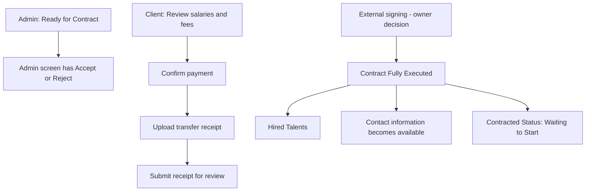

# S07 — العقود والمدفوعات

الحالة: **مراجعة نطاق بناءً على Figma فقط — غير جاهزة للتنفيذ**  
تاريخ المراجعة: 5 نوفمبر 2026  
النطاق العام: التعاقد والدفع والحالات الظاهرة في تصميم البورتالات.

## 1. قاعدة هذه الخطة

1. Figma هي المرجع الأساسي للسلوك والواجهات.
2. لا تتحول بيانات العرض التجريبية إلى Business Rules.
3. لا تضاف جداول أوأعمدة أوحالات أوEndpoints أوصلاحيات قبل وجود Action واضح في Figma أوقرار صريح من صاحب المشروع.
4. ملفات البيزنس تستخدم لفهم الهدف العام فقط، ولا تضيف Flow غير ظاهر في Figma.
5. أي نقطة لا يحسمها التصميم موضحة في قسم «غير محسوم» دون اقتراح حل داخل الخطة.

## 2. القرار المعتمد من صاحب المشروع

- التوقيع يتم خارج البورتال حاليًا.
- لا يوجد توقيع إلكتروني داخل Client Portal أوTalent Portal.
- لا يوجد تكامل E-sign في النطاق الحالي.
- لم يعتمد حتى الآن كيف يعرف النظام أن التوقيع الخارجي اكتمل، أوهل ترفع نسخة موقعة، أوأي دور ينفذ ذلك.

## 3. ما يظهر في Figma فعلًا

### 3.1 Client — مراجعة الدفع

المصدر: `4759:69426`.

الشاشة تعرض:

- Hiring Request واحدة تحتوي عدة Talents.
- لكل Talent: المسمى، كود `QDR-*`، نوع العقد، والراتب الشهري.
- عمود Fees بقيمة `To be confirmed` في التصميم الحالي.
- تنبيه أن Salary Subtotal لا يشمل Fees وليس Final Payment Amount.
- Bank Transfer Details:
  - Amount to Transfer.
  - Currency.
  - Transfer Method.
  - IBAN.
  - Account Name.
  - Account Number.
- Salary Subtotal.
- Total Fees.
- Final Payment Total.
- زر `Confirm payment` وزر `Cancel`.

لا تعتمد الأرقام أوالعملات أوبيانات الحساب الظاهرة كقيم حقيقية؛ هي بيانات تصميم تجريبية.

### 3.2 Client — رفع إيصال التحويل

المصدر: `4759:69555`.

الـModal تعرض:

- `Upload transfer receipt`.
- رفع JPG أوPNG أوPDF حتى 10MB.
- اختيار أوحذف الملف قبل الإرسال.
- `Submit receipt` و`Cancel`.
- النص يوضح أن الإيصال يرسل للمراجعة، وأن الدفع قد لا يكتمل قبل التحقق من التحويل.

التصميم لا يوضح من يراجع الإيصال، ولا شاشة المراجعة، ولا Actions القبول أوالرفض.

### 3.3 Client — المواهب المتعاقد معها

المصادر: `3621:28756` و`3649:29356`.

التصميم يثبت:

- وجود صفحة `Hired Talents`.
- حالة `Contract Fully Executed`.
- نوع العقد.
- إظهار Personal & Contact Information بعد اكتمال التعاقد.
- `Contracted Status` بقيمة `Waiting to Start`.
- Final Salary.
- Work Mode وWork Type.
- Working Days وWorking Hours.
- Start Date.

لا تظهر في الـNodes التي تمت مراجعتها Action لإنشاء العقد أوتوقيعه أوتنزيله أوإلغاءه.

### 3.4 Admin — حالات طلب التعيين

المصادر: `3971:44951` و`4310:66763`.

التصميم يعرض حالتين:

1. شاشة بحالة `Ready for Contract`، وبها:
   - Client وWorkspace data.
   - Talent data.
   - Contract Type.
   - Offer Details.
   - Hiring Progress.
   - `Accept` و`Reject`.
   - نص يفيد أن compensation package وagreement terms أرسلت للموهبة وأن العقد تحت المراجعة.
2. شاشة بحالة `Ready to Proceed`، وبها:
   - Interview = `Completed`.
   - Hiring Progress مكتمل حتى `Accepted`.
   - `Contracted Status = Waiting to Start`.
   - Final Salary وشروط العمل وStart Date.

التصميم لا يوضح بدقة ما الذي يقبله أويرفضه الأدمن في شاشة `Ready for Contract`، ولا يرسم Transition صريحًا بين الحالتين.

### 3.5 Admin — إعداد أنواع العقود

المصادر: `3916:38766` و`3916:42854` و`5351:62136`.

الموجود صراحة:

- نوعا `Managed Contract` و`One-Time Commission`.
- Availability لكل نوع.
- Basic Information.
- Default Fee Configuration.
- Fee Type.
- What You Get / Benefits.
- Professional Field Fee Overrides للـManaged Contract.
- Terms & Conditions.
- Managed Contract Defaults.

هذا الجزء هو إعداد Contract Types، وليس دليلًا على وجود إدارة ملفات عقود أوتوقيعات.

### 3.6 Talent — حالة التعاقد

المصادر: `3662:27043` و`4318:73133`.

الموجود صراحة:

- Activity باسم `Contract ready for signing`.
- شاشة Offer بعد التعاقد تعرض:
  - `Contracted Status`.
  - `Waiting to Start`.
  - Final Salary.
  - Work Mode وWork Type.
  - Working Days وWorking Hours.
  - Start Date.

لا تظهر شاشة توقيع، زر توقيع، رفع عقد موقع، تحميل عقد، أوتفاصيل مستند داخل Talent Portal.

## 4. الخدمات المدفوعة الأخرى الظاهرة في Figma

هذه الشاشات موجودة في التصميم، لكن لا يعني ذلك تلقائيًا أنها تدخل تنفيذ S07 دون اعتماد النطاق.

### 4.1 Client — Qader Expert Opinion

المصادر: `3260:26964` و`3260:27929`.

- شراء مرة واحدة لكل Talent.
- التصميم يعرض EGP 250 كبيانات واجهة، ولا تعتمد القيمة كسعر حقيقي دون قرار.
- النص يقول إن المراجعة متاحة بعد الشراء.
- بعد الشراء تظهر Evaluation Criteria والتقييمات.

### 4.2 Talent — Detailed Rejection Feedback

المصادر: `802:4409` و`3101:16653`.

- `Unlock detailed feedback`.
- Detailed rejection reason.
- CV review.
- Personalized tips.
- Faster reapplication.
- التصميم يعرض EGP 100 كبيانات واجهة، ولا تعتمد القيمة كسعر حقيقي دون قرار.

### 4.3 Talent — Profile Expert Review

المصادر: `3089:16895` و`3098:15273`.

- `Start Your Professional Review Now`.
- التصميم يعرض `$10 One-Time Payment`.
- تقرير خلال 48 ساعة.
- `14-day money-back guarantee`.
- شاشة نتيجة تحتوي Salary Recommendations وInterview Evaluations وPersonalized Tips.

السعر والـSLA والضمان لا يتحولون إلى Rules قبل اعتمادهم صراحة.

## 5. الـFlow المثبت فقط من Figma

الأسهم بين مجموعات Admin وPayment وExternal Signing ليست محددة في Figma؛ لذلك لا تربط الخطة هذه المجموعات بترتيب تنفيذي غير ظاهر.

## 6. الموجود حاليًا في الكود ويمكن البناء عليه لاحقًا

- Hiring Requests وItems.
- Offers والتفاوض وقرارات Client وTalent.
- Hiring Interviews.
- حالات حالية منها `ready_to_proceed` و`ready_for_contract` و`completed`.
- Contract Types وإعداداتها وBenefits وTerms وFee Overrides وDefaults.
- Contract Configuration Snapshot على Hiring Request Item.
- Media Library يمكن استخدامها عند اعتماد أي Flow رفع ظاهر أوصريح.

غير موجود حاليًا:

- Contract lifecycle منفذ.
- Payment flow مطابق لشاشات Figma.
- Receipt upload مرتبط بطلب تعيين.
- Hired Talents مبنية على Contract Fully Executed.
- شراء الخدمات المدفوعة الظاهرة في Figma.

## 7. غير محسوم في Figma — لا ينفذ قبل القرار

### 7.1 العقود

1. ما معنى Action `Accept` و`Reject` في شاشة Admin ذات حالة `Ready for Contract`؟
2. ما الحدث الذي ينقل العنصر إلى `Ready for Contract`؟
3. ما العلاقة والترتيب بين `Ready for Contract` و`Ready to Proceed`؟
4. ما المستندات الموجودة فعلًا لكل Talent أوClient؟
5. كيف يسجل النظام أن التوقيع الخارجي اكتمل؟
6. هل توجد نسخة عقد ترفع أوتعرض أوتحمل؟ ومن ينفذ ذلك؟
7. ما الشرط الدقيق لحالة `Contract Fully Executed`؟
8. هل `Waiting to Start` حالة عقد أم حالة Talent داخل عملية التعيين؟
9. ما الحالات الأخرى للعقد؟ التصميم المعروض لا يحصرها.

### 7.2 الدفع

10. هل شاشة الدفع تخص Hiring Request كاملة فقط أميمكن الدفع لكل Item؟
11. ما الذي يدخل Amount to Transfer لكل Contract Type؟
12. كيف تحسب Fees، خصوصًا أن الشاشة تعرض `To be confirmed`؟
13. ما العلاقة بين `Confirm payment` و`Submit receipt`؟
14. من يراجع التحويل، وما Actions المراجعة وحالاتها؟
15. هل يمكن إعادة رفع إيصال بعد الرفض أوإرسال أكثر من محاولة؟
16. هل توجد ضرائب أوPartial Payment أوRefund؟ لا تظهر في الشاشات التي تمت مراجعتها.
17. من أين تأتي Bank Transfer Details؟

### 7.3 الخدمات المدفوعة

18. أي من الخدمات الثلاث يدخل S07 الحالي؟
19. هل الأسعار الظاهرة معتمدة أمDummy Data؟
20. ما وسيلة الدفع والشاشات التالية للضغط على Purchase؟
21. من ينفذ Expert Review ومتى يصبح التقرير متاحًا؟
22. هل Faster Reapplication و48-hour SLA و14-day guarantee Rules معتمدة؟

## 8. ما تم حذفه من الخطة السابقة لأنه غير مثبت في Figma

- اقتراح جداول `contracts`, `contract_documents`, `contract_signatures`, `invoices`, `invoice_lines`, و`payments`.
- اقتراح حالات Contract وInvoice وPayment.
- اقتراح Endpoints للبورتالات الثلاثة.
- اقتراح صلاحيات مستقلة للعقود والفواتير والمدفوعات.
- افتراض أن Admin يراجع الإيصال أويرفع النسخة الموقعة.
- افتراض ترتيب الدفع والتوقيع أوأنهما Gate متوازيان.
- افتراض Invoice أوInvoice Lines أوPayment Gateway أوRefund flow.
- افتراض أن `completed` هي الحالة النهائية أوإضافة حالة `contracted`.
- افتراض أنواع المستندات والأطراف الموقعة وإصدارات الملفات.

## 9. شرط تجهيز خطة التنفيذ النهائية

لا تكتب سكيما أوEndpoints ولا يبدأ التنفيذ قبل:

1. الإجابة عن النقاط غير المحسومة أعلاه.
2. إعادة ربط كل قرار بشاشة Figma أوتسجيله صراحة كقرار من صاحب المشروع.
3. مراجعة السكيما والـAPI المقترحتين بعد اعتماد الـFlow، وقبل إنشاء أي Migration.

