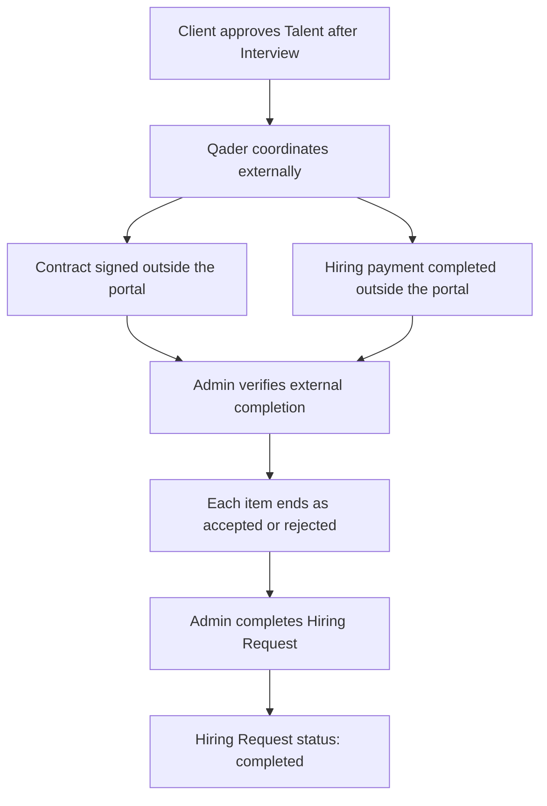

# S07 — العقود والمدفوعات

> حالة التنفيذ بتاريخ 25 نوفمبر 2026: تم تنفيذ أساس دفع الخدمات الرقمية المستقل عن المزود، والجداول الثلاثة، ومسارات Checkout والحالة والـWebhook، وربط فتح التقارير بالدفع. ما زال Adapter بوابة Production مؤجلًا لحين اختيار البوابة. التفاصيل في `S07-contracts-payments-implementation.ar.md`.

الحالة: **تم تبسيط تصميم الدفع وأصبح جاهزًا للتنفيذ بعد اختيار المزود**
تاريخ آخر قرار: 25 نوفمبر 2026
النطاق العام: التعاقد والدفع والحالات الظاهرة في تصميم البورتالات.

## 1. قاعدة هذه الخطة

1. Figma هي المرجع الأساسي للسلوك والواجهات.
2. لا تتحول بيانات العرض التجريبية إلى Business Rules.
3. لا تضاف جداول أوأعمدة أوحالات أوEndpoints أوصلاحيات قبل وجود Action واضح في Figma أوقرار صريح من صاحب المشروع.
4. ملفات البيزنس تستخدم لفهم الهدف العام فقط، ولا تضيف Flow غير ظاهر في Figma.
5. أي نقطة لا يحسمها التصميم أوقرار صاحب المشروع تظل موضحة صراحة ولا تتحول إلى Business Rule مفترضة.

## 2. القرار المعتمد من صاحب المشروع

- التوقيع يتم خارج البورتال حاليًا.
- لا يوجد توقيع إلكتروني داخل Client Portal أوTalent Portal.
- لا يوجد تكامل E-sign في النطاق الحالي.
- بعد موافقة العميل على الموهبة عقب المقابلة، يتم التواصل والتنسيق مع العميل والموهبة، ثم يوقع العقد خارجيًا.
- دفع التعاقد الحالي يتم خارج البورتال بالتنسيق المباشر مع العميل.
- شاشات التحويل البنكي ورفع الإيصال الظاهرة في Figma لا تنفذ ضمن التدفق الحالي.
- المدفوعات الأخرى داخل النظام تنفذ عبر Payments module محايد للمزود؛ مزود Production لم يحدد بعد.
- لا يضاف Checkout أومزود دفع فعلي أوInvoice أوRefund لدفع التعاقد الخارجي. الخدمات الرقمية الثلاث تستخدم موديول الدفع المبسط ومزودًا يحدد من Environment.
- الأدمن هو المسؤول عن التأكد من اكتمال التوقيع والدفع الخارجيين.
- لا يحفظ النظام حالة مستقلة للتوقيع أوالدفع، ولا يؤكد الأدمن كل حدث منهما من خلال Action منفصلة.
- بعد اكتمال التوقيع والدفع خارجيًا، ينفذ الأدمن Action واحدة لتحديث طلب التعيين إلى `completed`.
- عناصر طلب التعيين تنتهي بالحالة المناسبة لكل موهبة: `accepted` أو`rejected`، بينما الطلب الأب يصبح `completed` بعد انتهاء التعامل مع جميع عناصره.
- لا تحفظ حاليًا نسخة من العقد أوإثبات الدفع داخل النظام؛ تحفظ نتيجة دورة طلب التعيين فقط.
- `Contract Fully Executed` و`Waiting to Start` لا ينفذان كحالات Backend مستقلة أومشتقة في الدورة الحالية.
- لا تضاف Contract statuses أخرى؛ الحالات المعتمدة للدورة هي حالات طلب التعيين وعناصره الظاهرة والمعتمدة في Figma.

## 3. ما يظهر في Figma فعلًا

### 3.1 Client — مراجعة الدفع

المصدر: `4759:69426`.

الشاشة تعرض:

- Hiring Request واحدة تحتوي عدة Talents.
- لكل Talent: المسمى، كود `QDR-*`، نوع العقد، والراتب الشهري.
- عمود Fees بقيمة `To be confirmed` في التصميم الحالي.
- تنبيه أن Salary Subtotal لا يشمل Fees وليس Final Payment Amount.
- Bank Transfer Details:
  - Amount to Transfer.
  - Currency.
  - Transfer Method.
  - IBAN.
  - Account Name.
  - Account Number.
- Salary Subtotal.
- Total Fees.
- Final Payment Total.
- زر `Confirm payment` وزر `Cancel`.

لا تعتمد الأرقام أوالعملات أوبيانات الحساب الظاهرة كقيم حقيقية؛ هي بيانات تصميم تجريبية.

> قرار المنتج اللاحق: هذه الشاشة موثقة كجزء موجود في Figma، لكنها خارج التنفيذ الحالي لأن دفع التعاقد يتم خارجيًا بالتنسيق مع العميل.

### 3.2 Client — رفع إيصال التحويل

المصدر: `4759:69555`.

الـModal تعرض:

- `Upload transfer receipt`.
- رفع JPG أوPNG أوPDF حتى 10MB.
- اختيار أوحذف الملف قبل الإرسال.
- `Submit receipt` و`Cancel`.
- النص يوضح أن الإيصال يرسل للمراجعة، وأن الدفع قد لا يكتمل قبل التحقق من التحويل.

التصميم لا يوضح من يراجع الإيصال، ولا شاشة المراجعة، ولا Actions القبول أوالرفض.

> قرار المنتج اللاحق: رفع الإيصال ومراجعته لا ينفذان حاليًا داخل البورتال.

### 3.3 Client — المواهب المتعاقد معها

المصادر: `3621:28756` و`3649:29356`.

التصميم يثبت:

- وجود صفحة `Hired Talents`.
- حالة `Contract Fully Executed`.
- نوع العقد.
- إظهار Personal & Contact Information بعد اكتمال التعاقد.
- `Contracted Status` بقيمة `Waiting to Start`.
- Final Salary.
- Work Mode وWork Type.
- Working Days وWorking Hours.
- Start Date.

لا تظهر في الـNodes التي تمت مراجعتها Action لإنشاء العقد أوتوقيعه أوتنزيله أوإلغاءه.

### 3.4 Admin — حالات طلب التعيين

المصادر: `3971:44951` و`4310:66763`.

التصميم يعرض حالتين:

1. شاشة بحالة `Ready for Contract`، وبها:
   - Client وWorkspace data.
   - Talent data.
   - Contract Type.
   - Offer Details.
   - Hiring Progress.
   - `Accept` و`Reject`.
   - نص يفيد أن compensation package وagreement terms أرسلت للموهبة وأن العقد تحت المراجعة.
2. شاشة بحالة `Ready to Proceed`، وبها:
   - Interview = `Completed`.
   - Hiring Progress مكتمل حتى `Accepted`.
   - `Contracted Status = Waiting to Start`.
   - Final Salary وشروط العمل وStart Date.

التصميم لا يوضح بدقة ما الذي يقبله أويرفضه الأدمن في شاشة `Ready for Contract`، ولا يرسم Transition صريحًا بين الحالتين.

### 3.5 Admin — إعداد أنواع العقود

المصادر: `3916:38766` و`3916:42854` و`5351:62136`.

الموجود صراحة:

- نوعا `Managed Contract` و`One-Time Commission`.
- Availability لكل نوع.
- Basic Information.
- Default Fee Configuration.
- Fee Type.
- What You Get / Benefits.
- Professional Field Fee Overrides للـManaged Contract.
- Terms & Conditions.
- Managed Contract Defaults.

هذا الجزء هو إعداد Contract Types، وليس دليلًا على وجود إدارة ملفات عقود أوتوقيعات.

### 3.6 Talent — حالة التعاقد

المصادر: `3662:27043` و`4318:73133`.

الموجود صراحة:

- Activity باسم `Contract ready for signing`.
- شاشة Offer بعد التعاقد تعرض:
  - `Contracted Status`.
  - `Waiting to Start`.
  - Final Salary.
  - Work Mode وWork Type.
  - Working Days وWorking Hours.
  - Start Date.

لا تظهر شاشة توقيع، زر توقيع، رفع عقد موقع، تحميل عقد، أوتفاصيل مستند داخل Talent Portal.

## 4. الخدمات المدفوعة الأخرى الظاهرة في Figma

الخدمات الثلاث الظاهرة في التصميم معتمدة. الأسعار وصلاحيات الوصول منفصلة عن مزود الدفع، ويضاف Adapter المزود المختار دون تغيير Business workflow.

### 4.1 Client — Qader Expert Opinion

المصادر: `3260:26964` و`3260:27929`.

- شراء مرة واحدة لكل Talent.
- القيمة الافتراضية للسعر `250 EGP`، وتحفظ ضمن Platform Settings ليتمكن الأدمن من تعديل السعر والعملة.
- النص يقول إن المراجعة متاحة بعد الشراء.
- بعد الشراء تظهر Evaluation Criteria والتقييمات.

### 4.2 Talent — Detailed Rejection Feedback

المصادر: `802:4409` و`3101:16653`.

- `Unlock detailed feedback`.
- Detailed rejection reason.
- CV review.
- Personalized tips.
- Faster reapplication.
- القيمة الافتراضية للسعر `100 EGP`، وتحفظ ضمن Platform Settings ليتمكن الأدمن من تعديل السعر والعملة.

### 4.3 Talent — Profile Expert Review

المصادر: `3089:16895` و`3098:15273`.

- `Start Your Professional Review Now`.
- القيمة الافتراضية للسعر `10 USD`، وتحفظ ضمن Platform Settings ليتمكن الأدمن من تعديل السعر والعملة.
- تقرير خلال 48 ساعة.
- `14-day money-back guarantee`.
- شاشة نتيجة تحتوي Salary Recommendations وInterview Evaluations وPersonalized Tips.

الأسعار معتمدة كقيم افتراضية قابلة للتعديل. البيانات المعروضة في التقارير موجودة أصلًا من دورة تقييم الموهبة؛ الدفع يفتح صلاحية الوصول إليها ولا ينشئ مهمة Review جديدة.

### 4.4 مصدر التقرير بعد الدفع

لا نضيف Report authoring workflow جديدًا ضمن الدفع. تستخدم الصفحات بيانات التقييم الموجودة بالفعل:

- `Qader Expert Opinion` للعميل يعرض تقييم Qader للموهبة بعد شراء حساب مالك الـWorkspaces صلاحية الوصول: المعايير والتقييمات وتقارير HR وTechnical وPsychology من `talent_evaluations` والتقييمات المرتبطة بالمقابلات عند الحاجة.
- `Detailed Rejection Feedback` للموهبة المرفوضة يفتح تفاصيل التقييم والرفض الموجودة، ولا يعدل `reapply_at` ولا يتجاوز سياسة إعادة التقديم.
- `Profile Expert Review` يظهر للموهبة المقبولة، ويعرض Recommended Salary وEvaluation Criteria وInterview Evaluations وPersonalized Tips وتقارير HR وTechnical وPsychology و`final_feedback` الموجودة بالفعل.
- `Detailed Rejection Feedback` و`Profile Expert Review` يعرضان نفس بنية بيانات التقرير، ويختلف اسم الخدمة والسعر وحالة الطلب التي تسمح بشرائها: الأولى للطلب المرفوض والثانية للطلب المقبول.
- شراء أي منهما يرتبط بـ`talent_application_id` المحدد، وليس بحساب الموهبة مدى الحياة.
- تظل صلاحية التقرير المدفوع مرتبطة بمحاولة التقديم التي تم شراؤه لها. إذا قدمت الموهبة مرة أخرى، فإن تقرير الطلب الجديد يحتاج عملية شراء جديدة، ولا تفتح عملية الشراء القديمة التقرير الجديد.
- بعد تأكيد الدفع الناجح تظهر البيانات المتاحة مباشرة؛ لا نضيف Deadline تسليم مدته 48 ساعة في الـBackend.
- عبارة `48 hours` الظاهرة في شاشة الشراء لا تنشئ SLA تشغيليًا لأن التقرير موجود قبل الشراء.
- عبارة `14-day money-back guarantee` لا تنشئ حق Refund حاليًا، ويجب ألا تعتمد كقاعدة Backend أووعد دفع قبل اعتماد سياسة Refund مستقبلًا.
- توجد ثلاث خدمات/صلاحيات شراء مستقلة، لكن كل واحدة تفتح البيانات الملائمة لسياقها ودورها بدل إنشاء تقرير جديد.

### 4.5 تجهيز الدفع دون ربط مزود محدد

- بُني موديول الدفع خلف `PaymentGatewayInterface`، ولا ترتبط الـUse Cases باسم مزود بعينه.
- كل مزود يضاف من خلال Adapter مستقل، ويختار المزود النشط من Config/Environment وليس من Business workflow.
- تحفظ معاملات الشراء ومراجع المزود والحالة بصيغة موحدة داخل النظام، مع الاحتفاظ بالـpayload اللازم للتتبع دون تخزين بيانات دفع حساسة.
- شراء Qader Expert Opinion تكون صلاحية الوصول فيه لمالك الـWorkspaces ومربوطة بصف Talent الذي يمثل الـJob Profile، بينما شراء تقريري Talent يكون للمستخدم نفسه ومربوطًا بـ`talent_application_id`.
- نجاح دفع تقرير Talent لا يفتح إلا الطلب المحدد في معاملة الدفع، حتى لو كانت للموهبة طلبات سابقة أولاحقة.
- يمر تأكيد الدفع عبر Gateway contract وWebhook verification خاص بالمزود؛ لا تثق المنصة في نجاح يعيده الـFrontend وحده.
- شكل Redirect أوCheckout أوClient Secret يحدد عند اختيار أول مزود، ولا تفترض الخطة شاشة دفع غير موجودة في Figma.
- Refund لا يدخل التنفيذ قبل اعتماد سياسة الضمان واختيار مزود يدعمه.

## 5. الـFlow المثبت فقط من Figma



لا توجد Action مستقلة لتأكيد التوقيع أوالدفع، ولا Contract status مستقلة. تأكيد الأدمن النهائي يتم من خلال إكمال طلب التعيين بعد إنهاء جميع عناصره.

## 6. الموجود حاليًا في الكود ويمكن البناء عليه لاحقًا

- Hiring Requests وItems.
- Offers والتفاوض وقرارات Client وTalent.
- Hiring Interviews.
- حالة Item مبسطة؛ الوصول بعد موافقة الطرفين يظهر حاليًا كمرحلة `accepted`، بينما تفاصيل العقد والدفع المستقبلية لها مصادر مستقلة عند تنفيذها.
- Contract Types وإعداداتها وBenefits وTerms وFee Overrides وDefaults.
- Contract Configuration Snapshot على Hiring Request Item.
- Media Library يمكن استخدامها عند اعتماد أي Flow رفع ظاهر أوصريح.

غير موجود حاليًا بعد تنفيذ أساس الدفع:

- Contract lifecycle منفذ.
- Adapter بوابة Production؛ أساس الدفع العام للخدمات الرقمية منفذ، والمزود الحقيقي مؤجل لحين تحديده.
- Receipt upload مرتبط بطلب تعيين.
- ربط Hired Talents بالعناصر المقبولة من طلب تعيين مكتمل.
- شراء الخدمات المدفوعة الظاهرة في Figma.

## 7. القرارات المعتمدة وحدود التنفيذ

### 7.1 العقود وإكمال طلب التعيين

1. التوقيع يتم خارج البورتال، والأدمن يتأكد من اكتماله تشغيليًا.
2. دفع التعاقد يتم خارج البورتال، والأدمن يتأكد من اكتماله تشغيليًا.
3. لا تسجل الحالتان منفصلتين داخل النظام؛ ينفذ الأدمن Action واحدة لإكمال طلب التعيين بعد اكتمالهما.
4. لا تحفظ نسخة عقد أوإثبات دفع حاليًا.
5. كل عنصر ينتهي `accepted` أو`rejected` حسب نتيجته.
6. طلب التعيين يصبح `completed` بعد انتهاء جميع عناصره وتنفيذ الأدمن Action الإكمال.
7. `Contract Fully Executed` و`Waiting to Start` لا يمثلان حالات Backend في الدورة المعتمدة، ولا تضاف Contract statuses جديدة.

### 7.2 الدفع

1. دفع التعاقد الحالي خارج البورتال؛ لذلك لا تنفذ شاشة التحويل أورفع الإيصال الآن.
2. الأساس العام لدفع الخدمات الرقمية الثلاث يدخل التنفيذ، بينما Adapter بوابة Production مؤجل لحين تحديد المزود.
3. لا يوجد Refund في المرحلة الحالية، ولا تنفذ `14-day guarantee` كقاعدة Backend.

### 7.3 الخدمات المدفوعة

1. الخدمات الثلاث تدخل التنفيذ المستقبلي: Qader Expert Opinion وDetailed Rejection Feedback وProfile Expert Review.
2. الأسعار الظاهرة هي قيم Platform Settings افتراضية يستطيع الأدمن تعديلها مع العملة.
3. مزود الدفع لم يحدد؛ يبنى التكامل خلف Gateway contract قابل لإضافة مزود جديد دون تغيير Business workflow.
4. تقارير Qader Expert Opinion وDetailed Rejection Feedback وProfile Expert Review مبنية على بيانات التقييم الموجودة مسبقًا، وتظهر للمشتري بعد نجاح الدفع دون انتظار Reviewer جديد.
5. شراء Detailed Rejection Feedback لا يغير `reapply_at` ولا يسمح بإعادة التقديم مبكرًا.
6. `48 hours` ليست Deadline في الـBackend لأن التقرير موجود بالفعل.
7. لا يوجد Refund أو`14-day guarantee` تشغيليًا في المرحلة الحالية.
8. Profile Expert Review متاح للطلب المقبول، وDetailed Rejection Feedback متاح للطلب المرفوض؛ كلاهما يعرض نفس بيانات التقرير مع اختلاف اسم الخدمة وسعرها.
9. كل صف Talent Application هو محاولة تقديم مستقلة. شراء تقرير الموهبة يكون لكل `talent_application_id`، وإعادة التقديم تنشئ Application جديدة وتتطلب شراءً جديدًا لفتح تقريرها.

## 8. ما تم حذفه من الخطة السابقة لأنه غير مثبت في Figma

- اقتراح جداول `contracts`, `contract_documents`, `contract_signatures`, `invoices`, و`invoice_lines` الخاصة بدورة التعاقد الخارجي.
- اقتراح حالات Contract وInvoice أودفع التعاقد الخارجي.
- اقتراح Endpoints لإدارة عقد أودفع التعاقد داخل البورتالات الثلاثة.
- اقتراح صلاحيات مستقلة للعقود والفواتير والمدفوعات.
- افتراض أن Admin يراجع الإيصال أويرفع النسخة الموقعة.
- افتراض ترتيب الدفع والتوقيع أوأنهما Gate متوازيان.
- افتراض Invoice أوInvoice Lines أوPayment Gateway لدفع التعاقد الخارجي أوRefund flow.
- افتراض أن `completed` هي الحالة النهائية أوإضافة حالة `contracted`.
- افتراض أنواع المستندات والأطراف الموقعة وإصدارات الملفات.

## 9. حدود خطة التنفيذ التالية

عند تجهيز التنفيذ يقتصر العمل على:

1. مراجعة Action إكمال طلب التعيين للأدمن وشروطها، دون إنشاء دورة عقد أودفع مستقلة.
2. التأكد من أن كل عنصر انتهى `accepted` أو`rejected` قبل إكمال الطلب.
3. تحديث الطلب الأب إلى `completed` وتسجيل الحدث في سجل الأحداث الموجود.
4. بناء بيانات Hired Talents من العناصر المقبولة التابعة لطلب مكتمل، من غير الاعتماد على `Contract Fully Executed` أو`Waiting to Start`.
5. مراجعة الـAPI والسكيما المقترحتين قبل إنشاء أي Migration، وعدم إضافة مستندات أوحالات أوجداول للعقد والدفع خارج النطاق المعتمد.

## 10. هيكل الدفع المبسط المعتمد

هذا القسم هو المرجع المعتمد لتنفيذ دفع الخدمات الرقمية، ويستخدم ثلاثة جداول فقط: `payments` لعملية الشراء، و`payment_attempts` لمحاولات بوابات الدفع، و`payment_webhook_events` لمنع تكرار معالجة إشعارات المزود.

### 10.1 النطاق

الدفع داخل النظام يخص ثلاث خدمات فقط:

1. `qader_expert_opinion`: يشتريها العميل لعرض مراجعة الخبراء لموهبة.
2. `detailed_rejection_feedback`: تشتريها الموهبة لعرض مراجعة طلب مرفوض.
3. `profile_expert_review`: تشتريها الموهبة لعرض مراجعة طلب مقبول.

دفع التعاقد الخاص بطلبات التعيين يظل خارج البورتال، ولا يدخل في هذا الموديول.

لا يتضمن النطاق الحالي:

- اشتراكات.
- دفع جزئي.
- Refund.
- فواتير أوتفاصيل فواتير.
- جداول Refund أوDisputes أوSettlements.
- حفظ وسائل الدفع أوبيانات البطاقة.
- نظام Idempotency خارج الجداول الثلاثة المعتمدة.

### 10.2 ملكية شراء العميل

شراء `qader_expert_opinion` لا يتبع Workspace بعينها.

- الشراء يتبع `owner_client_id` الخاص بمالك الـWorkspace التي بدأت منها العملية.
- الـWorkspace الموجودة في مسار الـAPI تستخدم لتحديد سياق العضوية والصلاحيات فقط.
- إذا اشترى عضو الخدمة من Workspace، تصبح المراجعة مشتراة لحساب مالك هذه الـWorkspace.
- يمكن رؤية المراجعة من أي Workspace أخرى يملكها نفس `owner_client_id`.
- لا يستطيع المستخدم فتح Workspace ليس عضوًا فيها.
- داخل كل Workspace يجب أن يمتلك المستخدم صلاحية العرض حتى يرى المراجعة.
- العضو الذي يمتلك صلاحية الدفع يستطيع بدء الدفع، حتى لو لم يكن هو مالك الحساب.
- المستخدم الذي بدأ الدفع يحفظ في `payer_user_id` لأغراض التتبع، لكنه ليس مالك صلاحية الوصول.

مثال:

```text
Owner Client 10
├── Workspace A
│   └── Member X اشترى Expert Opinion للموهبة 25
└── Workspace B
    └── Member Y يستطيع عرضها إذا كان لديه صلاحية السوق
```

إذا كانت Workspace B تتبع مالكًا آخر، فلا تستفيد من عملية الشراء.

### 10.3 صلاحيات العميل

تستخدم صلاحية السوق الحالية فقط:

```text
client.marketplace.view
```

- Role المالك `owner` يستمر في امتلاك كل الصلاحيات تلقائيًا وفق النظام الحالي.
- العضو الذي يمنحه المالك صلاحية السوق يستطيع تصفح المواهب وبدء الدفع وعرض المراجعات المدفوعة.
- عملية الشراء تفتح التقرير لحساب المالك، وليس للمستخدم الذي دفع أوللـWorkspace التي بدأ منها الدفع فقط.
- كل عضو يحمل صلاحية السوق في أي Workspace تتبع نفس `owner_client_id` يستطيع عرض التقرير المدفوع.

### 10.4 شراء الموهبة

- الدفع يتبع `payer_user_id` الخاص بحساب الموهبة.
- الهدف هو `talent_application_id` المحدد.
- حالة الطلب تحدد الخدمة تلقائيًا:
  - `rejected` ⟵ `detailed_rejection_feedback`.
  - `accepted` ⟵ `profile_expert_review`.
- شراء تقرير Application قديمة لا يفتح تقرير Application جديدة.
- بيانات التقرير يجب أن تكون موجودة قبل السماح ببدء الدفع.

### 10.5 الجداول المعتمدة

#### 10.5.1 جدول `payments`

يمثل عملية شراء الخدمة داخل Qader، ولا يحتوي تفاصيل خاصة بمزود بعينه:

| العمود | النوع | الغرض |
| --- | --- | --- |
| `id` | bigint | المعرف الداخلي |
| `reference` | uuid/string unique | مرجع آمن يعاد للـFrontend |
| `purchase_key` | char(64) unique | بصمة يولدها الـBackend من الخدمة والهدف لضمان وجود Payment واحدة لكل استحقاق |
| `payer_user_id` | FK users | المستخدم الذي بدأ عملية الدفع |
| `owner_client_id` | nullable FK clients | مالك حساب العميل عند شراء Expert Opinion |
| `talent_id` | nullable FK talents | الموهبة المستهدفة في Expert Opinion |
| `talent_application_id` | nullable FK talent_applications | محاولة التقديم المستهدفة في خدمات الموهبة |
| `service` | varchar | نوع الخدمة المدفوعة |
| `amount` | decimal(18,4) | السعر وقت بدء الدفع |
| `currency` | char(3) | كود العملة وقت بدء الدفع |
| `status` | varchar | حالة الدفع |
| `paid_at` | nullable timestamp | وقت نجاح الدفع |
| timestamps | timestamps | الإنشاء والتحديث |

قواعد البيانات:

- `owner_client_id` و`talent_id` يمتلئان مع `qader_expert_opinion` فقط.
- `talent_application_id` يمتلئ مع خدمتي الموهبة فقط.
- السعر والعملة لا يستقبلهما الـBackend من الـFrontend؛ يقرآن من `PaidServicesSettings` ويحفظان كما كانا وقت بدء الدفع.
- لا تخزن بيانات بطاقة أوCVV أوأسرار المزود.
- يولد الـBackend `purchase_key` ولا يستقبلها من الـFrontend.
- تعاد Payment نفسها عند تكرار Checkout لنفس الخدمة والهدف.
- إذا كانت المحاولة الحالية فعالة تعاد جلسة الدفع نفسها، وإذا انتهت بالفشل أوالإلغاء أوالانتهاء تنشأ `payment_attempt` جديدة تحت Payment نفسها.
- وجود صف `paid` مطابق هو إثبات أن التقرير مفتوح.

#### 10.5.2 جدول `payment_attempts`

يمثل محاولة واحدة لدى بوابة دفع، ويسمح بإعادة المحاولة أواستخدام مزود آخر دون الكتابة فوق تاريخ المحاولة السابقة:

| العمود | النوع | الغرض |
| --- | --- | --- |
| `id` | bigint | المعرف الداخلي |
| `payment_id` | FK payments | عملية الشراء التابعة لها المحاولة |
| `gateway_request_id` | uuid unique | مفتاح ثابت لإعادة طلب إنشاء نفس المحاولة بأمان عند Timeout أو`5xx` |
| `provider` | varchar | اسم مزود الدفع |
| `provider_reference` | nullable varchar | المعرف الرئيسي للعملية عند المزود |
| `attempt_status` | varchar | الحالة الموحدة للمحاولة |
| `checkout_mode` | varchar | `redirect` أو`embedded` أو`sdk` |
| `checkout_url` | nullable text | رابط Checkout أو3DS عند إعادته من المزود |
| `client_token` | nullable text encrypted | Token مؤقت تحتاجه واجهة المزود، ولا يكون Secret Key |
| `provider_data` | nullable json | المعرفات الإضافية اللازمة للمزود دون إضافة أعمدة خاصة به |
| `failure_reason` | nullable text | سبب الفشل المنقح دون بيانات حساسة |
| `expires_at` | nullable timestamp | وقت انتهاء الجلسة أوToken عند وجوده |
| `completed_at` | nullable timestamp | وقت وصول المحاولة لحالة نهائية |
| timestamps | timestamps | الإنشاء والتحديث |

قواعد المحاولات:

- إعادة الاتصال بالمزود بعد Timeout أوNetwork error أو`5xx` تستخدم نفس `gateway_request_id`.
- فشل نهائي واضح أومحاولة جديدة من المستخدم ينشئ صفًا جديدًا ومفتاحًا جديدًا.
- لا تحفظ بيانات البطاقة داخل `provider_data`، وتحفظ فقط المعرفات والحالة اللازمة للتتبع.
- يطبق Index على `provider + provider_reference` للبحث عن المحاولة من Webhook.

#### 10.5.3 جدول `payment_webhook_events`

يستقبل الحدث مرة واحدة ويتيح معالجته في Queue بأمان:

| العمود | النوع | الغرض |
| --- | --- | --- |
| `id` | bigint | المعرف الداخلي |
| `payment_attempt_id` | FK payment_attempts | المحاولة المطابقة للحدث بعد التحقق من المزود والمرجع |
| `event_id` | varchar | معرف الحدث الفريد لدى المزود |
| `event_type` | varchar | نوع الحدث لدى المزود |
| `payload` | text encrypted | الـPayload اللازم للمعالجة بعد تنقيته من البيانات غير المطلوبة |
| `processing_status` | varchar | `received`, `processed` أو`failed` |
| `processed_at` | nullable timestamp | وقت انتهاء المعالجة |
| `processing_error` | nullable text | سبب فشل معالجة الحدث داخليًا بعد تنقيحه |
| timestamps | timestamps | الإنشاء والتحديث |

قواعد أحداث Webhook:

- يحدد Adapter المزود من مسار الـWebhook، ويتحقق من التوقيع ويطابق المرجع مع `payment_attempts` قبل حفظ الحدث؛ لذلك لا يكرر `provider` داخل جدول الأحداث.
- يطبق Unique على `payment_attempt_id + event_id` لمنع معالجة نفس الحدث مرتين داخل المحاولة.
- يتحقق Adapter من توقيع المزود قبل تسجيل أي تغيير في الدفع.
- تكرار حدث مسجل يعيد `2xx` دون إعادة فتح التقرير أوإرسال الإشعار.
- لا يعتمد النظام على Redirect أوالنتيجة القادمة من الـFrontend لتسجيل نجاح الدفع.

### 10.6 ملفات موديول الدفع

يتبع الموديول نفس طبقات المشروع، ولا تنشأ ملفات لمزود فعلي قبل اختياره:

```text
app/Modules/V1/Payments/
├── Application/
│   ├── Contracts/
│   │   └── PaymentGatewayInterface.php
│   ├── Data/
│   │   ├── CheckoutSessionData.php
│   │   ├── GatewayPaymentData.php
│   │   └── PaymentWebhookData.php
│   ├── Jobs/
│   │   └── ProcessPaymentWebhookJob.php
│   └── Services/
│       ├── CreatePaymentCheckoutService.php
│       ├── ProcessPaymentWebhookService.php
│       ├── PaidServiceAccessService.php
│       └── ReconcilePendingPaymentsService.php
├── Domain/
│   ├── Models/
│   │   ├── Payment.php
│   │   ├── PaymentAttempt.php
│   │   └── PaymentWebhookEvent.php
│   └── ValueObjects/
│       ├── CheckoutModeEnum.php
│       ├── PaidServiceEnum.php
│       ├── PaymentAttemptStatusEnum.php
│       ├── PaymentStatusEnum.php
│       └── PaymentWebhookStatusEnum.php
├── Infrastructure/
│   ├── Gateways/
│   │   ├── PaymentGatewayManager.php
│   │   └── {SelectedProvider}PaymentGateway.php
│   └── Providers/
│       └── PaymentModuleServiceProvider.php
└── Presentation/
    └── Http/
        ├── Controllers/
        │   ├── ClientPaymentController.php
        │   ├── TalentPaymentController.php
        │   └── PaymentWebhookController.php
        ├── Requests/
        │   └── CreatePaymentCheckoutRequest.php
        └── Resources/
            ├── PaymentCheckoutResource.php
            └── PaymentResource.php
```

الملفات الداعمة خارج الموديول:

```text
app/Console/Commands/ReconcilePendingPaymentsCommand.php
app/Modules/V1/AccessControl/Domain/ValueObjects/ClientPermissionEnum.php
app/Support/ApiDocumentation/EndpointNames.php
app/Support/ApiDocumentation/PortalExports.php
config/payments.php
config/modules.php
database/migrations/{timestamp}_create_payment_tables.php
routes/v1/client/payments.php
routes/v1/talent/payments.php
routes/v1/webhooks/payments.php
lang/ar/payments.php
lang/en/payments.php
lang/ar/permissions.php
lang/en/permissions.php
tests/Feature/PaymentFoundationTest.php
tests/Feature/ClientTalentMarketplaceFlowTest.php
tests/Feature/TalentEvaluationReadTest.php
```

مسؤوليات الملفات الأساسية:

- `CreatePaymentCheckoutService`: ينشئ أويعيد Payment بالـIdempotency، ثم ينشئ Attempt ويطلب جلسة الدفع من الـAdapter خارج Database transaction الطويلة.
- `ProcessPaymentWebhookService`: يقفل Payment وAttempt، ويتحقق من المبلغ والعملة وانتقال الحالة، ويسجل النجاح مرة واحدة.
- `PaidServiceAccessService`: يحدد `is_purchased`, `can_purchase`, و`can_view` من Payment مدفوعة والصلاحيات الحالية.
- `ReconcilePendingPaymentsService`: يستعلم من المزود عن المحاولات العالقة عند فقد Webhook أوحدوث Timeout.
- `ProcessPaymentWebhookJob`: يعالج الحدث المخزن بعد أن يعيد Controller استجابة ناجحة وسريعة للمزود.
- `PaymentGatewayManager`: يختار Adapter المسجل في `config/payments.php`، ولا يحتوي Business rules.
- `{SelectedProvider}PaymentGateway`: الملف الوحيد الذي يعرف Payload وحالات وتوقيع المزود المختار.
- `PaymentWebhookController`: يتحقق عبر Adapter، يطابق Attempt، يسجل الحدث مرة واحدة، ثم يرسل Job؛ ولا ينفذ منح الوصول داخله.
- `FakePaymentGateway`: يستخدم في `local` و`testing` فقط، ويرفضه النظام في Production.

لا ننشئ Adapter لكل من Paymob وMoyasar وStripe معًا؛ ينفذ Adapter المزود المعتمد فقط، وتستخدم المقارنة بينها لإثبات أن العقد والجداول لا يحتاجان تغييرًا عند استبدال المزود.

### 10.7 الحالات

```text
pending
processing
paid
failed
cancelled
expired
```

- `pending`: تم إنشاء عملية الدفع ولم يصل تأكيد نجاحها.
- `processing`: توجد محاولة دفع بدأت ولم تصل نتيجتها النهائية.
- `paid`: الدفع مؤكد والتقرير متاح.
- `failed`: بوابة الدفع أبلغت بالفشل.
- `cancelled`: العملية ألغيت.
- `expired`: انتهت جلسة الدفع قبل النجاح.

### 10.8 بوابة الدفع

يبقى الكود غير مرتبط باسم مزود محدد:

```php
interface PaymentGatewayInterface
{
    public function createCheckout(PaymentAttempt $attempt): CheckoutSessionData;

    public function parseWebhook(Request $request): PaymentWebhookData;

    public function fetchPayment(PaymentAttempt $attempt): GatewayPaymentData;
}
```

كل Adapter يعيد قيمًا موحدة؛ تحفظ بيانات الجلسة في `payment_attempts`، ويستخدم `amount` و`currency` للتحقق من القيم المحفوظة في `payments`:

```text
provider
provider_reference
checkout_mode
checkout_url
client_token
public_config
expires_at
status
amount
currency
```

`public_config` جزء من `CheckoutSessionData` فقط ولا يخزن في قاعدة البيانات؛ يستخدم لإرجاع القيم العامة التي تحتاجها واجهة المزود مثل Publishable Key. استقبال `PaymentAttempt` في `fetchPayment` يسمح للـAdapter بالاستعلام باستخدام `provider_reference`، أو`gateway_request_id` إذا حدث Timeout قبل استلام مرجع المزود.

يحدد المزود من Environment:

```text
PAYMENT_GATEWAY=provider_name
```

لا يغير Redirect من الـFrontend حالة الدفع. حالة `paid` تسجل بعد تحقق الـBackend من Webhook الخاص بالمزود.

### 10.9 الـEndpoints

#### 10.9.1 العميل

```text
POST /api/v1/client/workspaces/{workspace}/talent-marketplace/{talent}/expert-opinion/checkout
GET  /api/v1/client/workspaces/{workspace}/payments/{payment:reference}
GET  /api/v1/client/workspaces/{workspace}/talent-marketplace/{talent}/expert-opinion
```

لا يرسل الـFrontend `Idempotency-Key`. يولد الـBackend `purchase_key` من `owner_client_id + talent_id + service` ويعيد Payment نفسها عند تكرار الطلب.

الـFlow:

1. يتحقق الـBackend من عضوية المستخدم في الـWorkspace.
2. يتحقق من `client.marketplace.view` عند Checkout.
3. يأخذ `owner_client_id` من الـWorkspace ولا يستقبله من الطلب.
4. يحفظ الدفع مرتبطًا بالمالك والموهبة.
5. عند عرض التقرير يتحقق من `client.marketplace.view`.
6. يبحث عن أي Payment حالتها `paid` لنفس `owner_client_id + talent_id + service`.

#### 10.9.2 الموهبة

```text
POST /api/v1/talent/applications/{application}/evaluation/checkout
GET  /api/v1/talent/payments/{payment:reference}
GET  /api/v1/talent/applications/{application}/evaluation
```

لا يرسل الـFrontend مفتاح منع تكرار. يولد الـBackend `purchase_key` من الخدمة والـApplication المستهدفة ويعيد Payment نفسها عند التكرار.

الـBackend يحدد الخدمة والسعر من حالة Application، ولا يطلب من الموهبة إرسال اسم الخدمة.

#### 10.9.3 الـWebhook

```text
POST /api/v1/webhooks/payments/{provider}
```

- لا يحتاج Bearer Token أو`X-Authorization` لأن المتصل هو مزود الدفع، ولا يثق النظام في ذلك كحماية بديلة عن توقيع المزود.
- يقبل `{provider}` من قائمة الـAdapters المسجلة في `config/payments.php` فقط، ويرفض أي قيمة أخرى قبل قراءة الحدث.
- يعمل عبر HTTPS فقط، مع حد لحجم الطلب وRate Limit مخصص لا يمنع Retries الطبيعية للمزود.
- يحتفظ بالـRaw request body دون إعادة Encoding حتى يتحقق Adapter من HMAC أوSignature أوShared Secret بالطريقة الرسمية للمزود.
- تستخدم مقارنة ثابتة الزمن للأسرار والتوقيعات، ويطبق Timestamp tolerance ومنع Replay عندما يوفر المزود Timestamp موقعًا.
- تحفظ أسرار الـWebhook في Environment فقط، ولا تدخل Logs أو`payload` أوResponses.
- لا يثق في قيم Payload ولا يطابق Payment أويسجل Event قبل نجاح التحقق من التوقيع؛ يجوز للـAdapter قراءتها فقط بالقدر المطلوب لحساب توقيع المزود. الطلب غير الصحيح يرفض دون أي تغيير في قاعدة البيانات.
- بعد التحقق يطابق `provider_reference` أو`gateway_request_id` مع Attempt تابعة لنفس المزود، ويتحقق من أن الحدث يخص بيئة التشغيل الحالية عند توفير المزود قيمة Test/Live.
- يتحقق من المبلغ بعد تحويله إلى Minor Units، والعملة، والمرجع الداخلي قبل تحويل الحالة إلى `paid`.
- يسجل الحدث مرة واحدة باستخدام Unique على `payment_attempt_id + event_id`؛ الحدث المكرر يعيد `2xx` دون إرسال Job ثانية.
- بعد حفظ الحدث يرسل `ProcessPaymentWebhookJob` ويعيد `2xx` سريعًا؛ الأعمال الجانبية لا تنفذ داخل Request الخاصة بالمزود.
- تعالج الـJob الحدث داخل Database transaction مع `lockForUpdate` على Payment وAttempt، ولا تسمح بإرجاع `paid` إلى حالة أقدم بسبب حدث متأخر.
- تحديث `paid` يتم بشكل شرطي مرة واحدة، ثم ترسل الإشعارات بعد Commit حتى لا يتكرر فتح التقرير أوالإشعار.
- يخزن `payload` منقحًا ومشفرًا بالقدر اللازم لإعادة المعالجة فقط، دون بيانات بطاقة أوCVV أوAuthorization headers أوأسرار التوقيع.
- Redirect ونتيجة SDK في الـFrontend يستخدمان لعرض الحالة فقط، ولا يمنحان الوصول ولا يحدثان Payment.
- `ReconcilePendingPaymentsCommand` يراجع المحاولات العالقة مع المزود عند فقد Webhook، دون افتراض فشل العملية أونجاحها من غياب الحدث وحده.

### 10.10 البيانات المعادة قبل وبعد الدفع

قبل الدفع يعاد للواجهة:

```json
{
  "is_available": true,
  "is_purchased": false,
  "can_purchase": true,
  "can_view": false,
  "price": {
    "amount": "250.0000",
    "currency": "EGP"
  }
}
```

بعد الدفع ومع صلاحية العرض:

```json
{
  "is_available": true,
  "is_purchased": true,
  "can_purchase": false,
  "can_view": true,
  "price": {
    "amount": "250.0000",
    "currency": "EGP"
  }
}
```

`is_purchased` تخص حساب المالك عند العميل، ولا تخص المستخدم الذي دفع وحده.

### 10.11 ترتيب التنفيذ

1. إعادة استخدام صلاحية `client.marketplace.view` دون إضافة صلاحيات دفع جديدة.
2. إنشاء جداول `payments`, `payment_attempts`, و`payment_webhook_events` والموديلات والـEnums اللازمة.
3. إنشاء `PaymentGatewayInterface` وManager لاختيار المزود.
4. تنفيذ `purchase_key` داخل الـBackend وإعادة استخدام Payment مع إنشاء محاولات متعددة عند الحاجة.
5. تنفيذ Checkout وقراءة حالة Payment.
6. تنفيذ Webhook Adapter والتخزين الآمن للحدث قبل معالجته.
7. ربط شراء العميل بـ`owner_client_id + talent_id`.
8. ربط شراء الموهبة بـ`payer_user_id + talent_application_id`.
9. تفعيل قفل تقارير التقييم بدل الإتاحة المجانية الحالية.
10. إضافة الاختبارات وتحديث OpenAPI وApidog.

## 11. إكمال طلب التعيين بعد الإجراءات الخارجية

### 11.1 الـAction

```text
POST /api/v1/admin/hiring-requests/{hiringRequest}/complete
```

- يعاد استخدام صلاحية `admin.hiring-requests.handle` ولا تضاف صلاحية Contract أوPayment جديدة.
- المنفذ هو الأدمن المسؤول عن الطلب. تغيير المسؤول يتم أولًا من Reassign الحالي.
- الـAction تمثل إقرار الأدمن بأن الإجراءات الخارجية المطلوبة للعناصر المقبولة، ومنها التواصل والتوقيع ودفع التعاقد، اكتملت خارج البورتال.
- لا تستقبل الـAction حقول `signed`, `paid` أوتواريخ منفصلة، ولا ترفع مستندات.

### 11.2 شروط الإكمال

- الطلب حالته `active`.
- لا يوجد Item ما زال في `pending`, `offer`, `interview` أو`on_hold`.
- العناصر المقبولة تظل `accepted`، والمرفوضة تظل `rejected`؛ لا تحول إلى Contract statuses مشتقة.
- Item ملغاة تظل `cancelled` ولا تمنع إكمال الطلب لأنها نتيجة نهائية موجودة بالفعل في الدورة.
- إذا وجد عنصر مقبول، يكون تنفيذ Action الإكمال هو تأكيد الأدمن التشغيلي أن إجراءاته الخارجية انتهت.
- إذا انتهت جميع العناصر بالرفض أوالإلغاء، يمكن إكمال الطلب دون وجود توقيع أودفع خارجي.

ينفذ الـBackend داخل Database transaction:

1. `lockForUpdate` على الطلب وعناصره.
2. إعادة فحص المسؤول والصلاحية والحالات.
3. تحديث `hiring_requests.status` إلى `completed`.
4. تسجيل Event باسم `completed` يتضمن أعداد `accepted`, `rejected`, و`cancelled` فقط دون بيانات عقد أودفع مفترضة.
5. إعادة Resource الطلب مع `available_actions` المحدثة.

لا نضيف `completed_at` في هذه المرحلة؛ وقت الإكمال موجود في Event `completed`. يمكن إضافته لاحقًا فقط إذا احتاجه Filter أوتقرير واضح.

وقت Event `completed` هو تاريخ الأساس لحساب Start Date لكل عنصر مقبول، مع Notice Period المثبتة في آخر عرض نهائي لهذا العنصر.

### 11.3 `available_actions`

يظهر `complete` للأدمن المسؤول فقط عندما:

- يملك `admin.hiring-requests.handle`.
- الطلب `active`.
- كل العناصر في `accepted`, `rejected` أو`cancelled`.

بعد انتقال الطلب إلى `completed` لا تظهر Actions تشغيلية عليه أوعلى عناصره.

## 12. Hired Talents بدون جدول جديد

### 12.1 مصدر البيانات

الموهبة تعتبر Hired داخل Workspace عندما يوجد:

```text
hiring_request.status = completed
AND hiring_request_item.status = accepted
AND hiring_request.workspace_id = current workspace
```

- لا ننشئ جدول `hired_talents`.
- لا ننشئ حالة `contracted` أو`contract_fully_executed` أو`waiting_to_start`.
- العناصر المرفوضة أوالملغاة لا تظهر.
- نفس Talent يمكن أن تظهر في أكثر من Workspace إذا أكملت كل Workspace طلب تعيين مستقلًا لها.

### 12.2 Endpoints العميل

```text
GET /api/v1/client/workspaces/{workspace}/hired-talents
GET /api/v1/client/workspaces/{workspace}/hired-talents/{item}
```

- `{item}` هو Hiring Request Item المقبول، وليس Talent ID، حتى تظل بيانات العرض وشروط العمل مرتبطة بعملية التعيين الصحيحة.
- يعاد استخدام صلاحية `client.hiring-requests.view` وعضوية الـWorkspace؛ لا تضاف صلاحية جديدة في هذه المرحلة.
- القائمة تدعم Pagination والبحث بكود Talent أوالمسمى، ويمكن إضافة فلاتر مثبتة من Figma فقط عند التنفيذ.

### 12.3 البيانات المعادة

تعتمد `HiredTalentResource` على Hiring Request Item وآخر عرض نهائي، وتعيد:

- Item ID وReference.
- Talent ID و`talent_code`.
- الاسم وبيانات الاتصال التي تصبح متاحة بعد اكتمال الطلب فقط.
- Job Title.
- Contract Type وContract configuration snapshot.
- Final salary وCurrency.
- Work Type وWork Mode.
- Working days وWorking hours.
- Hybrid work days.
- Work location وLatitude وLongitude عند وجودها.
- Notice period المثبتة على آخر عرض نهائي.
- Start date المشتقة من تاريخ إكمال طلب التعيين وNotice Period.
- Workspace وHiring Request references.

لا تعيد Resource مستند عقد أوPayment proof أوContract status غير مخزنة.

لا نخزن `start_date` في عمود مستقل. تحسب من آخر عرض مقبول كالتالي:

```text
start_date = latest_accepted_offer.responded_at + latest_accepted_offer.notice_period_days
```

- `notice_period_days` أيام تقويمية.
- إذا كانت القيمة `0` يكون Start Date هو تاريخ إكمال الطلب نفسه.
- إذا لم توجد Notice Period مثبتة في العرض أو لم يسجل `responded_at` تكون `start_date = null` بدل افتراض مدة.
- تستخدم آخر نسخة عرض نهائية مرتبطة بالعنصر، ولا يعاد الحساب من بيانات Talent profile الحالية إذا تغيرت لاحقًا.
- الحساب مشتق للعرض فقط ولا ينشئ حالة `waiting_to_start`.

### 12.4 حماية الخصوصية

- Marketplace الحالية تستمر في إخفاء اسم Talent وصورتها وبيانات اتصالها.
- `HiringRequestItemResource` الحالية لا تكشف بيانات الاتصال للعميل قبل الإكمال.
- بيانات الاتصال الكاملة تعاد فقط من Hired Talents query التي تشترط Parent Request `completed` وItem `accepted` داخل نفس Workspace.
- لا يستطيع عضو Workspace أخرى الوصول إلى السجل حتى لو عرف Item ID.

## 13. حالة جاهزية التنفيذ

تم تنفيذ أساس الدفع الذي لا يعتمد على مزود:

1. استخدام صلاحية Marketplace الحالية للدفع وعرض Expert Opinion.
2. جداول `payments`, `payment_attempts`, و`payment_webhook_events` والموديلات والـEnums.
3. Gateway contract وManager وFake adapter للوكال والاختبارات.
4. Idempotency على إنشاء الدفع، ومنع تكرار Webhooks، ومطابقة المبلغ والعملة.
5. Checkout وقراءة حالة الدفع للعميل والموهبة.
6. ربط الدفع بإظهار التقارير الثلاثة.
7. Reconciliation مجدول واختبارات Docker.

المتبقي هو Adapter بوابة Production وبيانات اعتمادها وتجربة Sandbox وتحديث OpenAPI النهائي بعد اعتماد المزود. Action إكمال Hiring Request وHired Talents تظل دورة مستقلة عن الدفع الإلكتروني. Platform Settings وأسعار الخدمات منفذة بالفعل.
