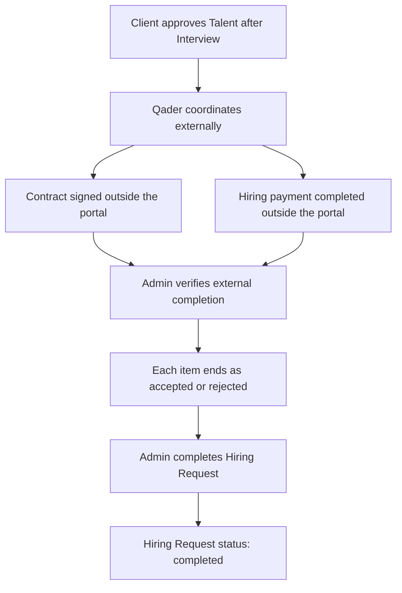

# S07 — العقود والمدفوعات

الحالة: **جاهزة للتنفيذ المرحلي بعد مراجعة السكيما النهائية**
تاريخ آخر قرار: 10 نوفمبر 2026
النطاق العام: التعاقد والدفع والحالات الظاهرة في تصميم البورتالات.

## 1. قاعدة هذه الخطة

1. Figma هي المرجع الأساسي للسلوك والواجهات.
2. لا تتحول بيانات العرض التجريبية إلى Business Rules.
3. لا تضاف جداول أوأعمدة أوحالات أوEndpoints أوصلاحيات قبل وجود Action واضح في Figma أوقرار صريح من صاحب المشروع.
4. ملفات البيزنس تستخدم لفهم الهدف العام فقط، ولا تضيف Flow غير ظاهر في Figma.
5. أي نقطة لا يحسمها التصميم أوقرار صاحب المشروع تظل موضحة صراحة ولا تتحول إلى Business Rule مفترضة.

## 2. القرار المعتمد من صاحب المشروع

- التوقيع يتم خارج البورتال حاليًا.
- لا يوجد توقيع إلكتروني داخل Client Portal أوTalent Portal.
- لا يوجد تكامل E-sign في النطاق الحالي.
- بعد موافقة العميل على الموهبة عقب المقابلة، يتم التواصل والتنسيق مع العميل والموهبة، ثم يوقع العقد خارجيًا.
- دفع التعاقد الحالي يتم خارج البورتال بالتنسيق المباشر مع العميل.
- شاشات التحويل البنكي ورفع الإيصال الظاهرة في Figma لا تنفذ ضمن التدفق الحالي.
- المدفوعات الأخرى داخل النظام تنفذ عبر Payments module محايد للمزود؛ مزود Production لم يحدد بعد.
- لا يضاف Checkout أومزود دفع فعلي أوInvoice أوRefund لدفع التعاقد الخارجي. الخدمات الرقمية الثلاث تستخدم الأساس العام و`FakePaymentGateway` محليًا إلى أن يحدد مزود Production.
- الأدمن هو المسؤول عن التأكد من اكتمال التوقيع والدفع الخارجيين.
- لا يحفظ النظام حالة مستقلة للتوقيع أوالدفع، ولا يؤكد الأدمن كل حدث منهما من خلال Action منفصلة.
- بعد اكتمال التوقيع والدفع خارجيًا، ينفذ الأدمن Action واحدة لتحديث طلب التعيين إلى `completed`.
- عناصر طلب التعيين تنتهي بالحالة المناسبة لكل موهبة: `accepted` أو`rejected`، بينما الطلب الأب يصبح `completed` بعد انتهاء التعامل مع جميع عناصره.
- لا تحفظ حاليًا نسخة من العقد أوإثبات الدفع داخل النظام؛ تحفظ نتيجة دورة طلب التعيين فقط.
- `Contract Fully Executed` و`Waiting to Start` لا ينفذان كحالات Backend مستقلة أومشتقة في الدورة الحالية.
- لا تضاف Contract statuses أخرى؛ الحالات المعتمدة للدورة هي حالات طلب التعيين وعناصره الظاهرة والمعتمدة في Figma.

## 3. ما يظهر في Figma فعلًا

### 3.1 Client — مراجعة الدفع

المصدر: `4759:69426`.

الشاشة تعرض:

- Hiring Request واحدة تحتوي عدة Talents.
- لكل Talent: المسمى، كود `QDR-*`، نوع العقد، والراتب الشهري.
- عمود Fees بقيمة `To be confirmed` في التصميم الحالي.
- تنبيه أن Salary Subtotal لا يشمل Fees وليس Final Payment Amount.
- Bank Transfer Details:
  - Amount to Transfer.
  - Currency.
  - Transfer Method.
  - IBAN.
  - Account Name.
  - Account Number.
- Salary Subtotal.
- Total Fees.
- Final Payment Total.
- زر `Confirm payment` وزر `Cancel`.

لا تعتمد الأرقام أوالعملات أوبيانات الحساب الظاهرة كقيم حقيقية؛ هي بيانات تصميم تجريبية.

> قرار المنتج اللاحق: هذه الشاشة موثقة كجزء موجود في Figma، لكنها خارج التنفيذ الحالي لأن دفع التعاقد يتم خارجيًا بالتنسيق مع العميل.

### 3.2 Client — رفع إيصال التحويل

المصدر: `4759:69555`.

الـModal تعرض:

- `Upload transfer receipt`.
- رفع JPG أوPNG أوPDF حتى 10MB.
- اختيار أوحذف الملف قبل الإرسال.
- `Submit receipt` و`Cancel`.
- النص يوضح أن الإيصال يرسل للمراجعة، وأن الدفع قد لا يكتمل قبل التحقق من التحويل.

التصميم لا يوضح من يراجع الإيصال، ولا شاشة المراجعة، ولا Actions القبول أوالرفض.

> قرار المنتج اللاحق: رفع الإيصال ومراجعته لا ينفذان حاليًا داخل البورتال.

### 3.3 Client — المواهب المتعاقد معها

المصادر: `3621:28756` و`3649:29356`.

التصميم يثبت:

- وجود صفحة `Hired Talents`.
- حالة `Contract Fully Executed`.
- نوع العقد.
- إظهار Personal & Contact Information بعد اكتمال التعاقد.
- `Contracted Status` بقيمة `Waiting to Start`.
- Final Salary.
- Work Mode وWork Type.
- Working Days وWorking Hours.
- Start Date.

لا تظهر في الـNodes التي تمت مراجعتها Action لإنشاء العقد أوتوقيعه أوتنزيله أوإلغاءه.

### 3.4 Admin — حالات طلب التعيين

المصادر: `3971:44951` و`4310:66763`.

التصميم يعرض حالتين:

1. شاشة بحالة `Ready for Contract`، وبها:
   - Client وWorkspace data.
   - Talent data.
   - Contract Type.
   - Offer Details.
   - Hiring Progress.
   - `Accept` و`Reject`.
   - نص يفيد أن compensation package وagreement terms أرسلت للموهبة وأن العقد تحت المراجعة.
2. شاشة بحالة `Ready to Proceed`، وبها:
   - Interview = `Completed`.
   - Hiring Progress مكتمل حتى `Accepted`.
   - `Contracted Status = Waiting to Start`.
   - Final Salary وشروط العمل وStart Date.

التصميم لا يوضح بدقة ما الذي يقبله أويرفضه الأدمن في شاشة `Ready for Contract`، ولا يرسم Transition صريحًا بين الحالتين.

### 3.5 Admin — إعداد أنواع العقود

المصادر: `3916:38766` و`3916:42854` و`5351:62136`.

الموجود صراحة:

- نوعا `Managed Contract` و`One-Time Commission`.
- Availability لكل نوع.
- Basic Information.
- Default Fee Configuration.
- Fee Type.
- What You Get / Benefits.
- Professional Field Fee Overrides للـManaged Contract.
- Terms & Conditions.
- Managed Contract Defaults.

هذا الجزء هو إعداد Contract Types، وليس دليلًا على وجود إدارة ملفات عقود أوتوقيعات.

### 3.6 Talent — حالة التعاقد

المصادر: `3662:27043` و`4318:73133`.

الموجود صراحة:

- Activity باسم `Contract ready for signing`.
- شاشة Offer بعد التعاقد تعرض:
  - `Contracted Status`.
  - `Waiting to Start`.
  - Final Salary.
  - Work Mode وWork Type.
  - Working Days وWorking Hours.
  - Start Date.

لا تظهر شاشة توقيع، زر توقيع، رفع عقد موقع، تحميل عقد، أوتفاصيل مستند داخل Talent Portal.

## 4. الخدمات المدفوعة الأخرى الظاهرة في Figma

الخدمات الثلاث الظاهرة في التصميم معتمدة. يمكن تنفيذ الأساس العام والأسعار وصلاحيات الوصول و`FakePaymentGateway` قبل اختيار مزود Production؛ يضاف Adapter المزود الفعلي لاحقًا دون تغيير Business workflow.

### 4.1 Client — Qader Expert Opinion

المصادر: `3260:26964` و`3260:27929`.

- شراء مرة واحدة لكل Talent.
- القيمة الافتراضية للسعر `250 EGP`، وتحفظ ضمن Platform Settings ليتمكن الأدمن من تعديل السعر والعملة.
- النص يقول إن المراجعة متاحة بعد الشراء.
- بعد الشراء تظهر Evaluation Criteria والتقييمات.

### 4.2 Talent — Detailed Rejection Feedback

المصادر: `802:4409` و`3101:16653`.

- `Unlock detailed feedback`.
- Detailed rejection reason.
- CV review.
- Personalized tips.
- Faster reapplication.
- القيمة الافتراضية للسعر `100 EGP`، وتحفظ ضمن Platform Settings ليتمكن الأدمن من تعديل السعر والعملة.

### 4.3 Talent — Profile Expert Review

المصادر: `3089:16895` و`3098:15273`.

- `Start Your Professional Review Now`.
- القيمة الافتراضية للسعر `10 USD`، وتحفظ ضمن Platform Settings ليتمكن الأدمن من تعديل السعر والعملة.
- تقرير خلال 48 ساعة.
- `14-day money-back guarantee`.
- شاشة نتيجة تحتوي Salary Recommendations وInterview Evaluations وPersonalized Tips.

الأسعار معتمدة كقيم افتراضية قابلة للتعديل. البيانات المعروضة في التقارير موجودة أصلًا من دورة تقييم الموهبة؛ الدفع يفتح صلاحية الوصول إليها ولا ينشئ مهمة Review جديدة.

### 4.4 مصدر التقرير بعد الدفع

لا نضيف Report authoring workflow جديدًا ضمن الدفع. تستخدم الصفحات بيانات التقييم الموجودة بالفعل:

- `Qader Expert Opinion` للعميل يعرض تقييم Qader للموهبة بعد شراء الـWorkspace صلاحية الوصول: المعايير والتقييمات وتقارير HR وTechnical وPsychology من `talent_evaluations` والتقييمات المرتبطة بالمقابلات عند الحاجة.
- `Detailed Rejection Feedback` للموهبة المرفوضة يفتح تفاصيل التقييم والرفض الموجودة، ولا يعدل `reapply_at` ولا يتجاوز سياسة إعادة التقديم.
- `Profile Expert Review` يظهر للموهبة المقبولة، ويعرض Recommended Salary وEvaluation Criteria وInterview Evaluations وPersonalized Tips وتقارير HR وTechnical وPsychology و`final_feedback` الموجودة بالفعل.
- `Detailed Rejection Feedback` و`Profile Expert Review` يعرضان نفس بنية بيانات التقرير، ويختلف اسم الخدمة والسعر وحالة الطلب التي تسمح بشرائها: الأولى للطلب المرفوض والثانية للطلب المقبول.
- شراء أي منهما يرتبط بـ`talent_application_id` المحدد، وليس بحساب الموهبة مدى الحياة.
- تظل صلاحية التقرير المدفوع مرتبطة بمحاولة التقديم التي تم شراؤه لها. إذا قدمت الموهبة مرة أخرى، فإن تقرير الطلب الجديد يحتاج عملية شراء جديدة، ولا تفتح عملية الشراء القديمة التقرير الجديد.
- بعد تأكيد الدفع الناجح تظهر البيانات المتاحة مباشرة؛ لا نضيف Deadline تسليم مدته 48 ساعة في الـBackend.
- عبارة `48 hours` الظاهرة في شاشة الشراء لا تنشئ SLA تشغيليًا لأن التقرير موجود قبل الشراء.
- عبارة `14-day money-back guarantee` لا تنشئ حق Refund حاليًا، ويجب ألا تعتمد كقاعدة Backend أووعد دفع قبل اعتماد سياسة Refund مستقبلًا.
- توجد ثلاث خدمات/صلاحيات شراء مستقلة، لكن كل واحدة تفتح البيانات الملائمة لسياقها ودورها بدل إنشاء تقرير جديد.

### 4.5 تجهيز الدفع دون ربط مزود محدد

- يبنى موديول الدفع مستقبلًا خلف `PaymentGatewayInterface`، ولا ترتبط الـUse Cases باسم مزود بعينه.
- كل مزود يضاف من خلال Adapter مستقل، ويختار المزود النشط من Config/Environment وليس من Business workflow.
- تحفظ معاملات الشراء ومراجع المزود والحالة بصيغة موحدة داخل النظام، مع الاحتفاظ بالـpayload اللازم للتتبع دون تخزين بيانات دفع حساسة.
- شراء Qader Expert Opinion تكون صلاحية الوصول فيه للـWorkspace ومربوطة بصف Talent الذي يمثل الـJob Profile، بينما شراء تقريري Talent يكون للمستخدم نفسه ومربوطًا بـ`talent_application_id`.
- نجاح دفع تقرير Talent لا يفتح إلا الطلب المحدد في معاملة الدفع، حتى لو كانت للموهبة طلبات سابقة أولاحقة.
- يمر تأكيد الدفع عبر Gateway contract وWebhook verification خاص بالمزود؛ لا تثق المنصة في نجاح يعيده الـFrontend وحده.
- شكل Redirect أوCheckout أوClient Secret يحدد عند اختيار أول مزود، ولا تفترض الخطة شاشة دفع غير موجودة في Figma.
- Refund لا يدخل التنفيذ قبل اعتماد سياسة الضمان واختيار مزود يدعمه.

## 5. الـFlow المثبت فقط من Figma



لا توجد Action مستقلة لتأكيد التوقيع أوالدفع، ولا Contract status مستقلة. تأكيد الأدمن النهائي يتم من خلال إكمال طلب التعيين بعد إنهاء جميع عناصره.

## 6. الموجود حاليًا في الكود ويمكن البناء عليه لاحقًا

- Hiring Requests وItems.
- Offers والتفاوض وقرارات Client وTalent.
- Hiring Interviews.
- حالة Item مبسطة؛ الوصول بعد موافقة الطرفين يظهر حاليًا كمرحلة `accepted`، بينما تفاصيل العقد والدفع المستقبلية لها مصادر مستقلة عند تنفيذها.
- Contract Types وإعداداتها وBenefits وTerms وFee Overrides وDefaults.
- Contract Configuration Snapshot على Hiring Request Item.
- Media Library يمكن استخدامها عند اعتماد أي Flow رفع ظاهر أوصريح.

غير موجود حاليًا:

- Contract lifecycle منفذ.
- Payments foundation للخدمات الرقمية؛ يمكن تنفيذها الآن، بينما Adapter بوابة Production مؤجل لحين تحديد المزود.
- Receipt upload مرتبط بطلب تعيين.
- ربط Hired Talents بالعناصر المقبولة من طلب تعيين مكتمل.
- شراء الخدمات المدفوعة الظاهرة في Figma.

## 7. القرارات المعتمدة وحدود التنفيذ

### 7.1 العقود وإكمال طلب التعيين

1. التوقيع يتم خارج البورتال، والأدمن يتأكد من اكتماله تشغيليًا.
2. دفع التعاقد يتم خارج البورتال، والأدمن يتأكد من اكتماله تشغيليًا.
3. لا تسجل الحالتان منفصلتين داخل النظام؛ ينفذ الأدمن Action واحدة لإكمال طلب التعيين بعد اكتمالهما.
4. لا تحفظ نسخة عقد أوإثبات دفع حاليًا.
5. كل عنصر ينتهي `accepted` أو`rejected` حسب نتيجته.
6. طلب التعيين يصبح `completed` بعد انتهاء جميع عناصره وتنفيذ الأدمن Action الإكمال.
7. `Contract Fully Executed` و`Waiting to Start` لا يمثلان حالات Backend في الدورة المعتمدة، ولا تضاف Contract statuses جديدة.

### 7.2 الدفع

1. دفع التعاقد الحالي خارج البورتال؛ لذلك لا تنفذ شاشة التحويل أورفع الإيصال الآن.
2. الأساس العام لدفع الخدمات الرقمية الثلاث يدخل التنفيذ، بينما Adapter بوابة Production مؤجل لحين تحديد المزود.
3. لا يوجد Refund في المرحلة الحالية، ولا تنفذ `14-day guarantee` كقاعدة Backend.

### 7.3 الخدمات المدفوعة

1. الخدمات الثلاث تدخل التنفيذ المستقبلي: Qader Expert Opinion وDetailed Rejection Feedback وProfile Expert Review.
2. الأسعار الظاهرة هي قيم Platform Settings افتراضية يستطيع الأدمن تعديلها مع العملة.
3. مزود الدفع لم يحدد؛ يبنى التكامل خلف Gateway contract قابل لإضافة مزود جديد دون تغيير Business workflow.
4. تقارير Qader Expert Opinion وDetailed Rejection Feedback وProfile Expert Review مبنية على بيانات التقييم الموجودة مسبقًا، وتظهر للمشتري بعد نجاح الدفع دون انتظار Reviewer جديد.
5. شراء Detailed Rejection Feedback لا يغير `reapply_at` ولا يسمح بإعادة التقديم مبكرًا.
6. `48 hours` ليست Deadline في الـBackend لأن التقرير موجود بالفعل.
7. لا يوجد Refund أو`14-day guarantee` تشغيليًا في المرحلة الحالية.
8. Profile Expert Review متاح للطلب المقبول، وDetailed Rejection Feedback متاح للطلب المرفوض؛ كلاهما يعرض نفس بيانات التقرير مع اختلاف اسم الخدمة وسعرها.
9. كل صف Talent Application هو محاولة تقديم مستقلة. شراء تقرير الموهبة يكون لكل `talent_application_id`، وإعادة التقديم تنشئ Application جديدة وتتطلب شراءً جديدًا لفتح تقريرها.

## 8. ما تم حذفه من الخطة السابقة لأنه غير مثبت في Figma

- اقتراح جداول `contracts`, `contract_documents`, `contract_signatures`, `invoices`, و`invoice_lines` الخاصة بدورة التعاقد الخارجي.
- اقتراح حالات Contract وInvoice أودفع التعاقد الخارجي.
- اقتراح Endpoints لإدارة عقد أودفع التعاقد داخل البورتالات الثلاثة.
- اقتراح صلاحيات مستقلة للعقود والفواتير والمدفوعات.
- افتراض أن Admin يراجع الإيصال أويرفع النسخة الموقعة.
- افتراض ترتيب الدفع والتوقيع أوأنهما Gate متوازيان.
- افتراض Invoice أوInvoice Lines أوPayment Gateway لدفع التعاقد الخارجي أوRefund flow.
- افتراض أن `completed` هي الحالة النهائية أوإضافة حالة `contracted`.
- افتراض أنواع المستندات والأطراف الموقعة وإصدارات الملفات.

## 9. حدود خطة التنفيذ التالية

عند تجهيز التنفيذ يقتصر العمل على:

1. مراجعة Action إكمال طلب التعيين للأدمن وشروطها، دون إنشاء دورة عقد أودفع مستقلة.
2. التأكد من أن كل عنصر انتهى `accepted` أو`rejected` قبل إكمال الطلب.
3. تحديث الطلب الأب إلى `completed` وتسجيل الحدث في سجل الأحداث الموجود.
4. بناء بيانات Hired Talents من العناصر المقبولة التابعة لطلب مكتمل، من غير الاعتماد على `Contract Fully Executed` أو`Waiting to Start`.
5. مراجعة الـAPI والسكيما المقترحتين قبل إنشاء أي Migration، وعدم إضافة مستندات أوحالات أوجداول للعقد والدفع خارج النطاق المعتمد.

## 10. خطة موديول الدفع للخدمات المدفوعة

هذه الخطة تخص شراء الخدمات الرقمية الثلاث فقط، ولا تشمل دفع التعاقد الخارجي الخاص بطلبات التعيين.

### 10.1 حدود الموديول

- الخدمات المدعومة هي:
  - `qader_expert_opinion`.
  - `detailed_rejection_feedback`.
  - `profile_expert_review`.
- لا يوجد Refund في المرحلة الحالية.
- لا يوجد Invoice أوPartial Payment أوSubscription.
- لا يرتبط الـBusiness workflow باسم بوابة دفع محددة.
- سعر الخدمة وعملتها يقرآن من `PaidServicesSettings`، ثم يحفظان Snapshot داخل معاملة الدفع حتى لا يؤثر تعديل الأدمن على معاملة بدأت بالفعل.
- مفاتيح وأسرار بوابة الدفع تحفظ في Environment فقط، ولا تعرض ضمن Platform Settings.

### 10.2 هيكل الموديول

```text
app/Modules/V1/Payments/
├── Application/
│   ├── Contracts/PaymentGatewayInterface.php
│   ├── Data/CheckoutSessionData.php
│   ├── Data/PaymentWebhookData.php
│   └── Services/
│       ├── CreatePaymentCheckoutService.php
│       ├── ProcessPaymentWebhookService.php
│       └── PaidServiceAccessService.php
├── Domain/
│   ├── Models/
│   │   ├── Payment.php
│   │   └── PaymentAttempt.php
│   └── ValueObjects/
│       ├── PaidServiceEnum.php
│       ├── PaymentStatusEnum.php
│       └── PaymentAttemptStatusEnum.php
├── Infrastructure/
│   ├── Gateways/FakePaymentGateway.php
│   └── Providers/PaymentModuleServiceProvider.php
└── Presentation/Http/Controllers/
```

عند اختيار مزود فعلي يضاف Adapter جديد فقط، مثل:

```text
PaymobPaymentGateway
StripePaymentGateway
TapPaymentGateway
```

لا تثبت SDK خاصة بمزود قبل اختياره. يستخدم الـAdapter لاحقًا SDK الرسمية للمزود أوLaravel HTTP Client حسب توثيقه الرسمي.

### 10.3 الحالات والقيم

`PaidServiceEnum`:

```text
qader_expert_opinion
detailed_rejection_feedback
profile_expert_review
```

`PaymentStatusEnum`:

```text
pending
paid
cancelled
```

- `paid` هي الحالة الوحيدة التي تمنح الوصول.
- لا تنتقل معاملة `paid` إلى حالة أخرى في النطاق الحالي لعدم وجود Refund.
- تكرار Webhook النجاح لا يعيد تنفيذ منح الوصول أوالإشعارات.

`PaymentAttemptStatusEnum`:

```text
pending
paid
failed
cancelled
expired
```

### 10.4 جدول `payments`

| العمود | النوع المقترح | الغرض |
| --- | --- | --- |
| `id` | bigint | المعرف الداخلي |
| `reference` | uuid/string unique | مرجع آمن يعاد للـFrontend بدل ID قابل للتخمين |
| `purchase_key` | string unique | مفتاح ثابت يمنع شراء الخدمة نفسها لنفس المستفيد والهدف أكثر من مرة |
| `payer_user_id` | FK users | المستخدم الذي بدأ الدفع |
| `workspace_id` | nullable FK workspaces | يمتلئ عند شراء Client لخدمة Qader Expert Opinion |
| `service` | varchar | قيمة من `PaidServiceEnum` |
| `subject_type` | varchar | Morph alias صريح: `talent` أو`talent_application` |
| `subject_id` | bigint | Talent profile أوTalent Application التي يفتح التقرير لها |
| `amount` | decimal(18,4) | Snapshot للسعر وقت بدء المعاملة |
| `currency` | char(3) | Snapshot لكود العملة |
| `status` | varchar | قيمة من `PaymentStatusEnum` |
| `paid_at` | nullable timestamp | وقت تأكيد الدفع من Webhook |
| timestamps | timestamps | الإنشاء والتحديث |

الفهارس والقيود:

- Unique على `reference`.
- Unique على `purchase_key`.
- Index على `payer_user_id + status`.
- Index على `service + subject_type + subject_id`.

`purchase_key` يكون حسب نطاق الوصول:

```text
Qader Expert Opinion:
workspace:{workspace_id}:qader_expert_opinion:talent:{talent_id}

Talent report:
user:{user_id}:{service}:talent_application:{application_id}
```

إذا كانت العملية `paid` يعاد نجاح الشراء الحالي بدل إنشاء دفع جديد. سجل `payments` يمثل عملية الشراء وصلاحية الوصول المستقرة، بينما كل اتصال ببوابة الدفع يحفظ في Attempt مستقل حتى لا يضيع تاريخ المحاولات أوتستبدل مراجع المزود.

### 10.5 جدول `payment_attempts`

| العمود | النوع المقترح | الغرض |
| --- | --- | --- |
| `id` | bigint | المعرف |
| `payment_id` | FK payments | عملية الشراء المستقرة |
| `provider` | varchar | اسم Adapter المستخدم |
| `provider_reference` | nullable varchar | مرجع جلسة/عملية الدفع لدى المزود |
| `status` | varchar | قيمة من `PaymentAttemptStatusEnum` |
| `failure_reason` | nullable text | سبب تقني منقح دون بيانات حساسة |
| `expires_at` | nullable timestamp | انتهاء جلسة الدفع إن أعاده المزود |
| `paid_at` | nullable timestamp | وقت نجاح هذه المحاولة |
| timestamps | timestamps | الإنشاء والتحديث |

- Unique على `provider + provider_reference` عندما يوجد المرجع.
- يسمح بمحاولة Pending واحدة فقط لكل Payment داخل Business service وTransaction lock.
- لا يستبدل Provider reference لمحاولة قديمة عند إعادة المحاولة؛ ينشأ Attempt جديد بعد فشل أوإلغاء أوانتهاء السابقة.
- وصول نجاح متأخر لمحاولة قديمة يعالج Idempotently ويحول Payment الأساسية إلى `paid` مرة واحدة.

### 10.6 جدول `payment_webhook_events`

| العمود | النوع المقترح | الغرض |
| --- | --- | --- |
| `id` | bigint | المعرف |
| `provider` | varchar | اسم المزود |
| `provider_event_id` | varchar | معرف Event عند المزود |
| `payment_attempt_id` | nullable FK payment_attempts | المحاولة بعد مطابقة مرجع المزود |
| `event_type` | nullable varchar | نوع الحدث عند المزود |
| `payload` | nullable json/text | Payload منقح أوEncrypted عند الحاجة، دون أسرار أوبيانات بطاقات |
| `status` | varchar | `received`, `processed`, أو`failed` |
| `processed_at` | nullable timestamp | وقت نجاح المعالجة |
| `failure_reason` | nullable text | سبب فشل المعالجة |
| timestamps | timestamps | الإنشاء والتحديث |

- Unique على `provider + provider_event_id` لضمان Idempotency.
- لا تخزن بيانات بطاقة أوCVV أوأسرار توقيع داخل الجدول أوLogs.

### 10.7 عقد بوابة الدفع

```php
interface PaymentGatewayInterface
{
    public function createCheckout(PaymentAttempt $attempt): CheckoutSessionData;

    public function parseAndVerifyWebhook(
        PaymentWebhookRequestData $request,
    ): PaymentWebhookData;
}
```

`CheckoutSessionData` يوحد القيم التي قد يعيدها أي مزود:

```text
provider_reference
checkout_url nullable
client_secret nullable
expires_at nullable
```

`PaymentWebhookData` يعيد بيانات موحدة بعد تحقق الـAdapter من Signature:

```text
provider_event_id
provider_reference
status
amount
currency
occurred_at
```

يختار `PaymentGatewayManager` الـAdapter من `config/payments.php` باستخدام `PAYMENT_GATEWAY`. لا يدخل اسم المزود إلى Use Cases الخدمات المدفوعة.

### 10.8 دورة إنشاء الدفع

1. يتحقق الـBackend من هوية المشتري وصلاحية الوصول للـWorkspace أوTalent Application.
2. يتحقق من أهلية الخدمة:
   - Qader Expert Opinion: Talent متاحة للـWorkspace في Marketplace.
   - Detailed Rejection Feedback: الـApplication تخص Talent profile تابعة للمستخدم وحالتها `rejected`.
   - Profile Expert Review: الـApplication تخص Talent profile تابعة للمستخدم وحالتها `accepted`.
3. يتحقق أن بيانات التقرير موجودة قبل السماح بالدفع حتى لا يدفع المستخدم مقابل تقرير فارغ.
4. يقرأ السعر والعملة من `PaidServicesSettings` ويحفظ Snapshot.
5. ينشئ أويعيد سجل `payments` باستخدام `purchase_key` داخل Database transaction مع Lock مناسب.
6. يعيد Attempt صالحًا ما زال `pending`، أويُنشئ `payment_attempts` جديدًا إذا انتهت المحاولة السابقة أوباءت بالفشل.
7. يستدعي الـGateway خارج Database transaction الطويلة.
8. يحفظ `provider_reference` ووقت الانتهاء على Attempt، ويعيد بيانات Checkout المناسبة للـFrontend.
9. Redirect من الـFrontend لا يغير حالة الدفع ولا يمنح الوصول.

### 10.9 دورة الـWebhook ومنح الوصول

1. يستقبل Endpoint عام الـWebhook دون Bearer Token أو`X-Authorization` لأن المتصل هو مزود الدفع.
2. يختار Adapter من `{provider}` ويتحقق من Signature قبل معالجة البيانات.
3. يسجل Event باستخدام `provider_event_id`؛ الـEvent المكرر يعاد له نجاح دون معالجة ثانية.
4. يطابق `provider_reference` مع Payment Attempt، ثم يصل إلى Payment الأساسية ويتحقق من المبلغ والعملة المخزنين.
5. يحدث Attempt وPayment داخل Transaction و`lockForUpdate`.
6. عند نجاح الدفع يضبط Attempt وPayment إلى `paid` ويسجل `paid_at` مرة واحدة.
7. وجود Payment مدفوع هو إثبات الوصول؛ لا نضيف جدول Entitlements مستقل في المرحلة الحالية.
8. تسجل Notification/Event بعد Commit دون تأخير استجابة الـWebhook.

### 10.10 نطاق الوصول لكل خدمة

| الخدمة | مالك الوصول | الهدف | مدة الوصول |
| --- | --- | --- | --- |
| Qader Expert Opinion | Workspace | Talent | دائم لهذا الـWorkspace وهذه الموهبة |
| Detailed Rejection Feedback | Talent user | Talent Application مرفوضة | دائم لمحاولة التقديم المحددة |
| Profile Expert Review | Talent user | Talent Application مقبولة | دائم لمحاولة التقديم المحددة |

- أعضاء الـWorkspace لا يرون Qader Expert Opinion إلا إذا كان لديهم حق عرض Marketplace داخل نفس الـWorkspace.
- Payment خاصة بـWorkspace أخرى لا تمنح الوصول.
- تقرير Talent القديم يظل متاحًا لصاحبه، لكنه لا يفتح تقرير طلب تقديم جديد.

### 10.11 الـEndpoints المقترحة

Client Portal:

```text
POST /api/v1/client/workspaces/{workspace}/talent-marketplace/{talent}/expert-opinion/checkout
GET  /api/v1/client/workspaces/{workspace}/payments/{payment:reference}
```

Talent Portal:

```text
POST /api/v1/talent/applications/{application}/detailed-feedback/checkout
POST /api/v1/talent/applications/{application}/profile-expert-review/checkout
GET  /api/v1/talent/payments/{payment:reference}
```

Webhook عام:

```text
POST /api/v1/webhooks/payments/{provider}
```

- Endpoints الشراء تستخدم المصادقة والصلاحيات العادية مع `X-Authorization`.
- Endpoint الـWebhook لا يستخدم مصادقة المستخدم أوAPI Key، ويعتمد على Signature الخاصة بالمزود مع Rate Limit.
- تفاصيل Marketplace وTalent Application تعيد حالة الشراء والسعر، وتعيد التقرير فقط عند وجود Payment مدفوع صالح.

### 10.12 إعدادات البيئة

`config/payments.php`:

```php
return [
    'default' => env('PAYMENT_GATEWAY', 'fake'),

    'gateways' => [
        'fake' => [
            'driver' => FakePaymentGateway::class,
        ],
    ],
];
```

Local وTesting:

```env
PAYMENT_GATEWAY=fake
```

Production بعد اختيار المزود:

```env
PAYMENT_GATEWAY=provider_name
PAYMENT_PROVIDER_API_KEY=
PAYMENT_PROVIDER_WEBHOOK_SECRET=
```

- `FakePaymentGateway` يسجل فقط في بيئات `local` و`testing`.
- محاكاة النجاح أوالفشل لا تكون متاحة في Production.
- اختبارات Feature تستدعي Fake Adapter أوWebhook service ولا تتصل بشبكة خارجية.

### 10.13 متطلبات الأمان والاعتمادية

- لا تثق في أي Success قادم من Frontend.
- تحقق من Webhook signature والمبلغ والعملة والمرجع.
- استخدم Idempotency وDatabase locks لمنع تكرار الدفع أوالإشعارات.
- لا تسجل Secrets أوبيانات بطاقات أوPayload غير منقح في Logs.
- يمنع Mass Assignment لحالة الدفع والمبلغ والعملة من Requests المستخدم.
- سعر المعاملة لا يأتي من Frontend؛ يرسل Frontend معرف الخدمة والهدف فقط.
- لا يمكن للمستخدم طلب Payment تخص مستخدمًا أوWorkspace أوTalent Application أخرى.
- يتم التعامل مع Webhook بسرعة، ويمكن نقل الأعمال الجانبية إلى Queue بعد حفظ الحالة بأمان.

### 10.14 Dependency مطلوب لدعم إعادة التقديم

الموديل المعتمد:

```text
User account
└── Talent row = Job Profile 1
    ├── Talent Application 1 = Attempt 1
    ├── Talent Application 2 = Attempt 2
    └── Talent Application N = Attempt N
```

- جدول `talents` الحالي هو الـJob Profile، وليس مجرد هوية حساب الموهبة.
- كل صف في `talent_applications` هو محاولة تقديم كاملة ومستقلة، ولا نضيف جدول `talent_application_attempts`.
- إعادة التقديم تنشئ Talent Application جديدة مرتبطة بنفس `talent_id` وتستخدم بيانات الـJob Profile نفسها.
- كل Application تحتفظ بالـSnapshot والحالة وتعيين المراجع وقرار المراجعة وسياسة إعادة التقديم والتقييمات والمقابلات والتقرير والأحداث الخاصة بها من خلال العلاقات الحالية.
- الدفع لتقرير Talent يرتبط مباشرة بـ`talent_application_id`؛ لذلك شراء تقرير Application قديمة لا يفتح تقرير Application جديدة.

الوضع الحالي يحتاج تعديلًا لأن:

- `talent_applications.talent_id` عليه Unique index يمنع أكثر من محاولة لنفس Talent profile.
- `CreateTalentApplicationUseCase` وRepository يستخدمان `firstOrCreate(['talent_id' => ...])` ويعيدان الطلب القديم.

قبل تنفيذ الدفع وإعادة التقديم:

1. يزال Unique المنفرد من `talent_applications.talent_id` ويستبدل Index عاديًا.
2. ينشأ Talent Application جديد عند إعادة التقديم المسموح بدل إعادة استخدام القديم.
3. يمنع وجود أكثر من Application غير نهائية لنفس Talent profile عبر Business validation وTransaction lock.
4. Endpoints «الطلب الحالي» تعيد أحدث Application فعالة أوأحدث محاولة بحسب الحالة، مع إمكانية الوصول للتقارير القديمة بالـApplication ID.
5. العلاقات الحالية التي تستخدم `application_id` تظل كما هي لأنها ستشير طبيعيًا إلى محاولة التقديم الصحيحة.

دعم أكثر من Job Profile مستقبلًا:

- يسمح لحساب User بامتلاك أكثر من صف في `talents`، وكل صف يمثل Job Profile مستقلًا.
- هذا سيتطلب مستقبلًا إزالة `unique(user_id)` من `talents` وتعديل علاقة المصادقة لاختيار الـJob Profile النشط.
- كل Talent profile يمكن أن يكون لها عدة Talent Applications، وكل Application هي محاولة مستقلة.
- لا ينفذ دعم تعدد Job Profiles الآن؛ ربط الطلب والدفع بـTalent/Application بدل User مباشرة يترك الامتداد ممكنًا.

هذا التعديل يراجع كسكيما مستقلة قبل إنشاء Migration، لكنه شرط لصحة ربط الدفع بكل محاولة تقديم.

### 10.15 ترتيب التنفيذ

1. تعديل إعادة التقديم لإنشاء Talent Application جديدة لكل محاولة مع إعادة استخدام بيانات Talent profile.
2. تنفيذ Platform Settings وأسعار الخدمات باستخدام `spatie/laravel-settings`.
3. إنشاء Payments module والجداول والEnums والGateway contract.
4. تنفيذ `FakePaymentGateway` واختبارات الحالات والـIdempotency داخل Docker.
5. ربط الخدمات الثلاث وصلاحية إظهار التقارير.
6. توليد OpenAPI وتحديث Apidog لكل Portal.
7. اختيار مزود الدفع الفعلي وإضافة Adapter وWebhook verification الخاص به.

## 11. إكمال طلب التعيين بعد الإجراءات الخارجية

### 11.1 الـAction

```text
POST /api/v1/admin/hiring-requests/{hiringRequest}/complete
```

- يعاد استخدام صلاحية `admin.hiring-requests.handle` ولا تضاف صلاحية Contract أوPayment جديدة.
- المنفذ هو الأدمن المسؤول عن الطلب. تغيير المسؤول يتم أولًا من Reassign الحالي.
- الـAction تمثل إقرار الأدمن بأن الإجراءات الخارجية المطلوبة للعناصر المقبولة، ومنها التواصل والتوقيع ودفع التعاقد، اكتملت خارج البورتال.
- لا تستقبل الـAction حقول `signed`, `paid` أوتواريخ منفصلة، ولا ترفع مستندات.

### 11.2 شروط الإكمال

- الطلب حالته `active`.
- لا يوجد Item ما زال في `pending`, `offer`, `interview` أو`on_hold`.
- العناصر المقبولة تظل `accepted`، والمرفوضة تظل `rejected`؛ لا تحول إلى Contract statuses مشتقة.
- Item ملغاة تظل `cancelled` ولا تمنع إكمال الطلب لأنها نتيجة نهائية موجودة بالفعل في الدورة.
- إذا وجد عنصر مقبول، يكون تنفيذ Action الإكمال هو تأكيد الأدمن التشغيلي أن إجراءاته الخارجية انتهت.
- إذا انتهت جميع العناصر بالرفض أوالإلغاء، يمكن إكمال الطلب دون وجود توقيع أودفع خارجي.

ينفذ الـBackend داخل Database transaction:

1. `lockForUpdate` على الطلب وعناصره.
2. إعادة فحص المسؤول والصلاحية والحالات.
3. تحديث `hiring_requests.status` إلى `completed`.
4. تسجيل Event باسم `completed` يتضمن أعداد `accepted`, `rejected`, و`cancelled` فقط دون بيانات عقد أودفع مفترضة.
5. إعادة Resource الطلب مع `available_actions` المحدثة.

لا نضيف `completed_at` في هذه المرحلة؛ وقت الإكمال موجود في Event `completed`. يمكن إضافته لاحقًا فقط إذا احتاجه Filter أوتقرير واضح.

وقت Event `completed` هو تاريخ الأساس لحساب Start Date لكل عنصر مقبول، مع Notice Period المثبتة في آخر عرض نهائي لهذا العنصر.

### 11.3 `available_actions`

يظهر `complete` للأدمن المسؤول فقط عندما:

- يملك `admin.hiring-requests.handle`.
- الطلب `active`.
- كل العناصر في `accepted`, `rejected` أو`cancelled`.

بعد انتقال الطلب إلى `completed` لا تظهر Actions تشغيلية عليه أوعلى عناصره.

## 12. Hired Talents بدون جدول جديد

### 12.1 مصدر البيانات

الموهبة تعتبر Hired داخل Workspace عندما يوجد:

```text
hiring_request.status = completed
AND hiring_request_item.status = accepted
AND hiring_request.workspace_id = current workspace
```

- لا ننشئ جدول `hired_talents`.
- لا ننشئ حالة `contracted` أو`contract_fully_executed` أو`waiting_to_start`.
- العناصر المرفوضة أوالملغاة لا تظهر.
- نفس Talent يمكن أن تظهر في أكثر من Workspace إذا أكملت كل Workspace طلب تعيين مستقلًا لها.

### 12.2 Endpoints العميل

```text
GET /api/v1/client/workspaces/{workspace}/hired-talents
GET /api/v1/client/workspaces/{workspace}/hired-talents/{item}
```

- `{item}` هو Hiring Request Item المقبول، وليس Talent ID، حتى تظل بيانات العرض وشروط العمل مرتبطة بعملية التعيين الصحيحة.
- يعاد استخدام صلاحية `client.hiring-requests.view` وعضوية الـWorkspace؛ لا تضاف صلاحية جديدة في هذه المرحلة.
- القائمة تدعم Pagination والبحث بكود Talent أوالمسمى، ويمكن إضافة فلاتر مثبتة من Figma فقط عند التنفيذ.

### 12.3 البيانات المعادة

تعتمد `HiredTalentResource` على Hiring Request Item وآخر عرض نهائي، وتعيد:

- Item ID وReference.
- Talent ID و`talent_code`.
- الاسم وبيانات الاتصال التي تصبح متاحة بعد اكتمال الطلب فقط.
- Job Title.
- Contract Type وContract configuration snapshot.
- Final salary وCurrency.
- Work Type وWork Mode.
- Working days وWorking hours.
- Hybrid work days.
- Work location وLatitude وLongitude عند وجودها.
- Notice period المثبتة على آخر عرض نهائي.
- Start date المشتقة من تاريخ إكمال طلب التعيين وNotice Period.
- Workspace وHiring Request references.

لا تعيد Resource مستند عقد أوPayment proof أوContract status غير مخزنة.

لا نخزن `start_date` في عمود مستقل. تحسب لكل Hired Talent كالتالي:

```text
start_date = date(hiring_request completed event) + latest_offer.notice_period_days
```

- `notice_period_days` أيام تقويمية.
- إذا كانت القيمة `0` يكون Start Date هو تاريخ إكمال الطلب نفسه.
- إذا لم توجد Notice Period مثبتة في العرض تكون `start_date = null` بدل افتراض مدة.
- تستخدم آخر نسخة عرض نهائية مرتبطة بالعنصر، ولا يعاد الحساب من بيانات Talent profile الحالية إذا تغيرت لاحقًا.
- الحساب مشتق للعرض فقط ولا ينشئ حالة `waiting_to_start`.

### 12.4 حماية الخصوصية

- Marketplace الحالية تستمر في إخفاء اسم Talent وصورتها وبيانات اتصالها.
- `HiringRequestItemResource` الحالية لا تكشف بيانات الاتصال للعميل قبل الإكمال.
- بيانات الاتصال الكاملة تعاد فقط من Hired Talents query التي تشترط Parent Request `completed` وItem `accepted` داخل نفس Workspace.
- لا يستطيع عضو Workspace أخرى الوصول إلى السجل حتى لو عرف Item ID.

## 13. حالة جاهزية التنفيذ

يمكن بدء التنفيذ دون اختيار Payment Gateway فعلية بالترتيب التالي:

1. تعديل Talent Applications لدعم أكثر من Application لنفس Talent profile عند إعادة التقديم.
2. تنفيذ Action إكمال Hiring Request وHired Talents.
3. تنفيذ Platform Settings وأسعار الخدمات.
4. تنفيذ Payments foundation و`FakePaymentGateway` وربط إظهار التقارير.
5. توليد OpenAPI واختبارات Docker.
6. إضافة Adapter مزود Production بعد اختياره واختباره في Sandbox الخاص به.

القرار الخارجي الوحيد المؤجل هو اسم بوابة الدفع وبيانات تكاملها؛ لا يمنع تنفيذ الأساس العام أوإكمال دورة طلب التعيين الحالية.
